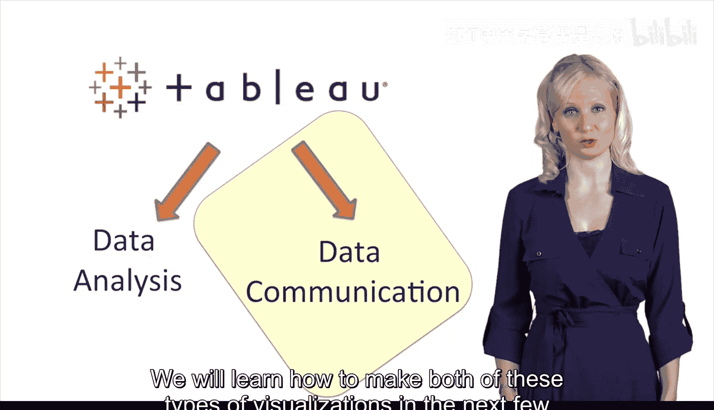

# 杜克大学《Excel 到 MySQL：商业分析（5课全）｜Excel to MySQL： Analytic Techniques for Business》中英 p85 10_02_03_使用SPAPS构建思维框架-第二部分.zh_en -BV1mS421X7yw_p85-

Yeah。In the last video， you filled out all the layers of your structured pyramid analysis plan or SP。

In this video， we're going to go over how to work through the layers of UPP to find business insights。

Once you have your categories in some categories organized。

 the next step is to list exactly what data you will use to address each of the most detailed categories within each larger category。

 I literally mean， write down what variable you will use from what data source。

 If you don't know where to get the data， mark it on your SP。

I suggest using one symbol or outline for I know where the data is and I know how to get it。

One symbol or outlined for， I'm pretty sure the data exists。

 but I'm not exactly sure where or how the variables are organized。 And another symbol4。

 I have no idea if this data exists。The reason I'm suggesting you do this is that although it's usually easy for you as an analyst to get your hands on some kind of data。

 it can be much harder to get your hands on exactly the type of data you want。

You need to figure out as quickly as possible if theres critical data missing or if there's data that's going to take a long time to prepare。

Sometimes it can take a month or even longer to resolve these types of issues。

 So the sooner you know， whether you will need to adjust your plans or work with your team to get other types of data。

 the better。Once you know what data variables you are going to use for each category or subcategory。

 the next step is to assign each category and subcategory a priority based on who suggested them。

 how much impact you suspect they could have and how feasible you suspect they will be to assess。

Once you've assigned the priorities， I suggest you reorder each path in your pyramid according to its priority。

 so it's easy for you to see what you need to focus on。If you do。

 all the highest priorities will be on the left and the issues with the lower priorities will be on the right。

In the end， you'll get something that looks like this。By the way。

 now is a good time the life cycle of your analysis project to ask for feedback from your team and or stakeholders。

 Idely， all the important stakeholders would agree to the plan you laid out。

 because not only will it determine the order in which you will do your work。

 it will also serve as a method for communicating and justifying your decisions about what to spend time on when you are working under a tight deadline。

😊，Your stakeholders might not be used to looking at SPS per se。

 but they will be grateful to have documentation of exactly what you plan to do。

The final step of an SP is to actually implement the plan and hone in on the most important issues or independent variables that will help you solve your business problem。

Your mission during this last phase of the project is to identify really big effects that will be worth investing your time and to understand more deeply。

Knowing how strong the relationships between your smart metric and your independent variables are likely to be gives you a very good picture of how long it will take you to reach conclusions about your business problem。

If there are at least some strong effects between your smart metric and independent variables you are testing。

 you will want to focus on those independent variables first。

 if there aren't any strong effects between your smart metric and independent variables you are testing。

 you will either need to go back to your stakeholders to figure out some more variables to examine。

 or you will need to enlist help from team members with more statistical expertise to make more nuanced models。

This step in your analysis project is where the power of visualization software for data analysis。

 as opposed to just data communication becomes most apparent。In the past。

 analysts use statistical programs or Excel to look for strong effects。 to find those effects。

 you would have to rearrange your data for almost every single analysis you wanted to implement。

In star contrast， well designed visualization programs like toBlow make strong relationships very easy to see immediately。

 and once you've gotten the data into the right format for your first analysis。

 you don't have to rearrange them ever again。Therefore， in combination with an Sap。

 I find visualization programs much more efficient than statistical programs for quickly identifying which independent variables are most important for understanding smart metrics。

This is especially the case in traditional business analytic situations that don't require complicated statistical or mathematical models。

The visualization strategy I like to use is to make one or two charts to assess every single category。

 specifically in layers 2 and three of your Spa。Hold off on making visualizations for deeper layers for right now。

Briefly describe what your charts would look like next to your variable or in the bottom layer of your pyramid so that they are easy to keep track of。

I recommend restricting yourself to bar charts， scatter plots and line charts during this phase for reasons we'll learn about more in coming weeks。

One by one， work through each of the categories and layers 2 and 3 to see if any of the charts on earth obvious patterns。

For each graph you make， ask yourself， do any patterns stand out to me or catch my eye？If not。

 highlight or mark the category with a color that means not likely to lead to an insight and don't go any further down the pyramid tracks beneath that category。

If it looks like maybe there is some kind of relationship between your smart metric and your independent variable。

 mark it with a color a symbol that represents how likely you think it will be to lead to an insight。

If there is definitely a relationship between your smart metric and your independent variable。

 mark it with the symbol that means， come back to me。Whenever a part of your S Pap is marked。

 come back to me， make a point to work your way down all of the layers with that part of the pyramid。

 making graphs for each layer of subcategories until you think you have a good。

 strong hypothesis about what's going on and why your smart metric is being impacted by these variables。

It will take a while to go through all the layers of your pyramid。

 So the reason I suggested starting by making graphs for both layer 2 and layer 3 of your pyramid。

 but not deeper layers， is because hopefully it will help you avoid doing a necessary work。

 If you don't see an obvious effect of these top layers。

 you are less likely to see them at more detailed layers。

 It usually is a good idea to make graphs for layer 3， as well as layer 2， though。

 because looking at just the larger category in layer 2 may hide important effects that you can only see when you segment the data a little bit more。

 This is especially true when you have a lot of subcategories in layer 3。😊，That said。

 you can use your judgment about whether you have enough data or categories to make it worth it to go through every item in layer 3 or below。

 or whether instead you want to only make graphs for layer 2 to save time。

As you go through the layers of your pyramid， make sure to incorporate what you learn into your plan。

 Add new hypotheses or cross out ones you know are no longer relevant。

Look at what patterns emerge and refine and streamline your hypotheses。 For example。

 if you found two possible categories or factors that likely have very strong relationships with their smart metric。

 it will likely be important to examine how these's factors interact。

 and you'll likely want to add that to your analysis plan。

Remember to continue to get feedback throughout the process as well。

 to make sure that what you are working on makes sense and is useful。Eventually。

 by the end of this process， you will whittle your way down to the factors that seem to have the strongest relationship with your smart metric。

By the time you have worked through the entire SAP。

 you will either have a strong hypothesis about what business changes could be implemented to achieve your smart goal。

 or you will have a much clearer idea of what other resources you need to finish the project。Further。

 just by virtue of going through the process， you will have a way to document what you've done for your team and stakeholders and have a mechanism for splitting work up with other members on your team if there's more work to do。

All of the visualizations you will make for your SP will be designed to help you analyze the data。

Once you've completed your analysis and know what data is most important for achieving your SM goal。

 you will then start the transition from making visualizations that analyze data to making visualizations that communicate the implications of your data。

We will learn how to make both of these types of visualizations in the next few weeks of this course。

