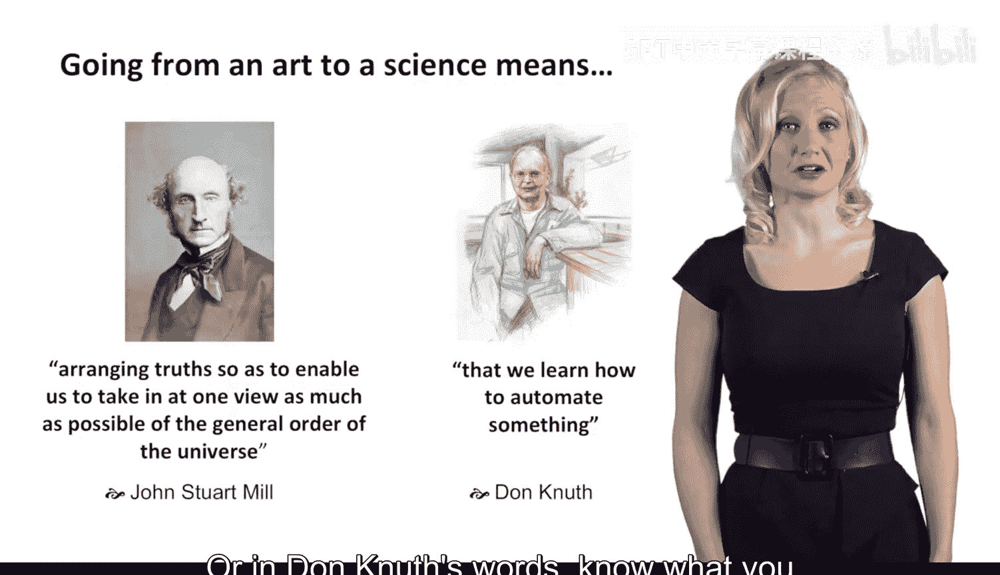

# 杜克大学《Excel 到 MySQL：商业分析（5课全）｜Excel to MySQL： Analytic Techniques for Business》中英 p86 11_03_01_利用数据可视化驱动分析.zh_en -BV1mS421X7yw_p86-

The reason that data analysts have sometimes been called data scientists is that our goal as analysts is to arrange the insights of our data in such a way that everybody who sees them is able to clearly understand their implications or their truths and how to act on them。

According to many philosophers like John Stetuwart Mill here， that's the realm of science。

Further in a practical world， one of the main jobs data analysts and data scientists have is to automate business processes of business insights using predictive computer algorithms。

 According to the computer scientist John Canoeth， who I've quoted here， that's the realm of science。

 too。So by both of these definitions， no matter what your formal job title is。

 your goal should be to be a data scientist， not just a data analyst。

The thing is we can't automate business processes effectively unless we know what features of the world are important to incorporate into the predictive algorithms we are using to automate those processes。

That's where art comes in。The art of data science is figuring out how to arrange the things we learn about our data into something that is meaning。

 In other words， to arrange it into a story that tells scientific truths that are so well understood that they could at least。

 in theory， be automated。Practically， that process means looking at your data in a whole bunch of different ways until you figure out the order your data's insights should be organized into in order for you to be able to in John Stewarts Mills words。

 Ex the general order of the universe， or in Don Kath's words。

 know what you should put into your predictive model that you are going to implement in some kind of programming language。

That's what visualizing data does for you。It helps you figure out what your data mean efficiently。

 and in the process of doing so helps you narrow in on what factors you should take into consideration in your statistical models or predictive algorithms。

Over the next two weeks， we're going to learn how to use the program Tableau to implement this type of visualization。

