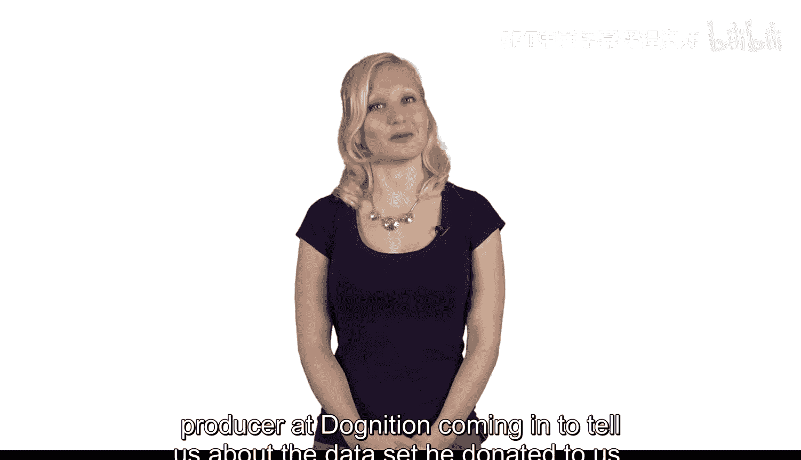
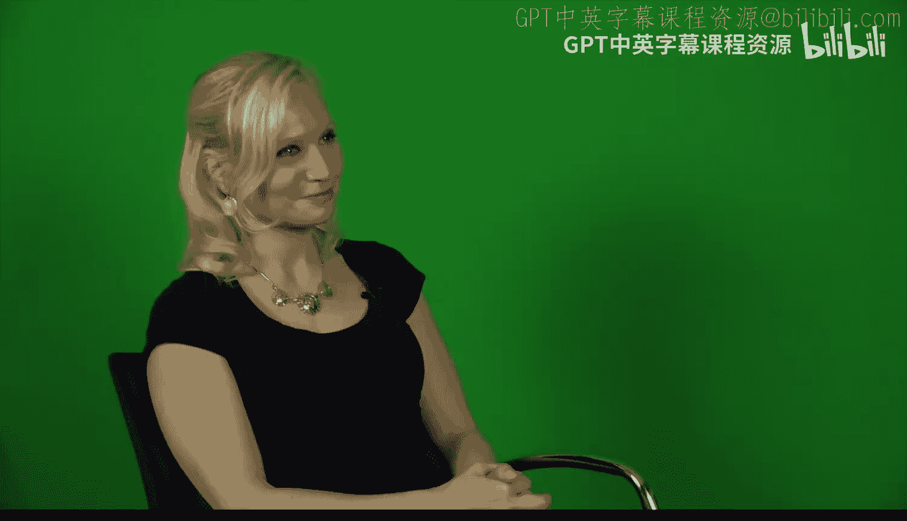
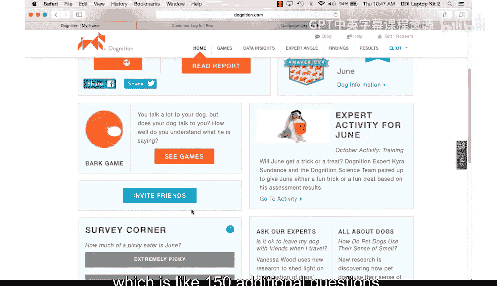
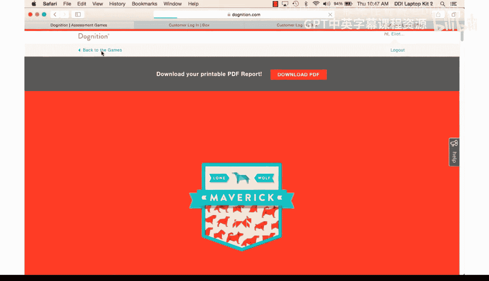
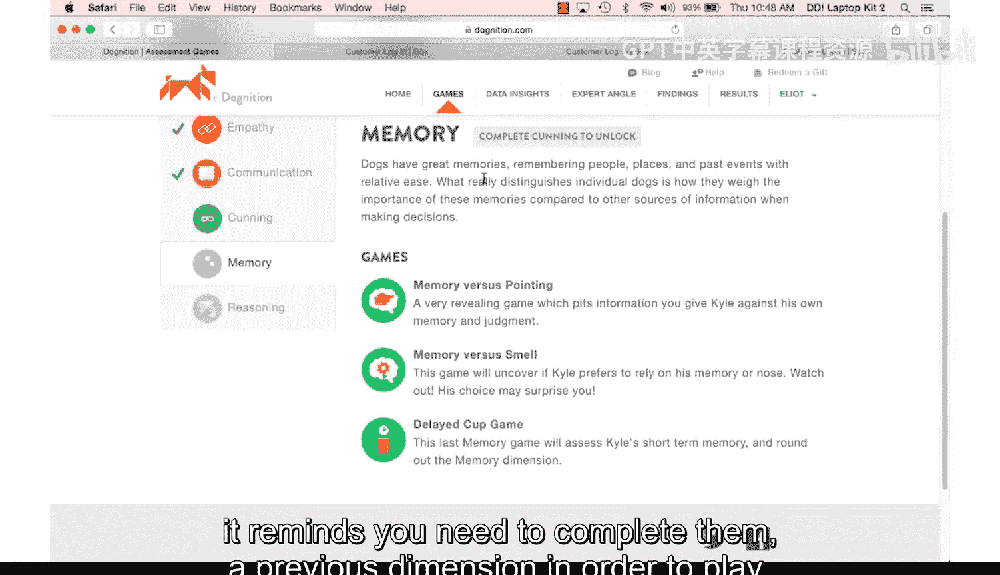
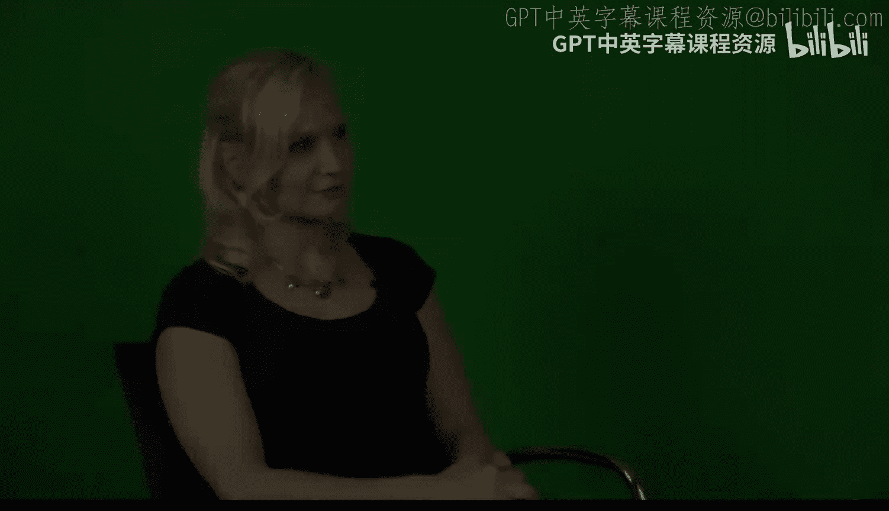
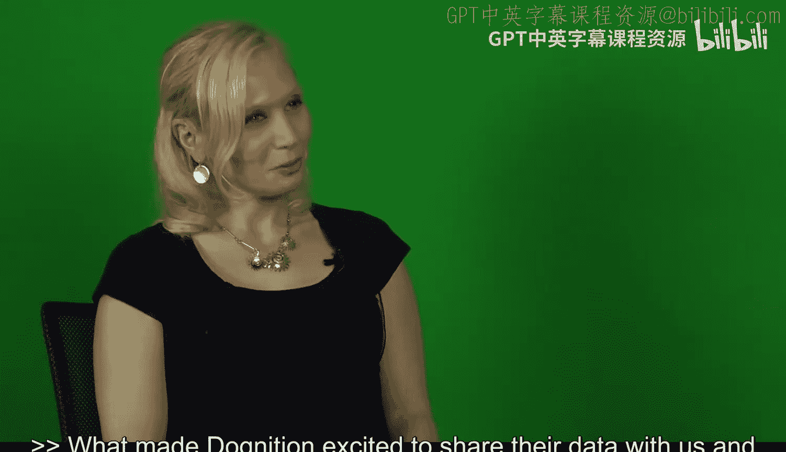

# 杜克大学《Excel 到 MySQL：商业分析（5课全）｜Excel to MySQL： Analytic Techniques for Business》中英 p89 14_03_02_认识您的Dognition数据.zh_en -BV1mS421X7yw_p89-

对。We are really fortunate in this class to be able to work with a real business data set from a real business。

 That business is called Dognition。 And today， we have Elliot Cohen。

 producer at Dognition coming in to tell us about the data set he donated to us。😊。

Hey it's great to meet you this is Cu。Thanks so much for coming in Oh it's our pleasure。

 both that you got a seat。Great， well， thanks again。

 So could you tell us a little bit about Doogniition and what role you play there， Sure。

 Doogniian is。😊，A way for dog owners and dog lovers all over the world to learn more about their dog。

 We have taken laboratory games that are done in dog labs and dog cognition labs all over the country and all over the world。

 And we have。Basically broken them down into their components and recreated them using household objects that anyone can use。

 finding whatever they have in their house at home。 And then we aggregate all this data。

 We have over 30000 people who are playing dogian games now， and we look at it as a group。

 And now we've recently published our first paper， which says that our data is as good as laboratory data。

In terms of what the users dog owners who play dognian get。

 you really get to learn a lot more about your dog that you wouldn't necessarily know。 know。

 a lot of people come in and they think， oh， gosh， what am I going。

 I know my dog smart or I know my dog's dumb。 But even Doctor Her who designed the games。

 learned a lot more about his dog， Tasmania。 So， for example， he， you know， Tasmania。

 he expected to have a very。Active memory when able to recall things very easily。

 But it turns out she doesn't really rely on her memory that much， she relies a lot on him。

 So when he's telling her sit and then she walks away。

 it's not cause she's regardinging what he's saying。 She actually just can't remember what he said。

 So this is an example of something that you'll gain through learning the proper skills that your dog relies on。

So the doian games themselves are broken down into。5 dimensions of canine intelligence。

 The dimensions are empathy， communication， cunning， memory and reasoning。

 And then across these five dimensions， we have 20 games or really 10 games and 10 warm ups。

 which then contribute to those dimensional scores， which will determine not if your dog is。

Use its memory or doesn't。 But what skills within memory your dog relies on。 And then from these。

 your dog will be placed into one of nine profiles。

 And these profiles are a combination of different traits。 And they have they。

What we found which is very interesting to begin with is your breed doesn't determine very much about what profile your dog will end up being。

 It's all about the individual way your dog is solving problems。

 So what does it actually look like when you log into the website。So to log into to Dogogniition。

 you just go to the login button。And。Wait for it to load， and then you log in。

With whatever your username and password is。And then what you see right here。

 this is what a completed dog sees。 So right in your homep page。

 it shows you all the dimensions you've completed， it shows you your next monthly game over here。

 here's your activities， and here's your survey corner。

 which is like 150 additional questions which people really like to answer because people like to answer questions about the dog This is where the report would be。

 so there are 15 pages of analysis。

And then they go back to the games。

This is a completed dog。And all the completed dimensions and all the completed results So if we looked at。

An incomplete dog。We can see this is Kyle。Up here on the top。

 So the way we'd get here we go from the home page right here。You see， it says up next。

 play the games。And。Here we are， this is the game that's next。

 it shows you have to complete the games on the side。Cunnings the game he's up to。And at the top。

 it says play， so youd click playing to go right into the games。And up here ahead。

 you see the games you haven't yet unlocked to play because you need to play them in the order and it reminds you you need to complete them in the previous dimension in order to play。

So what kind of subscription models do you have？Dgntion offers three types of subscriptions as ways to play the Doian games。

 We have the core Doognition assessment， and this is 10 games and 10 tests or warmups that contribute to your dog's Doition profile。

 which is one of those nine things that end up that your dog is afterwards。 On top of this。

 we have the dogian yearly and monthly subscriptions。

 And these are exciting additional things that you can do with your dog after you complete the assessment。

 which。😊，Really are two things you have 12 additional games over the course of a year。

 as well as  12 additional activities that are created by experts or trainers。

 and these games unlock games and activities unlock on a monthly basis from when you sign up one per month。

Okay， so if I understand correctly， each customer has the opportunity to complete 20 tests in the first month and they do it in the same order each time one by one as you make them available。

 I that right， The Dition gains were designed to go in a particular order and starting with empathy。

 going to communication， cunning， memory and reasoning。The reason for this was twofold。 One。

 the empathy games are actually our simplest games。

 They don't require anything other than you and your dog and for the eye contact game you require treats。

 But there's no， there's no training that you need to do in terms of getting your dog used to doing these。

 It's just you and your dog hanging out This is helpful because。

You don't need to worry about if your， if your dog is overexted， it'll be a calming experience and。

That' will really get your dog in the mood to play the games going forward。嗯。After that。

 the other thing that happens is the games slowly get more and more complicated。

 so we thought it'd be better to ramp it up。 Did you ever try making the test available in a different order？

About six months after launch for Dian， we were looking closely at how our product was performing in terms of completion rates and we realized wasn't as much as we realized we weren't happy with how far people were progressing。

 There was a very large drop off in the beginning and not as many people as we wanted were getting all the way through to the end to try to address this。

Our hypothesis was that people weren't enjoying the empathy dimension as much because while it was very easy and it was easy to get people into the games。

 it wasn't exactly exciting。 And we knew this because we designed and implemented an additional enjoyment slash surprise survey。

 So using the information we got from that， we developed an alternate hypothesis。

 which was instead of leading with empathy， we would lead with the memory dimension。

 which was scored as more enjoyable and very surprising in terms of the expectation versus what happened。

 The drawback to this， which we realized afterwards because it wasn't while the overall completion rate and advancement didn't change。

 it did change how far people got。 So more people got through the first dimension。

 but that didn't mean they got further。um。And the drawback of the memory dimension was that it's a very technical dimension in terms of what the instructions are asking you to do。

 and if。The dog isn't using a strategy that results in them getting a treat。

 but not going to get any treats at all。 And that gets really frustrated for both the owners and the dogs。

 So that's some insight into our one of our earlier tests。So now here's the million dollar question。

 though。What business problem does Doian have that you think we might be able to help you with？

Theogni as a product and a company is really broken into two components at the most basic。

 we have what we call the brochure， which is the outside non logged in version of what you see。

 which is our our website you go through you have the homepage。

 how it works and then 1000 other pages trying to give you more information if you're interested。

 and then we have the actual product itself， which is after you log in the issues to do with playing the games or interacting with the trainers or the experts or any number of things in there。

 So that gives us two very distinct areas of development that we can focus on。At Dogian。

 we have an interesting problem where we actually care a lot about what our customers do after they purchase。

 We don't once you give us the money， that's fantastic。

 but we actually want you to do a lot with Donian as a product。 And this comes into。

 we really want you to finish。 if you don't finish， then we only get a tiny amount of your data。

 And the overall goal of Doition is to publish papers and learn more about your dog。 And， you know。

 your， your contributions are helpful in keeping us running。 But at the end of the day。

 if we don't have your data， then we don't have anything。😊。

So one of the main things we're looking for is ways to increase。

In some respects to a completion rate， but really just get further people further along in their doian experience and through the games。

 we can do a lot of partial analyses where we look at just the people who have completed the first section of the games or just the P Q or just anything like that。

 But really what we're looking for is this huge comparison。

 we can look for your breed or any number of things across all the games。

 So anything that we can find about some insight to push users and their dogs to complete a bit more would be super helpful from our perspective。

 So do you have any tips for a class as we tackle this business problem。

 I actually do have a tip in terms of doing the data analysis。

 The most important thing that we found is that you have to go into every。Test with a question。

 you need to have a hypothesis and you need to know exactly what you're doing to test that because if you're just going in and looking。

 you're not gonna to either going to find things that don't matter。

 which is useless or you're not going to find anything which is equally useless。

 So find a testable hypothesis before you go in is the only really important thing I'd say。Great。

 so do you think you'd be willing to show us an example of one of your tests， Yeah sure。

So I'm going to show you guys the memory versus pointing game。

 I think this is a great example of how dogogniian is trying to see what strategy your dog uses。

 not that there's a right or a wrong answer。 This is a pretty far into the game。

 It's in the it's near the end of the memory dimension and what this will do is I'll put down some cups and I'll hide a piece of food under one of the cups and then I will stand up and point to the cup where I didn't hide the treat and this will directly point my information that the dog is learning from my actions versus where it knows the treat isnt remembers that it is So let's see what happens so。

We do as we。Put the two cups down， the dog is across。Cizu， show the treat。Put it under a cup。

And then。Get the treat。So the side that she goes to first is what she gets， so she knew。

That that's where the treat was， even though I pointed to the other side。

What made Dgogniian excited to share their data with us and to be part of this course。

 One of the things that Dgnian is really big on is education。 and， you know。

 we want to share information about dogs。 And， you know。

 if we have enough data and we have enough experience。

 we can share some data or info about how to make data driven decisions。

 then we ended up being very happy to help。

The one thing that was really important from our perspective。

 when we are sharing our data is that we take care of ourselves and we take care of our users。

 So all of the data that we shared what's anonymized is's no reference to individual users that no no references to。

Addresses or emails or name， anything at all that would identify an individual has been scrubbed from the data。

 so there's no tracing back to anyone。Now that you've heard about the business problem we have to solve together。

 go to the course website to find out some more details about the specific fields we have in the data set the Elliot and Dognian so kindly donated。

 In the meantime， I suggest you go check out the Dognian website。 It's really a cool company。

 And I think you'll really get excited about solving their business problems。😊。

