# 杜克大学《Excel 到 MySQL：商业分析（5课全）｜Excel to MySQL： Analytic Techniques for Business》中英 p91 16_03_01_数据相关职位薪资-您的第一个图表.zh_en -BV1mS421X7yw_p91-

So now we have our data set， we have a plan for how we're going to analyze it and answer our questions。

 and we've downloaded Tableau。 we're ready to make our first graph。Now to do that。

 we should all be using the same dataset set， so please go to the course website and download the dataset set called Sal data。

 make sure to save it to somewhere on your computer where you will be able to find it later。

Now I'm going to be going through these videos as if you're doing the exercises with me at the same time。

 but feel free to just watch the videos and do the exercises on your own later。Ready to get started？

Okay。So go ahead and open your copy of Tableau。 And when you open it up。

 it's going to look something like this。 Now， when you're using Tableau desktop。

 you're going to see this section here on the left。

 you can see that it connects to different servers or databases。

 you can see my SQL oracle and if you click on more servers。

 you can see the long list of different databases that Tableau can connect to。 Now。

 if you're using Tableau public， you're not going to be able to see these because Tableau Public cannot connect to databases。

 But since Tableau so kindly generously donated keys so that all of our students in this course can use Tableau De。

 you all should have access to these databases as well。

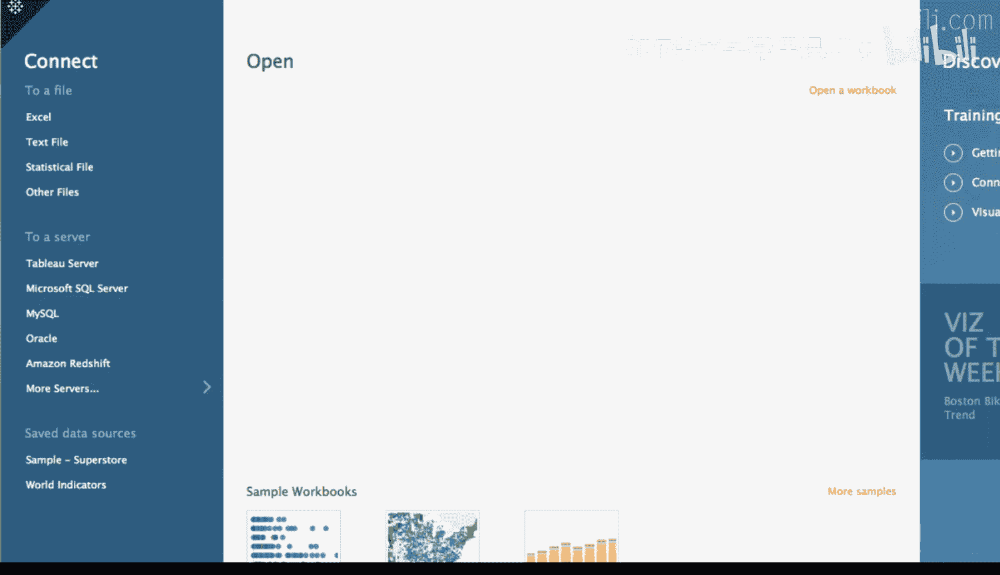

So today we're not going to connect to a database， we're going to connect to an Excel file。

 so go up here to connect to a file and click on Excel。Navigate to you save the dataset set。

And click on salary data。Say open。Sometimes， especially if you have a Mac。

 when you connect the first time， this can take a little bit of time。

Our data set is not the biggest data set in the world， but it is quite big for Excel standards。

 so this can take many seconds， tens of seconds or in some cases， with slower computers。

 even up as long as a minute。

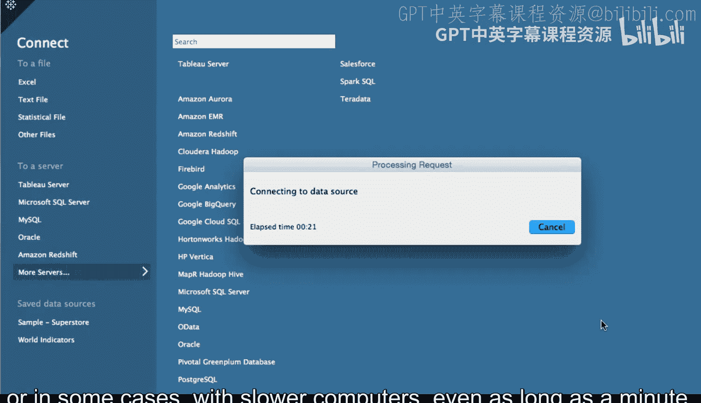

Now， when the data has loaded， you're going to come to a screen that looks something like this down here are all the names that Tableau has automatically interpreted from the dataset set。

 So each one of these names is one of the is in the header column or the header row of the Excel file And you can see that it automatically classified the name as well as the type of variable。

 So this these little icons here。 tell you the type of variable that Tableau thinks it is。

 Now usually Tableau does pretty good job， but it doesn't get it perfect every time。 So， for example。

 here， you can see that case received date it thinks is a string。 That's what the ABC means。

 But you can click on this and change the variable so that it's correct。

 So we can change this to date。 for example， do the same thing with decision date。

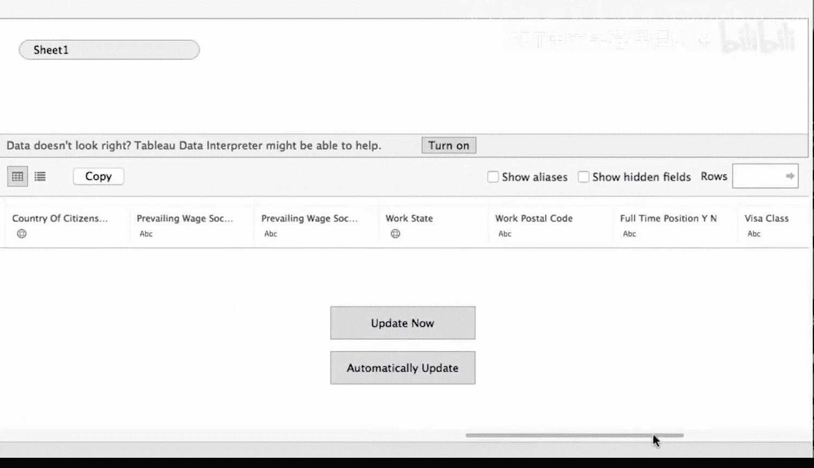

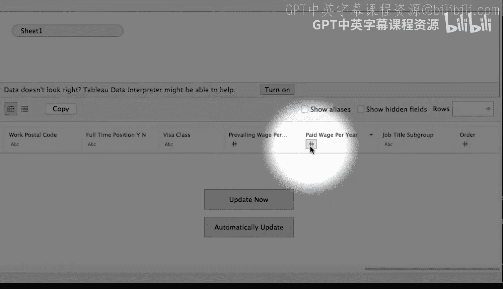

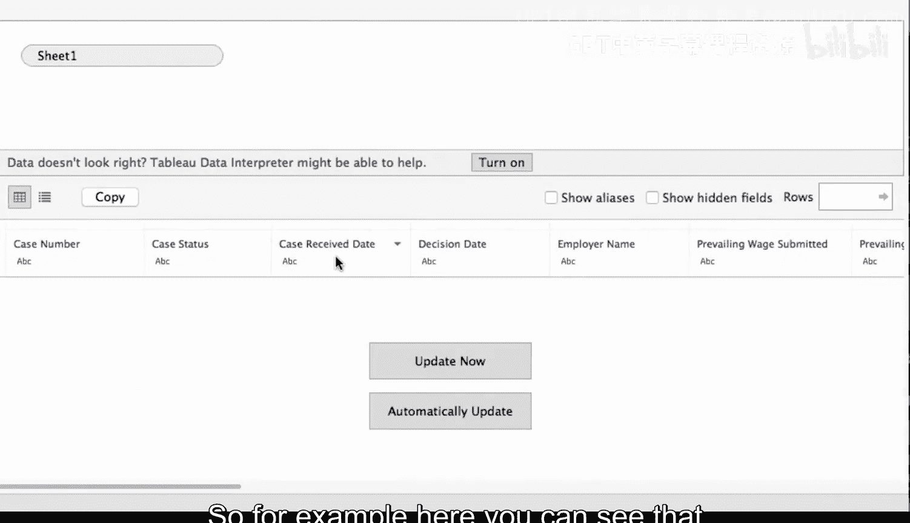

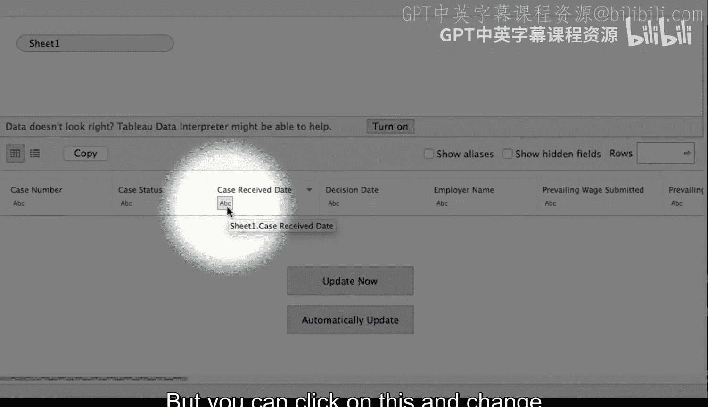

And here's another example of where it didn't get it quite right。

 prevailing we submitted should be a number and it thinks it's a string so we can change it to number decimal and you can do this for every single variable in your data Now there's another place to do this on the next screen so we'll go ahead with this for now and then I'll show you how to do it in a different way when we get to the next screen。

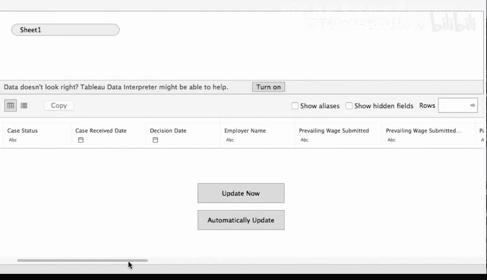

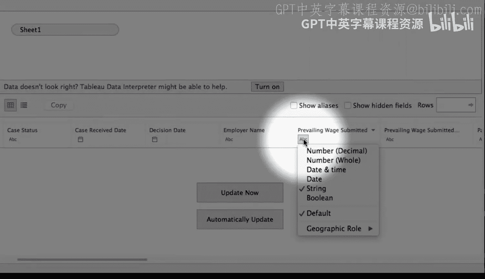

When you think you have your variables named and organized the way you want them。

 go ahead and clickUdate Now。And you'll start to see the data wheel。

Because it's going to take quite a bit of time to load the data， especially the first time。

Now as this loads， I want to prepare you for what you're going to see on the next screen。

Tableau is a very powerful program， and they really put a lot of effort into trying to make the user experience as pleasant as possible As a consequence。

 it has a lot of different capabilities， and there are usually two to three different ways to do just about everything。

😊，Now， unfortunately or fortunate， depending on how you see it。

 there isn't going to be time for me to show you how to do every single one of those things。 In fact。

 I would argue it's almost impossible for anyone one to know how to do them all。

 And that's why people go to tableau conferences every year to keep up to date and to learn what all the new bells and whistles are。

My strategy is to go through exercises that I think will show you the most important things you need to know as a business analyst。

 and as we go through them， I'm going to show you as many tips and tricks and options as I can。

But I'd like to encourage you to explore the data and explore Tableau on your own as well。

 The best way to learn all the ins and outs and really become comfortable with the program is to discover these things on your own。

 Plus， this will be a great time to practice that curiosity and fearlessness that's great to have as a data analyst。

 whenever you don't know how to do something， practice looking it up on your own and proving to yourself that you can figure it out because that fearlessness will be a great thing to have as a data analyst。

 and this is a great time to practice it。😊，This is what you see when you open up the workspace in Tableau may orient you to the screen over here in the left is where all of your variables are。

 And Tableau breaks them up， according to measures and dimensions。

 Me are basically continuous variables and dimensions are your discrete or categorical variables。

 Now， remember， I told you and the tips at the very beginning of the course。

 sometimes they are variables that can be either continuous or discrete。 In in this case。

 either a measure or dimension。 And you need to choose which one you want to define it as depending on your analysis。

 So to change that it's actually very easy in tableableau。

 Another time you might want to do this is if tableableau incorrectly assigned the variable as either a dimension or measure。

So there actually are two examples of that here， two of the main things we're going to be looking at in our data set are prevailing wage per year and paid wage per year。

 These actually are both continuous， meaning they're both measures。

 but Tableau thinks they're dimensions， so to change that it's very simple。

 like I said you just click and drag it down。Another way you can do that is you can click on this drop down menu and you can say convert to measure。

 and that will do the same thing。I want to show you a couple other things you can do with that drop down。

You can see that this is where you would rename the variable or duplicate it。

 but this is also where you would change the data type remember I told you on the last screen that there would be a place to do it here in the workspace this variable is experience required or the number of months of experience required Tableau thinks that that's a string but it's actually a number so here I can change that to number just like I did when we are bringing in the data。

One more thing I want to show you over here in the variable column is this very little icon。

 see this little magnifying glass， this is a way that you can search all of your variables when you have a ton of different columns and it can be hard to navigate so you can just type something in and or go directly to it。

Now up here is。A toolbar。 There are a lot of neat things up here that I encourage you to explore。

 The main ones I'm going to point out now are this very important one。 This is the undo button。

 You're gonna to use this a lot。 I imagine this is another important one。

 It's a little icon that has a graph with an X on it that clears the sheet。

 So it completely clears the workspace。 and up here is the larger toolbar or ribbon。

 and there are a lot of interesting things up here too。

 the main ones we're going focus on are the analysis one。 we'll come to this later。

 but your note right now that you see aggregate measures here。 We're going to be using that a lot。

 And also the format menu。 And now this is one of the things that's very redundant。

 or it's another way of doing things。 Almost everything on this list you can do in the workspace just by right clicking。

 but it's good to know that this is here。

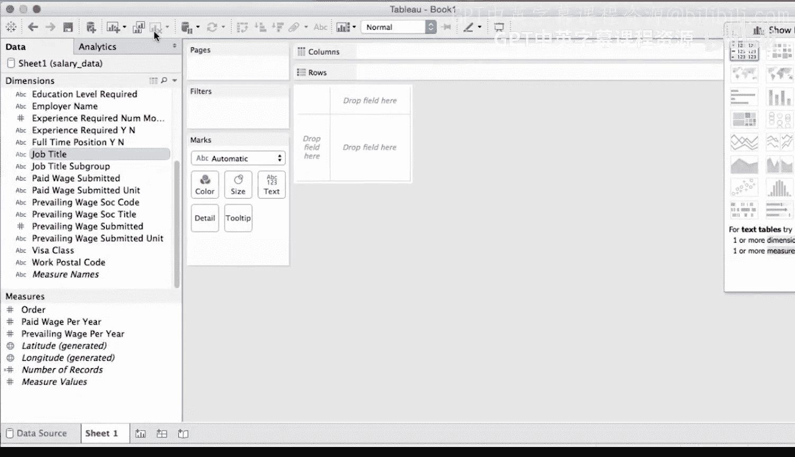

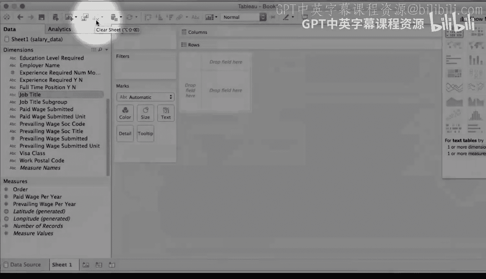

Now down here in the workspace， which is this whole area here。This。

 these things over here are called cards。 There's a markx card， the filter card， and a pages card。

These rows here are called shelves。 This one is the row shelf。

 and this is actually where you're going to tell tableableau literally what to do with the rows of your data。

 how you're going to aggregate over them。 And there's also a column shelf。

 and this is where you're going to show tableableau how to break up your data and what categories to put it in。

This is the showmi card over here， and this gives you all the different possible options。

 all the different ways that you could represent the data that you have in your workspace so it will automatically tell you the types of charts that are appropriate for the data you have so when they're grayed out。

 you can't use them it actually won't allow you to because it wants to make sure that you will only use best practices but when it's not grayed out than it will let you make them so we'll show you more about this before or show you more about this later。

Now our first question is， how much are we likely to make in different data related jobs？

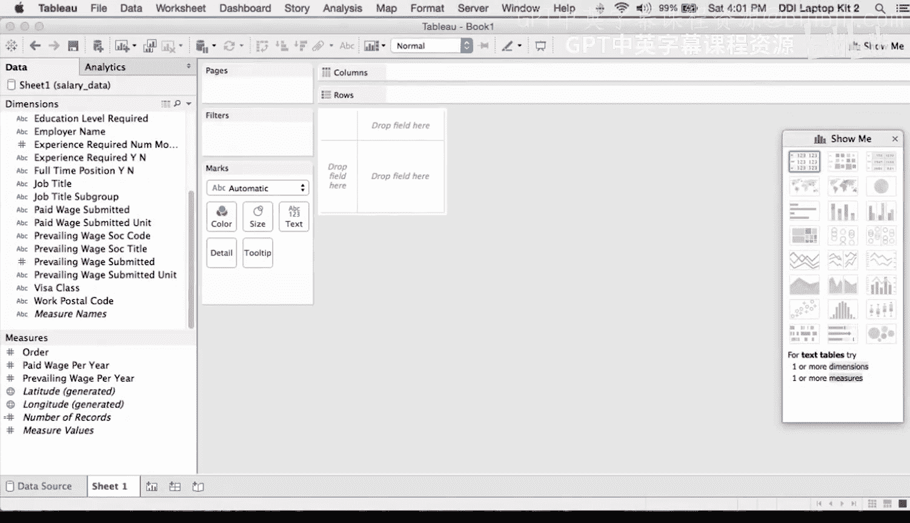

For this question， our dependent variable or the rows of data that we're most interested in and that we want to aggregate over is paid wage per year。

 Our independent variable is job title subgroup。 And remember。

 I told you that our course assistant was kind enough to go through all the titles。

 the different job applications and put them into subgroups that we might be interested in。

 So luckily for us， that part of the analysis is done already。

 So now that we know our dependent independent variable， we are ready to make the first graph。

 And I want you to take a deep breath and don't blank because if you do， you might miss this。 Now。

 in order to get paid wage per year over into the row shelf。

 you could either double click it or drag it。

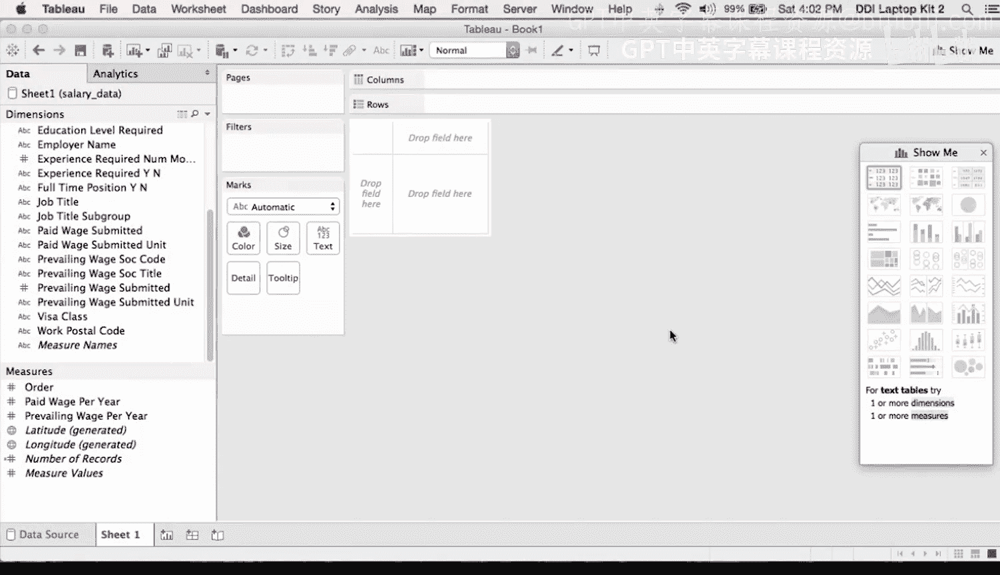

Then you put a job title subgroup again into the column shelf， again。

 either drag it or double click it。

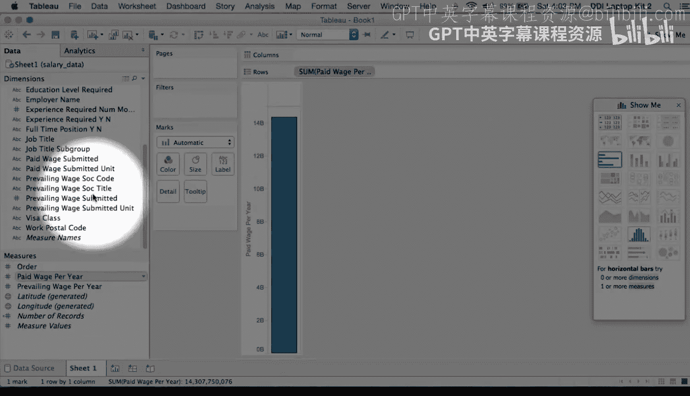

Boom， you have your first graph， it really was that simple and that quick， much quicker than Excel。

Now the first thing I want I want to orient you to is this access here now if you look carefully you'll see it says that the paid wage per year are some very high numbers in the billions in fact。

 unfortunately we wouldn't make billions of dollars in any of these data related jobs so what's happening here？

So to show you that we need to go up to the row shelf and the column shelf。

 and I also want to point out to you that this blue and green。Little rectangle looking like things。

 what tableableau calls pills， the green ones are measures and the blue ones are dimensions。

 so it's a good way to keep track of whether tableableau is thinking your variable is either a dimension or a measure。

Now， in the Rose column， you'll see that it says some and then it opens parentheses paid wage per year。

So remember， when we drag this variable onto this shelf。

 we're telling Tableau we want you to look at these rows of data and we want you to break them up according to different job title subgroups。

 but we have to tell Tableau what we wanted it to do with all the rows within one of those different subgroups。

 And right now it automatically thought we wanted to add them together or sum of them In reality。

 we wanted to know what the average was for something like the average。

 So to change that you click on this drop down and you can go down here and you see that it says its treating measure as a sum and it has checked next to sum。

 if we want to change it to an average or a median。

 we would simply click on either average or median and my preference is always median。

 especially if you don't know what the distribution of your data are。 So let's choose median。

And now if you look at the axis again， now you see that it's in the tens of thousands。

 which is much more accurate and represents what we would truly make in one of these jobs。

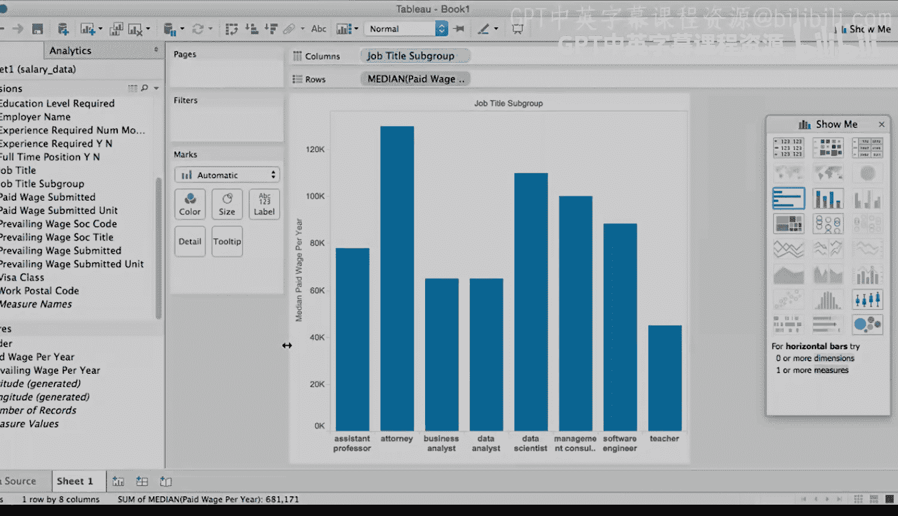

Congratulations， you've now made your first graph in Tableau。

