# 商业分析：16_03_01：数据相关职位薪资 - 您的第一个图表 📊

在本节课中，我们将学习如何使用 Tableau 创建您的第一个图表。我们将从准备数据集开始，逐步完成连接数据、调整变量、理解 Tableau 工作区，并最终生成一个关于不同数据相关职位薪资中位数的条形图。

---

## 准备数据与分析计划

现在我们已经有了数据集，制定了分析计划来回答问题，并且下载了 Tableau。我们准备好制作第一个图表了。

为了确保大家使用相同的数据集，请访问课程网站并下载名为 `Sal data` 的数据集。请将其保存到您电脑上方便查找的位置。

我将假设您与我同步进行练习来讲解这些视频，但您也可以先观看视频，稍后再自行练习。

---

## 启动 Tableau 并连接数据

首先，打开您的 Tableau 副本。打开后，界面将类似下图所示。

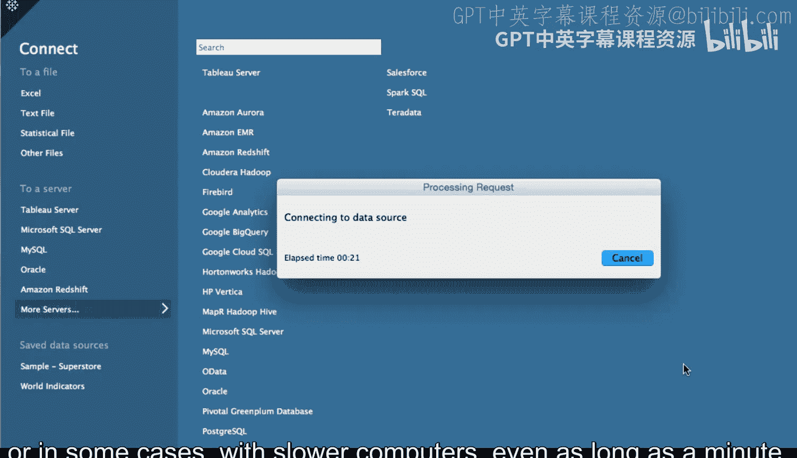

在 Tableau Desktop 左侧，您会看到一个区域，可以连接到不同的服务器或数据库，例如 MySQL、Oracle。点击“更多服务器”可以看到 Tableau 支持连接的长数据库列表。如果您使用的是 Tableau Public，则无法看到这些选项，因为它不能连接数据库。但幸运的是，Tableau 慷慨地为本课程所有学生提供了 Tableau Desktop 的密钥，因此您应该也能访问这些数据库。

今天我们不会连接数据库，而是连接一个 Excel 文件。请点击上方“连接到文件”并选择“Excel”。导航到您保存数据集的位置，点击 `salary data` 文件并打开。

首次连接时，尤其是在 Mac 上，可能需要一些时间。我们的数据集按 Excel 标准来说不算小，因此加载可能需要几秒、几十秒，在较慢的电脑上甚至可能长达一分钟。

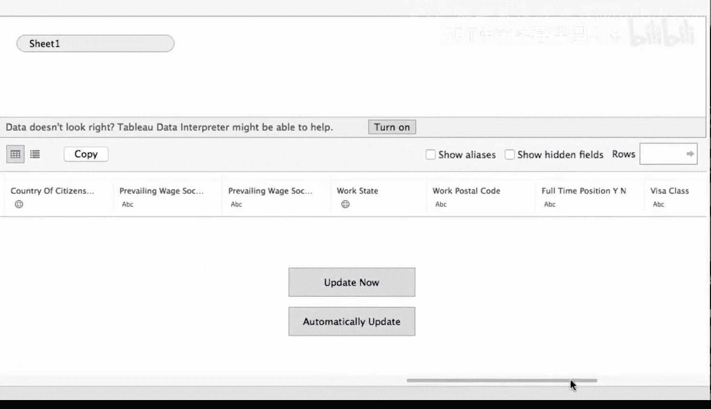

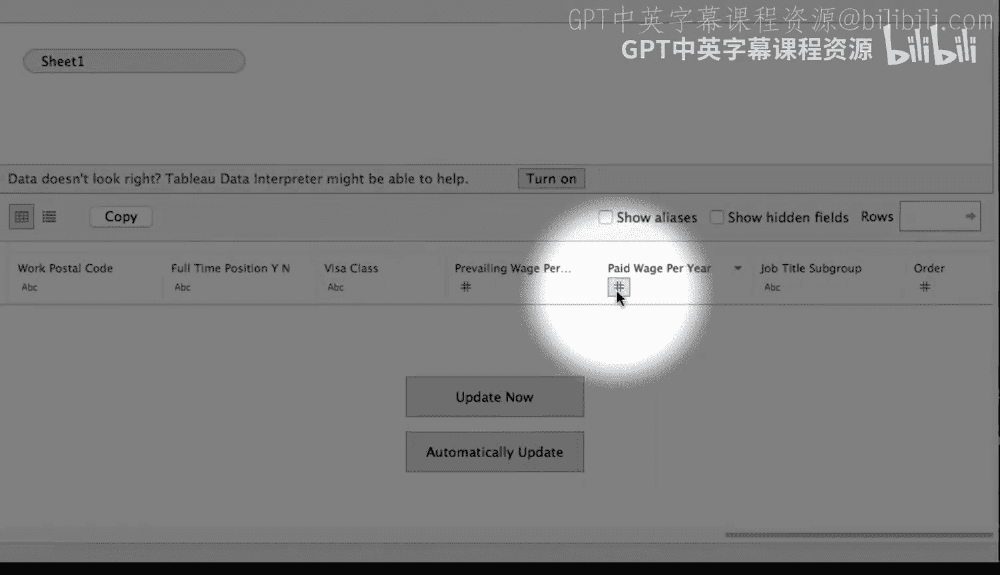

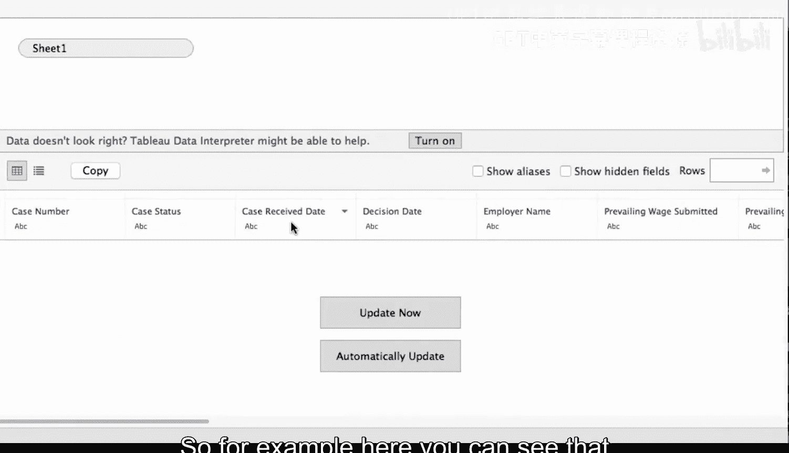

---

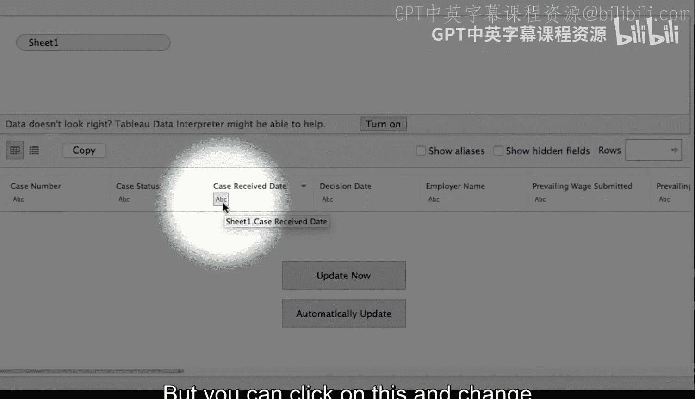

## 检查与调整数据变量

数据加载完成后，您将看到一个类似下图的屏幕。下方列出了 Tableau 从数据集中自动解释的所有变量名称。

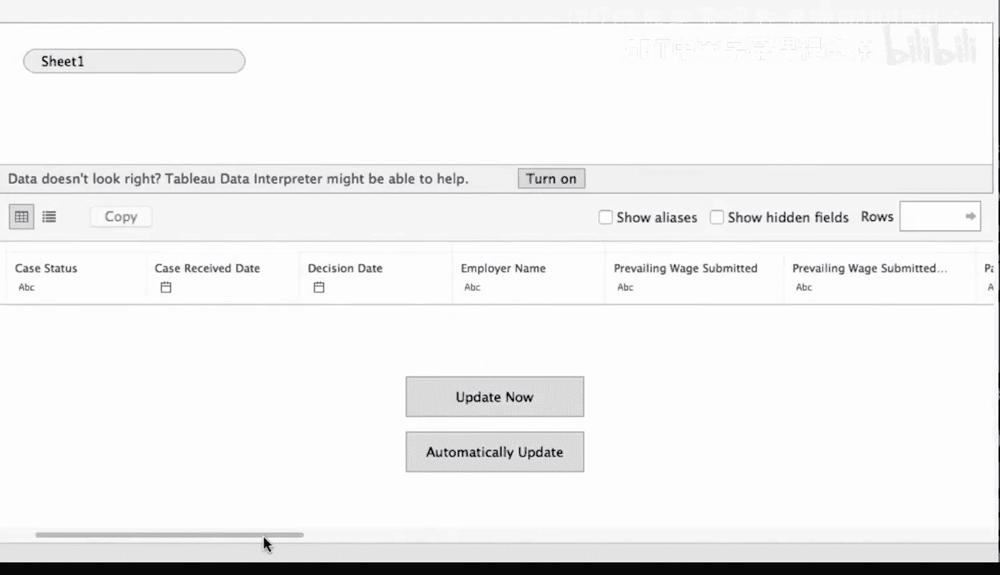

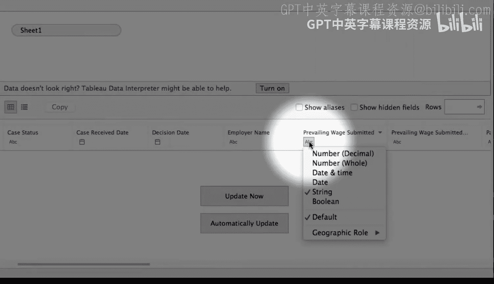

每个名称对应 Excel 文件标题行中的一列。Tableau 会自动对变量名称和类型进行分类，通过旁边的小图标表示。通常 Tableau 做得不错，但并非每次都完美。

例如，`case received date` 被识别为字符串（ABC 图标表示）。您可以点击它并将其更改为正确的类型，例如“日期”。对 `decision date` 进行同样的操作。

另一个例子是 `prevailing we submitted`，它应该是数字，但 Tableau 认为是字符串。我们可以将其更改为“数字（十进制）”。您可以对数据中的每个变量进行此类调整。在下一个屏幕中还有另一种方式可以完成此操作，因此我们现在先继续，稍后我会展示另一种方法。

当您认为变量已按所需方式命名和组织好后，请点击“立即更新”。您将开始看到数据加载轮，因为加载数据需要相当长的时间，尤其是第一次。

---

## 熟悉 Tableau 工作区

在数据加载时，我想为您介绍接下来将看到的屏幕。Tableau 是一个非常强大的程序，他们投入了大量精力来优化用户体验。因此，它拥有许多不同的功能，并且几乎每件事都有两到三种不同的操作方法。

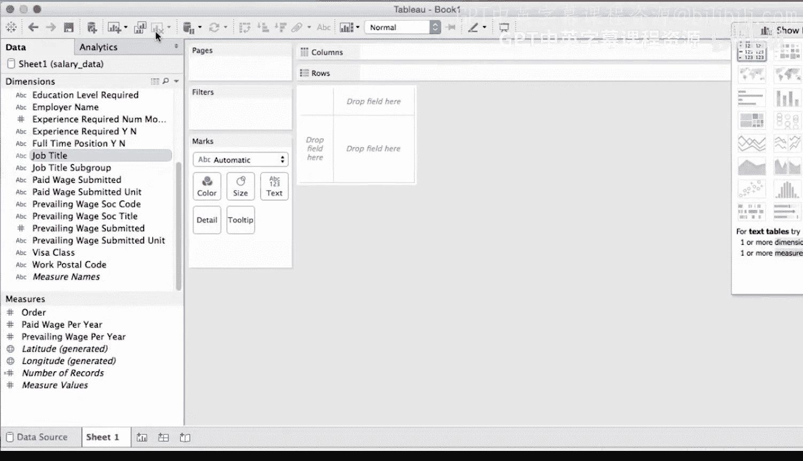

遗憾的是（或者说幸运的是，取决于您如何看待），我没有时间向您展示所有操作方法。事实上，我认为几乎不可能有人全部掌握。这就是为什么人们每年都参加 Tableau 会议以了解最新功能。

我的策略是通过练习向您展示作为商业分析师需要了解的最重要内容。在过程中，我会尽可能多地展示技巧、窍门和选项。但我鼓励您也自行探索数据和 Tableau。熟悉程序所有细节的最佳方式是自己去发现。此外，这也是练习数据分析师所需的好奇心和无畏精神的好时机。每当您不知道如何做某事时，练习自己查找并证明自己能够解决，这种无畏精神对数据分析师来说非常宝贵。

这是您在 Tableau 中打开工作区时看到的内容。让我为您介绍一下屏幕布局。

左侧是所有变量的位置。Tableau 根据“度量”和“维度”对它们进行划分。度量基本上是连续变量，维度是离散或分类变量。请记住，我在课程一开始的提示中告诉过您，有些变量既可以是连续的也可以是离散的。在这种情况下，您需要根据分析选择将其定义为度量或维度。在 Tableau 中更改这一点实际上非常容易。

您可能想要这样做的另一个原因是 Tableau 错误地将变量分配为维度或度量。这里就有两个例子：我们数据集中将要查看的两个主要变量是 `prevailing wage per year` 和 `paid wage per year`。它们实际上都是连续的，即都是度量，但 Tableau 认为它们是维度。要更改这一点非常简单，只需点击并向下拖动即可。另一种方法是点击下拉菜单并选择“转换为度量”，效果相同。

我想向您展示该下拉菜单的其他几个功能。您可以在此处重命名变量或复制它，但这也是更改数据类型的地方。记得我在上一个屏幕中提到，在工作区中也有地方可以操作。例如，变量 `experience required`（所需经验月数）被 Tableau 认为是字符串，但它实际上是数字。在这里，我可以像导入数据时那样将其更改为“数字”。

我想向您展示变量列中的另一个小功能：这个小放大镜图标。当您有很多列且难以导航时，这是一种搜索所有变量的方式，您可以输入内容直接定位。

上方是一个工具栏。这里有很多有趣的东西，我鼓励您探索。现在我要指出的主要几个是：这个非常重要的“撤销”按钮，您会经常用到它。另一个重要的图标是一个带 X 的图表，用于“清除工作表”，即完全清空工作区。上方是更大的工具栏或功能区，这里也有很多有趣的东西。我们将主要关注“分析”选项卡，稍后会用到，但请注意您现在看到“聚合度量”的地方，我们会经常使用它。还有“格式”菜单。这是功能冗余的一个例子，或者说提供了另一种操作方式。此列表中的几乎所有操作都可以通过在工作区中右键单击来完成，但知道它在这里也很好。

---

## 理解工作区布局

现在看下方的工作区，也就是整个这个区域。这边的东西称为“卡片”，有“标记”卡、“筛选器”卡和“页面”卡。

这些行称为“架子”。这个是“行”架子，您将在这里告诉 Tableau 如何处理数据的行，即如何对它们进行聚合。还有一个“列”架子，您将在这里向 Tableau 展示如何拆分数据以及放入哪些类别。

这边是“显示我”卡，它为您提供了所有不同的可能选项，即您可以在工作区中表示数据的各种方式。它会自动告诉您适合您数据的图表类型。当选项呈灰色时，您无法使用它们，因为 Tableau 希望确保您只使用最佳实践。当选项未呈灰色时，它允许您制作它们。我们稍后会更多地介绍这个。

---

## 构建第一个图表

我们的第一个问题是：在不同的数据相关工作中，我们可能赚多少钱？

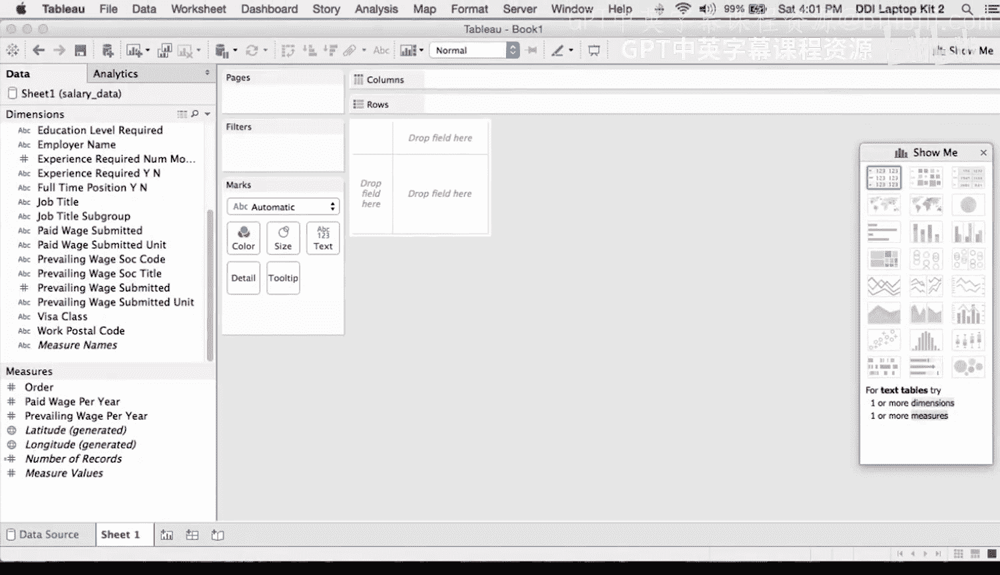

对于这个问题，我们的因变量（即我们最感兴趣并希望聚合的数据行）是 `paid wage per year`。我们的自变量是 `job title subgroup`。请记住，我告诉过您，我们的课程助理非常友好地审查了所有职位申请标题，并将它们归入我们可能感兴趣的亚组中。幸运的是，这部分分析已经完成了。

既然我们知道了因变量和自变量，我们就可以制作第一个图表了。请深呼吸，不要走神，因为如果您走神，可能会错过这一步。

现在，为了将 `paid wage per year` 放入行架子，您可以双击它或拖动它。

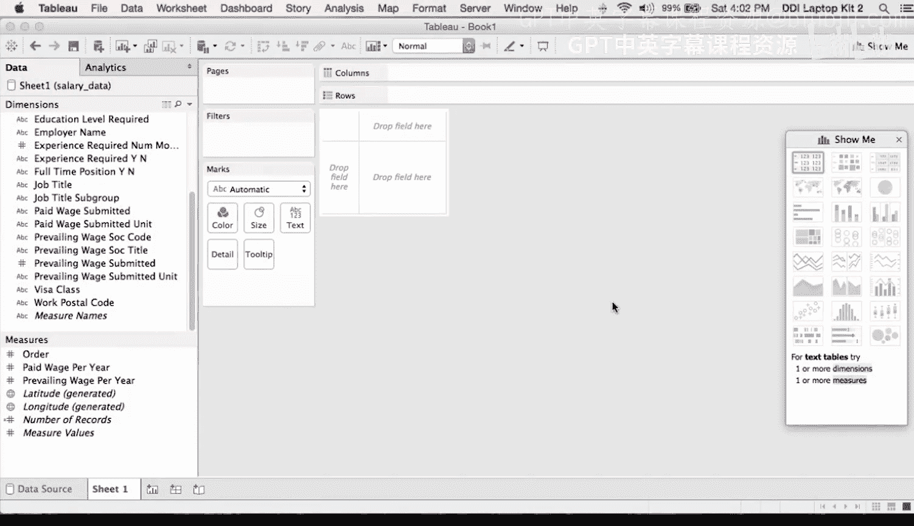

然后将 `job title subgroup` 放入列架子，同样可以拖动或双击。

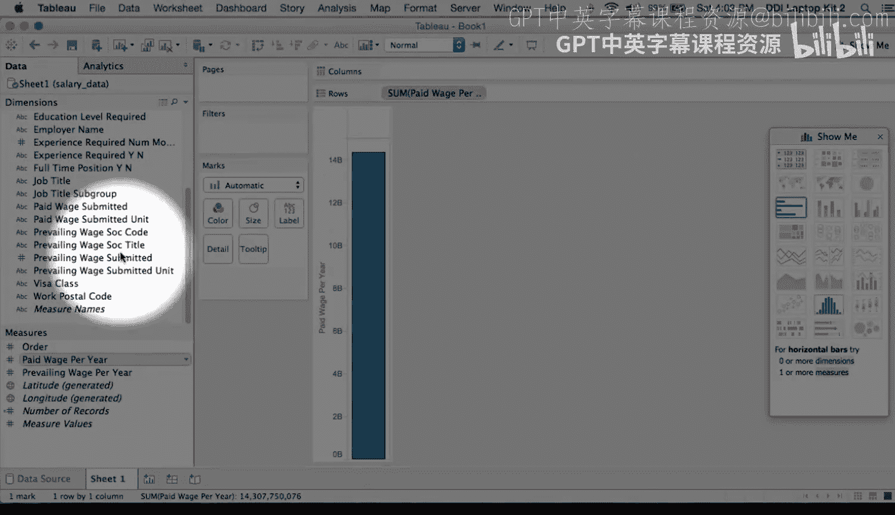

**完成！** 您已经创建了第一个图表。真的就是这么简单快捷，比 Excel 快得多。

---

## 调整聚合方式与解读图表

现在我想引导您注意这个坐标轴。如果您仔细观察，会发现 `paid wage per year` 显示的是数十亿的极高数字。不幸的是，我们在任何数据相关工作中都赚不到数十亿美元。那么这里发生了什么？

为了向您展示，我们需要查看行架子和列架子。我还想向您指出这些蓝色和绿色的小矩形状的东西，Tableau 称之为“药丸”。绿色的代表度量，蓝色的代表维度。这是跟踪 Tableau 如何识别变量的好方法。

现在，在行架子上，您会看到它写着“总和”，然后括号里是 `paid wage per year`。请记住，当我们将这个变量拖到这个架子上时，我们是在告诉 Tableau：我们希望您查看这些数据行，并希望您根据不同的 `job title subgroup` 来拆分它们。但我们必须告诉 Tableau，我们希望它如何处理这些不同亚组内的所有行。目前，它自动认为我们希望将它们相加或求和。实际上，我们想知道的是类似平均值的东西。

要更改这一点，请点击此下拉菜单。您会看到它显示“度量”被处理为“总和”，并且“总和”旁边有勾选。如果我们想将其更改为平均值或中位数，只需点击“平均值”或“中位数”即可。我的偏好始终是中位数，尤其是在您不知道数据分布的情况下。所以让我们选择“中位数”。

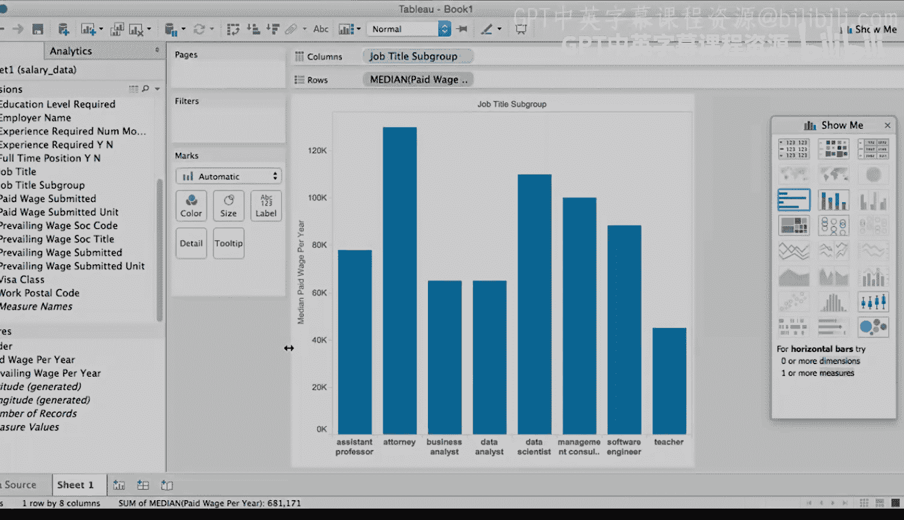

现在再看坐标轴，您会发现数字变成了数万，这更准确，更能代表我们在这些工作中真正能赚到的钱。

---

## 总结

恭喜！🎉 您已经在 Tableau 中制作了第一个图表。

在本节课中，我们一起学习了如何将 Excel 数据连接到 Tableau，检查和调整变量类型，熟悉 Tableau 工作区的基本布局（包括维度、度量、架子和卡片），并通过简单的拖放操作创建了一个条形图。最关键的一步是理解并正确设置聚合方式（例如将默认的“总和”改为“中位数”），以确保图表反映有意义的业务洞察。这个简单的流程是后续所有复杂分析的基础。