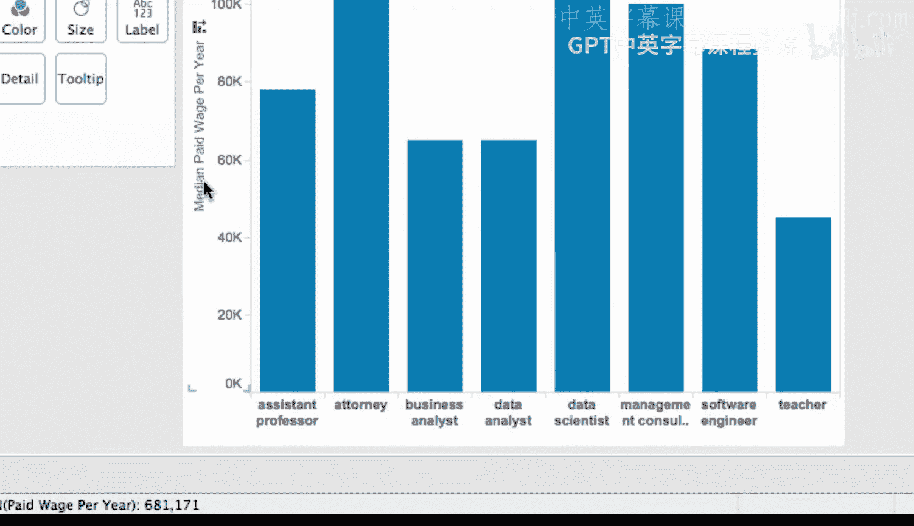
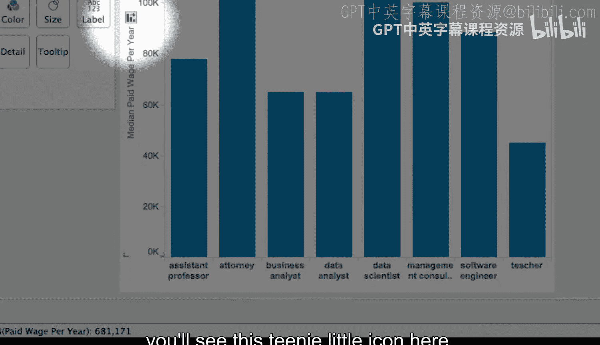
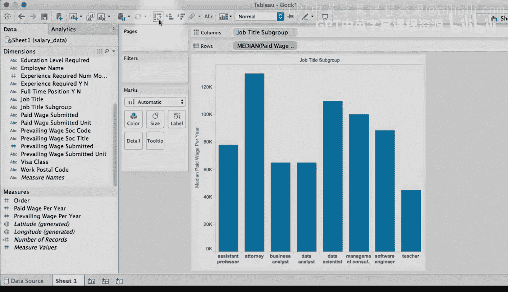
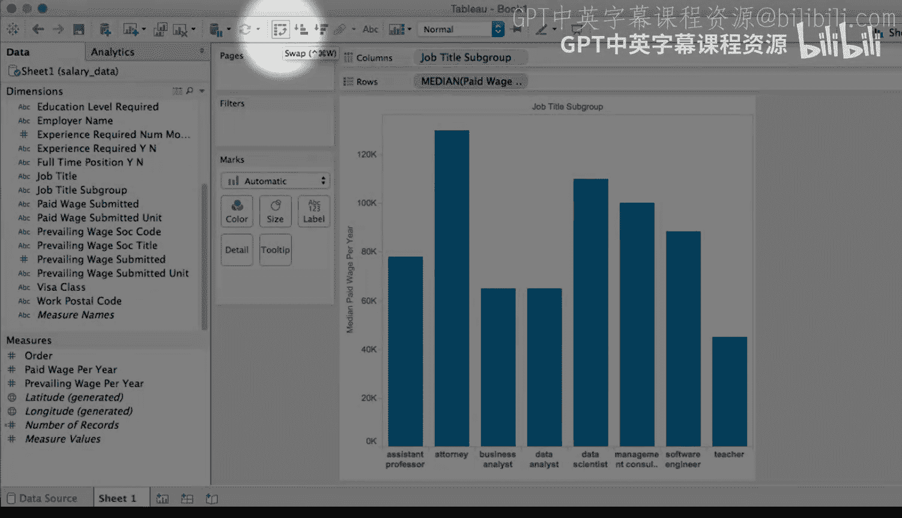
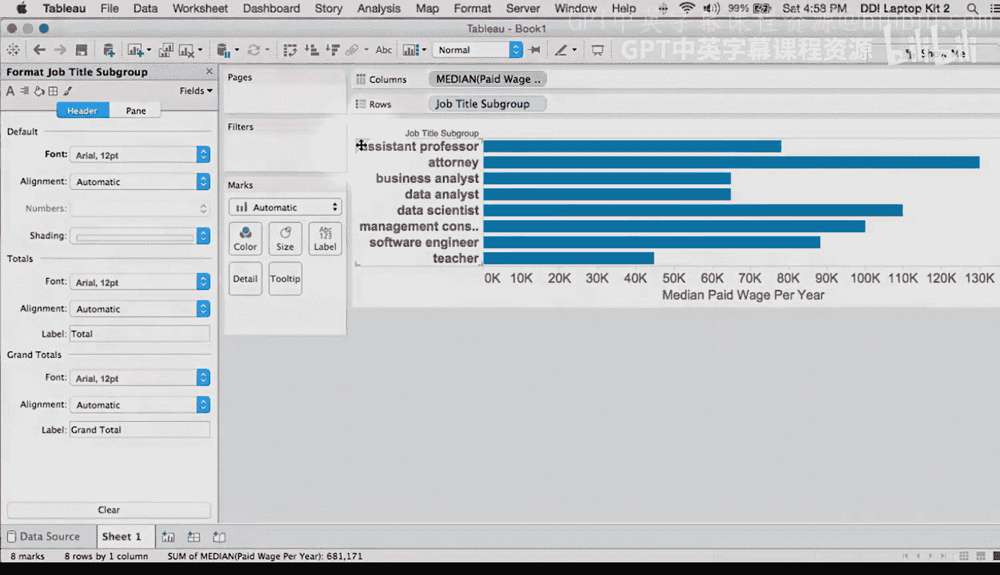
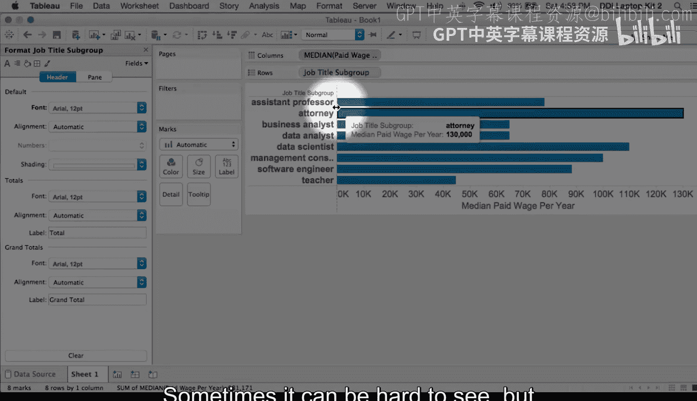
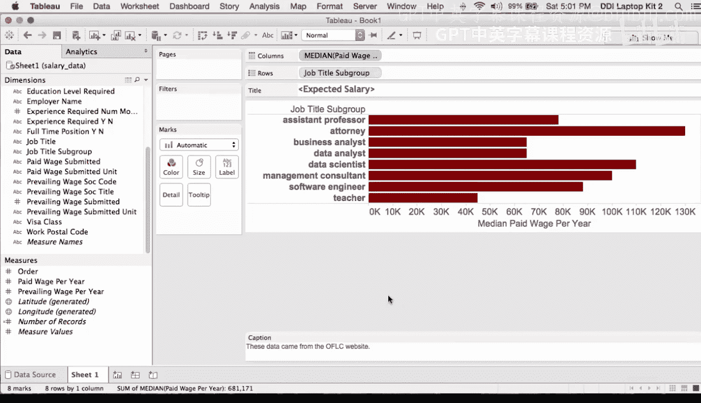
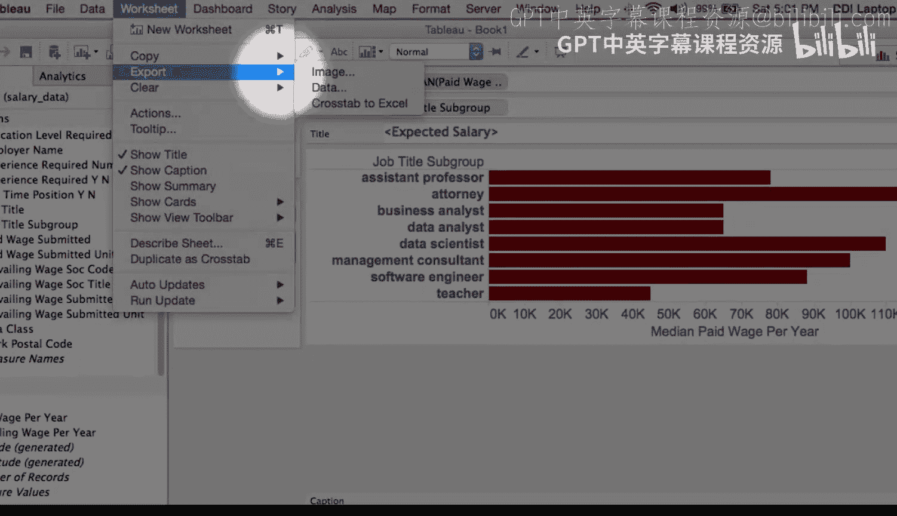
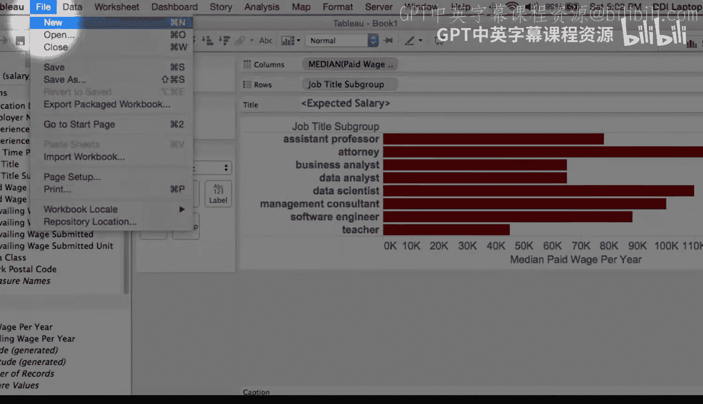
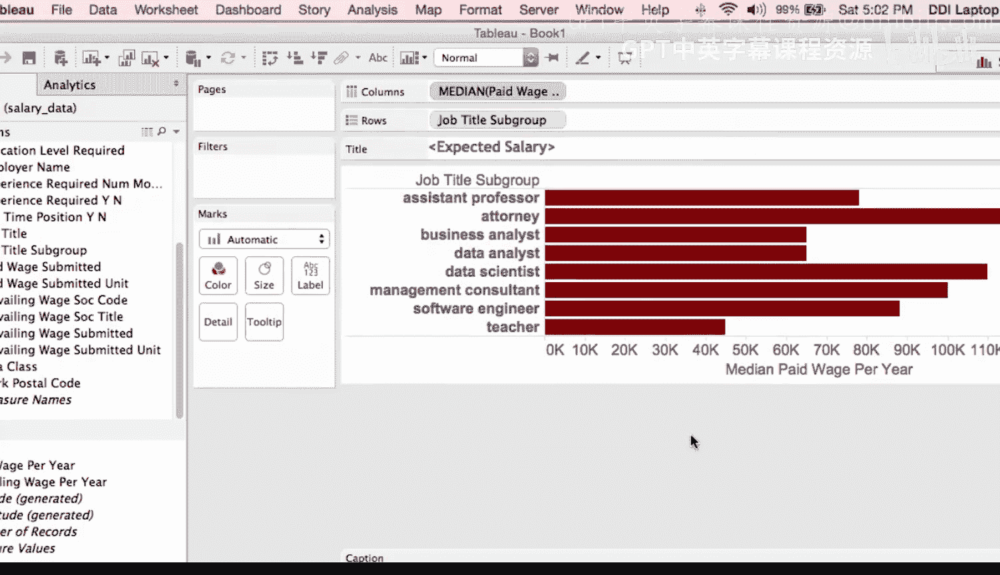

# 杜克大学《Excel 到 MySQL：商业分析（5课全）｜Excel to MySQL： Analytic Techniques for Business》中英 p92 17_03_02_格式化并导出您的第一个图表.zh_en -BV1mS421X7yw_p92-

Hi guys， Before we move on to our next data question。

 I wanted to show you a couple ways you can format your graph in case you wanted to start using Tableau immediately for your own business applications To do that。

 let's go ahead and make the exact same graph we made last time for practice。 So go back to Tableau。

😊，Put paid wage per year in the rows I'm going to double click it to do that and put paid job title subgroup onto columns I'll double click that as well again it's adding over the rows instead of taking the median so we're going to change the aggregation to median。

So this should be exactly what we had before。 Now， the first thing I want to show you is that you might not want these different job title subcategories to be in the exact same order that they are now。

 One quick way to change that is to go or hover over this axis。

 and you'll see this teeny little icon here looks like a little graph with an arrow。

 That's the quick sort button。 If you click it once。

 it will organize your bar so that the bar with the highest value goes first。 If you click it twice。

 itll organize it so that the bar with the highest value goes last。 if you click it three times。

It will go to the original order that you had when you directly from the worksheet Now you might want to change the orientation of these bars to make it easier to read these these labels so it's a vertical bar chart now but perhaps you want to make it into a horizontal bar chart that's actually very easy to do I'll show it to you this time by going up to this little button up here on the toolbar it looks kind of like an upside down L。

You'll see it says swap if you press this， it will instantaneously make it into a horizontal chart。

Now， the next thing you might want to do is you might want to make the text a little bit bigger so this is a little small。

 so you can right click on the axis and clickFor。Now the other way to do this。

 like I alluded to before is you could go up to this format menu choose and choose whatever you want there。

can change the font。Or the size， let's make it 12 can do that for any of these as well。

 again let's make it 12。And as you can see here， sometimes when you make it bigger。

 it might make it harder to see everything at once。

 so if you click on everything that's in this particular box。

 it'll give you the option if you hover over it， sometimes it can be hard to see but this teeny little arrow that goes in both directions。

 if you click that you can move。

And change the size of everything that's in this axis。

 Let's go ahead and change the job title subgroup。Foratting as well。

Now another thing I want to show you is that you can change the color by clicking on the color button within the markx card so we can make it red。

We can also change the size of the bars using the slider this is the or the size button on the marks card so we can make them smaller。

 which will make more white space or larger so there's hardly any white space。

Say do something like that。And you can either add labels by clicking on the label button。

 show mark labels， or not as you like。Now another thing I want to show you is that you might notice here that there's no title on the entire chart that's because the way Tableau works。

 it makes the title whatever the title of your worksheet is if you want to change that you can right click and if you go up to the top of the menu it's not at the very top but right underneath it you'll see that there's an option for title caption and summary。

Let's go ahead and click title Now you'll see there's a title bar here or title shelf and if you double click that you can change what your title is you can see right now it's called Che one so that's what our worksheet is called we can change that title。

Now you won't see the title directly on the worksheet， you'll only see it when you export it。

So we'll see that in just a second。Now we can also add a caption if you're interested。

In case you want to be able to say some， give some extra details to your audience。

 so we might want to say。Again， double click this， we might want to say something like。

G your data source。And now we have。A chart that we might be happy with so you can play around with these different options or are lots of different things you can do。

 but let's say that this is exactly what you want your chart to look like。

 I'm going to show you two different ways you can export this to be able to show it to other people。

 One way to do that is to go to worksheet and click export。

 You can see one of the options here is image。

Click on image。It will give you a couple different options。

 Now here is where you can see the option to either include the title on your image。

 include the caption， or if you have legends， it'll also give you options about where you can put the legend So if you want the caption and the title to be shown on your image when you export it make sure you click these you can see you can unc them or click them So again go ahead and press save。

Navigate to anywhere where you know it will be。Give it a title。And click save。

Now one other way you can do this is a little counterintuitive and that's to save it as a PDF。

 so if you go to fileile， you're actually going to go to print this time。

 even though you're saving it。

Sometimes it can take a little time to come up and make sure that down here in this drop down。

 you're saving it as a PDF。So here again， can it will have defaults about where it's going to save it to。

 go ahead and press print。It will have saved it to your defaults are。

Great job。 So far。 You now know how to open data in Tableau。

 You have a sense of how long it can take to open large data sets。 You know how to make graphs。

 You know how to format them and you know how to export them。

 You are well on your way to becoming a tableableau expert。😊。

