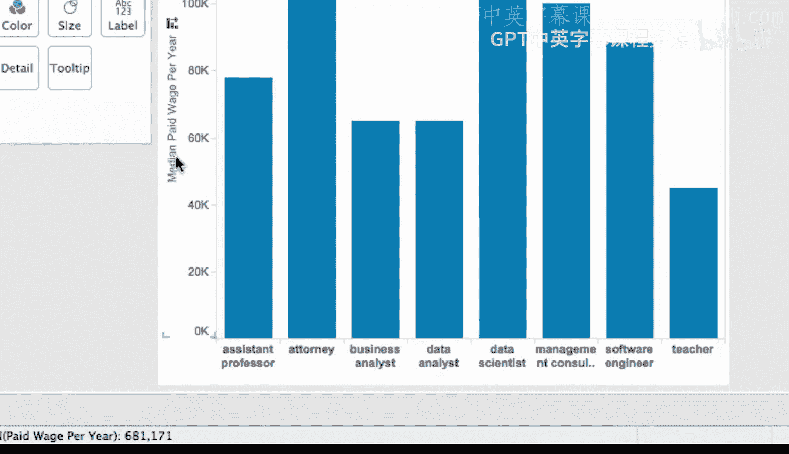
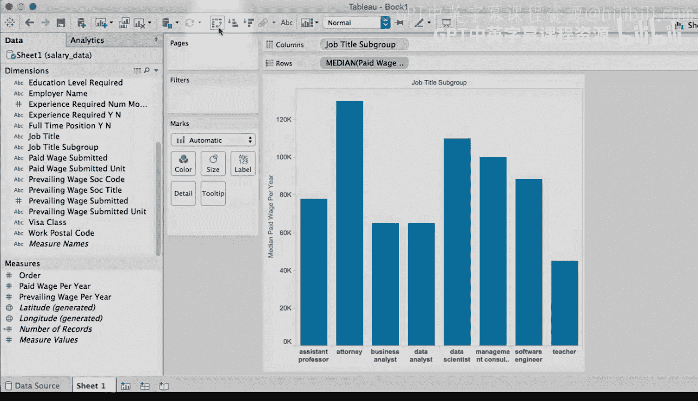
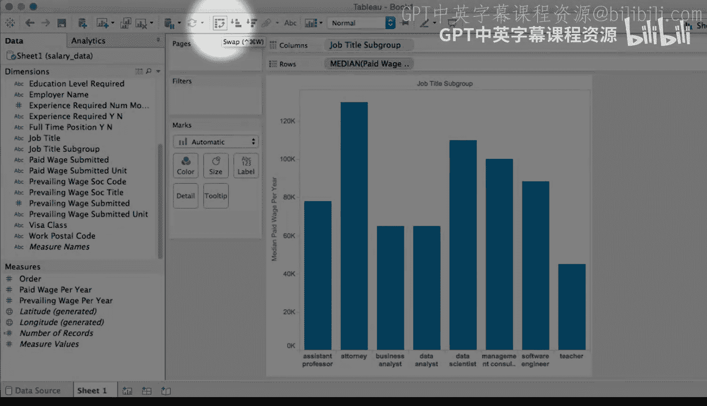
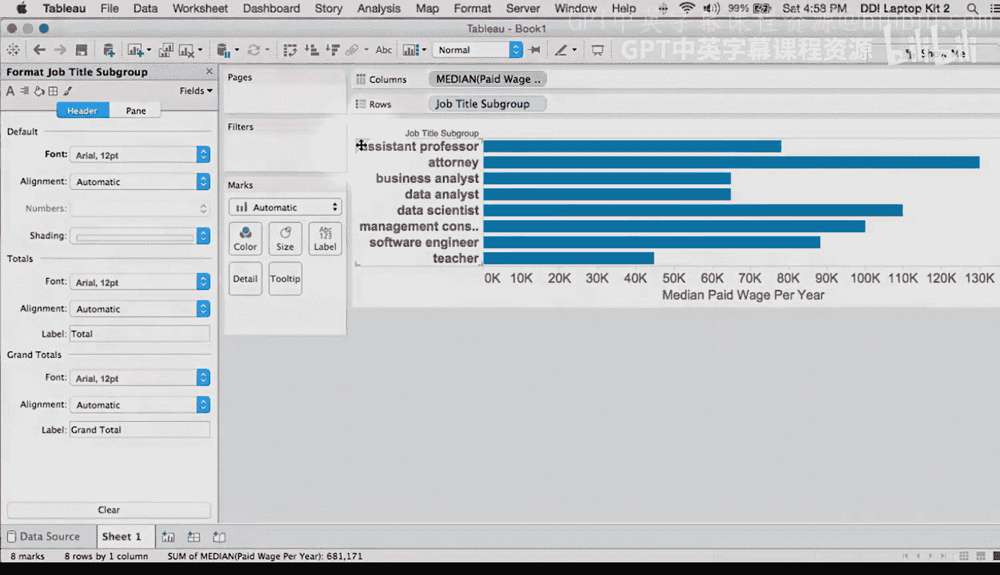
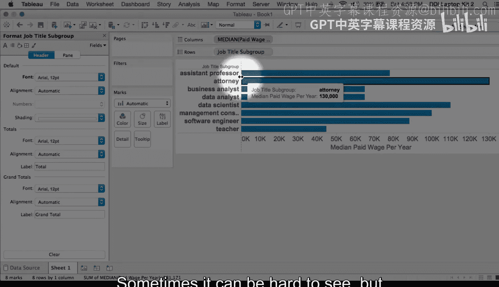
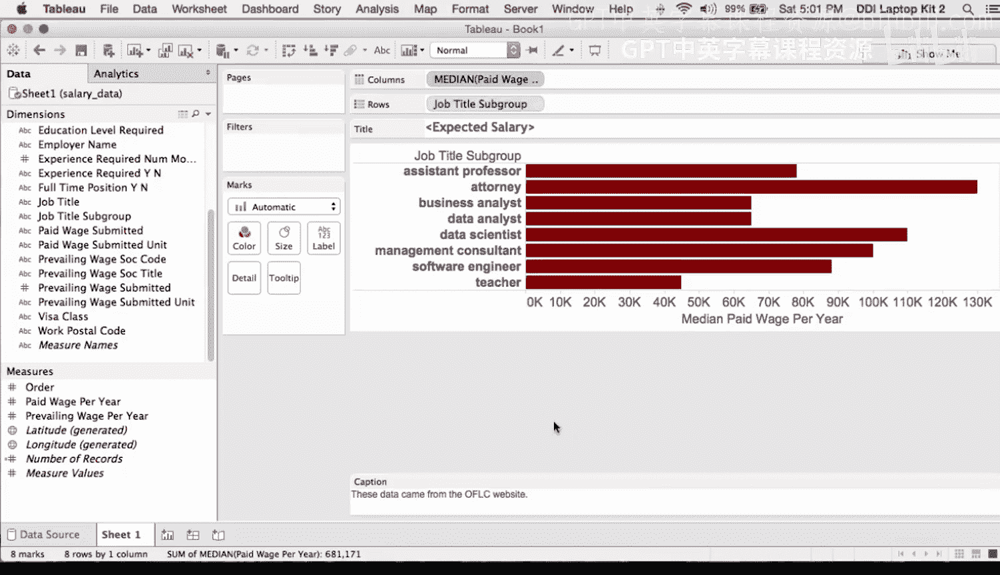
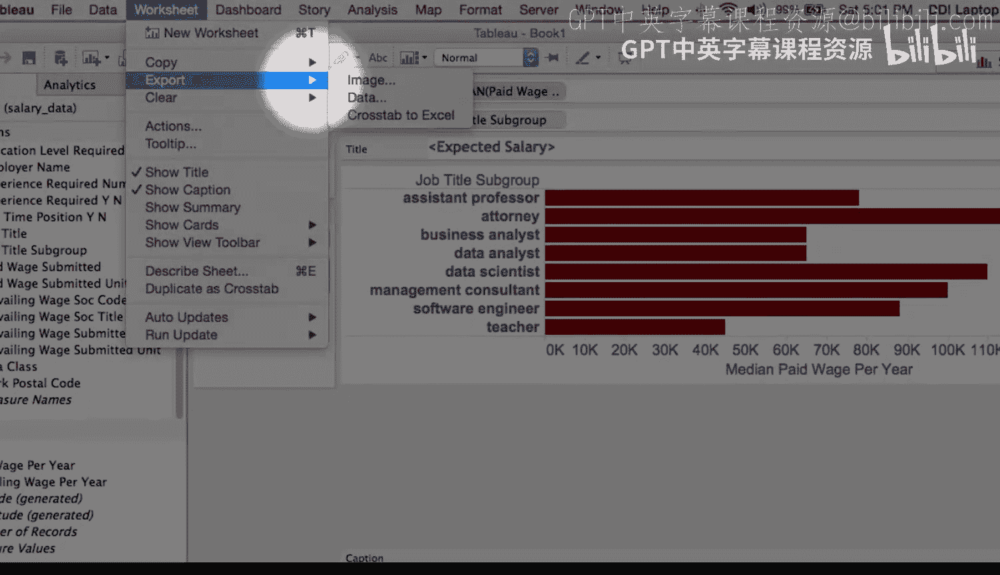
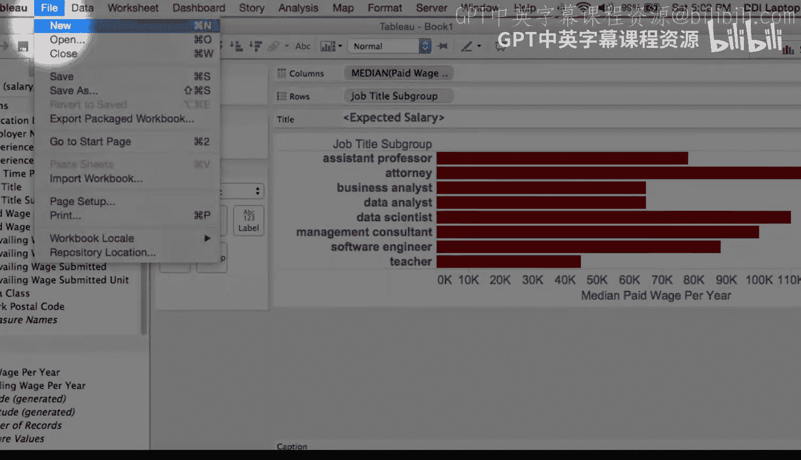
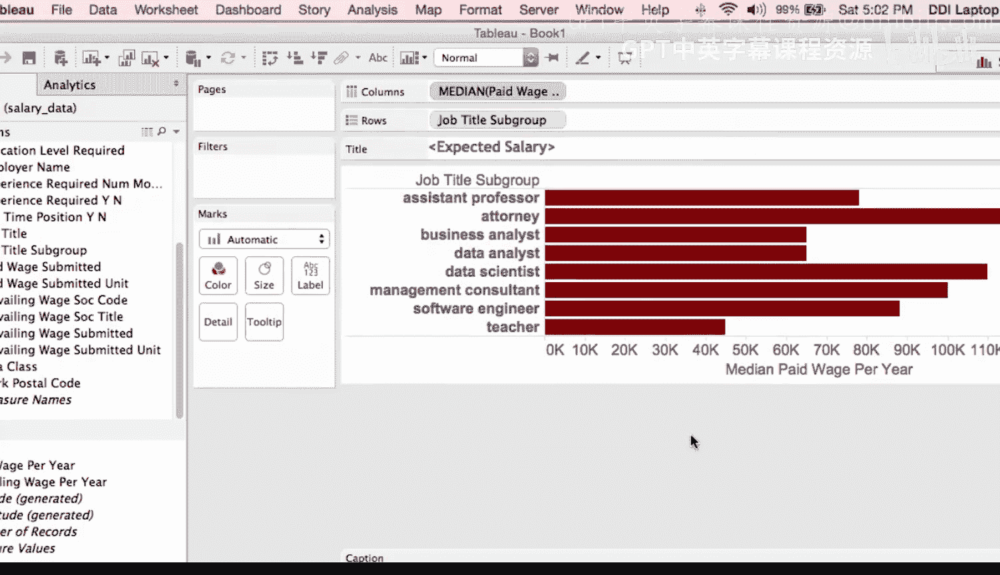

# Tableau 商业分析：第17课：格式化并导出您的第一个图表 📊

在本节课中，我们将学习如何在 Tableau 中格式化图表，使其更美观、更易读，并掌握将最终图表导出为图像或 PDF 文件的方法。这些技能对于将分析结果应用于实际业务场景至关重要。

上一节我们学习了如何创建基本的条形图。本节中，我们来看看如何调整图表的格式以满足展示需求。

## 创建练习图表

首先，我们重新创建上一节练习中使用的图表。
1.  将 `paid wage per year` 字段拖放至“行”功能区。
2.  将 `paid job title subgroup` 字段拖放至“列”功能区。
3.  由于默认聚合方式为求和，需将其更改为中位数。点击“行”功能区上的 `SUM(paid wage per year)` 下拉菜单，选择“度量(合计)” -> “中位数”。

现在，我们得到了与之前完全相同的图表。

## 调整图表排序

您可能不希望子类别按照当前默认顺序排列。一个快速调整排序的方法是使用“快速排序”按钮。
*   将鼠标悬停在横轴（或纵轴，取决于图表方向）上，会看到一个类似带箭头的小图标的按钮。
*   点击一次，条形将按数值从高到低排序。
*   点击两次，条形将按数值从低到高排序。
*   点击三次，将恢复为从工作表直接生成时的原始顺序。

## 更改图表方向

为了便于阅读较长的标签，可以将垂直条形图转换为水平条形图。
*   在工具栏上找到一个类似倒置“L”形状的按钮，其提示为“交换”。
*   点击此按钮，图表将立即变为水平条形图。

## 调整文本格式

图表中的文本可能较小，需要进行调整。有两种主要方法可以修改字体大小。

**方法一：右键菜单**
*   右键点击坐标轴文本。
*   选择“格式”。
*   在侧边出现的格式面板中，可以更改字体、大小等。例如，将大小改为12。

**方法二：顶部菜单**
*   点击顶部菜单栏的“格式”。
*   选择“字体”，然后进行修改。

调整文本大小后，有时所有内容无法完全显示。此时可以调整坐标轴区域的大小。
*   点击包含坐标轴标签的整个区域。
*   将鼠标悬停在边缘，会出现一个双向箭头图标。
*   点击并拖动即可调整该区域的大小。

您可以对“行”功能区的字段标签进行同样的格式调整。

## 自定义颜色与大小

接下来，我们通过“标记”卡自定义图表的外观。
*   **更改颜色**：点击“标记”卡中的“颜色”按钮，可以为条形选择新的颜色，例如红色。
*   **调整条形大小**：使用“标记”卡中的“大小”滑块，可以调整条形的宽度。向左滑动使条形变细（增加空白），向右滑动使条形变粗（减少空白）。
*   **添加数据标签**：点击“标记”卡中的“标签”按钮，并勾选“显示标记标签”，即可在条形上显示具体数值。

## 添加标题与说明

默认情况下，图表使用工作表的名称作为标题。要添加或修改标题：
*   在图表区域的空白处右键点击。
*   在菜单中，选择“标题” -> “编辑标题”。
*   此时会出现标题编辑框，双击即可输入自定义标题，例如“各职位子类别的年薪中位数”。

请注意，在工作表视图下，标题可能不会直接显示，但在导出时会包含。

您还可以添加图注，为观众提供额外信息。
*   右键点击图表区域。
*   选择“标题” -> “编辑说明”。
*   在说明编辑框中，可以输入文字，例如“数据来源：公司人力资源数据库”。

## 导出图表

格式化完成后，有两种主要方式可以将图表导出，以便与他人分享。

**方法一：导出为图像**
*   点击顶部菜单栏的“工作表”。
*   选择“导出” -> “图像”。
*   在弹出的对话框中，可以选择是否在导出的图像中包含标题、说明和图例。
*   确保勾选所需选项后，点击“保存”，选择保存位置并命名文件。

**方法二：打印为PDF**
*   点击顶部菜单栏的“文件”。
*   选择“打印”。
*   在打印设置中，将目标打印机选择为“另存为PDF”。
*   点击“打印”按钮，系统会将其保存为PDF文件到默认位置。

---

本节课中我们一起学习了如何格式化 Tableau 图表，包括调整排序、方向、文本、颜色和大小，以及如何添加标题和说明。最后，我们掌握了两种导出图表（图像和PDF）的方法。现在，您已经掌握了在 Tableau 中打开数据、创建图表、格式化并导出的完整流程，正稳步成为一名 Tableau 分析专家。