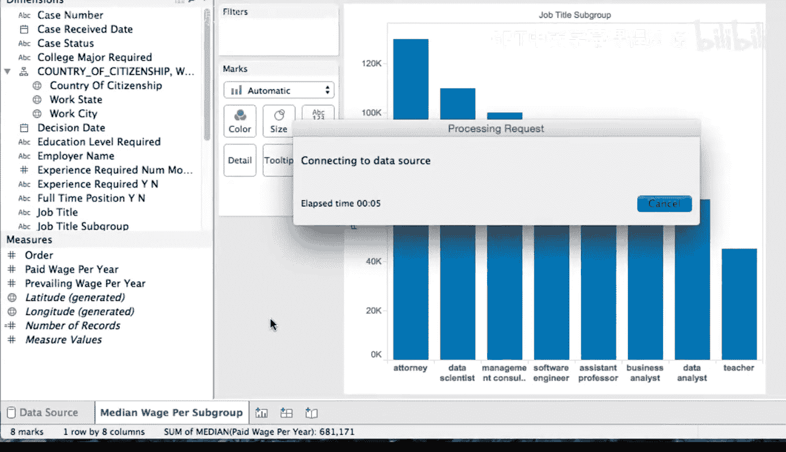
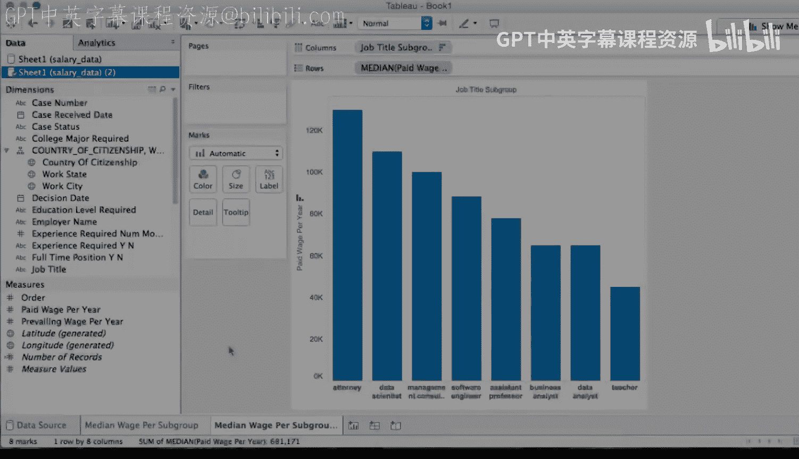
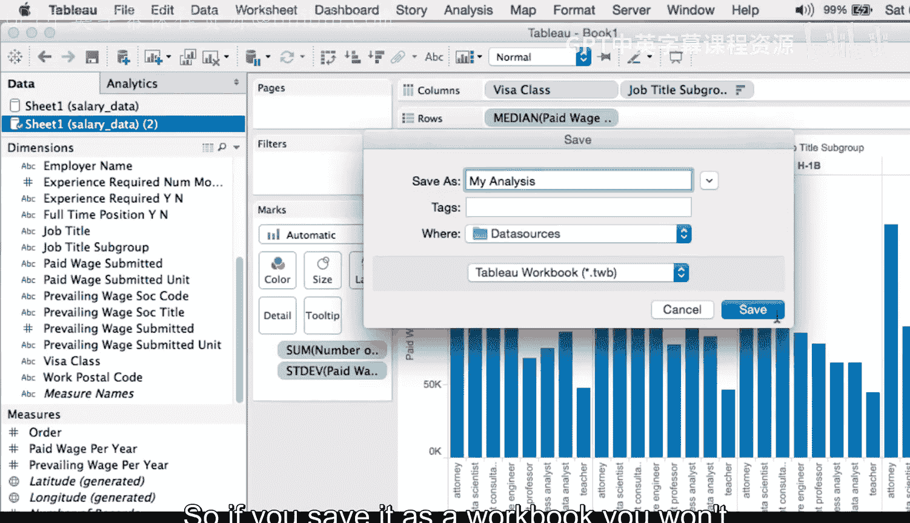

# 杜克大学《Excel 到 MySQL：商业分析（5课全）｜Excel to MySQL： Analytic Techniques for Business》中英 p93 18_03_03_深入探索-使用行与列货架.zh_en -BV1mS421X7yw_p93-

In the last video， we got an idea for how much you might make in different data related fields。

Especially for those of you who live outside of the US。

 Our next question is whether those salaries might change， depending on the visa you apply for。

 It turns out that green cards cost quite a bit more to sponsor than visas。

 So you might first hypothesize that companies will sponsor less green cards than they will sponsor visas。

 On the other hand， because the green cards cost much more。

 Comp might have a higher bar for the people they sponsor with green cards。 Therefore。

 they might also work harder to try to recruit those people。

 So it seems possible that the salaries for people who are sponsored with green cards might be higher in our data set than those who are sponsored with H1 V visas。

Let's test those hypotheses in this video and in the process。

 learn what happens when you put different variables or more than one variable in either the column shelf or the row shelf。

Let's begin by making the same graph we did last time， one last time。 Now。

 this time I'm going to give you one extra tip， since we've already learned how to change the aggregation when it's on the row when a variables on the row shelf。

When you have a variable over here in the variables cards you can click on the drop down and go to default properties here's where you can change the default aggregation so if you go to aggregation you can see that the default aggregation right now is some。

We can make it median。 So now anytime you bring paid wage per year to the rose column。

 it will automatically be median， which will make our life a little easier。

 So let's go ahead and put it on the rose column。 You see it's median。

 Let's put job title subgroup in columns and let's。Order it using the Quick order button。

 so this is basically the same chart we had last time。

I'm going to show you one more thing before we get started， so first of all。

 let's change our sheet name。So let's call this median。W置。For subgroup。

Now we can actually make different worksheets so that you can have multiple different graphs going at the same time。

 so if you right click， say copy sheet。And now go ahead and say pay sheet。

Now because it has to connect to the data source again， sometimes this can take a little bit of time。

But once the query is finished， you will see a duplicate of the worksheet you had before。

So now that we have this graph， let's see what happens or how we would break each one of these subcategories up according to the salaries you would make if you were applying for different visa categories。

 Now the variable that refers to visa categories over here is called visa class So it's actually very simple or the way you would break these bars up into Vi class is actually very simple。

 you drag visa class over behind job title subgroup on the columns bar so you can see immediately it broke up each of the job title subgroups into the different visa classes and also this is a good point to remind you how long this would have taken to do in Excel。

 so this is the power of Tableau how quickly it allows you to look at these types of visualizations Now let me show you what would happen if you change the order of these two different pills if we dragged job title subgroup behind visa class。

Now the main category you see up here is visas class and it breaks each visa class up into job title subgroups。

Now as we examine this data， it looks like the hypotheses probably aren't supported。

 it looks like attorney always makes the most or at least makes a very high amount in most of these these visa subcategories。

 teachers usually make the least it's not obvious that there's a clear pattern between the different visa classes。

 but perhaps you aren't satisfied with that and you want to know your data more you want to find some more details and really make sure you understand it。

Well the first thing you can do is you can hover over each bar and will' actually tell you the exact value of the bar。

 so if it's hard to see from just the axis， you can see here that it says 185。

000 is the median paid wage for an attorney who's applying for an E3 Australian visa。

But you can actually get more details than that， so if you right click。Go to view data。

Now the summary page is what we just saw when we hovered over the bar。

 but if you go to underlying data。It will actually give you the raw data that is used to calculate and compute the median for that particular bar。

 So it has every single field shown。 You can also unclick this to show just specific fields。

 But let's keep all show all fields shown for right now。And as we scroll through。

 we can look to see if there's anything that catches our eye that might be a little weird。

 and one thing you might notice， especially when you get here is that there seems to be a lot of New York listed as the cities that people are applying to work for for this particular visa。

Might begin to wonder， well， is this true for the other attorney classes and other visa classes because if we go back to our chart here you see that this particular bar is particularly high compared to the others。

 so we might want to keep this in the back of our mind for later Now another thing I want you to notice is down here in this corner it shows you how many rows were included in that bar so how many rows in our entire data set werere in the visa class of E3 Australian and were also in the subgroup category of attorney。

You can see when you go back to summary， it's only one row because according to that aggregation。

 the only hand for one row。So this would be one way that you can find out more about the data that's going into each one of these bars。

There are some things that you will likely only pick up by scrolling through the raw data itself。

 but there are other things you might want to know that Tableau can tell you in a much quicker way。

 For example， there's a quicker way to know how many items go into each bar。

 Look at what happens when you put the number of records into the rope onto the row shelf。

 numberumber of records is a measure that Tableau automatically makes for you。

If we put it behind median of the paid wage on rows。You can see that down here， first of all。

 it automatically makes another graph right underneath the visa class。

 and this gives you the number of records in each one of these bars。

 So if you hover over one of these bars， it'll tell you exactly how many records went into this particular bar。

 Now， an interesting feature of tableableau is that once you have these variables in your workspace。

 it will put that information in the what they call the tooltip。

 which is the information you get when you hover over the data point。

 So you can see now that just because we made this graph with number of records。

You now see the number of records when you hover over this particular bar。

In the paid wage per year graph， so there's another way to do this to get this information on the tooltip。

 even if you don't want to make the number of records on the graph itself。

So to show you how to do this， first of all， let's take this off of the graph and we do that simply by taking it off the shelf。

And instead， we're going to put number of records on this icon here， which is the detail。

They call it the property， looks like a button to me。

 but they call it the property of the markx card， so we put numbers of records on the detail。

Now you can see here that the pill is in the Marx card。

 but they didn't make any type of graph on the worksheet， however。

 when you hover over each one of these bars now the number of records is included in the toolt。

So the De button is a way that you can use the markx card to include more details in your graph。

 We'll come back to this later， this is a good preview of how the Marx card works and how it can do some interesting and weird things in addition to just changing the formatting of your graph。

Now， what if you want to get a quick sense about how variable the salaries are within each category。

 because that might give you an idea of how reliable each one of these medians are。

 One way to do that would be to use a standard deviation calculation。

 The standard deviation is a measure of the spread of the values within a certain variable。

Any idea how to do that， this is going to be a little tricky you would have had to pay very close attention to something I didn't point out in previous videos。

Okay， the way to do this is to use a different type of aggregation over paid wage per year。

 So go ahead and drag paid wage per year to row。 And this time。

 change the aggregation to standard deviation。Now， there are two different types of standard deviation that you're going to see here。

 There is the standard deviation that has in parentheses PP that stands for population。

 This is the population standard deviation。 And you can use this in two different cases。

 I'm not going to go through the math here of how the standard deviation is calculated。 by the way。

 I'm just going to tell you which one you would use to report the dispersion of the data in different circumstances。

 So the population standard deviation is used when you either have a really。

 really large sample of the general population that you think represents the general population very well。

 or when you don't care if the sample you have relates to general population So if all you want to do is describe your specific data and you don't care how that relates to other datasets。

 you can use the population standard deviation。If on the other hand。

 you want to interpret your data as if it does represent the general population。

 and you think that you probably have some type of bias sample or it may not be the perfect representation of the general population。

 then you use the standard deviation， the normal one。

 so that's the one we're going to use here because we want to interpret our data as if it would apply to us。

 even though we know we are not in this data set。So let's go ahead and click on that。

So now you see here that we have the standard deviation for each one of these bars in this plot underneath it。

Now， in terms of interpretation， I told you before that the standard deviation represents the spread of the values within each one of these bars up here。

So if the standard deviation is really large， like in these cases here。

That usually means something is up。 In other words。

 it probably means you have some extreme outliers in your data。 Outliers of values that are very。

 very different from the rest of your data。 They're usually much larger or much smaller。

 I've posted a link to a great video online that will show you how even one outlier in your data set can really affect。

 especially your average values and your standard deviation values。 In the meantime。

 let's take these standard deviation plots as a warning signal that we might have outliers in our data。

 And so let's add check for outliers to our analysis plan。

Since these outliers might influence many other aspects of our analysis。

 we'll want to address these outliers or their possibility very soon。

Now I'd like to show you two last things before we finish this video。

The first is a reminder about how we can take this graph off and still get the information in the toolt。

 One way to do that is what I showed you before， you can simply take this pill off and then move the paid weight per year to the detail and change the aggregation again。

 but that takes a lot of steps one way you can do that faster is if you press the shift key。

 you can move this pill directly to the detail bar。So now the graph is gone。

 but if you hover over each bar， you will see that standard deviation of paid wage per year is in the tool tip。

 so that's an easy way to get more information quickly。

The last thing I wanted to show you is that there's one other way you can save your data without exporting it that's very useful so we don't have to make the graphs each time。

 go ahead and go to file and save as。And this time。

 save it as a Tableau workbook and save it in someplace that you'll know where to find it。

So if you save it as a workbook。You won't have to make the charts each time。

 so this will be useful for later。

Great job。We learned a couple things today。 First of all。

 we learned from our data analysis that the type of visa you apply for probably doesn't affect the salary we make in these different job subcategories。

 So as we move forward with our analysis， we aren't going to worry about Vi class any more。

In analyzing this， we also learned about Tableau， we learned what happens when you put multiple different variables in either the column shelf or the row shelf。

We also learned about how you can use tool tipss to get more information about the data you're looking at。

