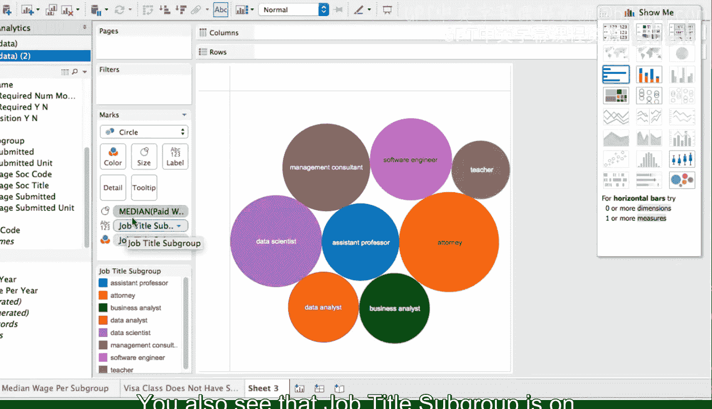
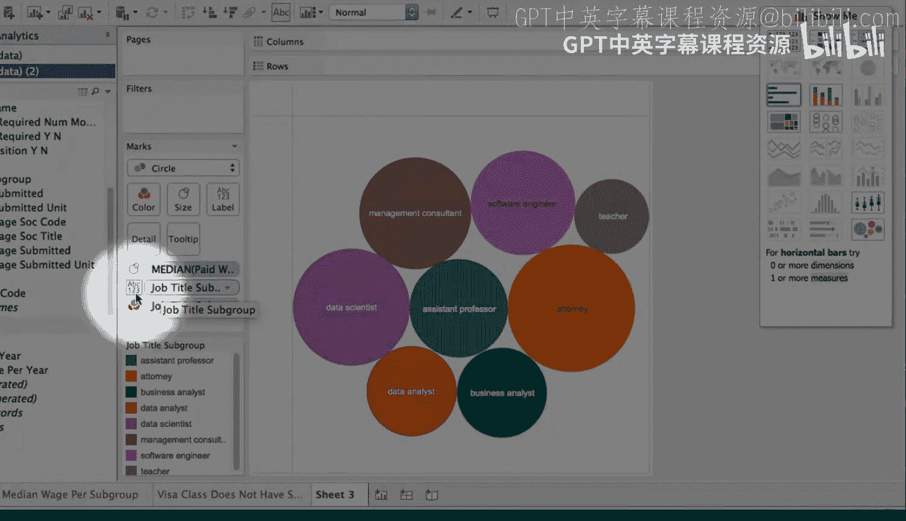
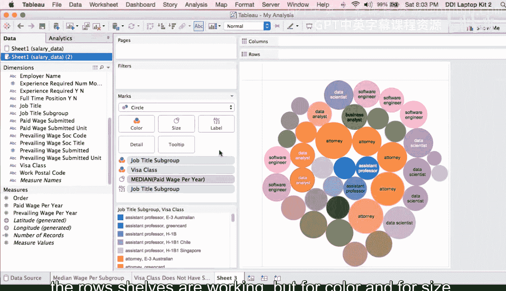

# 杜克大学《Excel 到 MySQL：商业分析（5课全）｜Excel to MySQL： Analytic Techniques for Business》中英 p94 19_03_01_理解标记卡.zh_en -BV1mS421X7yw_p94-

This lesson is going to be entirely dedicated to the Mars cardt。

We've used the marks card twice so far in this course。

 The first time we used it to change the formatting in our bar graph。

 And the second time we used it to change the level of detail that we could see at the tool tip the tool tip when we hovered over a bar。

😊，I think that gives you an idea of how wide the functions of the Marx card can be。

 The functionality of the Marx card is actually a pretty hard thing to explain。

 I think it was originally designed to do simple things， like formatting。But over time。

 as Tableau has gotten more and more sophisticated。

 it seems like the computer programmers have pretty much co opted the Marx card to handle pretty much everything that they couldn't figure out how to put in either the columns or the row shelf。

As a consequence， it does some very cool things， but those things can also be kind of unintuitive。

I think it's fair to say that the Marx card generally has two overall functions。First of all。

 any time you have a graph that's going to use area to represent something like a pie chart。

 say or a bubble chart， the markx card lets you define what variable will be associated with that area。

The other thing the Marx card does in general is what I mentioned before。

 It's pretty much the way you define anything that you can't define in either the rows or the columns。

Now， in this video， we're going to use a type of visualization that I don't recommend you use most of the time。

But we're going to use it to answer the same questions we did in the last video。

 and we're going to use it just so that you get a good feeling of how the Marx card works。

Once you do that， and once you feel comfortable with it。

 it will give you a good intuition for the weirder things and more sophisticated things will'll do in later videos。

😊，So let's get started。

So for this demonstration， I want you to go ahead and open up the Tableau file you made last time and make a new worksheet we probably won't save the worksheet this time。

 but we're going to use it to explore。So let's start by making the graph we've made every time paid wage per year on rows and job title subgroup on columns。

 Now， this is our bar chart from before。 First thing I want to do is show you how we would make this into a bubble chart。

 So if you go to this show me card here。 go all the way down to the bottom and you'll see this packed bubble chart。

 click on that。And you'll see that now the exact same data that before was represented in the bar chart is now shown in this bubble chart。

So the size of each one of these bubbles represents the length of the bar that we saw before。Now。

 I want to point out a couple interesting things to you。 First of all。

 you will see that there are no pills left on either the column shelf or the row shelf。

Now they are all on the Marx card， and that's why I'm using this particular visualization to help us understand how the Marx card works。

Now you'll see that median paid wage per year on has this icon next to it。

 which means that it's being coded by size。 That's how you know the size of each one of these bubbles represents the median paid wage for that particular category。

NowYou also see that jobb title subgroup is on the marks card in two different places。

 it's here with an icon on the label icon left to the left of it。

 which means that the job title subgroup is being used for the labels on these bubbles。

 but it's also being used to color code for color， that's why it has here again with color associated next to it。

So to give you a sense of how this will work。Let's see what happens if we take job title subgroup off of the color property in the marks card。

 So just pull it off。Now， you see that although the labels for each of the subcategories still remain。

All the bubbles are one color。Now， let's take a guess。

 Do You have any idea what would happen if I take job title subgroup off of the marks card as well。

Let's see。There it's a little bit of a trick question。

 What this is showing you is showing you the median paid wage of the entire dataset because there's nothing else on this workspace that's dividing the dataset up into anything else。

 So this is the median paid wage for the entire worksheet。

 Let's start all over again and see if we can recreate that bubble chart from scratch to start all over use this icon I showed you before。

 This is the clear this clear sheet icon that will completely clear our worksheet。

So let's see if we can this out。 Let's start by putting paid wage per year and row again。

 And now let's put job title subgroup on color because that should color code things。

 a color code the data， according to the job title subgroups。Now。

 why doesn't this look like the bubble chart from before。

 It does seem to code job title subgroup by color， but it's not making it into a bubble chart。

 That's because as long as the paid wage per year is here on the rows。 It's not being coded by area。

 And the point of a bubble chart is that it's coding that variable by area。

 So the way to change that would be to move this variable down to size。 Now， to do this。

 you have to use that trick I told you before。 make sure you press shift and hold it down。

 and that will allow you to drag this pill directly onto the size property。Of the Mars card。Now。

 this is interesting。 Now it seems to bes get rid of the showmi card so you can see this。

 Now it seems to be color coding each job title subgroup by size。

 So you can see this is the biggest one， that's 130000。 This one's 110000。 But why is it in squares。

 Why does it seem to be represented by squares in this they call it tree chart as opposed to a bubble chart。

 That's because the marks are being coded by squares right now。

 So this if you click on this dropdown， it'll give you lots of different types of marks you can have。

 And I would say that each one of these marks does something a little different。

 So not all these marks are created equally。 This is an example of where it seems like a lot of different functionalities were kind of dumped in one place。

 even though they aren't all the same thing。But the easy way to change this square tree chart into a bubble chart is to change the marks to circle instead of square。

 so click on circle and now you see that we have something very similar to what we had before to completely get it to be the same thing we have to go to job titlele subgroup and also put it on the label property of the Mars card。

And now this recreates exactly what we saw before， you can see that job title subgroup is both on the color property and the label property。

 and the median paid wage is coded by size with a circle mark。So let's do one more exercise。

 Let's combine what we learned from our last video with what we learned from this video。

When we put visa class onto columns。We will now make。5 different types of bubble charts。

 each for a different visa glass。What do you think would happen if I put Lisa class on the color。

 Any ideas。Okay， let's see what would happen。 So go ahead and drag besa glass directly under color。

So now， since there's nothing in the columns or row shelf breaking up all of the data course。

 according to Vis class， it's only being broken up according to color。

 And you can see now that job title subgroup got booted off of color。

 That's because only one variable can be on color at the same time。

 at least in this standard way of doing things。 So this chart is coding visa class by color。

It's coding the paid wage per year by the size of the bubble。

 and it's coding the job title subgroup by the labels。

Now you might notice that Tableau automatically keeps labels off if they are too large to fit in the area。

 that's one of the downsides of area charts， by the way。

 in addition to the fact that it's harder to just be able to detect the difference between different areas。

 it also makes it harder to make sure the labels stay on there。

 you can do your best to try to fix that by selecting all of the data。

And then right clicking and go to mark label and click always show。

So now all the labels will stay on there， even if they're run into each other。Now。

 I'd like to do one more exercise to show us in a little more depth exactly what the Marx card can do。

So last time we took Vi class and we dragged it directly onto color。 right。

 So we got something like this。 This time， I want you to press shift。

And then drag Via class down to color。Now， you see something very， very different。It's very pretty。

 You see lots of these colors， but it's not immediately apparent what all of these colors are。

 So the way to figure that out is to go down to the legend。 And if you scroll up and down。

 you see that what tableableau did is it made one colored or general class of colors for each job title subgroup。

 and then it made a different shade of that color for each of the visa classes。

 So all the blues represent assistant professors， and each of the visa classes has a different shade of blue within that。

Now， if you take a look at this， even for just a second or two。

 you can start to see why this does not convey information very well。 And it also is confusing。

 because normally， if you have a color bar kind of like this。

 or you have different shades of a color。 it usually represents a continuous variable。

 whereas in this case， tableableau is using it to represent a categorical variable。

 So this chart is pretty much as bad as it comes in terms of visualization practices。 That said。

 we used it because it gives you a good idea of how the Marx card works。 Basically。

 it's working as the columns on the row shelves are working， but for color and for size。

Now， I just wanted to take a moment to give you some quick commentary。

I just showed you an example where I said over and over again that the visualization we made was not a visualization made with best practices。

 I also realized I told you at the beginning of the course that Tableau was designed to only allow best practices。

 So I realize there's a conflict there。 that's because I'm giving Tableau the benefit of the doubt。

 When Tableau was designed。 It was designed with the intention of not allowing anyone to implement something that was not good for communicating information。

 Well Tableau has gotten so popular that it's kind of caved under pressure from its customers。

 Custom have asked more and more of Tableau and asked them to allow them to do things。

 even if Tableau knows or the people who create Tableau know it's not good for communicating information。

 And they do have to do what their customers say。 So here's an example or what the example I just showed you as an example of how it can be hard to get to this kind of pretty but not very useful visualization。

 but Tableau does still allow you to do it。 So they're still trying to only let you use best practices。

 but they have to。Do what their customers say， so this is what happened。

I hope this set of exercises has given you a good intuition for how the Marx card can work and how powerful it can be。

 This will be very useful for later on in the course when we do some more complicated and sophisticated things with the Marx card。

😊。