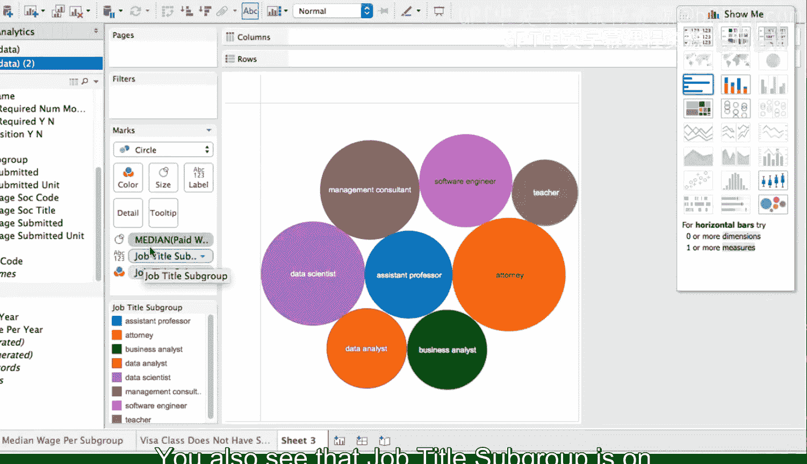
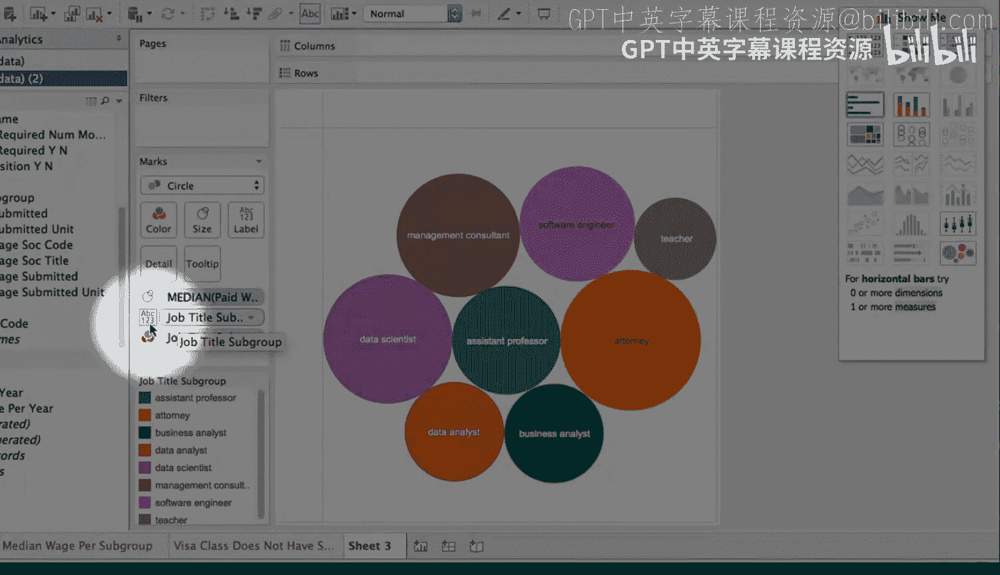
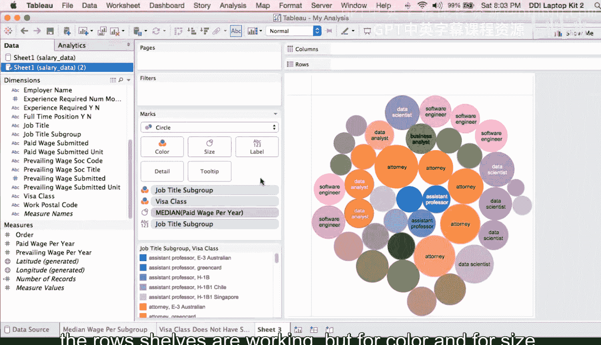

# Tableau 数据可视化：第 19 章：理解标记卡 📊

在本节课中，我们将深入学习 Tableau 中的“标记卡”。我们将通过创建和修改气泡图等图表，来探索标记卡如何控制图表的外观、颜色、大小和标签。理解标记卡是掌握 Tableau 高级可视化功能的关键。

---

## 标记卡简介

上一节我们介绍了如何构建基本图表。本节中，我们来看看 Tableau 界面中一个功能强大但可能有些复杂的部分——标记卡。

到目前为止，我们在本课程中已经使用过两次标记卡。第一次是用它来更改条形图的格式。第二次是用它来更改当鼠标悬停在条形上时，工具提示中显示的详细信息级别。这让你对标记卡功能的广泛性有了一定了解。

标记卡的功能实际上很难一言以蔽之。它最初可能被设计用于处理简单的格式设置。但随着 Tableau 变得越来越复杂，程序员似乎将许多无法放入“列”或“行”功能区处理的功能都整合到了标记卡中。因此，它能实现一些非常酷的效果，但这些效果有时可能不太直观。

可以说，标记卡通常有两个主要功能。首先，在任何使用面积来表示数据的图表中（例如饼图或气泡图），标记卡允许你定义哪个变量与这个面积相关联。其次，标记卡通常用于定义所有无法在“行”或“列”功能区中定义的内容。

在本视频中，我们将使用一种我不太推荐经常使用的可视化类型。但我们将用它来回答与上一个视频相同的问题，目的是让你更好地理解标记卡的工作原理。一旦你熟悉了它，就能更好地理解后续视频中我们将要做的更奇特、更复杂的操作。

---

## 创建气泡图

让我们开始实践。请打开上次创建的 Tableau 文件，并新建一个工作表。我们可能不会保存这个工作表，但会用它来进行探索。

首先，我们创建之前做过的图表：将“年薪中位数”放在行上，将“职位子组”放在列上。这是我们之前的条形图。

接下来，我将展示如何将其转换为气泡图。请找到“显示卡”，滚动到底部，你会看到“填充气泡图”选项，点击它。现在，之前用条形表示的相同数据，在这个气泡图中以气泡大小来呈现。

这里有几个有趣的地方需要注意。首先，你会看到“列”和“行”功能区上没有任何字段了。它们现在都位于标记卡上。这就是为什么我使用这种特定的可视化来帮助我们理解标记卡的工作原理。

你会看到“年薪中位数”旁边有一个尺寸图标，这表示它正通过尺寸进行编码。这就是为什么每个气泡的大小代表了该特定类别的年薪中位数。同时，“职位子组”出现在标记卡的两个不同位置：它既在标签属性上（左侧有标签图标），也在颜色属性上（旁边有颜色图标）。这意味着“职位子组”被用于这些气泡的标签，同时也用于颜色编码。

---

## 探索标记卡属性

为了让你感受这是如何工作的，我们来看看如果从标记卡的颜色属性中移除“职位子组”会发生什么。只需将其拖走。现在，虽然每个子类别的标签仍然保留，但所有气泡都变成了同一种颜色。

现在，让我们猜一下，如果我将“职位子组”也从标记卡上完全移除，会发生什么？让我们看看。这有点像一个陷阱问题。现在图表显示的是整个数据集的年薪中位数，因为工作区中没有其他任何东西将数据集划分开来。所以，这是整个工作表的年薪中位数。

让我们从头开始，看看是否能从零开始重新创建那个气泡图。使用我之前展示过的“清除工作表”图标，它会完全清空我们的工作表。

让我们尝试一下。首先，再次将“年薪中位数”放到行上。现在，将“职位子组”放到颜色上，因为这应该会按颜色对数据进行编码。为什么这看起来不像之前的气泡图？它似乎确实按颜色编码了“职位子组”，但没有将其变成气泡图。这是因为只要“年薪中位数”还在行上，它就不是通过面积进行编码的。而气泡图的要点正是通过面积来编码那个变量。

改变这一点的方法是将这个变量移动到“大小”属性上。要做到这一点，你必须使用我之前告诉你的技巧：按住 `Shift` 键，然后拖动这个字段直接放到标记卡的“大小”属性上。

现在这很有趣。它似乎按大小对每个“职位子组”进行颜色编码。你可以看到最大的那个是130000，这个是110000。但为什么是方块？为什么它看起来像是用方块表示的？这是因为当前的标记被编码为方块。如果你点击这个下拉菜单，它会提供许多不同类型的标记。每种标记的功能略有不同，并非所有标记都是平等的。这似乎是许多不同功能被集中在一个地方的例子，尽管它们并不完全相同。

将这个方块树状图变成气泡图的简单方法是将标记从“方形”改为“圆形”。点击“圆形”，现在你会看到我们得到了与之前非常相似的东西。为了完全重现，我们必须将“职位子组”也放到标记卡的“标签”属性上。现在，这就完全重现了我们之前看到的内容：你可以看到“职位子组”同时位于颜色属性和标签属性上，而“年薪中位数”则通过圆形标记的大小进行编码。

---

## 结合多变量分析

让我们再做一次练习，将我们从上一个视频学到的内容与这个视频的内容结合起来。

当我们将“签证类别”放到列上时，我们现在将制作5种不同类型的气泡图，每种对应一个不同的签证类别。你认为如果我把“签证类别”放到颜色上会发生什么？让我们看看会发生什么。将“签证类别”直接拖到颜色属性下。

现在，由于列或行功能区上没有其他东西根据“签证类别”来划分所有数据，数据只根据颜色进行划分。你可以看到“职位子组”被从颜色属性上挤掉了。这是因为至少在这种标准操作方式下，同一时间只能有一个变量在颜色属性上。所以，这个图表通过颜色编码“签证类别”，通过气泡大小编码“年薪中位数”，并通过标签编码“职位子组”。

你可能会注意到，如果标签太大而无法在区域内显示，Tableau 会自动将其关闭。这是面积图的缺点之一：除了更难检测不同面积之间的差异外，还更难确保标签始终显示。你可以通过选择所有数据，然后右键单击，进入“标记标签”并点击“始终显示”来尽力修复这个问题。

---

## 深入探索标记卡功能

我想再做一次练习，更深入地展示标记卡的功能。

上次，我们直接将“签证类别”拖到颜色上，得到了类似这样的图表。这次，请按住 `Shift` 键，然后将“签证类别”拖到颜色属性上。现在，你会看到非常不同的东西。它看起来很漂亮，有很多颜色，但不太清楚所有这些颜色代表什么。

要弄清楚这一点，可以查看图例。如果你上下滚动，你会看到 Tableau 为每个“职位子组”创建了一类颜色，然后为每个“签证类别”创建了该类颜色的不同深浅。例如，所有蓝色代表助理教授，而每个签证类别在该蓝色系中都有不同的深浅。

即使只看一两秒，你也能开始明白为什么这种表示方式传达信息的效果不佳，而且容易造成混淆。因为通常，如果你有一个像这样的颜色条，或者一种颜色的不同深浅，它通常代表一个连续变量，而在这里，Tableau 用它来代表一个分类变量。因此，就可视化实践而言，这个图表可以说是相当糟糕的。

尽管如此，我们使用它是因为它能让你很好地理解标记卡的工作原理。基本上，它就像“列”和“行”功能区一样工作，但针对的是颜色和大小。

---

## 关于可视化最佳实践的说明

刚才我反复展示了一个例子，并说我们制作的可视化并不符合最佳实践。我也意识到，在课程开始时我曾说过 Tableau 被设计为只允许最佳实践。我意识到这里存在矛盾。这是因为我在给 Tableau 留有余地。

Tableau 在设计时，其初衷是不允许任何人实施不利于信息传达的内容。然而，随着 Tableau 越来越受欢迎，它在客户的压力下做出了一些妥协。客户对 Tableau 的要求越来越多，要求允许他们做一些事情，即使 Tableau 的创建者知道这对信息传达无益。他们必须听从客户的意见。所以，我刚才展示的例子就是一个例证，说明了如何可能做出这种美观但不太有用的可视化，而 Tableau 仍然允许你这样做。他们仍在努力引导用户使用最佳实践，但也不得不满足客户的需求。

---

## 总结

本节课中，我们一起学习了 Tableau 中标记卡的核心功能。我们通过创建气泡图，探索了如何利用标记卡控制数据的视觉编码方式，包括颜色、大小、标签和标记类型。我们了解到，标记卡是一个多功能区域，用于处理所有无法在“行”或“列”功能区定义的可视化属性。虽然强大的功能允许创建复杂的图表，但我们必须始终牢记可视化最佳实践，以确保图表能清晰、有效地传达信息。对标记卡的深入理解，将为我们后续学习更复杂和高级的 Tableau 技巧打下坚实的基础。