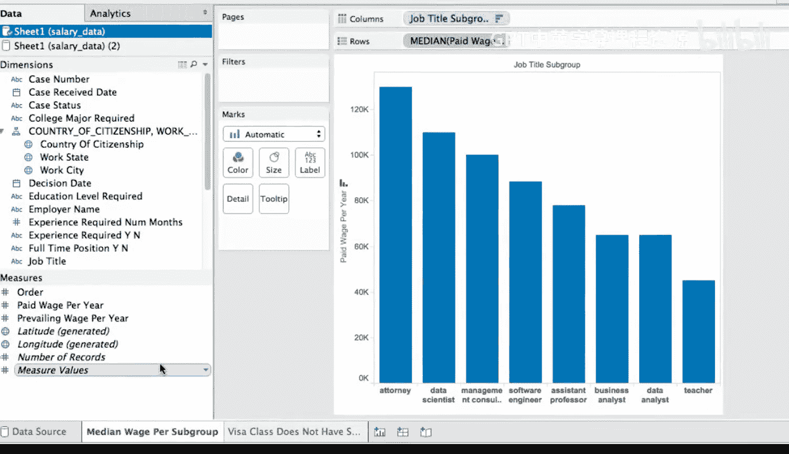
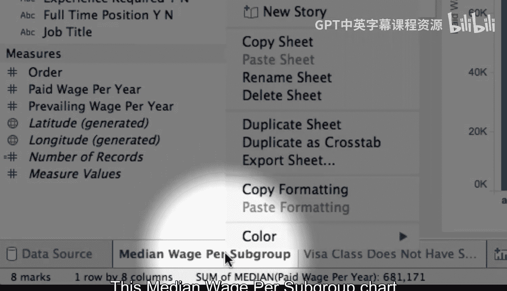
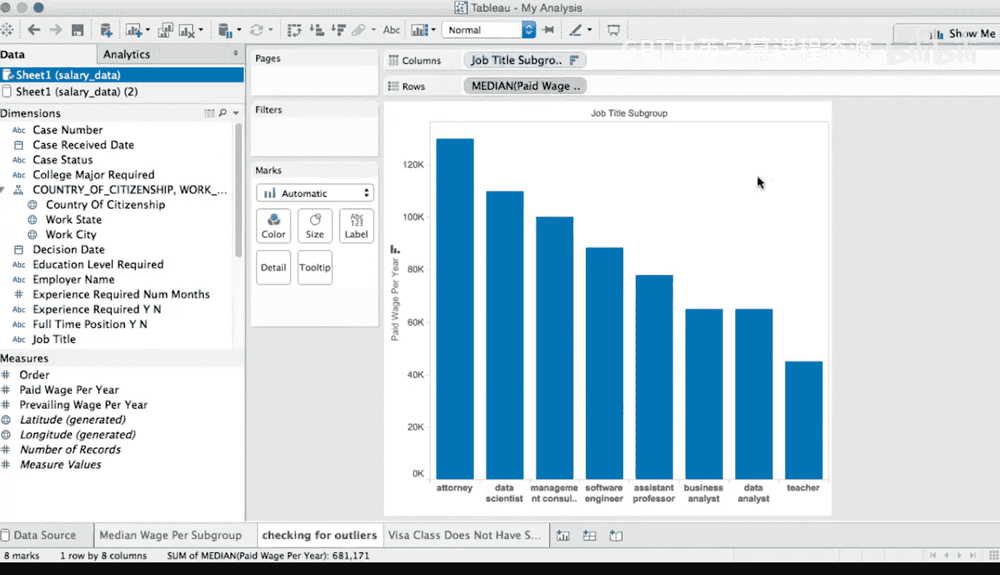
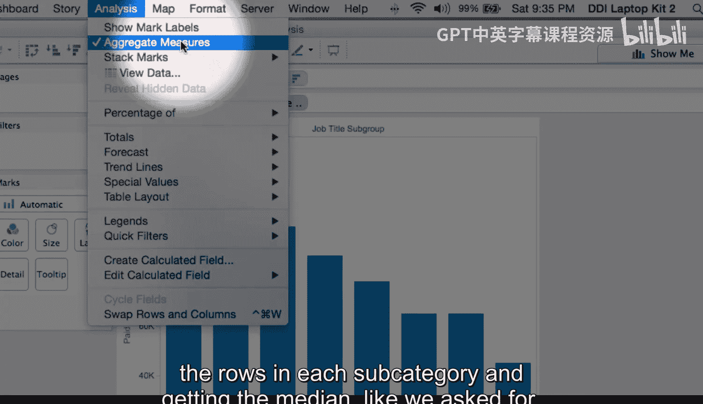
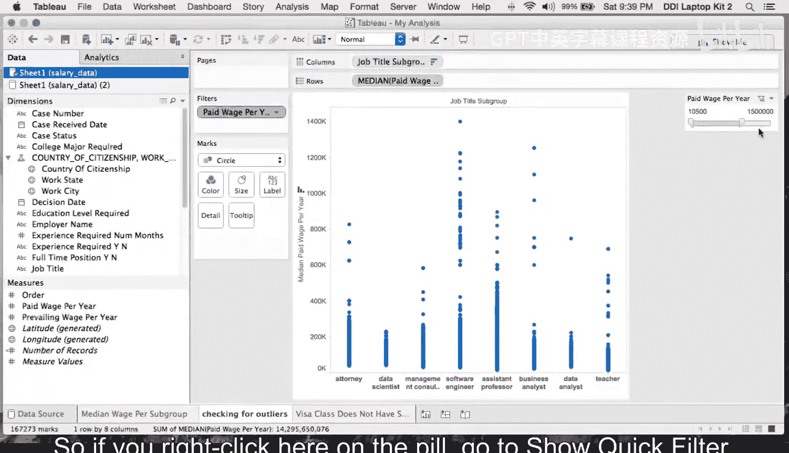
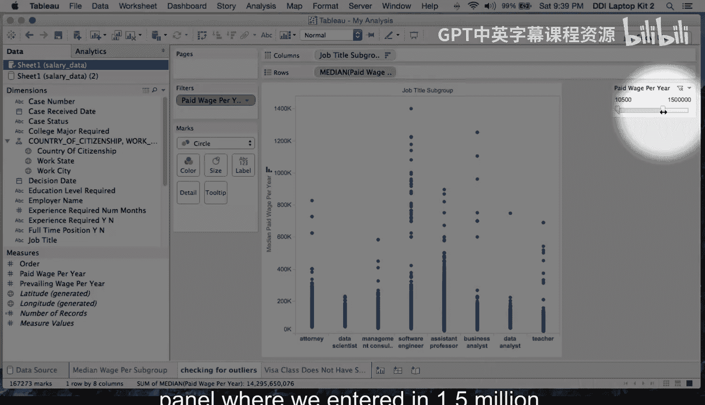
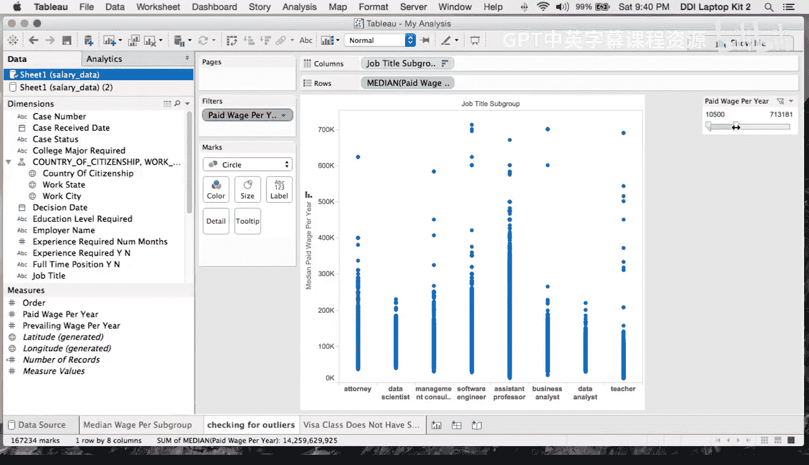
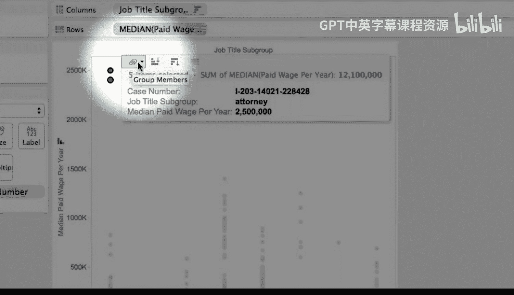
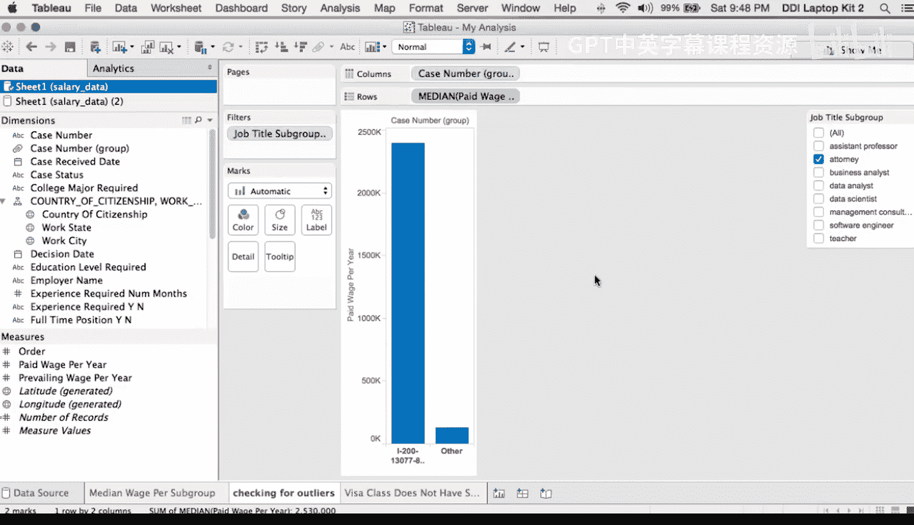

# 杜克大学《Excel 到 MySQL：商业分析（5课全）｜Excel to MySQL： Analytic Techniques for Business》中英 p95 20_03_01_通过散点图、筛选和分组移除异常值.zh_en -BV1mS421X7yw_p95-

A couple of videos ago， we added check for outliers to our data analysis plan。

The easiest and fastest way to do this is to make what's called a scatter plot and to check by eye to see if there are any individual data points that are obviously sticking out。

So that's what we're going to learn how to do in this video。 And in the process。

 we're going to have our first exposure to adding filters and making groups。To do this。

 we'm going to go ahead and open your tableau work book。

And go to our favorite chart。 this median wage per subgroup chart。

 And I want you to to duplicate the sheet。

And let's rename the sheet。And call it。Checking for outliers。

So there are a couple things I want to do before we actually make the scatter plot。

 The first thing is， I want to remind ourselves why we're looking for the scatter plot in the first place。

 So let's look at the standard deviations again。 So let's add paid wage per year。To Rose。

Let's make this into standard deviation。And just for this plot。

Let's change the marks so that they are a little bit easier to understand。

 Let's move the mark or change the marks instead of bars to shapes。So what we can see here。

 this is our paid wage per year or median paid wage per year。

 it's really the attorney subgroup that has the crazy outliers because this standard deviation is so much higher than the rest of them。

 so we suspect that the biggest outliers are going to be in the attorney group。

So let's find out if that's the case。 Let's go ahead and take this off of our plot。

 And now we're going to make our scattered chart。Before we do that。

 I just want you to quickly note down here in the corner。 It says that there are 8 marks。

 That's because we have 1，2，3，4，5，6，7，8 different subcategories。

 Now I make the sub part to make the scatter chart。

 We're going to go up to the analysis part of the ribbon of the menu。

And go down two different。Two different steps to the aggregate measures item。

 You see right now that it is checked。 That's because we are aggregating over the rows in each subcategory and getting the median like we ask for。

 Now， if you uncheck this， it will no longer aggregate over the rows。

 and it will instead show you a different single data point for every single row in the data set。

Now to make this a little bit easier to look at， let's change the size using the marks card of each item on our scatter plot。

And if you want， instead of making it circles， we can make it。Salad circles like that。

s make the size even a little bit smaller。Okay， so just like we predicted based on the standard deviations。

 the attorney subcategory clearly has these very， very high outliers。

 these other subcategories have some very high values。

 but they don't seem like they're totally unreasonable given where the rest of the group is It's really these data points here Now we can use the techniques we learned before to find out a little bit about these data points so let's right click and view the data to see what's going on with them。

This is the that's how much they're being paid per year。And if we go to the underlying data。

We can see what's going on with them。 First of all。

 we can see that two of these of these submissions were submitted on the same day。If we scroll over。

 we can see also that four out of those five outliers come from the same law firm。

 so this suggests that either this law firm is in the practice of paying its employees over $2 million a year。

 or there's someone who kind of consistently making mistakes every time they submit their visa applications so we can keep that in mind。

Now， what if we wanted to look at our data without those outliers or at least have the ability to do so in the future？

I'm going to show you two different ways to do that。 The first ways to say。

 basically tell you your data， I don't want to see anything that is above 1。

5 million per year because I don't believe anything above 1。5 million per year is real。To do that。

 we can use what's called a filter。 a filter is pretty much exactly what it sounds like。

 It's a type of funnel that either lets some things in and keep some things out so we can use。

 we can filter by paid wage per year， because we want to say we only want to look at things。

 We only want to look at data points where paid wage per year is under 2。5 million。Or're under 1。

5 million。So to do that， there are many ways to do it。

 but we're going to start by dragging paid wage per year over onto the filter card。

And it will pop up a goi that looks like this。 This is telling you， this is your lowest value。

In your data set and this is your highest value and so you can change the filter to say I want everything in between these two marks。

 so we are going to look at everything between the lowest mark， the minimum value and 1。

5 million so you can either slide the bar or you can actually enter。The values you want。And click。

 okay。So now you see that the axis longer no longer shows anything above 1。5 million。

 Now we can also look at this in a different way， you can notice here there's 167273 marks if we undo the filter we just did。

You can see there is 1，6，7，2，7，8 marks。 so that shows you that the filter was applied。

Let's putut the filter back on。And I want to show you how you can dynamically change that filter。

 So if you right click here on the pill， go to show quick filter。

And you'll see over here this other little interactive bar pops up。

 and this lets you do dynamically what you were just doing in that first panel where we entered in 1。

5 million。

So if we can either make this go all the way up to the maximum value again。

 and now you can see the marks， say a go up。If we go all the way up。

Now it's the total number of marks， 16，7，27，8。Or we can have even a filter that's even filters even more things out。

 So let's just go to。Something like this。Now you can see that there are many fewer marks and now are。

Access only goes up to as high as our filter is。So this is one way that you can simply look at your data without looking at those hellliers。

You got to make sure that you always look at whether a pill is on your filter card。

 it's very easy to forget whether or not you have a filter on so for example。

 if you say hide the card or you just made it go away， the filter is still there。

 you can see that by looking at the filter shelf filter card and you can also see that by seeing that the axis still only goes up to 1。

5 million to actually remove the filter， you actually have to pull it off the filter card。

So the second way that you can look at the data without these outliers is to actually group these outliers into their own group。

 say this is the outlier group。And to do that， you can you're going to actually select these specific data points Now before we do that。

 I need to show you one more thing the way Tableau works is it can only use the information that's in its workspace like I've kind of alluded to before。

We're going to need to use a variable that refers to these specific data points in order to select these specific data points。

 so to do that， we're going to drag case number， which has a separate case number for every single row of thats in our data。

 We're going to drag case number to the detail property on our Marx card。

And that could take a little while sometimes， so first of all。

 now you know that's there because if you hover over。If you hover over any of these data points。

 now you can see that case number is in the tool tip。To show you why that's important。

Now I want you to select。All of these data points。And right click。You can do this in two ways。

 If you right click， you can either say see that it says group here or。Select it again。

And if you hover her over， you'll see this little paper clip， which also lets you group。

So I want you to select the paper clip or group if you use the drop down。And now I want you to。

 just for purposes of illustration， click on grouping based on job title subgroup。

So just to clarify what we're seeing here。In the workspace。

 Tableau knows that these data points have a case number。

 and I know that these data points have a job title subgroup。We can tell Tableau to group。

According to one。Of these variables independently or both of them。

 If we choose just job title subgroup。So this will be tableableau will purposely group everything that has the same job title subgroup as those data points。

So。This might take a second。What you see down here is what the result of the grouping was。

 So Tableau automatically color codes the data points according to whether it's in the group or outside of the group。

So the blue means it's in the group and the gray means it's outside of the group now this didn't do what we want it to do because it selected all of the different data points that shared the same job title subgroup。

What we really wanted to do was just choose the data points that were up here。

 so to do that we should have。Can ungroup this。We should have just grouped。These items。Based on。

Case number。So if we do this this time。Now you can see。

Only five items are the ones that have these very specific case numbers， everything else。

And the data set is put into the group， other。Now， you can use this group to do a couple different things。

 So， first of all， let's go up here to our variables and you'll see that now under case number。

 theres a new variable called case number group。So this is there permanently now unless you get rid of it。

 And so we can use it for different things。 We can drag it onto the filter。Just like we did before。

And now， go ahead and say all， because I'll show you what it looks like。Right。

 click on the filter again。 Show quick filter。Now。You have the option to either look at all the data。

Or you can look at just the data。That doesn't include the outliers。

So you could either look at the outliers by themselves。Or。

You can look at the data without the outliers。Now this can be very useful later on because sometimes you might want to look at other properties of the data based on this grouping。

 so you might want to look at for example， how much education those outliers have。

 or if you have a very big group of outliers， you might want to see if they come from a certain geographic region or if they have some other types of properties that are the same。

So you can use your variable over here， your group to variable in the same way you use any other type of variable。

Now， to show you an example of how you can use this new variable you just made。

 let's go ahead and put a paid wage per year on row。And then let's put job title subgroup。

In the filters。 And I'm doing this because we know that our outliers are just in the attorney group。

 So we only want to look at。The data points that come from the attorney subgroup。

 so go ahead and say， okay， and if you want to be able to see that， just say show the quick filters。

 we're only looking at the data from the attorney subgroup。Now。

 if we put our new case number group into columns。You'll see that。

All of the data from our outliers is here and all of the data from everything else is here。

 and so right now we're looking at paid wage per year。

 but in the future we can look at things like education。

 how many years of experience they need and other things。

 so this is a good way to be able to explore your outliers in the future。

Now that you know how to use filters and groups， you have the skill set to be able to answer our next data analysis question。

Would my salary in different data analysis related fields change if I lived in different parts of the country。

Let's find out。