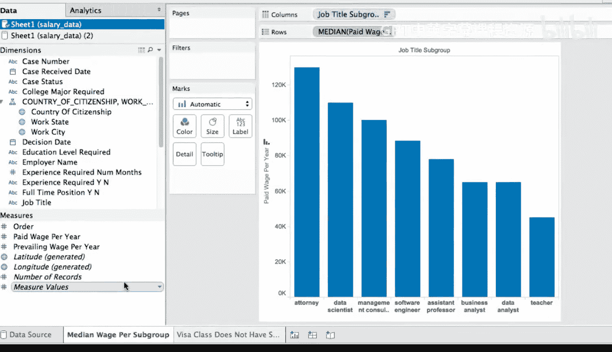
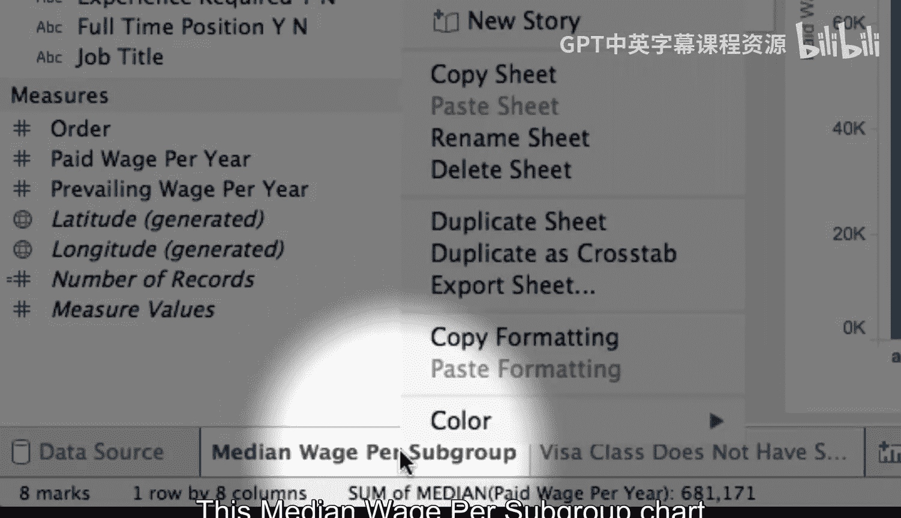
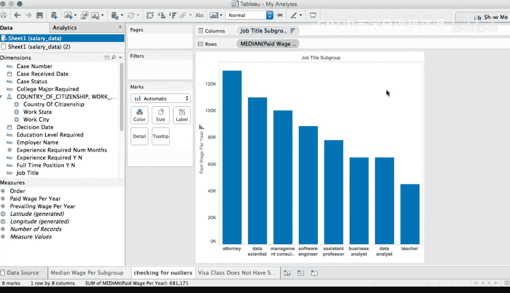
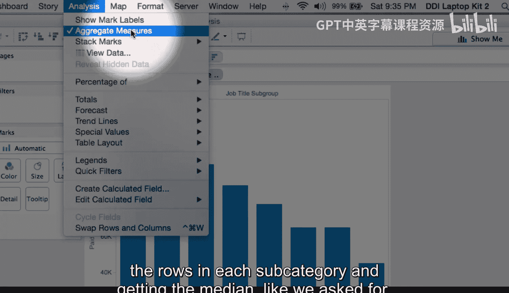
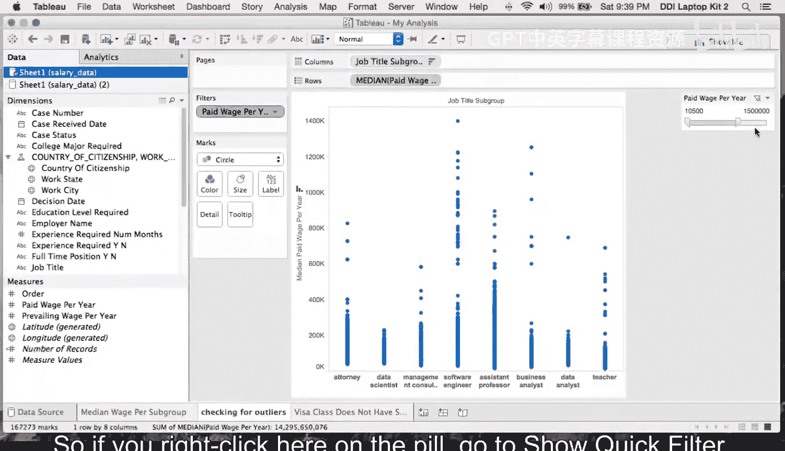
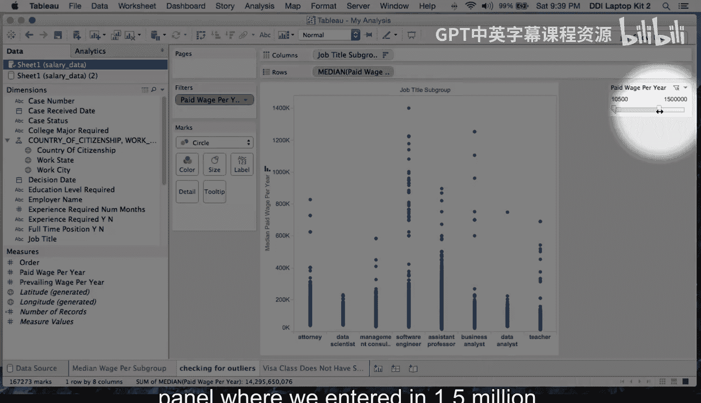
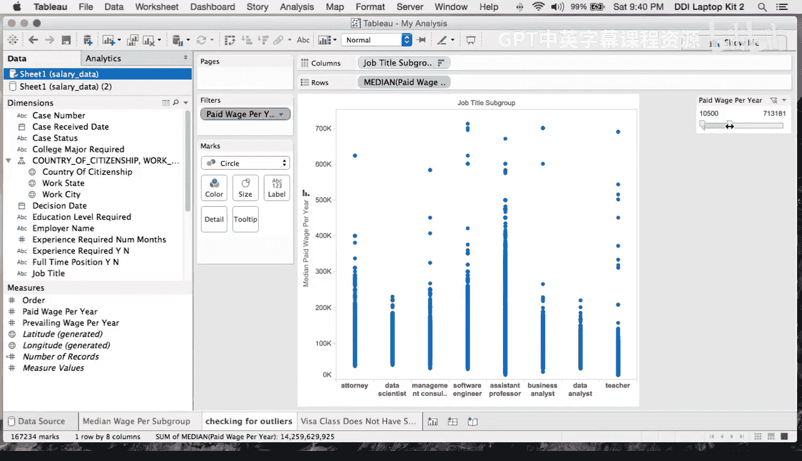
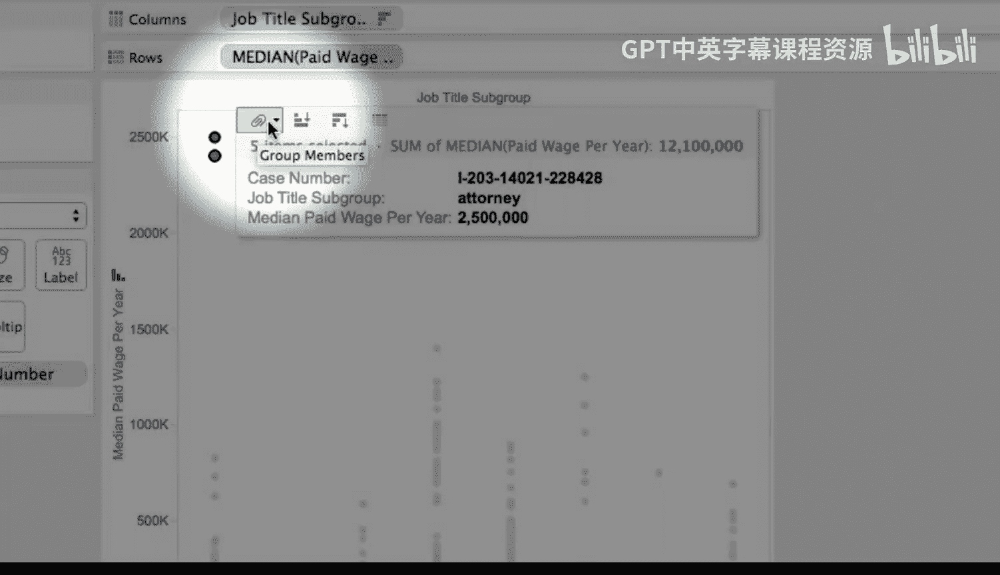
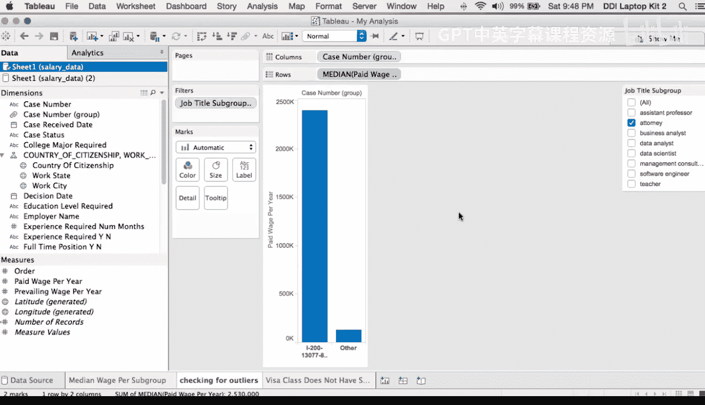

# 商业分析：5：通过散点图、筛选和分组移除异常值 📊

在本节课中，我们将学习如何使用 Tableau 的散点图功能来识别数据集中的异常值。我们还将掌握两种处理这些异常值的关键技巧：应用筛选器和创建数据分组。这些技能对于清理数据、聚焦核心趋势至关重要。

---

在之前的课程中，我们已将“检查异常值”纳入数据分析计划。最快捷的方法是创建散点图，并通过目视检查是否存在明显偏离的数据点。本节我们将学习如何操作，并首次接触添加筛选器和创建分组。

首先，打开你的 Tableau 工作簿，并定位到我们之前创建的“各子组年薪中位数”图表。

为了保留原始图表，我们需要复制一个工作表副本。

将新工作表重命名为“检查异常值”。

在制作散点图之前，我们先回顾一下寻找异常值的原因。让我们再次查看标准差。

将“年薪”字段拖到“行”功能区，并将其计算类型改为“标准差”。为了更清晰地观察，我们将标记类型从“条形图”改为“形状”。

此时可以看到，“律师”子组的标准差远高于其他组，表明该组可能存在极端异常值。

现在，移除“年薪”字段，开始制作散点图。制作前，请注意视图左下角显示有“8 个标记”，这代表我们数据中的 8 个子类别。

要创建散点图，需要取消数据的聚合。操作路径是：点击顶部菜单栏的“分析” -> 取消勾选“聚合度量”。

取消聚合后，视图会为数据集中的每一行数据都显示一个单独的点。

为了让视图更易读，我们可以使用“标记”卡调整点的大小和形状，例如将其改为空心圆并调小尺寸。

正如根据标准差的预测，“律师”子类别中确实存在极高的异常值。其他子类别虽有一些高值，但相对合理。我们可以通过之前学过的技巧进一步查看这些异常点的详细信息。

右键点击异常数据点，选择“查看数据”。可以看到，其中两个申请的提交日期相同。滚动查看底层数据会发现，五个异常值中有四个来自同一家律师事务所。这可能意味着该律所确实支付高薪，也可能表明其提交签证申请时 consistently 存在错误。

接下来，我们学习两种在分析中排除这些异常值的方法。

**第一种方法是使用筛选器。** 筛选器就像一个漏斗，可以按条件包含或排除数据。例如，我们可能认为年薪超过 150 万美元的数据不真实，希望将其过滤掉。

操作步骤如下：将“年薪”字段拖到“筛选器”卡上。在弹出的对话框中，设置范围从最小值到 150 万。你可以拖动滑块或直接输入数值。

点击“确定”后，坐标轴不再显示高于 150 万的值，视图左下角的标记总数也会减少。你还可以右键点击筛选器胶囊，选择“显示快速筛选器”，以动态调整筛选范围。

**重要提示：** 务必留意是否有筛选器生效。即使隐藏了筛选器卡，筛选条件依然存在。要彻底移除筛选，必须将其从“筛选器”卡上拖走。

**第二种方法是将异常值分组。** 这允许我们将它们标记为一个独立的组（例如“异常值组”）以便后续对比分析。

在分组前，需要确保 Tableau 能识别每个独立的数据点。为此，将“案例编号”字段拖到“标记”卡的“详细信息”属性上。这样，每个数据点都有了唯一标识。

现在，按住 `Ctrl` 键（或使用套索工具）选中散点图中的异常值点。右键点击，选择“组”（或点击标记旁的纸夹图标）。

在弹出的分组对话框中，这次我们**基于“案例编号”进行分组**，而不是“职位子组”。这样，只有选中的特定点会被归为一组，其余数据点则归入“其他”组。

分组完成后，Tableau 会自动用颜色区分组内（蓝色）和组外（灰色）数据。同时，在左侧数据窗格的“案例编号”下，会生成一个名为“案例编号（组）”的新变量。

这个分组变量可以像其他变量一样使用。例如，可以将其拖到“筛选器”卡上，并通过快速筛选器选择查看“所有数据”、“仅异常值组”或“排除异常值组”的数据。

这个分组在后续分析中非常有用。例如，我们可以单独分析异常值组的教育背景、工作经验等属性。

为了演示，我们将“年薪”拖到“行”，将“职位子组”拖到“筛选器”并仅选择“律师”。然后，将新建的“案例编号（组）”变量拖到“列”。

现在视图被分为两列：一列显示异常值组的律师数据，另一列显示其他律师的数据。这便于我们对比两组在年薪或其他维度上的差异。

---

**本节课总结**

在本节课中，我们一起学习了：
1.  **创建散点图**：通过取消“聚合度量”来可视化每个数据点，从而识别异常值。
2.  **应用筛选器**：通过数值范围筛选，快速排除或聚焦特定区间的数据。
3.  **创建数据分组**：通过选择特定数据点并基于唯一标识符（如案例编号）进行分组，从而创建可重用的数据子集，用于深入的对比分析。

现在你已经掌握了使用筛选器和分组来处理异常值的技能，这为我们回答下一个数据分析问题——“在不同地区，数据分析相关领域的薪资是否会变化？”——做好了准备。让我们在接下来的课程中继续探索。