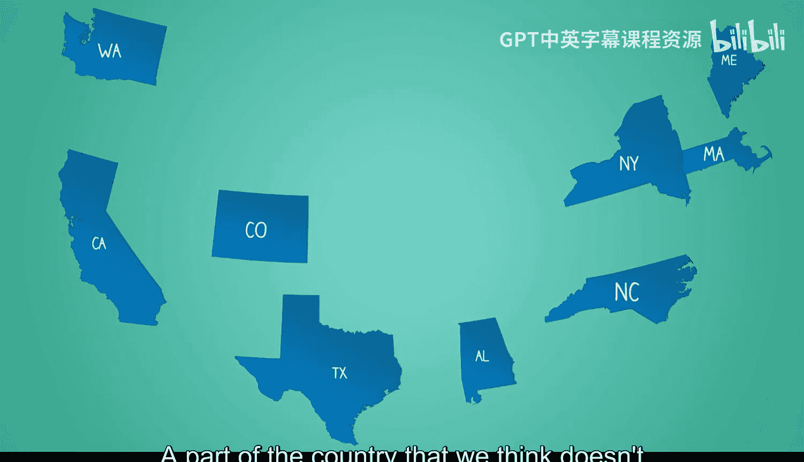
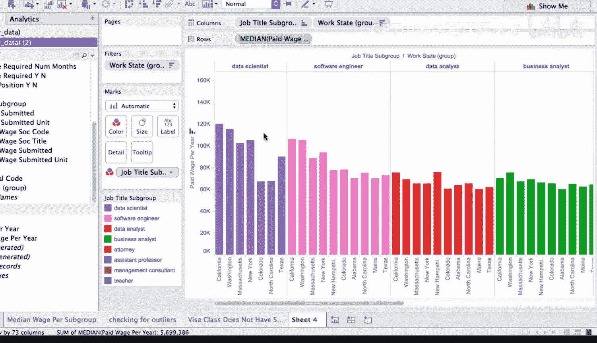

# 杜克大学《Excel 到 MySQL：商业分析（5课全）｜Excel to MySQL： Analytic Techniques for Business》中英 p96 21_03_02_利用筛选和分组分析各州数据相关薪资.zh_en -BV1mS421X7yw_p96-

Now， let's tackle the next question in our data analysis plan。

Would my salary likely change in different data analysis related jobs if my job was located in different parts of the country。

Now， the reason you might want to ask this is because you might only be willing to move to certain parts of the country。

 In fact， many people who are interested in data analysis jobs are only willing to move to parts of the country that they think have very large tech industries。

 for our purposes this time。 Let's assume that the only parts of the country you're interested in moving to are。

 California， Washington， North Carolina， Colorado， Texas， New York， Massachusetts， Alabama。

And we also include Maine as a control， say part of the country that we think doesn't have a high tech related industry。

And thanks to the last video， you probably have a good idea how to do that Now。

 you could use a filter。 So let's go ahead to our tableableau workbook。And let's prepare that filter。

So I'm waiting to make a new worksheet。And I want you to take。Work state。And drag it in the filter。

Now you'll see immediately that a filter a filter Gui comes up and I didn't point this out before。

 but this is different， of course， than the filters and continuous variables here you can actually click specific categories as opposed to clicking on slider bars and we're not going to talk about them right now。

 but I do want to show you that filters can also use different types of。Of different type of filters。

 So you don't just have to use categories。 You can also use wildcard in strings that you can do certain types of words。

 You can use conditions。 And you can also do things like look at the top 10 or top 5。 But right now。

 let's focus on a general。 So this is showing us all the different states we have in our data set。

 And as we scroll down， you might very quickly realize that we have a problem。

It looks like in our data set sometimes the states have their full name。

 but other times they have abbreviations。So this is what happens in the real world。 Data is messy。

 and it's not always clear what to do about it。Fortunately。

 Tableau has a great feature that lets us solve this problem。 and you've actually seen it already。

 It's called grouping。😊，So to show you how to do that。

 I want you to go to work state and I want you to go on the drop down。And go to create and say。

 create group。Now when you do this， it's going to bring up all of the different options。

 all of the different entries that you have in the state column of your data and what you can do is you can click。

Different entries。And us let them all at the same time and then say group。

 And then you can rename them。California。All in lower work case。

And you can do that for every single state。So why don't you go ahead and do that for all the states that I mentioned。

So once you've finished making all of your groups， I want to make sure you do one more thing while you're in this window。

 click on the box it says include other。 because what that does is it takes everything you didn't put in its own group。

 and it put， it puts it in one category called other。

 So this will make filtering much easier for you later。So now go ahead and say， okay。

And now go over to your variables and you'll see that works state group is a new variable in your dimensions。

Put that grouped variable in your filter。Now you can either click each one of these individually or。

You can say other and click on exclude。So now let's go ahead and answer our question。

 Let's put paid paid wage per year， and rose。Let's put our job title subgroup in columns。

 and now of course we want to break down those job title subgroups according to which state they're in。

 so let's take the new variable we made work state group and put it after job title subgroup in columns。

Now to make this a little easier to see， we might want to make every single subgroup of professions be one color。

 so we can also take job title subgroup and bring it to color。

AndNow it makes each subgroup pop out to our eye。 So as we go through this。

 you can see that seems like the different professions don't。

Or the salaries for assistant professor don't change that much according to the different states。

 but in our data related jobs， they do now but make this a little easier to see I want to show you one other thing about ordering。

You can take the legend down here and use it to change the order in which each of the subcategories is being shown。

 so let's say we want to put data scientists first。

 we can click on it and drag it to the top of the legend， then we can put。

 say software engineer next。Data analyst， next。And business analyst。

And let's say we put attorney after that。So now data scientists will come first。

 software engineer next， data analysis， data analyst next， and so on。

Now if we take a look at our data here， it looks like in the data scientist role。

 there are four states that seem to be winning out， California， Massachusetts。

 New York and Washington， and although it's a little hard to see。

 the same four states are sticking out in software engineer， so California， Massachusetts。

 New York and Washington。Now in the data analyst and business analyst roles。

 it seems like the salaries are actually pretty constant， these these are the absolute salaries。So。

 this is very interesting。Seems like in the more technical jobs。

 there are certain states that will pay more， so we probably want to keep that in mind for the future。

 Now， what if you wanted to look at another state that you didn't think of before。

 say you wanted to take another comparison state like New Hampshire。

 you could go to your work state group。Variable， edit the group。

And now go into your other and it's very simple to add another group， go down to say New Hampshire。

Make a move。And now， you can see。But everything else is still left and other。

But you have a new a do group called New Hampshire。 So say， okay。If we could order filters。

Show quick filter。You can show that now New Hampshire is also being shown。

 so if we go down to our graph。You can see that New Hampshire has been added wherever there is data from New Hampshire。

 So， for example， here in software engineer。We're here in data Ana and actually it looks like a data analyst for data analyst。

 New Hampshire is actually doing quite well。Now you might look at this chart and think it would be really nice if we could order the different subgroups according to the item that has the highest salary within that subgroup。

 so we might want to make the data scientist category have in its first column。

 the bar that has the highest value in that second column。

 the one that has the second highest value and so on。

 and you might want to order it that way for every single job category。Now。

 I agree that that would be very useful。 but if you press the sort button。

 you'll see that isn't exactly what happens。Looks like it's ordering it in some type of way。

 but not in the way you would expect。 And the reason for that is actually kind of complicated。

 So we're going to learn how to do this type of sorting in the next module。

