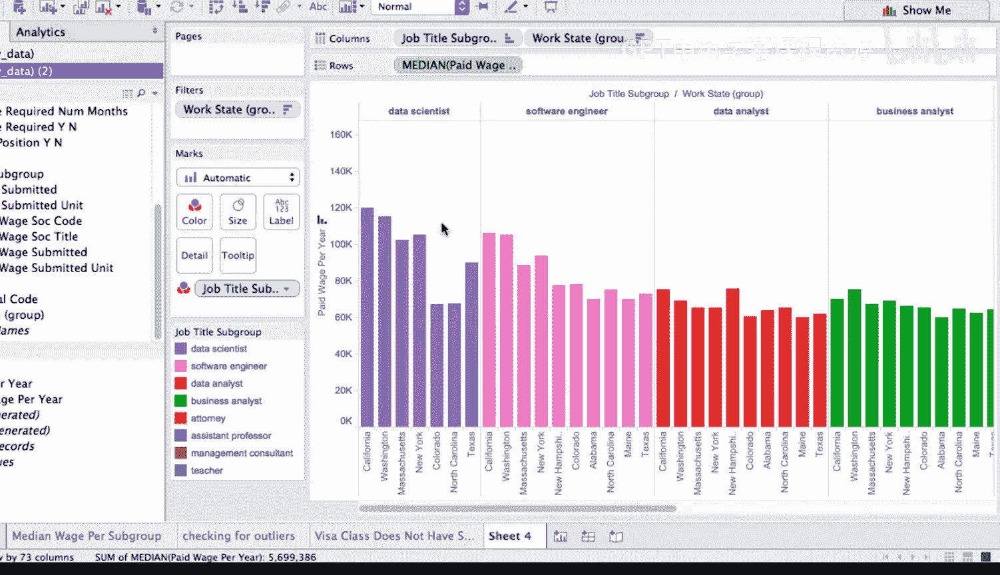

# Excel 到 MySQL：商业分析：P96：利用筛选和分组分析各州数据相关薪资 📊

在本节课中，我们将学习如何使用 Tableau 的筛选和分组功能，来分析不同地理位置（美国各州）对数据分析相关职位薪资的影响。我们将处理数据中的不一致问题（如州名全称与缩写），并通过可视化比较目标州的薪资差异。

## 概述

我们的数据分析计划中的下一个问题是：如果我工作地点位于美国的不同地区，我在不同数据分析相关工作中的薪资是否可能发生变化？提出这个问题的原因可能是，你只愿意搬迁到国内的某些特定区域。事实上，许多对数据分析工作感兴趣的人只愿意搬到他们认为科技产业非常发达的地区。

本次分析，我们假设你只对搬到以下地区感兴趣：加利福尼亚州、华盛顿州、北卡罗来纳州、科罗拉多州、德克萨斯州、纽约州、马萨诸塞州、阿拉巴马州。同时，我们将缅因州作为对照，即我们认为高科技产业不发达的地区。

## 应用筛选器

在上一节我们学习了基础操作，现在可以开始应用筛选器。让我们打开 Tableau 工作簿，并准备筛选器。

首先，创建一个新的工作表。然后，将“工作州”维度拖放到“筛选器”区域。

这时会立即出现一个筛选器图形界面。需要指出的是，这与连续变量的筛选器不同。在这里，你可以点击特定的类别，而不是操作滑块。我们现在不深入讨论其他类型，但需要知道筛选器也可以使用通配符、条件或查看前N项（如前10名）等功能。目前，我们专注于“常规”筛选。

筛选器显示了数据集中所有不同的州。但滚动查看时，很快会发现一个问题：数据集中，有时州名使用全称，有时使用缩写。这就是现实世界中的数据——它通常是混乱的，处理起来并不总是那么明确。

## 创建分组解决问题

幸运的是，Tableau 有一个很棒的功能可以解决这个问题，即“分组”功能。

以下是创建分组的步骤：
1.  右键单击“工作州”维度。
2.  在下拉菜单中选择“创建” -> “组”。
3.  在弹出的窗口中，会显示州列中的所有不同条目。
4.  你可以点击不同的条目（例如 “CA”, “California”），然后点击“分组”按钮将它们合并。
5.  将合并后的组重命名为统一的名称，例如 “california”。
6.  为你提到的所有州重复此操作。

完成所有分组创建后，在这个窗口中还有一件重要的事情：请勾选“包含‘其他’”选项。这样做的目的是将所有未放入特定分组中的条目归入一个名为“其他”的类别。这将使你后续的筛选工作变得更加容易。

设置完成后，点击“确定”。现在，查看你的维度列表，会发现一个新的变量“工作州（组）”。将这个分组变量拖放到筛选器中。

在筛选器界面，你可以逐个点击选择感兴趣的州，或者选择“其他”并点击“排除”。这样，视图将只显示你关注的州的数据。

## 构建可视化图表

现在，让我们来回答我们的问题。将“年薪”度量拖放到“行”功能区。将“职位标题子组”维度拖放到“列”功能区。

当然，我们希望根据这些职位所在的州来进一步细分。因此，将我们新建的“工作州（组）”变量拖放到“列”功能区，放在“职位标题子组”的后面。

为了让图表更易于观察，我们可能希望每个职业子组用一种颜色突出显示。因此，也可以将“职位标题子组”拖放到“颜色”标记卡上。

现在，每个子组在视觉上更加突出。浏览图表可以发现，不同职业的薪资变化模式不同。例如，助理教授的薪资似乎不随州的变化而有太大变动，但在数据分析相关工作中，薪资则因州而异。

## 调整图例顺序

为了让视图更清晰，我想介绍另一个关于排序的功能。你可以使用图例来改变各个子类别在图表中显示的顺序。

操作方法是：
1.  点击并拖动图例中的项目。
2.  例如，如果我们希望“数据科学家”排在第一位，可以点击它并将其拖到图例顶部。
3.  接着可以排列“软件工程师”、“数据分析师”、“商业分析师”等。

调整后，数据科学家将首先显示，其次是软件工程师，依此类推。

观察我们的数据，在数据科学家角色中，有四个州的薪资似乎更高：加利福尼亚州、马萨诸塞州、纽约州和华盛顿州。尽管有些难以看清，但同样的四个州在软件工程师角色中也较为突出。而在数据分析师和商业分析师角色中，各州的薪资似乎相当稳定（这是绝对薪资值）。这非常有趣，似乎在技术性更强的工作中，某些州会支付更高的薪水，这一点值得我们未来注意。

## 动态添加新的对比组

如果你想查看之前未考虑的其他州（例如新罕布什尔州）进行对比，该怎么办？你可以轻松地编辑分组。

以下是步骤：
1.  右键单击“工作州（组）”变量，选择“编辑组”。
2.  在分组编辑窗口中，找到“其他”类别。
3.  向下滚动，找到“New Hampshire”，选中它。
4.  点击“分组”按钮，然后可以重命名这个新组。
5.  点击“确定”。

现在，如果你在筛选器上显示快速筛选控件，可以看到新罕布什尔州也已被列出。回到图表中，你会发现只要有来自新罕布什尔州的数据，它就会被添加进来。例如，在数据分析师类别中，新罕布什尔州的表现实际上相当不错。

## 关于高级排序的说明

观察这个图表，你可能会想：如果能根据每个职位子组中薪资最高的州来排序条形图，那将非常有用。例如，让数据科学家类别中，第一列是薪资最高的州，第二列是第二高的州，以此类推，并且希望对每个职位类别都进行这样的排序。

这确实是一个有用的想法。然而，如果你点击排序按钮，会发现结果并非完全如你所愿。Tableau 会以某种方式排序，但不是你期望的那种方式。其原因有些复杂。因此，我们将在下一个模块中学习如何实现这种类型的排序。

## 总结

本节课中，我们一起学习了如何利用 Tableau 的筛选和分组功能来分析地理位置对薪资的影响。我们处理了原始数据中州名不一致的问题，创建了统一的分组，并通过条形图可视化了不同州在不同数据分析职位上的薪资差异。我们发现，对于技术性更强的职位（如数据科学家、软件工程师），特定州（如加州、纽约州等）的薪资明显更高。同时，我们也掌握了如何动态编辑分组以纳入新的对比项。这些技能对于进行清晰、有效的数据比较至关重要。