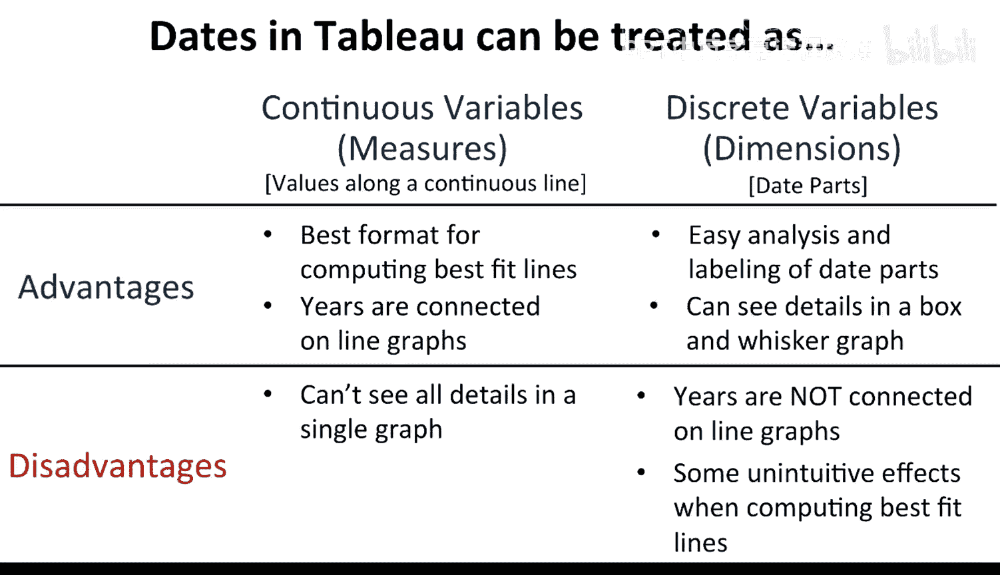

# 杜克大学《Excel 到 MySQL：商业分析（5课全）｜Excel to MySQL： Analytic Techniques for Business》中英 p97 22_03_01_何时使用折线图.zh_en -BV1mS421X7yw_p97-

Welcome back。 In this lesson， we're going learn how to make line graphs and Tau。

But before we jump in， I want to talk a little bit about why you might want to use line graphs。

 especially when you have the option to use bar graphs or line graphs to visualize your data。

Line graphs are best for conveying two types of information。

 The first type of information is how things change over time。

 We naturally think of the progression of time as a line or an arrow。

 So visualizations that are consistent with that notion。

 such as line graphs are often easier for our brains to process than bar charts that break time up into chunks。

The second type of information line graphs are useful for is displaying how well two continuous variables relate to one another。

When we want to see how two variables are related， the more data we see the better because the extra details allow us to really see how well changes in one variable tracks with changes in another variable。

One of the interesting things about Tableau is that it can treat dates as either continuous variables。

 which it calls measures or discrete variables， which it calls dimensions。

When you treat dates as a continuous variable， Tableau interprets the dates as individual values along a continuous line。

 It's therefore the most logical way to format your dates when you want to implement a statistical method called regression to compute a best fit line between dates and another variable of interest to determine how reliable your f are over time。

These graphs tend to be particularly useful for making decisions about how important the effects you see are and for conveying the final conclusions of your analyses。

 However， it could be difficult to understand all the details of your data from a single line graph。

When you treat dates as a discrete variable or a dimension。

 Tableau interprets the dates as collections of separate date parts。Date parts are labels like year。

 month and day。Each date part can be interacted with independently。

 which can be useful for some types of graphs， like when you want to see all the data you have from the month of February。

Labelling date parts can be much more straightforward when you treat dates as dimensions as well。

 However， making line graphs over time when you treat dates as a dimension can lead to some strange effects。

 because Tau breaks up the lines between years。 That said。

 treating dates as dimensions allows you to make other graphs used in statistics called box plots or box and whisker plots that allow you to see all the details of your data at different time points。

 box and whisker plots are usually too complicated to communicate the conclusion of analysis to an audience effectively。

 but they are very helpful for you as the analyst to understand the details of your data quickly。

As a data analyst， you will have to get good at deciding which types of visualizations are most appropriate for what types of situations。

Let's get some first hand experience making those decisions by tackling our next data analysis question。

 That question is， have data related salaries been changing over time。Let's find out。

