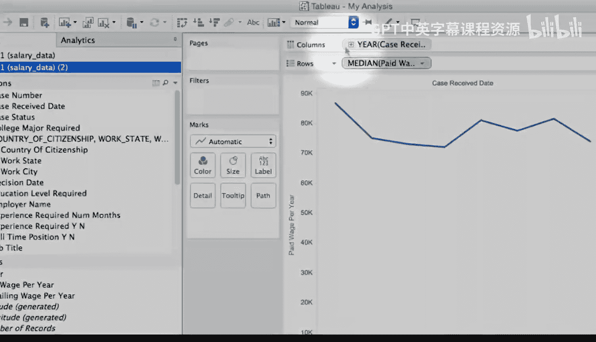
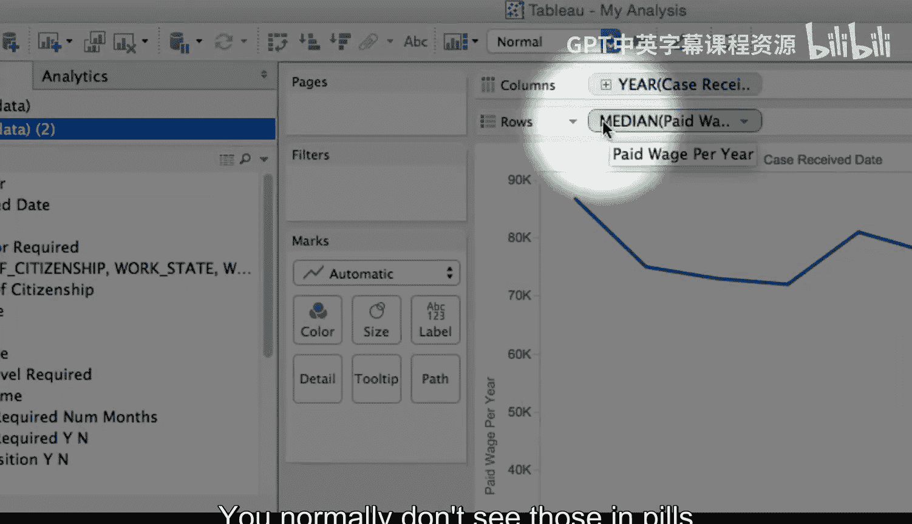
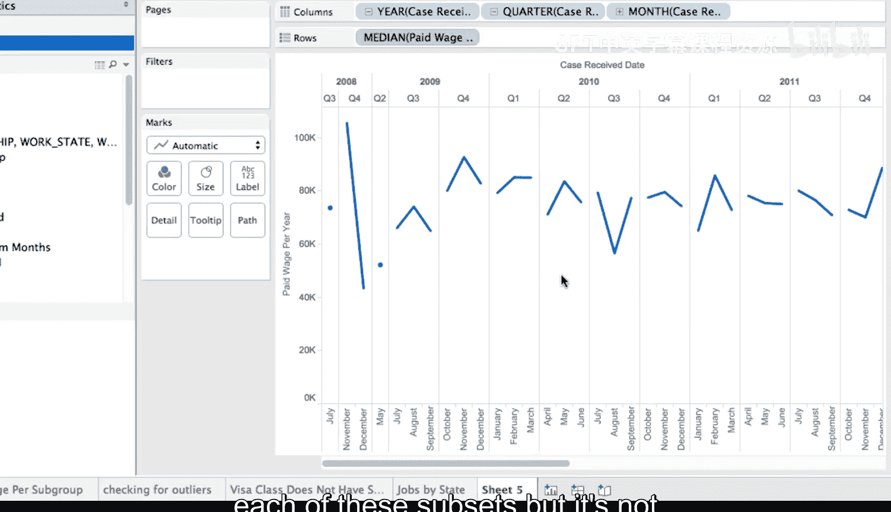
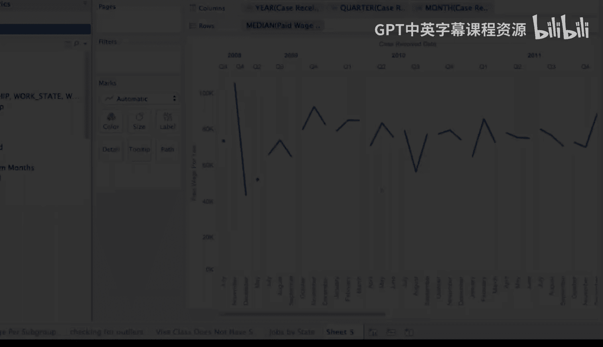
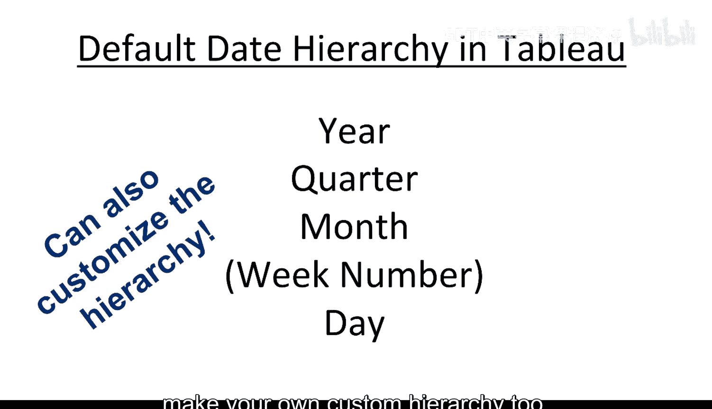
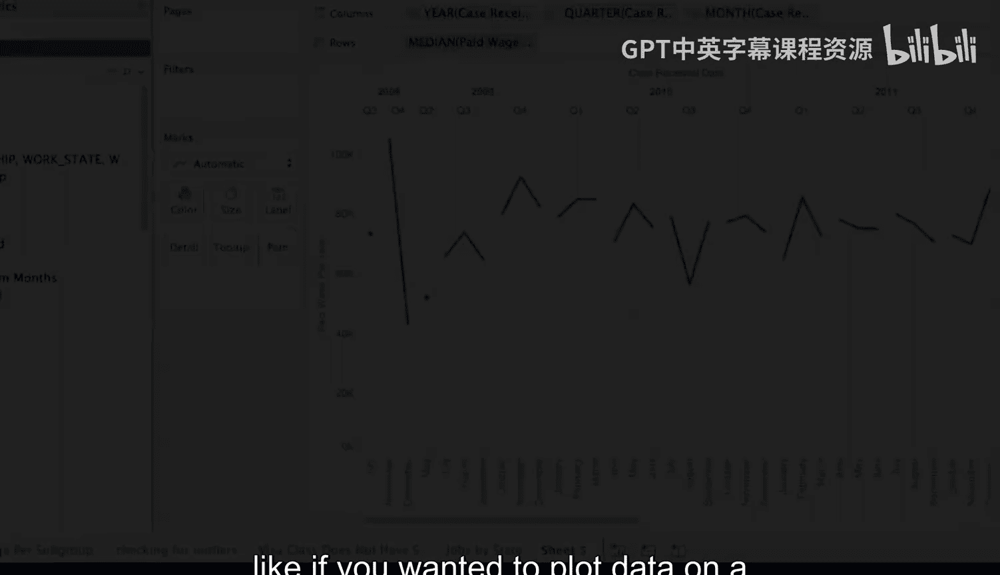
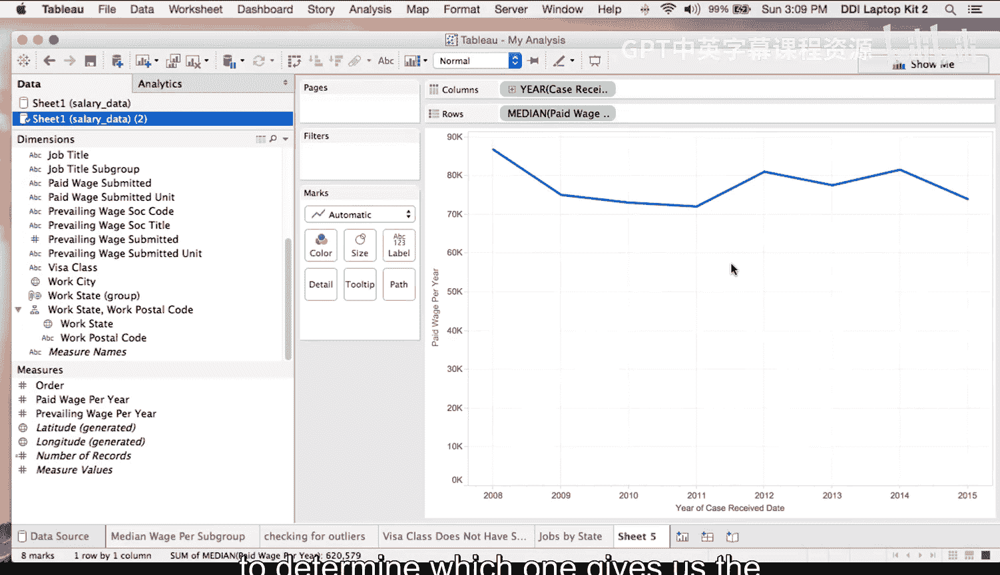

# 杜克大学《Excel 到 MySQL：商业分析（5课全）｜Excel to MySQL： Analytic Techniques for Business》中英 p98 23_03_02_日期作为层级维度或度量.zh_en -BV1mS421X7yw_p98-

You've heard a lot in this specialization about how the future of business lies in data and the people who analyze it。

You're probably taking this course because you've heard similar things and are interested in figuring out how to get in on the fun。

Now， if companies need more and more data analysts and data scientists。

 you might expect that salaries for these positions are increasing， along with the need。

 And if that's the case， you might guess for yourself that if you enter the field now。

 the salary you can expect later will only be increasing in proportion to the number of years of experience you have。

In this video， we're going start to explore whether that would be the case。

Okay， go ahead and open your tableau workbook and open up a new worksheet。

Now I'd like to start by looking how salaries across our entire data have changed over time。

 so to do that let's put paid wage per year in rows again。

 and let's take casereive date as our date that we're going to explore and we're going to start by looking this just by year。

 even though we actually have the actual date in our data that every single application was received。

So if we just drag this over to columns and see immediately that tableau makes a line chart。

 I lets start by just focusing on the data itself。 If we look at this line chart down here on the X axis is time and here is paid wage per year。

 so it looks like indeed there was a dip after 2008。

 which probably correlated with the recession of 2008 and maybe data or all the jobs you're looking at in this data set are going up slowly。

 but they seem to have not quite made it back to where they were before 2008。

So we'll think about this later and come back to it。Now that we've looked at the data。

 I want to point out to you a couple things about tableableau specifically。

 the first thing I want to show you is if you go up to the column shelf。

 you'll see that year is blue。 The pill for year is blue。Now。

 the fact that year pill is blue means that Tableau is treating it as dimensional or categorical。

 That means Tableau is treating each year as its own independent data points that are not connected。

The next thing I want you to notice is this little plus sign here next to the year title。

 You normally don't see those in pills。 So let's go ahead and press it and see what happens。

If you press it once and you look at the X axis now。

 you'll see that Tableau is showing you quarters as opposed to years。 if you press it again。

It's now showing you months。 Sometimes you might be missing a month。

 And so Tableau will leave that month out of the data。 For example， here in quarter 2 of 2009。

So Tableau is making these lines within each of these subsets。

 but it's not connecting the lines between them。 Why is that。

That's because Tableau is treating dates and automatically treats dates like hierarchies。

The default is that Tableau will automatically put dates into hierarchies defined by year at the top。

 quarterter is next month， and then sometimes week and day。 In this default。

 year will always go be the highest point in the hierarchy。

 which means it treats each year as independent and and won't connect the lines on the graph。

I do want to point out you can change these defaults and make your own custom hierarchy too。

 like if you want to plot data on a biweekly or bi monthly basis， for example。

 but for now we're going to go ahead and use the defaults and let's go back to looking at the data at the quarter level。

Now， I do want to take one brief pause here to point out because we probably won't come back to hierarchies again in the course。

You can make any kind of hierarchy and Tableau makes some ones free automatically and you can make your own。

 so for example， if you go over to our variable panel over here。

 you'll see that Tableau made this hierarchy with our country of citizenship work state and worksy。

This little icon over here means that it made it into a hierarchy。 Now。

 it actually did this incorrectly。 It was smart。 It was a good idea。

 but it was incorrect because country of citizenship in our data actually refers to the applicant whereas works state and work city refers to the actual job itself。

 so we don't actually want to group these things。 and we can ungroup them simply by clicking on the dropdown and saying remove hierarchy。

 So now it takes everything out of the hierarchy。It's very easy to make your own hierarchies that have that same capability of drilling down。

 like you saw over here when we were looking at the tapes and to make your own hierarchies。

 you just drag one variable on another。 So， for example。

 if we want to make a hierarchy with work postal code within work postal state。

 we would simply take work postal code。And we would drag it into。Work postal state。

 And then it will make a hierarchy with work state and work postal code。

And we don't need to use that variable right now for this analysis。

 but I did feel obligated to show you that you could do this in Tableau in case you need it for your own analysis。

Okay， let's go back to our question about whether salaries are changing over time。Now。

 sometimes it can be useful to treat date as a dimension as a categorical variable。

 but in our case this time， it makes more sense to treat it as a measure because we know time doesn't actually stop in between years。

 it keeps going。 So it makes more sense to make a graph that connects all of our dates together。

 So to do that， we need to change our date field into a measure。

 Now I've talked about a couple ways to do that already via our variable pan over here。

 but I'm going to show you a different way to do it this time。 first of all， let's go back to here。

 make it a little bit easier。If you click on the drop down， this is a little confusing。

 I don't know why they don't put labels on this， but you'll see that there are two different places where Tableau refers to the year that it or refers to the part of the hierarchy in the date。

 This first block actually refers to all the instances when Tableau treats the date as a dimension。

 the second block here refers to all the times when Tableau treats the date as a measure。

 So if you simply click on year down here in this block as opposed to this block。

You'll see now the pill color has changed to green and it's treating it as a measure。

 so it still has this plus button。 If you press it。

 you'll see that it is still breaking up the data and to different parts of the hierarchy。

 but now it's connecting the lines instead of treating them all as completely independent so you can keep drilling down to different levels of detail Here's month。

And here is weak and for some reason it's a little bit harder to go back up a hierarchy when you treat it as a measure in Tableau。

 I think it's just a programming weirdness， so the easiest way to do it is to go back up via this dropdown。

So the reason that I should say the reason that this is so jagged is because we don't always have a lot of data for each one of these data points。

 so the data is pretty noisy， so for analysis purposes we should go back to a level of detail that we feel a little bit more confident has more data。

 so either quarter or year。So let's start by going to quarter。

 and I just want you to notice something。 So if we look at the data at the level of quarter here。

 you might have a different interpretation than if you look at the data at the level of year。

 when we look at it the level of year， it makes it look like salaries are pretty high。

 They dipped down after the recession， and they haven't really made it back up。 and in fact。

 they might be having some trouble here in 2015。But if you look at it the level of quarter。

 you see that actually， there is some kind of weird spike in salaries。

 Maybe there were some outliers or something， but theres some type of weird spike in one quarter in 2008。

 But actually， the salaries are pretty close to what they are now。 And if anything。

 it looks like maybe salaries are on the rise。 So this is a good example of where you have to make a decision about how you're going to look at your data and your decision can impact your interpretation。

 right now， I would say， let's go ahead and look at our data at the level of year just to make it easier。

 But we may want to go back and forth and look at it at the level of quarter and year at different times of the analysis to determine which one gives us the best picture of what's really going on。

Well done。Now that you understand how dates work in Tableau and the consequences of treating a date as either a dimension or a measure。

 we are ready to answer our data analysis question of whether data salaries are changing over time。

 That's what we'll do in the next video。