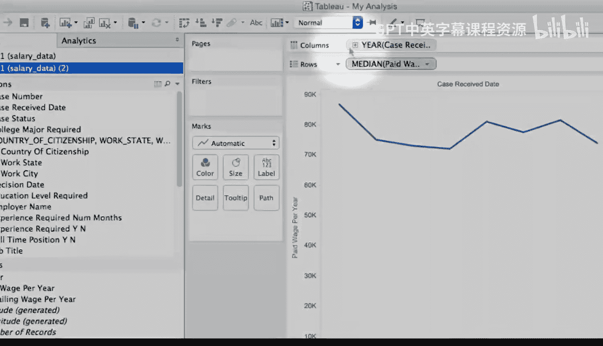
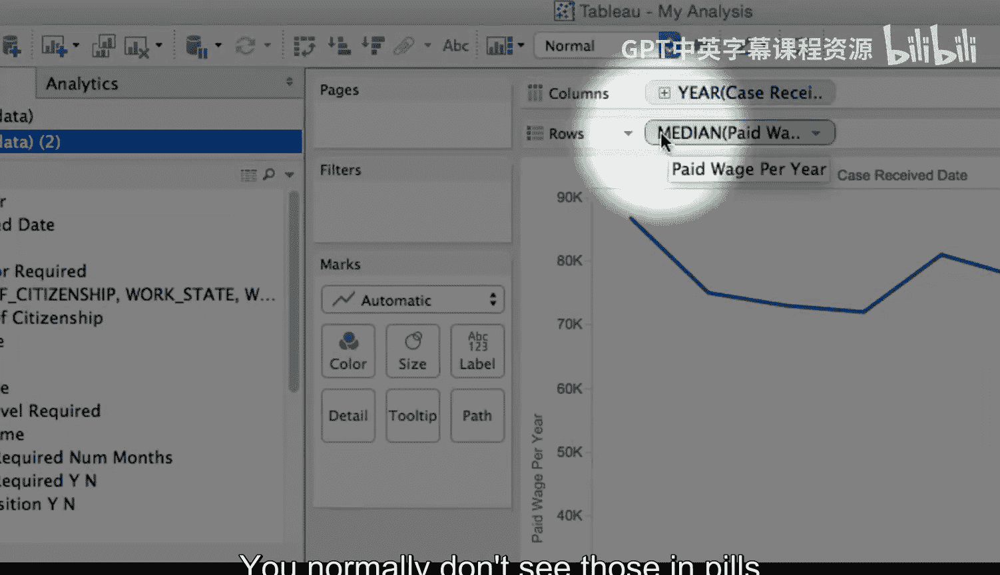
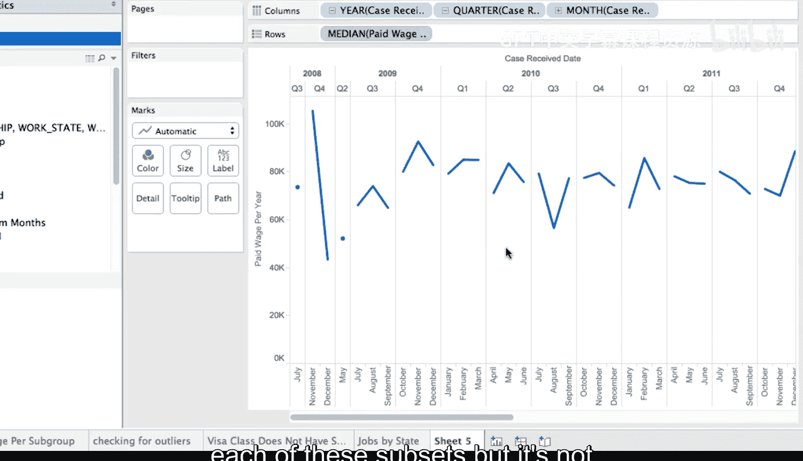
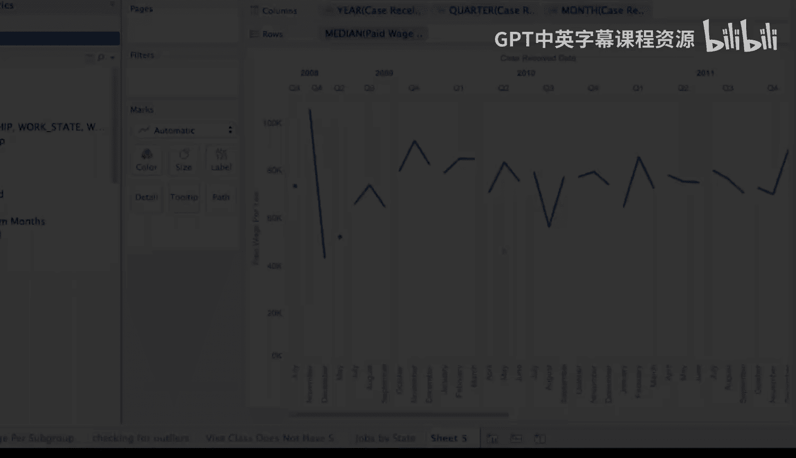
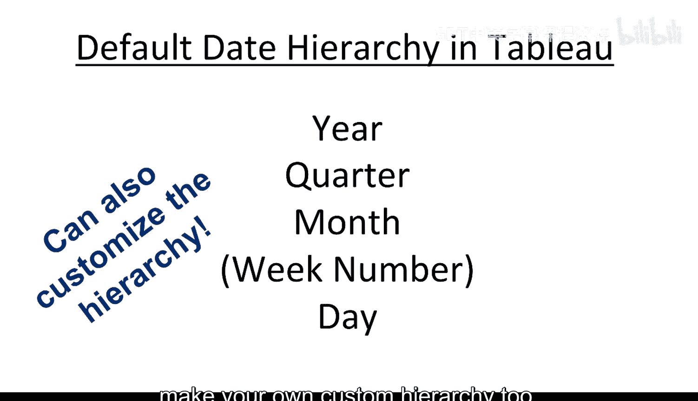
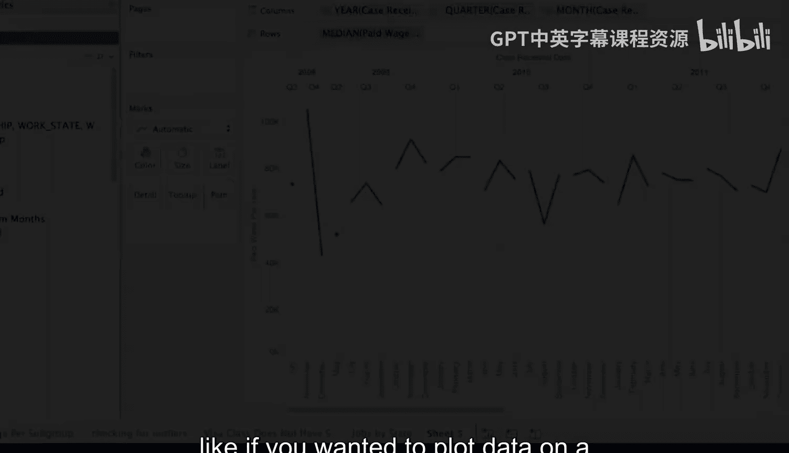
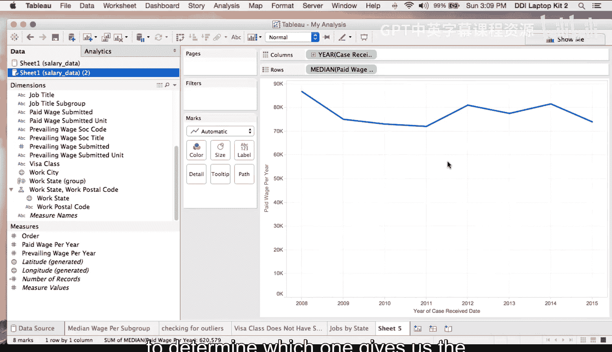

# Excel 到 MySQL：商业分析：5.3：日期作为层级维度或度量 📅

在本节课中，我们将学习如何在 Tableau 中处理日期数据。日期既可以作为维度（分类变量），也可以作为度量（连续变量），理解这种区别对于正确分析和可视化数据至关重要。我们将通过探索薪资随时间变化的趋势来实践这一概念。

---

你在这个专项课程中已经多次听说，商业的未来在于数据及其分析者。你很可能选修这门课程，是因为听过类似的观点，并希望了解如何参与其中。如今，公司对数据分析师和数据科学家的需求日益增长。你可能因此预期，这些职位的薪资会随着需求而上涨。如果是这样，你或许会推测，如果现在进入这个领域，未来的薪资将与你积累的工作经验年数成比例增长。在本视频中，我们将开始探索情况是否如此。

首先，请打开你的 Tableau 工作簿并创建一个新的工作表。我们想从观察整个数据集中薪资随时间的变化开始。为此，我们再次将 `paid wage per year` 放入行功能区。然后，我们将使用 `casereive date` 作为要探索的日期字段，并先按年份查看，尽管我们的数据中实际包含每个申请收到的具体日期。

如果我们直接将 `casereive date` 拖到列功能区，Tableau 会立即生成一个折线图。让我们先关注数据本身。观察这个折线图，X 轴是时间，Y 轴是年薪。数据显示，2008 年后薪资确实出现了下滑，这可能与 2008 年的经济衰退有关。此后，数据集中所有职位的薪资似乎在缓慢回升，但似乎仍未恢复到 2008 年之前的水平。我们稍后会再思考这个问题。

现在我们已经查看了数据，我想向你指出 Tableau 中的几个特性。首先，请注意列功能区上的 `Year` 胶囊是蓝色的。**`Year` 胶囊显示为蓝色，意味着 Tableau 将其视为维度或分类变量。** 这表示 Tableau 将每一年视为独立、不连续的数据点。

其次，请注意 `Year` 标题旁边有一个小加号。胶囊上通常不会显示这个符号。让我们点击它看看会发生什么。

点击一次后，观察 X 轴，你会发现 Tableau 现在按季度显示数据，而不是年份。再次点击，则会显示月份。有时某个月份可能没有数据，Tableau 会将其从图表中省略，例如 2009 年第二季度这里。Tableau 在这些子集内部绘制了线条，但并未连接不同子集之间的线条。这是为什么呢？

**这是因为 Tableau 默认将日期视为层级结构。** 默认情况下，Tableau 会自动将日期组织成由年、季度、月、有时还有周和日定义的层级。在这个默认设置中，年始终是层级的最高点，这意味着它将每一年视为独立的，因此不会在图表上连接不同年份之间的线条。

需要指出的是，你可以更改这些默认设置，创建自定义的层级。例如，如果你想按双周或双月绘制数据。但目前，我们将继续使用默认设置，并回到按季度级别查看数据。

现在，我想在此稍作停顿，指出一点，因为我们在课程中可能不会再深入讨论层级。你可以在 Tableau 中创建任何类型的层级，Tableau 会自动创建一些，你也可以自定义。例如，如果你查看左侧的变量面板，会发现 Tableau 用 `country of citizenship`、`work state` 和 `work city` 创建了一个层级。这个小图标表示它已被组织成层级。然而，这个自动创建实际上是不正确的。Tableau 的想法是好的，但 `country of citizenship` 在我们的数据中指申请人的国籍，而 `work state` 和 `work city` 指的是工作地点本身，因此我们实际上不希望将这些变量分组。我们可以通过点击下拉菜单并选择“移除层级”来轻松取消分组。这样，所有变量就从层级中移除了。

创建具有相同下钻功能的自定义层级非常简单，就像我们刚才查看日期时看到的那样。要创建自己的层级，只需将一个变量拖放到另一个变量上。例如，如果我们想创建一个包含 `work postal code` 和 `work postal state` 的层级，只需将 `work postal code` 拖放到 `work postal state` 上，它就会创建一个包含工作州和邮政编码的层级。虽然我们当前的分析不需要这个变量，但我觉得有必要展示在 Tableau 中可以这样做，以备你在自己的分析中需要。

---

现在，让我们回到关于薪资是否随时间变化的问题。有时，将日期视为维度（分类变量）是有用的。但在我们当前的情况下，将其视为度量（连续变量）更有意义，因为我们知道时间在年份之间并未停止，而是持续流动的。因此，创建一个连接所有日期的图表更合理。为此，我们需要将日期字段更改为度量。

我之前已经介绍过通过变量面板更改的几种方法，但这次我将展示另一种方式。首先，让我们回到这里，让操作更简单些。点击下拉菜单（这里的设计有点令人困惑，不知道为什么没有标签），你会看到 Tableau 在两个不同的地方引用了日期层级的部分。第一个区块实际上包含了 Tableau 将日期视为维度的所有实例，而第二个区块则包含了 Tableau 将日期视为度量的所有实例。因此，如果你点击第二个区块中的 `Year`，而不是第一个区块中的，你会发现胶囊的颜色变成了绿色，表示它现在被当作度量处理。

它仍然有这个加号按钮。点击后，你会看到它仍然将数据分解为层级的不同部分，但现在它会连接线条，而不是将它们全部视为完全独立的。你可以继续下钻到不同级别的细节，这里是月份，这里是周。在 Tableau 中将日期视为度量时，向上回溯层级会稍微困难一些，我认为这只是程序的一个小怪癖，最简单的方法是通过这个下拉菜单回到上一级。

线条如此锯齿状的原因是我们并非每个数据点都有大量数据，因此数据噪音较大。为了分析目的，我们应该回到一个我们认为数据更充足、更有信心的细节级别，比如季度或年。让我们从季度开始，并请注意一点。如果我们在此处按季度查看数据，你的解读可能与按年查看时不同。按年查看时，薪资看起来相当高，经济衰退后下滑，并且似乎没有真正恢复，甚至在 2015 年可能遇到了一些困难。但按季度查看时，你会发现实际上 2008 年某个季度薪资出现了奇怪的峰值，可能是存在一些异常值。但总体来看，薪资与现在水平相当接近。甚至可以说，薪资可能正在上升。这是一个很好的例子，说明你必须决定如何查看数据，而这个决定会影响你的解读。目前，为了简化，我们按年查看数据。但在分析的不同阶段，我们可能需要来回切换，同时按季度和年查看，以确定哪种方式能最真实地反映实际情况。

---

做得好。现在你已经理解了日期在 Tableau 中的工作原理，以及将日期视为维度或度量的不同后果。我们已经准备好回答我们的数据分析问题：数据相关薪资是否随时间变化。这将是下一个视频的内容。

在本节课中，我们一起学习了 Tableau 中日期字段的双重性质。我们了解到，日期默认被组织成年、季、月等层级结构，并且可以作为维度（蓝色胶囊）或度量（绿色胶囊）使用。这种选择直接影响图表的连接性和数据解读。我们还实践了如何通过点击胶囊或使用下拉菜单在层级间导航，以及如何创建和移除自定义的数据层级。理解这些是进行有效时间序列分析的基础。