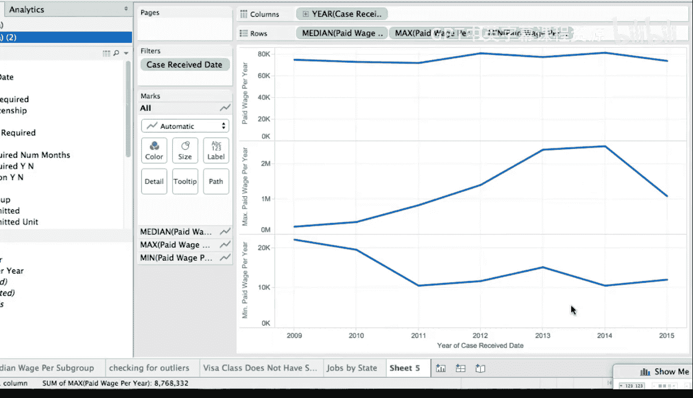

# 杜克大学《Excel 到 MySQL：商业分析（5课全）｜Excel to MySQL： Analytic Techniques for Business》中英 p99 24_03_03_使用日期层级分析数据相关薪资随时间变化.zh_en -BV1mS421X7yw_p99-

In this video， we are going to build off what we learned in the last video to answer the question of whether specific categories of data related jobs are changing over time。

 especially compared to other types of jobs。Let's go back to our Tableau workbook exactly where we left it last time。

Now that we understand how dates work， we are ready to answer our question whether specific categories of data related salaries are going up。

 especially compared to other types of jobs。Now， to do that。

 we need to add job dial subgroup information to this graph， and ideally。

 we would do that by adding a separate line onto the chart for each job subcategory。

Any idea how we would do that。In order to get all the subcategory lines in the same graph。

 we won't be able to use either the column shelf or the row shelf。

 So what do we do when we can't use the column shelf for the row shelf。 We use the Marx card。

 of course。And I'm going to suggest that we code different job subcategories by color。

 So go ahead and take job title subgroup and drag it onto to color。Now。

 you see that tableableau has made a different line， the different color for each job title subgroup。

Now before we continue this。Data shows us something very clearly。

 Looks like we really don't have a lot of data for 2008。 In fact。

 we don't have any data at all for 1，2，3，4，5，6 of our job subcategories。

 So we really shouldn't be interpreting what's happening in 2008。 So if we go back to our。

Chart that we just made。I'm going to suggest that from now on。

 we only look at data from 2009 on so we can do that by using a filter like we did last time。

And so you can filter based on。Re of dates。And to do that。We can。Move this all the way to 2009。

The first of 2009， okay。Now， when you look at the data this way。

 gives you a different picture than it did before。 Now it looks like really maybe jobs overall are increasing in salary。

 so maybe they've taken a dip in 205。Let's go back and focus on looking at how these change for different job title subgroups。

 so go ahead and put job title subgroup directly on color again and you'll see that because you're using the same graph。

 it's still only looking at data from 2009 on and it's also worth noting still that there are two job title subcategories that don't have any data for 2009 so that's important to remember。

Now， I know this chart is a little busy， so I'm going to show you a cool feature in Tableau that makes it much easier to navigate these types of more complicated graphs。

 If you go to job title subgroup， you'll see this little icon that's a highlighter and it says highlight selected items。

 So if you click on that。It's actually a toggle。 So it will toggle on and off。

 When you click on one of the categories in your legend here。

 it will gray out everything else and just show you that particular category。

 So this makes it much easier to look at each different category on its own without using a filter。

 It's a different way of doing it。 And this doesn't actually filter out the data。 by the way。

 it's just showing you specific。Or it's graying out specific parts of the data。

So when we look at this， you'll see that data scientists looks like the salaries are relatively constant。

 they have a bit of a dip in 2015。 softwareftware engineers look like maybe they're starting to go up。

Data analysts unclear， and business analysts also unclear。

So it's not we don't have a whole lot of information here to go on。

 so I'm going to suggest that we actually look at this in more detail to get a better sense of what the data actually are and the way to do that is to look at a scatter plot again so we can see all the data in one place。

 I want you to go up to analysis and before you do that notice that the pill is green here。Now。

 go to analysis and go to aggregate measures to un aggregategregate the data。

As a trick for right now to make it easier to see everything。

 we are going to change year to a dimensional variable because it will condense the x axis a bit due to the way Tableau treats dimensional dates。

Then go to the show me card。And click on scattertterplot。

And let's make the size of the marks just a little bit smaller。Okay。So now when we do this。

 let's again look at our highlight of specific subgroups。

 and I'm going to actually put these in order according to the way we've been looking at them。

And business analyst。Next， I'll try to always go in this order to make it easier for us to pay attention to。

 So if we just look at the data from data scientist， it looks like well。

If you look at the very bottom values， they seem like maybe they're going down。

 Does't there don't seem to be a whole lot of outliers up here。 What about software engineer。

Software engineer looks very different。 If You look at the very bottom values of these pink dots。

 It does look like they're going down， but it also looks like the top values。

 And kind of each one of these blobs is going up。 It's also obvious that there are a whole lot more outliers over time。

 So there are a lot more individual instances of very high salaries for software engineers。

 What about data analysts。Again， we're seeing this pattern。

 perhaps even more pronounced this time where the lowest values seem to be going down。

 the highest values seem to be going slightly up。 There aren't as many outliers。Same thing。

 Im with business analyst。So the suggests is that it might be the case that overall either salaries are the same or maybe slightly going up。

 but also might be the case that you can you have a greater opportunity to make more our higher salary。

 but you also have greater risk to make less salary。 Let's look at that more directly。

 I think the best way to do that is to go back to a line chart。We need to re aggregate our measures。

So this is the line chart we had before。And now for purposes right now。

 let's take job title subgroup。Off of our workspace。

What I want to do is I want to look more directly at whether it is actually the case the lowest salaries for each one of these categories is going down。

 but the highest salary levels are going up。To do that， let's put paid wage per year。On rows。

 And this time， let's， instead of the median， let's aggregate it and take the maximum。

And let's do the same thing。And show the minimum。So what this is showing us here。

 this is the median paid wage for all of our data set over time。

 This is the maximum paid wage over time， and this is the minimum paid wage over time。Now。

 when you look at it this way， it makes it pretty obvious that at least overall。

 in the whole data set。Definitely the case that despite the fact that median wages are staying the same。

It's possible to make way more money in individual instances。

 but it's also possible to have salaries that are way less than you expect if you are looking for the medium。

How could we figure out whether the effects we just in our line graphs are robust enough that we should take them into consideration when we do the rest of our analysis and when we make decisions？

I'm going to suggest that the best way to do that in this context is to use statistics。

 In the next video， we're going to learn how to compute those statistics in Tableau。

