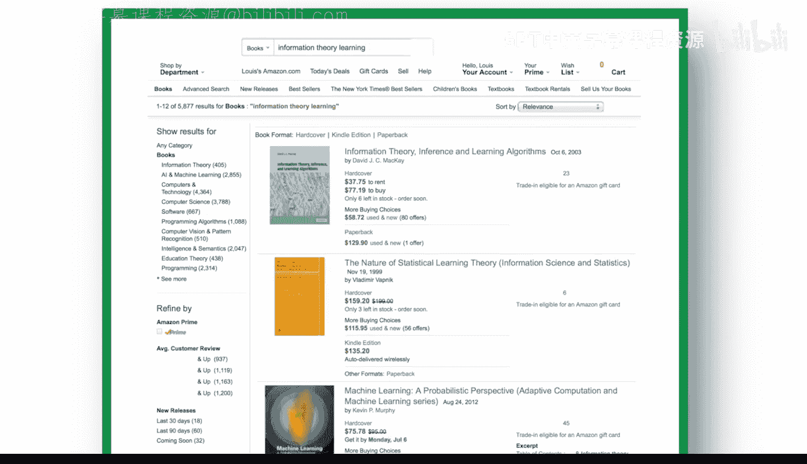
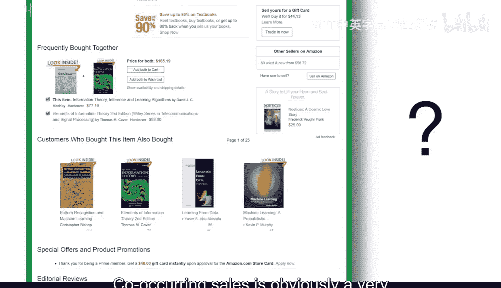

#  010：亚马逊动态收入指标解析（第二部分）🔍

在本节课中，我们将深入探讨亚马逊如何利用动态收入指标来优化其推荐系统。我们将重点关注“共同购买”和“共同浏览”数据，了解亚马逊如何存储、分析并运用这些信息来最大化销售潜力。

上一节我们介绍了亚马逊如何为每本书存储分类和销售排名数据。本节中，我们来看看亚马逊还为每本书追踪了哪些其他动态收入指标，以及它如何存储和使用这些信息。

## 共同购买数据：揭示关联销售模式

当用户点击一本具体的书（例如 David McKay 的《信息论、推理与学习算法》）时，亚马逊会展示一个“经常一起购买”的推荐区域。这揭示了亚马逊追踪的一个关键动态指标：**共同购买数据**。

以下是亚马逊追踪共同购买数据的关键点：
*   亚马逊记录每一笔同时购买多本书的交易。
*   它为销售的每一本书维护一个实时更新的数据库，记录在同一用户会话中、由同一客户ID购买的其他书籍。
*   这种数据被称为**共现数据**，可以用**共现矩阵**来表示。

一个随之而来的问题是：亚马逊展示的“经常一起购买”的书籍列表，是否严格按照共现频率从高到低排序？答案可能并非如此。亚马逊很可能通过A/B测试来优化这个展示位置，以最大化销售额或利润。它可能展示的是能带来最佳追加销售收入的书籍，而非严格意义上共现频率最高的书籍。

## 共同浏览数据：捕捉未完成的购买意向

除了追踪用户同时购买了哪些书，亚马逊还维护着一个关于用户**浏览行为**的共现数据库。

以下是亚马逊利用浏览数据的方式：
*   亚马逊记录用户在浏览过程中点击查看过的每一本书，即使最终没有购买。
*   在商品页面底部，亚马逊会有一个单独的列表，展示用户在浏览了当前书籍（但未购买）的同一会话中，最常购买的其他书籍。
*   通过这第二组记录，亚马逊可以识别出那些浏览了某本书但未购买的用户，最终购买了哪些其他书籍。

## 亚马逊的三层推荐逻辑

综上所述，亚马逊的推荐系统主要基于三层动态指标：

1.  **第一层：利润最大化的“经常一起购买”指标**。这是最直接的促销手段，旨在提高单次交易的价值。
2.  **第二层：基于购买的推荐引擎**。假设用户会购买当前查看的书籍，系统会推荐其他可能被一起购买的书籍。
3.  **第三层：基于替代购买的推荐**。基于那些浏览了当前书籍但未购买的用户，最终购买了哪些其他书籍的数据进行推荐。

本节课中我们一起学习了亚马逊如何利用“共同购买”和“共同浏览”这两类动态收入指标来构建其强大的推荐系统。我们了解到，这些数据被结构化为共现矩阵，并通过A/B测试不断优化展示策略，其最终目的都是为了精准预测用户行为并最大化销售收入。