#  011：库存管理 📊

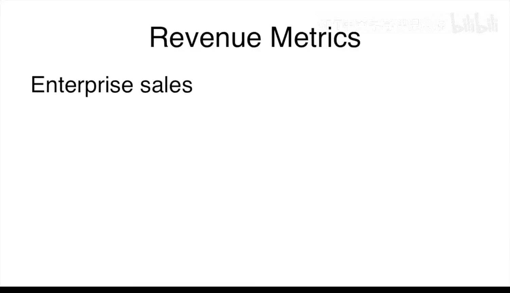

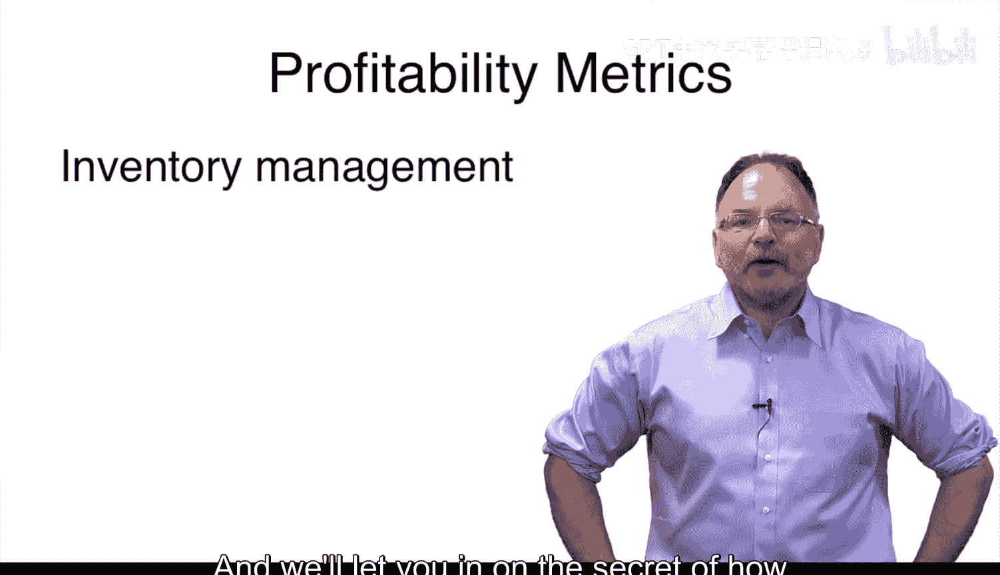

在本节课中，我们将学习用于评估公司库存管理效率的关键指标。库存管理是企业在不降低产品质量的前提下，降低成本、最大化利润的主要方式之一。我们将了解库存的定义、为何需要最小化库存时间，并学习如何计算和分析库存周转天数。

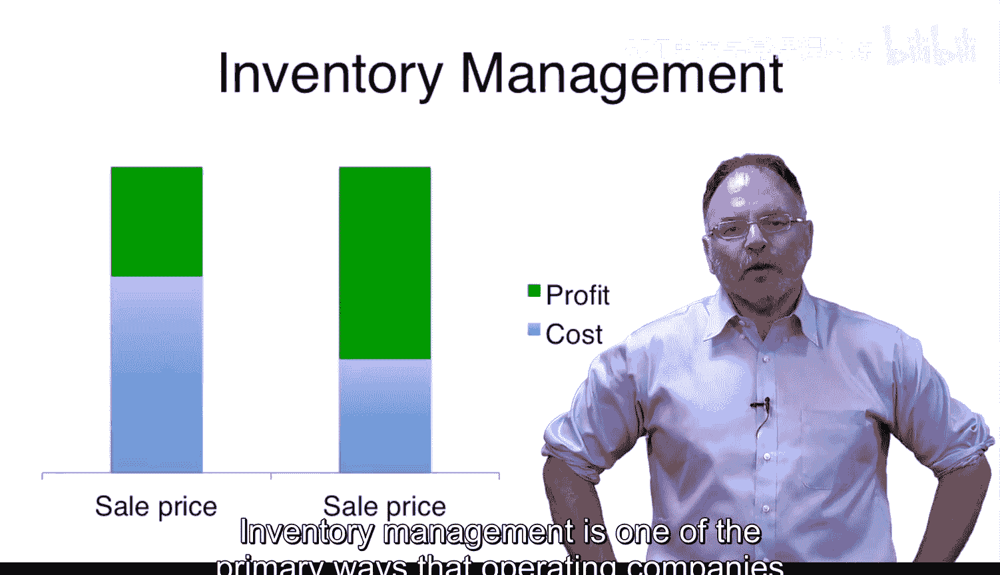

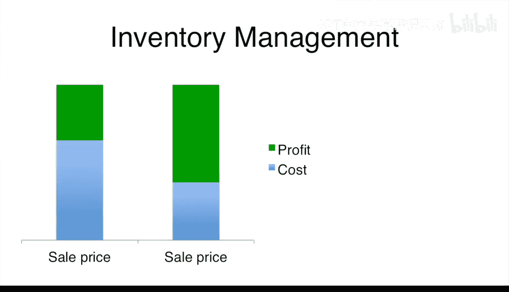

上一节我们介绍了企业销售相关的收入指标，本节中我们来看看盈利能力和效率指标，特别是广泛用于评估公司库存管理效率的指标。同时，我们还将揭示如何以最低价格预订酒店客房的秘密。

## 为何关注库存管理？🤔

库存管理是运营公司降低成本、最大化盈利能力的主要途径之一，且无需以任何方式降低所售商品的质量。

## 定义库存 📦

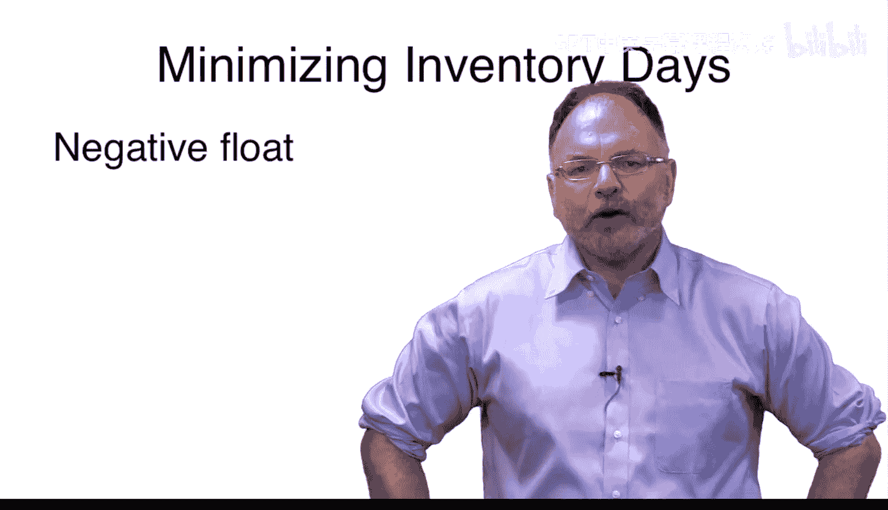

库存通常指等待被购买的成品，通常存放在零售店的货架上，或位于工厂与客户之间的物流仓库中。

产品从制造到售出之间闲置的时间越长，对制造商而言效率就越低。库存时间会侵蚀利润。

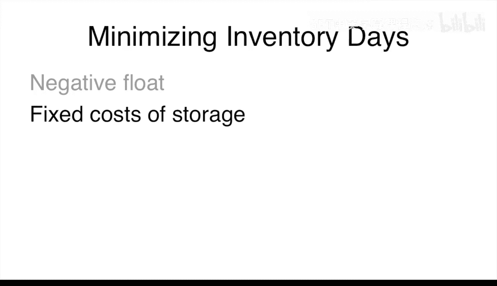

以下是需要最小化库存时间的四个主要原因。

以下是需要最小化库存时间的四个主要原因。

1.  **负现金流**：你应该从“Eggs Roast Coffee”案例研究中熟悉这个问题。向零售商供货的制造商通常要等到商品在零售端售出后才能收到货款，但生产该产品的资金已经支出。这种负现金流需要营运资金，也意味着利息支出。负现金流的时间越长，支付的利息就越多。如果公司信用不佳，且负现金流意外增加，它可能会在等待库存售出的过程中耗尽现金。
    *   例如，零售服装店尤其容易因店内未售出库存导致的现金流问题而被迫破产。在美国，仅2015年前六个月，就有三家大型零售连锁店（Wet Seal、Cache 和 Simply Fashion）宣布破产。
2.  **固定的仓储成本**：每天为仓库或零售店供暖、照明、空调、支付租金、安保及其他维护都需要成本。产品在货架上存放的时间越长，需要分摊给它的仓储成本就越高。
    *   例如，假设一个家具仓库和展厅的固定成本为每年10万美元，它有空间展示200套完全组装好的豪华餐桌。这些餐桌的平均售价为1200美元。如果平均库存周转率为每年一次，则意味着我们每年将售出200张桌子，我们需要将10万美元分摊到这200个单位上，即每张桌子500美元的仓储成本。如果平均库存周转率为每年五次，那么我们只需要为每张桌子分摊100美元，这看起来更合理。
3.  **损耗**：平均而言，库存物品在库存中存放的时间越长，其价值就越低。有些库存物品会完全损耗。如果它们没有立即售出，其价值会降至0。考虑新鲜烘焙的面包或必须在制作当天售出的餐厅食物。这些都是极端例子，其中每单位未售出的额外库存都是完全损失。库存损耗的其他例子包括任何有保质期的产品。在美国和其他国家，许多杂货商品都有规定的“销售截止日期”，超过此日期则依法不得销售。我们稍后将单独考虑的一种特殊完全损耗情况是酒店客房和航空公司座位。如果它们在“过期日”之前没有售出，其作为库存的价值将变为零。
4.  **过时**：在库存中存放六个月或更长时间的物品，实际上可能是永远没有人想再购买的东西。可能是该产品的产量超过了全球需求，或者产品已经过时并被更好的产品取代。或者时尚已经改变。物品在库存中存放的时间越长，其最终需要在不销售的情况下被处置、造成完全损失的风险就越大。

## 库存周转天数 📅

基于上述原因，**平均库存持有天数**（缩写为“库存天数”）是一个非常有用的业务跟踪指标。

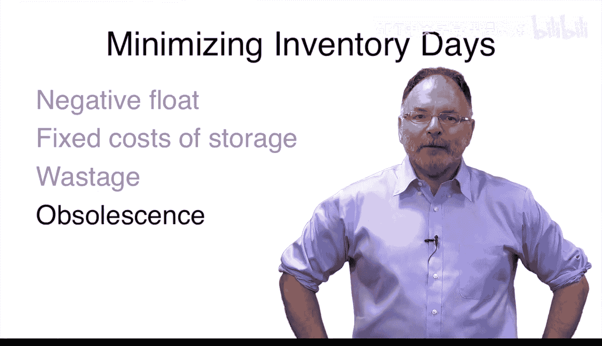

然而，没有多少公司愿意公开其库存天数数据。不过，我将与您分享一个便捷的技巧，用于根据上市公司必须在年度报告中包含的数字来估算其库存天数。

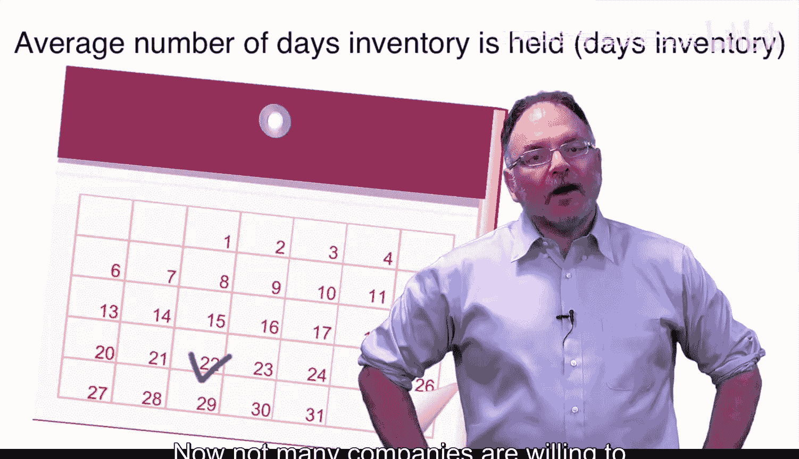

上市公司年度报告将包括年末库存价值以及年度销售成本总额。库存价值使用与评估销售成本相同的会计方法，因此这是同类比较。公司年末库存除以年度销售成本总额，再乘以一年的天数（365），就是对平均库存天数的很好估计。

**公式：**
`库存天数 ≈ (年末库存价值 / 年度销售成本) × 365`

我们将以沃尔玛为例进行计算，数据来源于Investopedia.com（一个拥有优秀商业指标术语表的网站）。

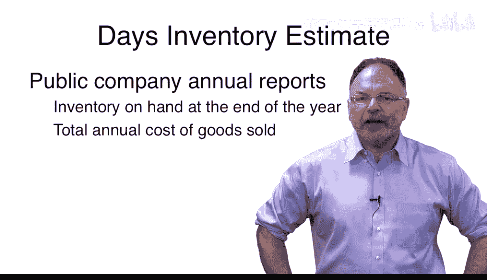

截至2014年1月的财年，沃尔玛年报给出年末库存为449亿美元，年度销售成本为3581亿美元。

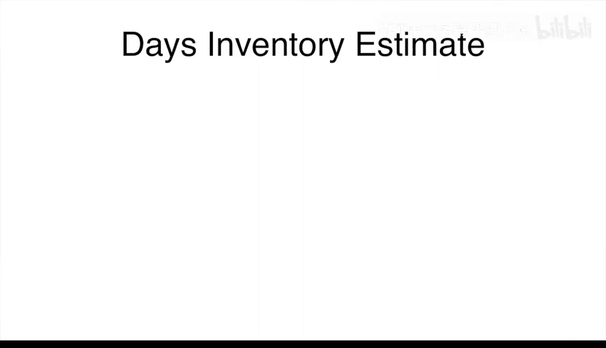

沃尔玛该年度的估计库存周转天数计算如下：44.9除以358.1，等于0.125，再乘以365，结果约为46天。沃尔玛平均在46天内售出其所有库存，考虑到每家沃尔玛需要备货的滞销商品数量，这相当令人印象深刻。一家沃尔玛商店通常备有超过10万个不同的产品SKU。

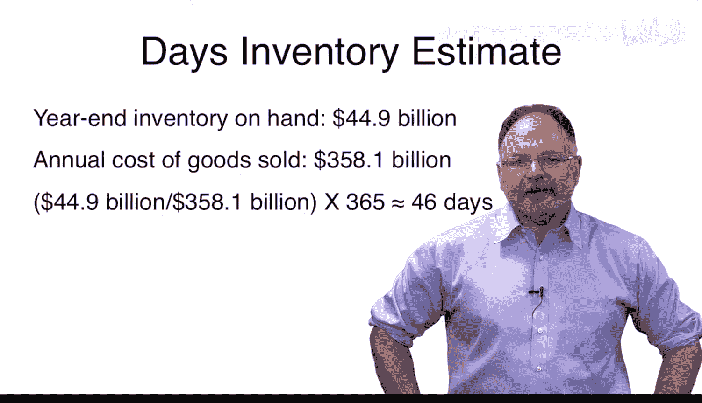

## 深入分析：SKU级别的动态跟踪 🔍

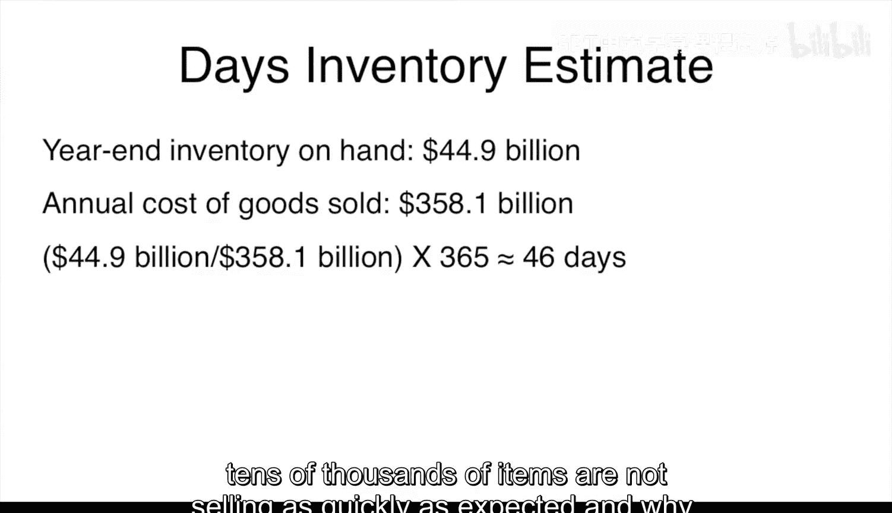

库存天数指标很好，但它没有告诉我们成千上万种商品中，哪些没有按预期速度销售以及原因。

可能是特定产品具有季节性、不再流行、或因有缺陷被客户退回。这些都是我们希望立即了解的动态指标。

所有拥抱大数据文化的公司（包括美国主要的零售杂货连锁店，如沃尔玛、7-11、好市多等）都在单个产品SKU级别跟踪库存周转和库存天数。

他们进一步按国家地理区域甚至单个商店细分该分析。这是通过跟踪本地管理层重新订购任何商品的日期和数量（通常还包括商品上架时间）来实现的，并与收银台销售数据（记录所有销售的确切时间和SKU）进行比较。

例如，如果北卡罗来纳州的一家商店每年销售50把雪铲，且所有销售都发生在12月至3月之间，那么让他们在4月至11月期间持有雪铲库存是没有意义的。

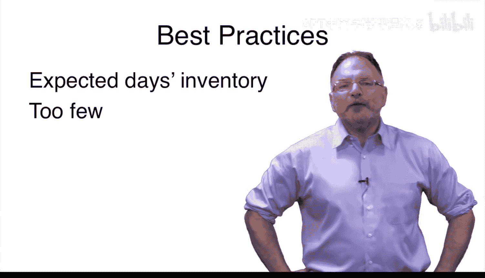

在最佳实践系统中，每个产品SKU都有其自己预期的库存天数，并根据地区和季节性因素使用数学模型进行调整，这有助于确定应为其分配多少货架空间。任何时候发现实际库存天数与预期不同，这就是一个需要关注的警告信号。

另一个问题是货架上某商品数量太少。我们无法直接测量有多少次潜在客户因为想要的商品缺货而不高兴地空手离开，但一个衡量“空手而归的流失客户”的好代理指标是任何特定SKU的库存达到零的次数。从品牌声誉的角度来看，手头至少备有一件你可能预期会销售的商品是非常可取的。

正如彭博社记者梅根·麦卡德尔在2013年的一篇文章中所说：“沃尔玛曾试图削减其承载的SKU数量，但最终不得不将它们重新上架，因为这导致了投诉和销售损失。”产品的单位销售量越高，每次我们看到零库存时潜在的营收损失就越大。一个极好的做法是，每当观察到潜在客户空手离开大型零售店时，派一位友好的市场研究员手持5美元礼品券追上他们，并询问：“您今天有没有在找某样我们货架上没有的商品？”事实上，我注意到昨天在我当地的杂货店（一家大型全国连锁店的一部分），员工现在接受培训，在结账时会问：“今天有什么东西您没找到吗？”我每次都想回答“是的，鸸鹋蛋”，希望某个数据分析师会决定他们应该储备鸸鹋蛋。您也可以试试。

## 总结 📝

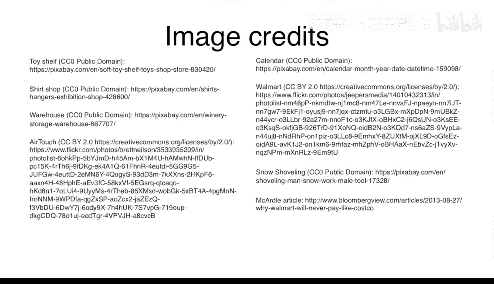

本节课中我们一起学习了库存管理的关键效率指标。我们了解到库存持有时间过长会因负现金流、固定仓储成本、损耗和过时而侵蚀利润。**库存周转天数**是一个核心指标，可以通过`(年末库存 / 销售成本) × 365`来估算。更重要的是，现代企业需要在单个SKU级别动态跟踪库存，考虑地区和季节性因素，并警惕库存异常（过高或为零），以优化库存水平、减少损失并提升客户满意度。高效的库存管理是提升企业盈利能力的关键杠杆。