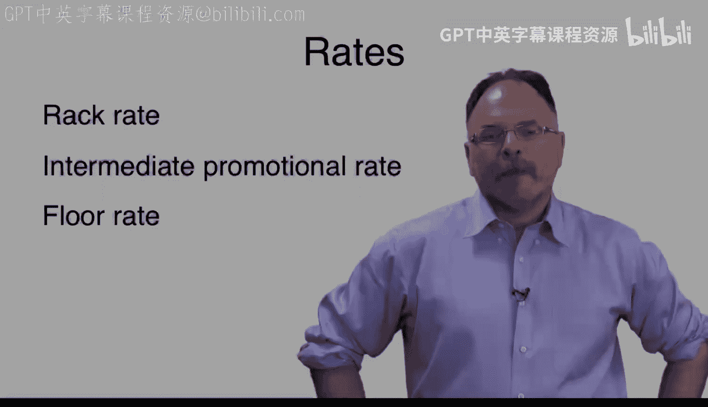
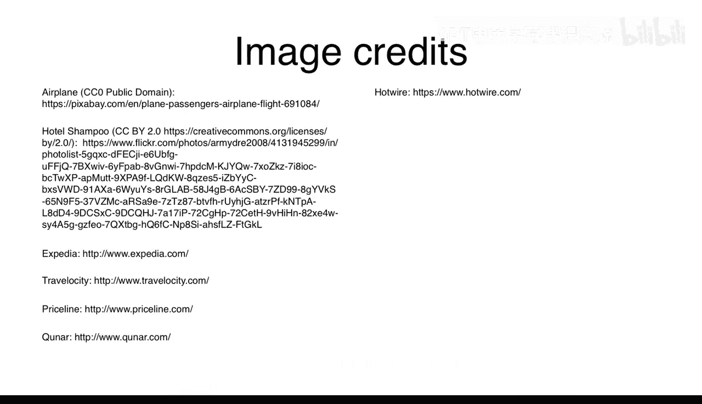

#  012：酒店客房入住率优化 🏨

在本节课中，我们将要学习如何将商业分析应用于酒店业，通过优化客房入住率来提升盈利能力。我们将探讨酒店客房作为一种“易逝资产”的特性，并学习如何利用数据分析来制定动态定价策略。

---

并非所有库存中的易逝资产都是传统意义上摆在货架上的产品。两个重要的例子是机票和酒店客房。以下是为何可以将它们视为完全易逝资产的原因。

航空公司有定期航班，例如从罗利-达勒姆机场飞往旧金山。如果航空公司填满那个座位，其最低可变成本仅仅是额外燃料，用于承载可能增加的约100公斤乘客及其行李，或许还有一瓶水和一些花生。与该座位相关的几乎所有成本都是固定成本或沉没成本。航空公司不能因为航班上有一个空座位，就在飞机租赁、维护或支付飞行员和机组人员工资上减少开支。如果座位没有及时售出，创造该座位的资金就完全浪费了。

类似地，在任何给定的夜晚，一间未被租出的酒店客房对酒店所有者来说都代表着一个失去的机会。租出一间房的变动成本非常低，主要是提供干净床单和一小瓶洗发水的成本。使该酒店客房可供使用的几乎所有成本都是不可收回的固定成本，即沉没成本。

今年六月，我为了参加Coursera的一个研讨会，在森尼维尔的格兰德酒店从周六住到周五晚上。我被告知，同一间客房在一周中每晚的价格都不同。这就是**可变定价**。

---

上一节我们了解了酒店客房作为易逝资产的特性，本节中我们来看看酒店如何制定其可变定价策略。答案当然是**商业分析**。我们将看一个将商业分析应用于入住率指标的简化模型。

假设一家酒店在过去两年里，每晚对所有基础客房收取固定的150美元房价。查看过去两年的数据，该酒店的入住率略高于平均水平，为66.4%（这些数字是我虚构的。美国酒店的平均入住率在2013年和2014年分别为62.3%和64.4%）。到目前为止，这没什么用。

然而，如果我们按星期几重新计算平均入住率，会看到以下模式。

以下是按星期几划分的入住率数据：

*   **周一**：85%
*   **周二**：90%
*   **周三**：95%
*   **周四**：88%
*   **周五**：45%
*   **周六**：30%
*   **周日**：40%

显然，在工作日有更多人前往该酒店旅行，周三是高峰日，而周六和周日的旅行者则少得多。商务旅行者希望周末和节假日在家。这告诉我们这主要是一家商务酒店。

我们可以从这些周度数据推断，如果我们对周一、周二和周四收取稍低的价格，对周五、周六和周日的客房收取更低得多的价格，或许能够提高整体入住率。

---

上一节我们发现了入住率的周度模式，本节中我们进一步深入，看看周三的特殊情况。如果我们更深入地研究周三的入住率数据，会发现除了周度模式外，还存在季节性模式。

例如，感恩节前的那个周三，入住率可能是35%。圣诞节后那一周的周三，只有40%。而八月的周三，入住率可能达到75%。我们假设平均周三入住率是95%，而九月、十月、三月和四月的周三入住率是100%，这意味着酒店在这些月份的周三完全售罄。

因此，我们正在拒绝数量未知的客人。在九月、十月、三月和四月的周三，我们的需求超过了供应。虽然不清楚需求超过供应的具体程度，但很明显，我们在那些夜晚的收费可能低于我们能够收取的价格。

所以，我们对周三的策略可能是根据一年中的时间收取三种不同的价格：对节假日和八月的周三收取低于150美元的价格；对大多数周三保持150美元；对四个商务旅行高峰月的周三收取高于150美元的价格。

---

那么，我们应该提高或降低多少价格呢？这就进入了权衡价格与需求的复杂模型领域。这些模型的最佳基础是**经验性的**：尝试不同的价格，观察房间是卖得太慢还是太快。

以下是实现此目的的一种方法：在在线旅行社（OTA）网站上列出批量客房。OTA对酒店来说并非理想选择，因为它们会收取客房价格10%到25%的佣金，因此酒店更愿意直接向消费者销售。

然而，一个典型的策略是：将特定夜晚的一批客房以预先商定的价格分配给一个OTA。如果OTA未能全部售出，未售出的房间将释放回酒店，由酒店尝试直接销售。OTA为酒店提供了一种机制，可以在不同日期测试不同价格，以观察该批客房是否以该价格售罄。

---

酒店在试验其公布价格或门市价（即未打折的客房价格）时面临一个挑战：即使是对价格不敏感的最后时刻商务旅客，这个价格也会成为新的最高价。

理想情况下，我们的酒店希望能够以较低的价格（甚至可以低至其理论上的盈亏平衡价格，即所谓的**底价**）提供一些房间，以吸引度假旅行者，同时为我们的商务旅行者保持较高的价格。

有一种方法可以实现这一点。给定客房的最低价格通常出现在所谓的**不透明库存市场**中。在不同时期，Expedia、Hotwire、Priceline、Kayak和Travelocity等都提供过此类服务。它们仅按价格提供某个城市的房间，可能也提供一些基本的评级类别信息（如酒店的星级），但不会透露酒店名称或任何其他可能让你识别出是哪家酒店的信息。

不透明库存市场的买家只有在购买完成后才知道他们将入住哪家酒店，并且所有购买都不可更改且不可退款。这种不确定性和不可更改性对商务旅行者没有吸引力。因此，这个市场使得酒店有可能在同一晚对同一房间保持至少两种不同的价格。

---

尽管关于不透明库存市场规模的确切统计数据很少，但我怀疑这个市场约占美国和加拿大酒店客房销售的2%到4%，并且可能没有增长。高档酒店不希望公开他们正在以比同一晚相同房间通常价格低30%到60%的价格出租一些房间。

此外，对酒店来说，不透明定价交易即使有利润，也往往微乎其微。价格往往接近所谓的**底价**，这是基于分配给每间房的固定成本加上一间房的变动成本，计算出的酒店每间房的盈亏平衡点的会计计算结果。

除了不透明定价，酒店可以也确实在使用各种模型，以介于门市价和底价之间的价格销售房间。例如，当酒店意识到有些房间可能无法售出时，他们可以向邮件列表或移动短信列表中的客户提供门市价的折扣，这些客户过去曾对该酒店或该品牌表现出一定的忠诚度。有一定品牌联系或品牌忠诚度的人会愿意支付高于不透明库存底价的价格。

---

那么，酒店何时应该以门市价的80%向忠诚客户提供房间呢？答案是：当房间在到期前以挂牌价租出的概率低于80%时。

总而言之，酒店客房通常每晚至少有三个潜在价格：**门市价或挂牌价**、**底价**，以及酒店可以在最后时刻向忠诚客户提供的**中间促销价**。只有底价是恒定的。挂牌价和促销价会根据星期几和一年中的季节而变化。因此，理论上，一家酒店在一年内可以以超过1000种不同的价格出租同一级别的房间。

---

本节课中我们一起学习了酒店客房作为易逝资产的特性，以及如何利用数据分析来制定动态定价策略以优化入住率。我们探讨了从固定定价到基于周度和季节性模式的可变定价的转变，介绍了门市价、底价和促销价的概念，并了解了不透明库存市场在价格区隔中的作用。通过应用这些商业分析技术，酒店可以更有效地管理需求，最大化收入潜力。