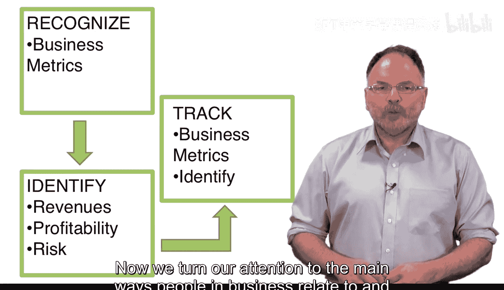
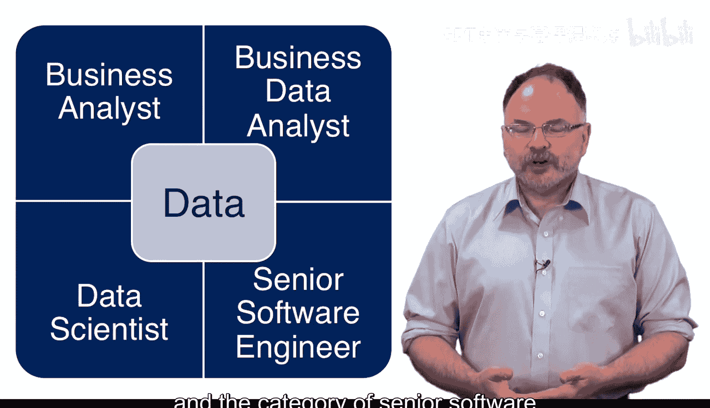
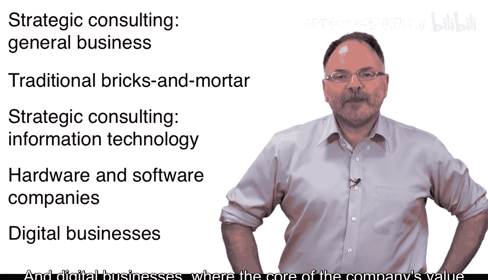

#  014：大数据背景下的角色与企业关联 📊

在本节课中，我们将探讨商业环境中人员如何与公司数据互动和协作。我们将介绍一个简化的角色分类框架，并分析不同类型公司与大数据的基本关系。理解这些内容有助于你明确职业方向，并评估所在公司的数据分析成熟度。

## 角色分类框架 👥

上一节我们学习了如何识别重要的商业指标。现在，我们将注意力转向商业人士与公司数据互动的主要方式。

我们提出了一个简化的框架，将主要角色分为四类，并对应四种不同的职位头衔。

以下是四种主要角色类型：

*   **商业分析师**
*   **商业数据分析师**
*   **数据科学家**
*   **高级软件工程师或技术项目经理**

## 本课程与职业角色的关联 🎯

接下来，我们解释本专项课程与这些角色的关联。

关联很简单。任何成功完成本专项课程的人，都将为担任商业分析师或商业数据分析师的初级职位做好充分准备。

数据科学家职位需要额外的技能和工作经验。但如果你有志于未来成为数据科学家，完成本专项课程后，你将清楚地了解需要采取哪些步骤来实现目标。除了少数拥有统计学、计算机科学及相关领域博士学位直接进入行业的人，大多数在职数据科学家都是几年前从商业数据分析师起步，并在工作中学习了所有额外所需的技能。美国也有许多优秀的硕士项目可以为你从事数据科学家职业做准备。

另一方面，高级软件工程师/项目经理的职业道路与商业分析师/数据科学家的职业道路截然不同，其培训和要求也大相径庭。我们将解释其原因，并讨论在优秀公司中，商业分析师、商业数据分析师、数据科学家和软件工程师如何合作与协作以取得卓越成果的最佳实践。

## 公司与大数据的关系 🏢

在考察了与数据相关的不同类型工作后，我们将思考数据在各类公司成功中扮演的角色。

我们根据公司与大数据的基本关系，将公司分为五种类型。

以下是五种公司类型：

1.  **专注于通用业务的战略咨询公司**
2.  **所有行业中的传统实体公司**
3.  **专注于信息技术或系统集成的战略咨询公司**
4.  **销售用于收集、存储、分析和使用大数据的硬件、软件或软件即服务的公司**
5.  **数字业务公司，其价值创造的核心涉及数据的实时分析**

## 实体公司的数据分析成熟度 📈

在庞大的实体公司类别中，一些公司已经完全接纳了我称之为“大数据文化”所带来的机遇。

例如，在美国的杂货零售领域，**好市多**是运用数据分析最佳实践的优秀典范。而像**Food Lion**这样的公司则相对落后。还有像**A&P**这样的公司似乎不知从何开始，事实上，A&P现在已经破产。

因此，识别你的公司在采纳数据分析最佳实践的频谱上处于什么位置显然非常重要。我们将提供一些方法和工具，帮助你能够做到这一点。

我们还包含了一些简短的访谈，让你可以直接聆听目前在数据分析职业中蓬勃发展、但在不同类型公司中扮演多种不同角色的人们的经验。

## 总结 ✨

本节课中，我们一起学习了商业数据分析领域的四种关键角色及其与课程的关联，并了解了五类公司与大数据的不同关系模式。我们还认识到，即使在传统实体公司中，对数据分析的接纳程度也差异巨大，这直接影响其竞争力。理解这些框架有助于你规划职业路径，并评估企业利用数据驱动决策的能力。