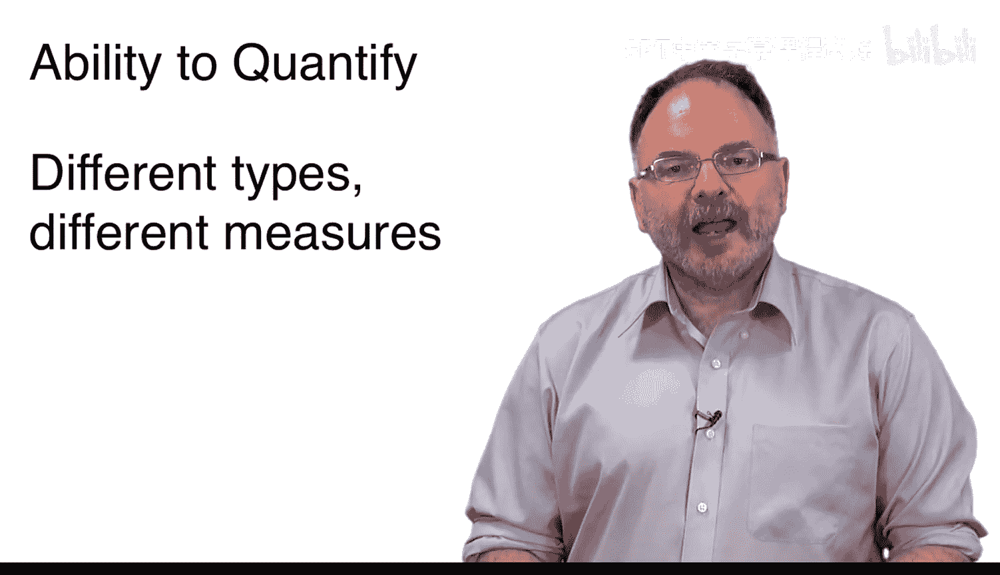
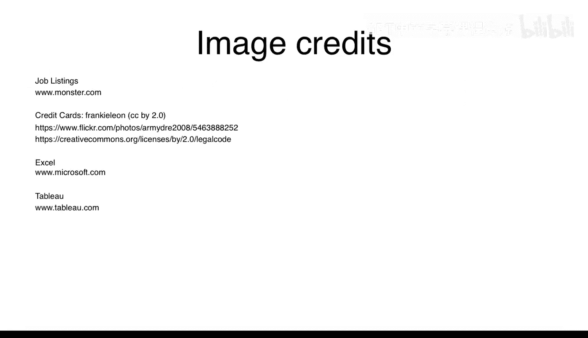

#  015：业务分析师的核心技能 📊

在本节课中，我们将探讨业务分析师这一职位所需的核心技能。通过分析大量招聘广告，我们发现“业务分析师”这一头衔涵盖的工作范围非常广泛，职责要求也各不相同。我们将聚焦于所有这类职位共同要求的核心能力，并将其分解为七个关键领域。

## 概述

业务分析师需要将商业问题转化为可分析、可执行的方案。这要求他们不仅具备技术能力，还需理解业务本身。接下来，我们将逐一解析这七个核心技能领域。

## 核心技能详解

上一节我们概述了业务分析师角色的多样性，本节中我们来看看所有成功候选人都应具备的七项核心技能。

以下是业务分析师需要掌握的第一项核心技能：

1.  **识别关键业务指标的能力**
    这指的是对特定公司所在行业领域的深入了解。到目前为止，我们讨论的多是适用于许多行业的横向业务指标，例如企业销售漏斗。然而，许多指标只在特定的垂直市场或行业领域内才具有相关性。每个行业都有其专业指标以及通用指标，这些专业指标有其自身的概念和词汇。在本课程中，我们将涵盖几个主要垂直市场（包括房地产和金融服务）的行业特定指标。请记住，若想为其他垂直市场的业务分析师职位做准备，你需要对该行业特有的、衡量其成功、效率和风险的关键指标进行额外的行业特定研究。

在明确了需要分析哪些指标后，下一步就是如何分析它们。以下是业务分析师需要掌握的第二项核心技能：

2.  **应用合适模型分析指标的能力**
    业务分析师需要了解的模型可以在 Excel 中运行。本课程将涵盖跨多个行业使用的最重要的通用模型。值得花点时间澄清一下我们所说的“模型”是什么意思。模型是我们用简化的数学形式来代表现实世界情况的方式。例如，在银行整体信用卡违约风险的模型中，信用卡用户与卡片互动的全部行为（从总是按时全额还款，到有时错过最低还款额，再到严重拖欠但计划补上，乃至故意累积债务后消失）过于复杂。因此，一个模型可以将他们仅分为两类：违约和非违约。然后，我们可以利用历史模式来预测下个月有多少客户会从一类转移到另一类。这将是一个用于违约风险的二元分类模型。模型之所以有用，是因为它们比它们所代表的混乱现实更简单、更小巧，并且它们使用数学公式来代表现实，这使得修改模型、用于预测未来等变得容易。本课程的模型都可以在 Excel 中设置和执行。在课程二中，我们将深入讨论商业分析中最重要的模型。

建立了模型之后，我们需要评估其表现。以下是业务分析师需要掌握的第三项核心技能：

3.  **量化模型有效性的能力**
    不同类型的模型依赖不同的指标来衡量其表现。我们将研究所有最常用模型类型的标准性能衡量指标。例如，我们上面提到二元分类模型可用于预测未来的违约率。但进行二元分类的方法有很多种，选择我们可用的最佳方法（基于我们拥有的数据和其他限制条件）需要有一种公认的方式来比较所有二元分类模型之间的性能。正如我们稍后将看到的，有一个通用指标可以比较任意两个二元分类：**ROC曲线下面积**。关于此的更多细节将在课程二中介绍。

技术分析能力固然重要，但理解业务需求是分析的起点。以下是业务分析师需要掌握的第四项核心技能：

4.  **倾听与访谈的能力**
    这包括访谈客户（内部或外部）以定义项目需求。业务分析师的大部分工作成果以各种报告的形式呈现。一份报告可以是客户需求文档，将客户所述的需求转化为公司能够交付的产品功能和确切服务。或者，一份报告可能仅供内部使用，客户是营销副总裁或销售团队。一份有效的报告能够将问题“操作化”，它清晰地阐明了为解决该问题需要采取的具体步骤、由谁执行、按什么顺序执行。这些步骤随后可以被衡量和跟踪。我们将在本课程后续部分给出更多示例。

将需求转化为分析，离不开强大的工具支持。以下是业务分析师需要掌握的第五项核心技能：

5.  **Excel 技能**
    *   **基础技能**：包括识别业务数据中的模式和趋势、进行预测、组织财务信息以及在图表中展示结论的能力。
    *   **中级技能**：例如导入和管理大型数据集、开发和测试不同模型以及使用规划求解运行优化的能力。这些主题将在课程二中深入讲解。

分析结果需要有效地传达给决策者。以下是业务分析师需要掌握的第六项核心技能：

6.  **演示技能**
    即使用 PowerPoint 进行有效、清晰、简洁且有说服力的口头和书面沟通。这个主题将在课程三中深入讲解。

最后，为了让非技术受众也能直观理解你的发现，可视化是关键。以下是业务分析师需要掌握的第七项核心技能：

7.  **使用数据可视化的能力**
    这能使你的结论和建议对非技术受众来说变得直观易懂。在本专项课程中，我们将教授商业领域最广泛使用的数据可视化工具之一 **Tableau** 的使用。同样，这个主题将在课程三中深入讲解。

## 总结

本节课中，我们一起学习了成为一名成功的业务分析师所需具备的七项核心技能：从识别行业特定指标、应用和分析模型，到倾听需求、运用 Excel 工具，再到通过演示和数据可视化清晰传达见解。这些技能共同构成了将数据转化为商业价值的完整链条，我们将在后续课程中对其中多项技能进行深入探讨。