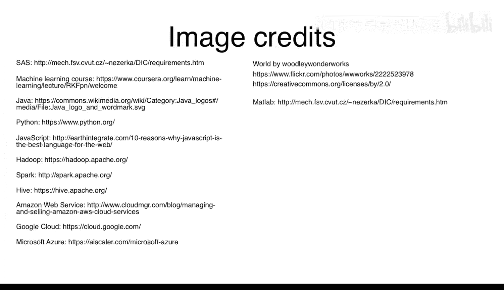

#  019：数据科学家 👨‍🔬

## 概述
在本节课中，我们将要学习数据科学家这一新兴的领导角色。我们将了解其定义、重要性、核心职责，以及成为一名数据科学家所需掌握的、超越商业数据分析师的额外技能。

## 什么是数据科学家？
数据科学家是一个新兴的领导角色。这一角色具有跨学科性质，其职责范围在不断演变。尽管如此，数据科学家正日益被视为至关重要的职位。目前，市场对熟练数据科学家的需求远远大于供给。

在过去十年中，很难想象任何有竞争力的、追求规模化的企业，能够在没有协调一致地整合以下三个要素的情况下，在其市场中生存，更不用说发展和取胜了。

## 数据科学家的核心职责
数据科学家的核心职责是协调整合以下三个关键要素，以支持企业决策。

**1. 建模、机器学习与预测**
这指的是利用模型、机器学习算法进行预测分析的环境。

**2. 数据驱动的业务流程**
这指的是一个关键业务流程数据被持续捕获、存储、分析，并在整个组织内更新和共享的环境。

**3. 实时或准时的决策支持**
最后，数据需要以实时或准时的方式传递给决策者。

在许多情况下，决策者本身就是一个计算机算法，它无需人工输入即可实时决定如何与客户互动，就像我们之前讨论过的亚马逊推荐引擎一样。这需要对用户体验设计过程产生重大影响，并需要投入更多的软件工程资源。

在其他情况下，需要将客户最近的交易信息提供给销售或支持人员，以便他们在与客户联系时，了解迄今为止发生的一切。准时的标准就足够了，但这同样需要付出巨大努力来设计、构建和维护公司的数据存储与检索系统。

无论在哪种情况下，数据科学家都是那些能够把握大数据在显著改进业务流程方面的可能性的人。他们能够将公司的业务目标和需求转化为数据库架构和软件工程术语，同时也能将工程师的需求和关注点转化为公司非技术管理层能够理解的语言。

## 超越商业数据分析师的技能要求
成为一名数据科学家的要求始于商业数据分析师所需的相同技能。但数据科学家还需要熟悉大量额外的技术和概念。数据科学家需要是宏观蓝图的大师，理解不同的工具和技术如何整合形成一个连贯的整体。

我们已经确定了数据科学家需要具备的、超越商业数据分析师九项技能的八个额外技能领域。以下是这八个技能领域的详细介绍：

**1. 更高级的建模工具**
至少对 **R**、**Matlab** 或 **SAS** 其中之一具备中高级知识。

**2. 高级统计方法**
大多数数据科学家至少在大学或在线课程中学习过一门微积分级别的概率与统计推断课程。本专项课程的第二课将介绍你在此类课程中会遇到的大部分高级主题，但以入门方式进行，以便你自己决定是否有兴趣深入学习这些主题。

**3. 贝叶斯学习与概率模型**
用于预测分析的机器学习算法。机器从数据中学习的方式，通过贝叶斯假设和贝叶斯方法得到了很好的体现。几乎所有实时决策系统都依赖机器学习来确保决策反映最新的数据输入。同样，第二课将简要介绍这些主题。

**4. 额外的关系型数据库技能**
至少包括如何填充（即向数据库中存入数据）和优化（使提取数据更快）**SQL** 数据库。

**5. 关键通信技术的中级知识**
了解用于在客户层（通常是网络浏览器或移动应用）和数据库层之间通信的最重要技术。这些工具是 **Python**、**Java** 和 **JavaScript**。

**6. 管理分布式和非结构化数据的经验**
包括 **Hadoop**、**MapReduce**、**Hive**、**Pig** 和 **Spark** 等工具。

**7. 自然语言处理工具与方法的基础知识**
用于情感分析等应用。

**8. 大规模可扩展的云数据托管与处理经验**
使用 **Amazon Web Services (AWS)** 或其最接近的竞争对手之一，如 **Microsoft Azure** 或 **Google Compute Engine**。

## 总结
本节课中，我们一起学习了数据科学家这一关键角色。我们了解到，数据科学家是连接业务需求与技术实现的桥梁，负责整合建模预测、数据流程和实时决策支持。要胜任这一职位，不仅需要具备商业数据分析师的核心技能，还需掌握从高级统计、机器学习算法到数据库优化、云计算等八大领域的扩展技能。这使其成为当今数据驱动商业环境中需求旺盛且至关重要的领导者。