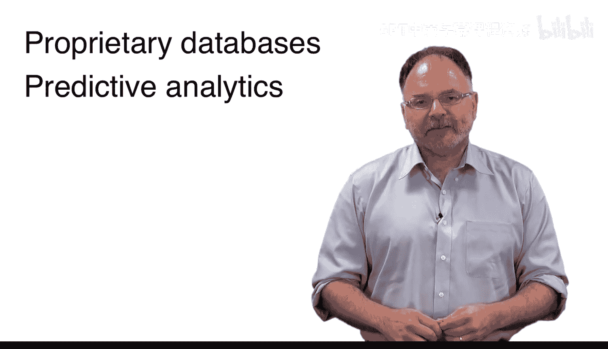
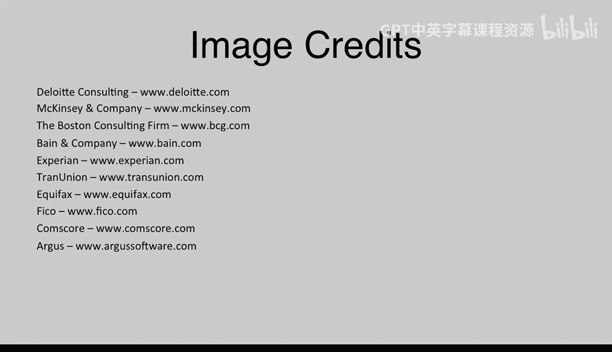

#  023：传统战略商业咨询 🏢

在本节课中，我们将要学习传统战略商业咨询公司的运作模式、核心业务以及它们如何依赖数据分析来为客户提供价值。我们将了解不同类型的咨询公司及其对商业分析师和数据科学家的需求。

---

战略商业咨询公司为希望在不断变化的全球数字经济中保持竞争力的公司提供关于最佳实践的专家建议。

战略咨询公司的大部分工作基于收集和分析数据，并利用这些数据向客户推荐业务流程的改进方案。为此，它们需要大量的商业分析师。这类公司中规模最大的包括德勤咨询、麦肯锡、波士顿咨询集团和贝恩公司，其年度咨询收入分别超过60亿、50亿、30亿和20亿美元。

通常情况下，商业分析师处理的数据属于客户。咨询公司或客户内部的技术人员会从客户已存储在各种数据库中但未动态使用的数据中提取信息，通常以Excel电子表格的形式提供给商业分析师。

商业分析师研究这些数据，并应用各种模型来发现业务流程改进的机会。

---

上一节我们介绍了通用战略咨询公司，本节中我们来看看一种特殊类型的咨询公司。

这类咨询公司是那些围绕特定行业或市场领域，开发了自有专有数据库及相关预测模型的专业咨询公司。这类咨询公司往往需要更多的商业数据分析师，有时也需要数据科学家。

以下是这类咨询公司的几个例子：

*   **征信机构**：它们收集人们的债务和还款历史信息，并将这些信息出售给银行和其他提供信贷的机构，以帮助它们决定是否应该向某人提供贷款。

---

三大领先的征信机构是益博睿、环联和艾克飞。第四家公司名为**FICO**（前身为Fair Isaac），它利用征信机构最初收集的数据生成一个单一的数字——**FICO信用评分**，用以预测信用价值。FICO分数的范围从300分（信用极差）到850分（信用极佳）。

FICO是最早的数据驱动预测分析公司之一。在美国，每天有超过2400万笔贷款决策使用其评分，这占全美所有贷款决策的90%。

---

除了征信机构，还有其他基于专有数据建立成功咨询业务的战略商业咨询公司。

另外两个例子是**comScore**和**Argus信息与咨询服务公司**。

*   **comScore**：在获得用户许可的情况下追踪网络和移动端的点击流，观察流量去向，相当于网络领域的尼尔森收视率。comScore“衡量人们在数字世界中的行为”。该公司去年的收入为3.39亿美元。
*   **Argus**：它整合了行业内大部分信用卡的交易、余额和还款数据。因此，它拥有征信机构所没有的交易级购买信息。征信机构只知道你在某张卡上欠了多少钱以及你是否逾期还款，但不知道你买了什么以及何时购买。

Argus建立关于消费者行为的模型，细分潜在客户，并帮助银行进行新信用卡的营销推广以及管理信用风险。Argus的收入未单独披露，但它是年收入18亿美元的Verisk Analytics的一部分。

---

本节课中我们一起学习了传统战略商业咨询的生态系统。我们了解到，无论是通用战略咨询公司（如麦肯锡、德勤），还是基于专有数据的专业咨询公司（如FICO、comScore、Argus），其核心都是**数据收集、分析与建模**，以驱动业务决策和流程优化。这些公司是商业分析师和数据科学家的重要雇主，他们利用从Excel表格到大型专有数据库的各种数据源来创造价值。