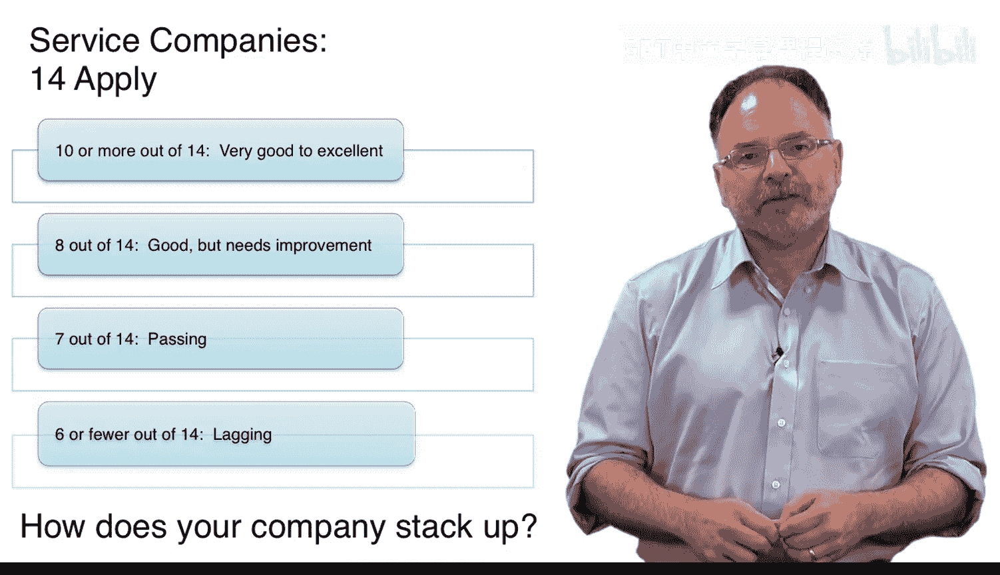

#  024：实体企业

## 概述
在本节课中，我们将探讨实体企业在数字经济时代面临的挑战与机遇。尽管数字技术飞速发展，但全球经济的大部分仍由实体商品的生产、运输和销售构成。我们将重点关注那些正受到数字公司严重威胁的传统行业，并介绍一套评估企业大数据文化成熟度的清单。

## 实体经济的现状与挑战
尽管数字技术呈爆炸式增长，世界经济的大部分仍然由制造实体商品构成。这包括将商品运输到所需地点，或在商店向公众销售商品。

我们显然无法讨论每一种类型的业务。因此，在本课程中，我们将重点关注传统实体经济的某些特定领域。这些领域目前正受到数字公司的严重威胁。这些领域通过采用最佳商业分析实践获益最大，而若停滞不前则损失最大。

## 受威胁的行业领域
受威胁的行业包括但不限于以下领域：
*   **所有形式的消费者零售**：包括书籍、电影、音乐、时尚、电子产品、杂货、家居用品。
*   **金融服务**：包括发行信用卡、向个人和小企业提供其他类型的无担保贷款、支付处理，以及作为投资顾问管理他人资金。
*   **房地产**：特别是酒店房间等短期住宿。
*   **物流与运输**：特别是世界各地的本地出租车行业。

## 实体企业的人才需求
所有规模的实体公司都需要一些商业分析师。但它们同时需要商业数据分析师和数据科学家。它们通常将大部分IT基础设施开发外包给顾问和供应商。但它们仍然需要一些拥有广泛技术IT项目管理经验的个人。

向大数据文化转型的过程在一些公司已经相当深入，这些公司正在进行重大的数据科学和软件开发工作。而另一些公司仍在试图弄清楚它们应该做什么。

## 大数据文化评估清单
以下是一个你可以用来评估一家公司在拥抱大数据文化方面进展程度的清单。该清单共有20个项目，其中19项与产品公司相关，14项与服务公司相关。随着时间的推移，这份清单无疑会演变，它代表了2015年至2016年的行业状况。

以下是评估清单的具体项目：

1.  **移动化与购买体验**：提供其网站的移动版本，并在所有全球市场测试快速加载时间。它是否使用边缘缓存、Akamai等内容交付网络？你是否可以直接从Android和iOS的移动应用以及网页上购买产品和服务？
2.  **用户行为追踪**：追踪访问者的完整点击流（在网站上的确切路径及每点停留时间），而不仅仅是统计独立访客或页面浏览量。
3.  **新用户转化定义**：将新网站访问者的转化定义为两个步骤：首先，个人注册并提供姓名和电子邮件；其次，他们成为产生收入的客户。
4.  **网站功能优化**：对网站功能进行持续的A/B测试，以优化转化为收入的比率。
5.  **广告效益管理**：知道如何实现并维持较高的谷歌广告排名。知道每次点击付费网络广告能盈利的最高价格。这需要同时知道每次点击的收入转化率和新客户的平均生命周期价值。
6.  **客户互动激励**：为客户提供有意义且有效的激励，促使他们在到店访问间隙与公司在线互动。
7.  **个性化实时促销**：理想情况下，基于对客户特定历史的偏好分析，向个人提供实时在线促销优惠。
8.  **产品公司：线上查库存**：（仅适用于产品公司）允许客户在线时查看其本地商店货架上的商品。
9.  **产品公司：线上下单，门店提货**：（再次仅适用于产品公司）允许客户提前下单并在商店提货。
10. **产品公司：快速配送合作**：与第三方购物和配送服务合作，实现从最近商店当日或更短时间内的配送（针对产品公司）。
11. **服务公司：服务交付速度**：（服务公司的等效项）确保无论你提供何种服务，你完成服务交付的速度都与你的在线竞争对手一样快。例如，如果你提供贷款，借款人收到钱的速度是否与从你的在线竞争对手那里一样快？
12. **客户信息整合**：追踪与客户的所有互动（销售、投诉、网络互动），将其归集在数据库中的单一客户记录ID下，并在与客户互动时“准时”提供这些信息。
13. **会员与忠诚度计划**：通过增值会员和忠诚度计划（如Costco会员或Amazon Prime）识别经常性收入的机会。
14. **销售点定制化**：在结账时，根据特定客户过去的购买兴趣，为其提供针对额外产品或服务的定制优惠券。
15. **高价值客户培育**：制定客户激励措施，以奖励和培养你的最高消费客户（在拉斯维加斯他们称之为“鲸鱼”，或航空公司中的“行政白金卡”客户）。
16. **客户流失管理与召回**：持续跟踪客户流失率，并对静默一段时间的客户进行跟进，提供特别激励以吸引他们回归。
17. **产品公司：门店级库存跟踪**：（仅适用于产品公司）在门店级别跟踪所有库存单位，以防止库存天数过长。
18. **产品公司：缺货与需求研究**：（产品公司）跟踪所有零库存商品以消除空货架，并进行研究以识别客户需要但未进货的产品。
19. **产品公司：精细化库存管理**：（产品公司）按门店、地区、季节甚至星期几来调整单个商品的库存水平，以平衡最小化库存天数和浪费与避免缺货。
20. **临期促销与减损**：提供有效的降价和最后一刻促销计划，以销售任何可能浪费的库存（无论是产品还是酒店房间或机票等服务）。

## 清单评分与解读
以下是你可以为公司评分的方法：
*   **对于产品公司（共19项）**：
    *   **16项或以上**：非常好到优秀。
    *   **14项**：良好，但需要改进。
    *   **11项**：及格。
    *   **少于11项**：你的公司落后了，需要考虑改变其商业文化，或直接退出面临数字竞争的市场。
*   **对于服务公司（共14项适用）**：
    *   **10项或以上**：非常好到优秀。
    *   **8到10项**：良好，但需要改进。
    *   **7项**：及格。
    *   **6项或更少**：公司再次落后，需要改变其商业文化，或考虑退出其正在竞争的数字市场。

## 总结
本节课中，我们一起学习了实体企业在数字经济背景下的核心处境。我们明确了受数字技术威胁最严重的传统行业领域，并详细探讨了实体企业对数据分析人才的需求。最重要的是，我们掌握了一套包含20个要点的评估清单，用于系统性地衡量一家公司在构建大数据文化方面的成熟度。通过这个清单，企业可以识别自身优势与不足，从而制定有效的转型策略，在数字时代保持竞争力。