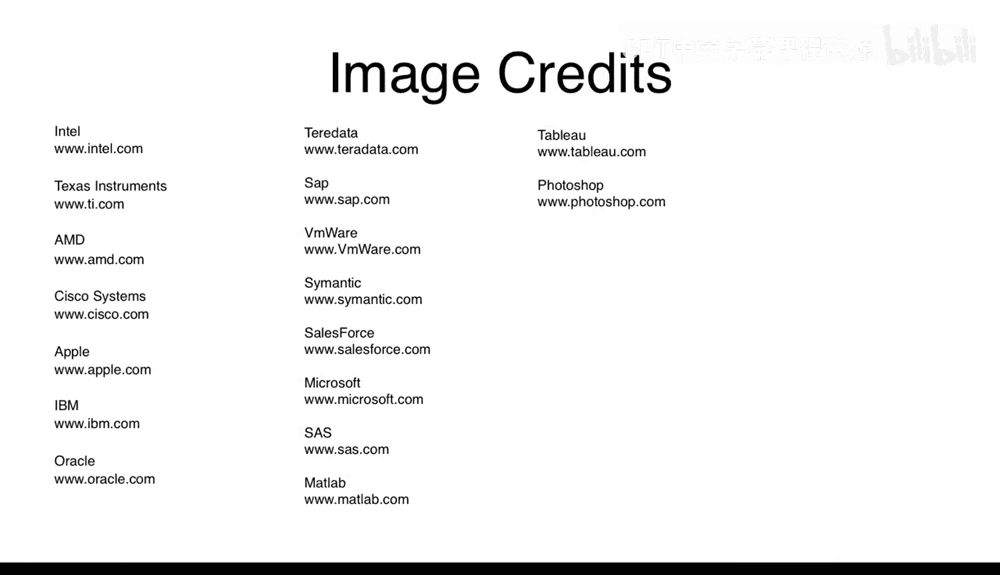

#  027：硬件与软件公司 🖥️💾

在本节课中，我们将探讨硬件与软件公司的商业模式、成本结构以及它们在信息技术产业中的层级划分。我们将了解这些公司如何在大数据时代生存与发展，并认识该领域的主要参与者。

---

硬件与软件公司会雇佣一些商业数据分析师和数据科学家。

但他们的主要需求是熟练的软件工程师和技术项目经理。

公司的价值取决于专有技术的高效开发与交付。

硬件和软件具有不寻常的价格动态。技术开发具有很高的固定成本。

而可变成本通常接近于零。开发一个复杂的企业软件应用，其第一个可销售版本的成本可能高达500万美元。

但第二个以及之后的每一个额外副本，其成本基本上可能只需一美分。

一个新的半导体芯片可能在一个造价50亿美元的晶圆厂中生产。

但该生产线上单个芯片的可变成本。

仅仅是原材料的成本，可能只是价值几美分的纯净硅砂。

大数据文化之所以成为可能，完全是因为当今存储和处理电子信息的成本极低。

如今低得离谱的计算成本，是商业硬件和软件市场50年来激烈价格战的结果。

这些市场由高固定成本和极低可变成本这一不寻常的动态所驱动。

价格战往往将任何商品化产品或服务的价格压低至接近可变成本的水平。

换句话说，大多数市场参与者都在亏损。只有少数能够生存下来。

就我个人而言，在我的职业生涯中见证了数据存储成本下降了百万倍。在1993年。

也就是我创立第一家软件公司的那一年，我曾受邀参观当时世界上最大的商业数据库。

该数据库由位于俄亥俄州代顿的米德数据中心拥有。他们通过拨号调制解调器提供远程访问，访问存储在占地一英亩、运行Unix系统的大型机上的1TB文本数据。

存储那1TB文本的硬件和软件价值超过1亿美元。而现在。

我只需花费64美元，就可以在我的便携硬盘上存储1TB数据。

为了生存，硬件和软件公司要么需要找到方法，成为商品或服务的绝对最低成本提供者。

要么就需要在一个增值的品牌利基市场中占据如此主导的地位，以至于当更低成本的替代品不可避免地出现时，放弃主导品牌所带来的感知转换成本超过了其带来的收益。

接下来，我们将简要介绍在这场达尔文式竞争中生存下来的主要公司。

按照它们主要关注的信息技术堆栈层级来组织。

这些大约20家公司提供了大数据所需的大部分核心技术。

信息技术基础设施通常用一个“堆栈”来描述。

我们高度简化的IT堆栈只有三层：底层是**硬件**。

中层是**数据库和企业软件**。顶层是**桌面商业软件**。

在堆栈的底层是硬件。

芯片和其他组件被组装成机器、服务器和路由器。在这一层级。

是以英特尔为首的半导体芯片公司，其收入为550亿美元。

还包括德州仪器，收入130亿美元，以及AMD，收入46亿美元。

思科是互联网路由器的主要提供商，收入为490亿美元。

一个非常特殊的硬件公司是苹果，收入为2240亿美元。

是世界上最大的IT公司。实际上，按市值计算。

苹果的规模是世界第二大公司埃克森美孚的两倍。

苹果以其成功控制整个堆栈而闻名，从芯片和显示器，到操作系统。

应用程序、外观和感觉、移动设备，一直到iTunes和其自有云存储等专有增值服务。

在堆栈的中层是企业级、可扩展的操作系统、网络服务器软件。

大型关系型和分布式数据库，当然还有大型企业软件应用。

这是只有专业人士才会交互的软件。用户友好的界面往往不存在。

并且很少（如果有的话）考虑让产品直观或易于使用。

这一层的主要目标是可扩展性，当然还有安全性。

企业软件层面的领导者是IBM，收入为860亿美元。

主要专注于为公司构建企业系统。其次是甲骨文。

收入为380亿美元。专注于能够处理高并发流量的大型数据库，以及人力资源。

客户关系管理、财务和供应链领域的企业软件。接下来是SAP。

其供应链和财务系统收入为210亿美元。

一个较小的参与者，也是甲骨文在商业数据库领域最后幸存的竞争对手之一，是Teradata，收入为27亿美元。

赛门铁克，生产企业安全软件，收入为67亿美元。

VMware，生产允许在单台机器硬件上运行多个操作系统和并发用户的企业软件。

收入为60亿美元。一个有趣的混合型公司。

提供非常复杂的企业级软件来管理客户关系管理和销售流程的所有方面。

但将其软件完全作为托管服务提供的是Salesforce.com，收入为41亿美元。

然后是第三层，用户友好的商业桌面软件应用程序，使知识工作者能够访问和处理公司数据。

这一层目前由微软主导，其Microsoft Word、Excel。

PowerPoint等产品收入为860亿美元。稍偏技术的统计和建模软件包包括SAS，收入约为40亿美元。

以及Matlab，由Mathworks私有持有，收入约为7.5亿美元。

此外，还有数据可视化工具，如Tableau，收入为4.68亿美元。

以及数字图像处理工具，如Adobe Photoshop，收入为435万美元。

所有这些硬件和软件公司都有大数据战略。

微软正在进军目前由亚马逊网络服务主导的托管软件即服务领域。

IBM和甲骨文都有云服务产品，IBM甚至在云端托管SAP企业应用。

所有这些公司都试图重塑自我，提供用于人类或计算机驱动决策的即时和实时数据。

大多数公司都有广泛的机器学习和预测分析计划。例如，IBM的Watson。

以及微软的Azure项目。

---

本节课中，我们一起学习了硬件与软件公司的核心商业模式，其特点是**高固定成本**和**极低可变成本**。我们通过一个简化的三层模型（**硬件层**、**企业软件层**、**桌面应用层**）梳理了信息技术堆栈，并认识了各层级的主要公司，如英特尔、苹果、IBM、甲骨文、微软等。最后，我们了解到这些公司正积极向云计算、大数据分析和人工智能领域转型，以适应技术发展的趋势。