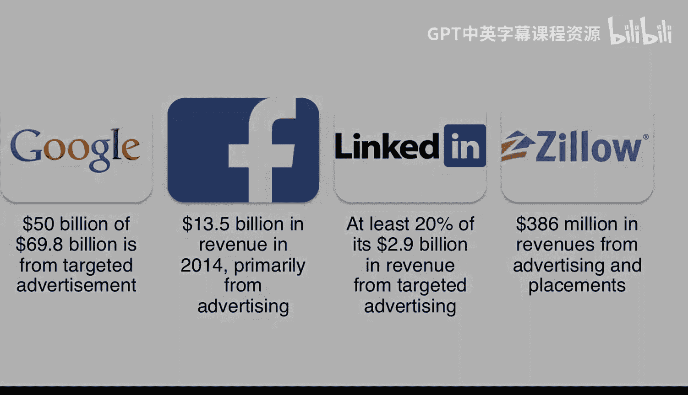
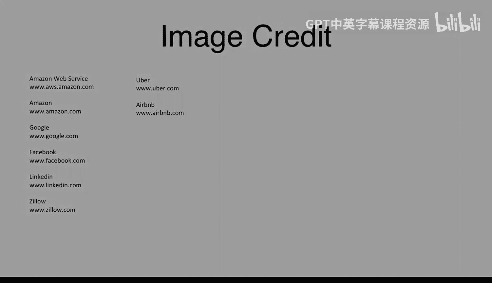

#  028：数字化企业 🏢💻

在本节课中，我们将要学习什么是数字化企业，并了解几个通过创新商业模式和数据分析技术颠覆传统行业的领先公司案例。

---

我们选择认定为数字化企业的公司，是那些运用新商业模式颠覆传统市场或开创全新市场的领导者。这些公司的驱动力在于开发新的信息技术，包括软件和商业分析工具，主要供其内部使用。由于它们对实时数据处理和机器学习有卓越的掌握，其销售的产品或服务通常能比竞争对手提供得更好、更快、更便宜。

因为它们正在构建全新的系统，这些公司需要软件工程师，其次也需要数据科学家。它们对商业分析师和商业数据分析师的需求相对较少。

上一节我们介绍了数字化企业的核心特征，本节中我们来看看几个具体的行业领导者案例。

以下是几个数字化企业的例子：

*   **亚马逊**：它彻底改变了多个零售行业，从图书开始，扩展到电子产品和其他商品。但最近，其最大的影响在于名为亚马逊网络服务（AWS）的托管存储和处理业务。在亚马逊696亿美元的收入中，有超过60亿美元来自其庞大的服务器农场。这些服务以可变成本租赁的方式提供给全球2000强公司、中型企业和许多知名初创公司（包括Airbnb和Uber）。亚马逊网站在2015年夏天市值超过了沃尔玛，成为全球最大的零售商。我们之前讨论过亚马逊出色的实时用户体验定制以实现收入优化。亚马逊还通过其Prime会员计划推行经常性收入忠诚度计划模型，并在全球范围内作为低成本的数据和处理托管服务提供商参与竞争。或许最非凡的是亚马逊在云计算领域的早期主导地位。据传亚马逊迄今已构建了超过50万台定制Linux服务器。其云计算收入估计超过了该领域三个最接近的竞争对手（IBM、谷歌和微软）的总和。

*   **广告支持的免费信息服务公司**：许多互联网公司免费提供信息和服务，通过销售定向广告或在搜索结果中获得更好位置来赚钱。这些公司利用分析技术，既使其服务尽可能有用和吸引人，也用于识别用户以针对他们开展特定的广告活动。该领域的领导者首先是**谷歌**，其698亿美元收入中有超过500亿美元来自定向广告。其次是**Facebook**，其2014年135亿美元的收入主要来自广告。第三是**LinkedIn**，它拥有多个收入来源，但其29亿美元收入中至少有20%来自定向广告。第四家主导住宅房地产租赁和销售列表、房地产信息和指标领域的数字信息公司是**Zillow**，其3.86亿美元收入主要来自广告和展示位。

接下来，我们将目光转向共享经济领域，看看两家同样以数据分析闻名的创新公司。

以下是两家共享经济领域的数字化企业：

*   **Uber**：它与传统出租车公司竞争。Uber以数字方式连接司机和需要乘车的人，允许双方查看彼此的评论，并允许乘客查看最近Uber车辆的距离地图、最快可用车辆到达所需时间，以及在出发前获得前往指定地址的承诺固定价格。Uber还在汽车需求超过供应时收取更高费用，这是一种优化可用汽车库存清理的可变定价方法。Uber司机拥有自己的汽车并作为独立承包商工作，因此Uber的资本支出极低。Uber通过匹配司机和乘客收取20%的佣金。2015年，乘客总支出为100亿美元，Uber的佣金收入预计将超过20亿美元。

*   **Airbnb**：它与传统酒店竞争。Airbnb将希望出租空置公寓甚至房间的房主与寻求更个性化旅行体验的旅行者匹配起来。它也提供房主和租客的相互评价，提供详细的地图功能以识别特定区域的可用房源，并为房主提供预测分析工具，以根据位置、星期几、一年中的时间等因素优化他们的收入。Airbnb平均收取11%的客房租金佣金，因此2014年约40亿美元的预订额带来了约4.2亿美元的收入。

---

本节课中我们一起学习了数字化企业的定义及其核心特征，并深入分析了亚马逊、谷歌、Facebook、Uber和Airbnb等领先企业如何利用先进的信息技术、数据分析和创新的商业模式，在各自领域取得颠覆性成功。理解这些案例有助于我们认识数据分析在现代商业中的强大驱动力。