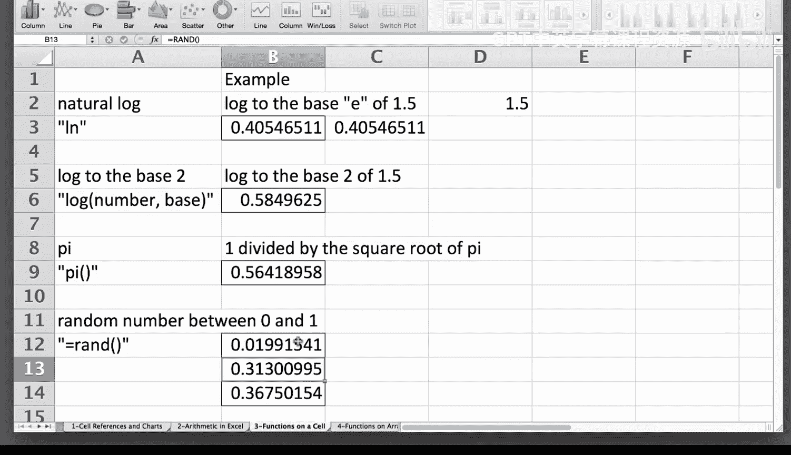

#  041：单个单元格函数应用 📊

在本节中，我们将学习 Excel 中单个单元格函数的核心应用。Excel 的强大之处远不止于算术运算，其内置的数百个函数能帮助我们处理各种复杂计算。我们将通过几个简单的例子来了解如何使用这些函数。

## 常用数学函数示例

上一节我们介绍了基本的算术运算，本节中我们来看看几个常用的数学函数如何在一个单元格内使用。

### 自然对数函数

如果我想计算某个数值的自然对数（以 e 为底），可以使用 Excel 的 `LN` 函数。例如，计算 1.5 的自然对数：

**公式**：`=LN(1.5)`

操作方法是：先输入等号 `=` 激活公式，然后输入函数名 `LN`，最后在括号内输入数值 `1.5` 即可。同样，我们也可以引用其他单元格进行计算：

**公式**：`=LN(D2)`

这将计算 D2 单元格中数值的自然对数。

### 指定底数的对数函数

如果你想计算以其他数为底的对数，例如以 2 为底 1.5 的对数，需要使用 `LOG` 函数并指定两个参数。

**公式**：`=LOG(1.5, 2)`

在这个公式中，第一个参数 `1.5` 是真数，第二个参数 `2` 是指定的底数。

### 使用常数 Pi

Excel 内置了圆周率 π 的常数。例如，计算 1 除以 π 的平方根：

**公式**：`=1/(PI()^0.5)`

这里的 `PI()` 就是 Excel 中表示 π 的函数，括号是函数语法的一部分。`^0.5` 表示计算平方根。

## 随机数生成函数

Excel 另一类非常实用的函数是随机数生成器，它可以生成适用于绝大多数场景的伪随机数。

### 生成 0 到 1 之间的随机数

要生成一个介于 0 和 1 之间的随机数，可以使用 `RAND` 函数。

**公式**：`=RAND()`

每次双击包含此公式的单元格，或者工作表重新计算时，都会得到一个新的随机数。以下是生成多个随机数的方法：

*   在多个单元格中输入 `=RAND()`。
*   每次刷新或编辑工作表时，这些单元格都会生成新的随机数。

如果需要让随机数在生成后固定不变，可以在 Excel 的选项设置中关闭自动重算功能。这样，随机数就不会在你点击其他单元格时改变了。

## 本节总结

本节课中我们一起学习了在 Excel 单个单元格内应用函数的基本方法。我们介绍了如何计算对数和利用常数 π，还学习了生成随机数的技巧。这些是 Excel 众多内置函数中的几个基础例子。

接下来，我们将探索 Excel 另一个强大的功能：对一组数字（即数组）进行操作。在 Excel 中，组织在一列或多列中的一组数字被称为数组，处理数组将极大地提升我们的数据分析效率。