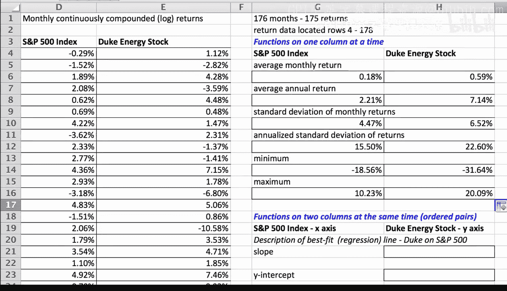

#  042：数据集数值函数 📊

在本节课中，我们将学习 Excel 中处理数据集的核心数值函数。这些函数能让我们对整列或整行的数据进行批量计算，例如求平均值、标准差等描述性统计量，从而进行更深入的分析。

上一节我们介绍了基础的数据处理，本节中我们来看看如何运用函数对成组的数据进行分析。

## 使用函数分析数据列

Excel 的强大之处在于，它能对聚集在单列或单行中的大量数字应用函数。例如，我们可以计算一组数字的平均值、标准差、最小值、最大值以及其他许多关于该数据集的描述性统计量。

此外，我们还有函数可以对有序的数字对集合进行分析。这意味着我们可以处理一个由两行或两列组成的数组，将它们的值配对，并执行针对两个变量的函数。

## 实战分析：股票收益率计算

为了说明这一点，我使用了从雅虎财经下载的数据：标准普尔 500 指数（代表美国股市 500 家最大公司）和杜克能源公司（一家大型美国公司）的股价。我获取了每月初的收盘价数据，这里使用的是“调整后收盘价”，它包含了股息的再投资。我查看了 176 个月的价格数据，据此可以计算 175 个月的月度回报率。

我将计算连续复利月度回报率（或称对数回报率）。方法是取两个价格比值的自然对数，其中较新的价格作为分子。公式如下：

`=LN(较新价格 / 较旧价格)`

例如，计算八月相对于七月的回报率：`=LN(八月价格 / 七月价格)`。如果价格从 1930 降至 1925，则当月会有小幅损失（-0.29%）。

接下来，我们可以使用 Excel 的填充柄技巧：只需点击单元格右下角的小方块并向下拖动，公式就会自动填充所有 175 个回报率的计算。这不仅方便，而且因为我们使用了**相对引用**，公式在行和列方向上都会自动调整。

当我将这个公式向右拖动到杜克能源的价格列时，公式中的引用会自动右移一列，开始引用 C 列的数据。这样，我就得到了两个时间序列的月度回报率：一个是市场指数的，另一个是个股的。

## 比较股票与市场表现

我常常需要分析个股相对于其所属市场指数（即更大范围的市场）的表现。首先，我好奇在这段时间内，是指数表现更好还是股票表现更好。

为了计算一列（或一行）数值的平均值（Excel 称之为“数组”），我需要使用函数。操作步骤如下：

1.  输入函数名称，例如 `AVERAGE`。
2.  输入我感兴趣的第一个数值的单元格位置。
3.  输入一个冒号 `:`。
4.  输入我感兴趣的最后一个数值的单元格位置。

这样，我就选中了这两个单元格及其之间的所有单元格来计算平均值。例如：`=AVERAGE(D4:D178)`。

同样，由于使用了相对引用，我可以将这个公式向右拖动，轻松计算出杜克能源股票的平均回报率。结果显示，在此期间，杜克能源的平均表现明显优于标准普尔 500 指数。

月度回报率是单月的。如果我想知道年化的连续复利回报率，只需将月度平均值乘以 12。公式为：`=月度平均回报率单元格 * 12`。然后，我可以通过拖动公式来计算杜克能源的年化回报率。

## 评估风险：标准差

在查看财务回报数据时，我通常还关心个体回报的离散程度，标准差是我用来评估这种离散程度的常用指标。

Excel 内置了标准差函数。我使用 `STDEV.P` 函数（P 代表总体标准差）来计算。我将使用与平均值相同的范围：`=STDEV.P(D4:D178)`。这样我就得到了月度标准差。我可以将其格式化为百分比以便阅读。

同样，我可以将这个公式向右拖动，计算杜克能源股票的月度标准差。

如果我想将这个值年化，需要注意的是，标准差的年化不是乘以 12，而是乘以 12 的平方根。公式如下：

`=月度标准差 * SQRT(12)`

Excel 有内置的平方根函数 `SQRT`。按此方式计算并拖动公式，我就能得到杜克能源的年化标准差。由此可见，虽然杜克能源在此期间的回报率显著高于标准普尔 500 指数，但其波动性也大得多，即可能的结果范围更广。

## 查看极值：最小值与最大值

另一种查看可能结果范围的方法是观察每个数据集的最差月份和最佳月份。Excel 提供了 `MIN` 和 `MAX` 函数。

以下是计算最小值与最大值的步骤：

*   **最差月份（最小值）**：使用 `=MIN(D4:D178)`。结果显示，在此期间最差的一个月损失了 18.5%。
*   **最佳月份（最大值）**：使用 `=MAX(D4:D178)`。结果显示，最佳的一个月获得了 10.3% 的收益。

对于整个指数是如此。而杜克能源股票曾有一个月下跌了 31%（更糟），但也曾有一个月上涨了 20.9%（更好）。

## 总结与结论

本节课中我们一起学习了如何利用 Excel 的数值函数对数据集进行描述性统计分析。

从描述性统计的角度，我已经可以得出一些结论：在这超过 14 年的时间里，杜克能源股票似乎比单纯投资标准普尔 500 指数能带来更高的回报。但是，为此我需要承担更高的风险：其回报的标准差更大，低谷更低，高峰也更高。因此，从风险调整后收益的角度看，杜克能源股票的高回报并非“免费的午餐”，获得更高回报需要付出相应的代价（更高的波动性）。