#  048：成本决定最优阈值 📊

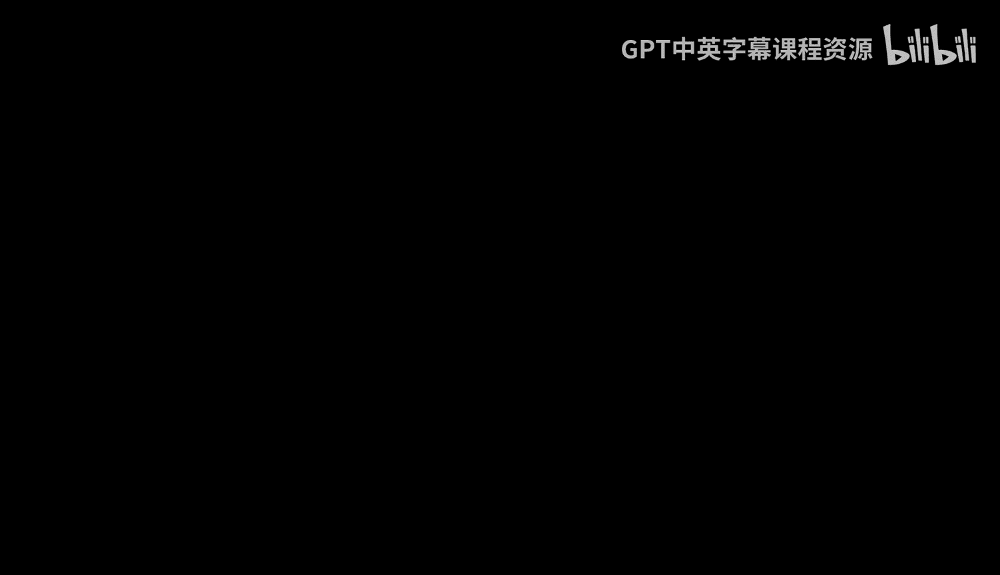

在本节课中，我们将学习如何通过分析不同决策错误的成本，来确定分类模型的最佳阈值。理解这一点对于构建高效且经济的商业分析工具至关重要。

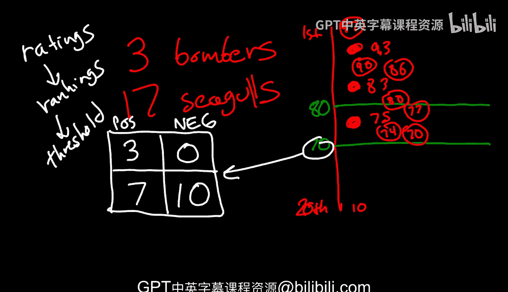

---

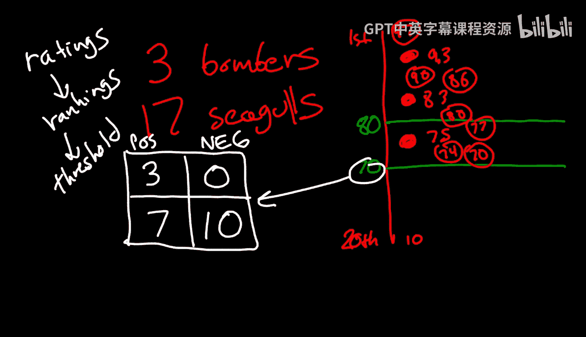

## 描述阈值的典型方法

上一节我们介绍了分类模型的基本概念，本节中我们来看看如何具体描述和评估一个阈值。

我们通常使用**假正率**和**真正率**来刻画一个特定的阈值。

*   **假正率** 的计算公式是：`假正例数量 / 负例总数量`。
*   **真正率** 的计算公式是：`真正例数量 / 正例总数量`。

---

## 阈值与坐标点

现在，让我们将阈值转化为可视化的坐标点。

我们当前看到的图中，阈值为 **80**。它的假正率是 **4/17**，真正率是 **2/3**。而我们另一个阈值为 **70** 的点，其假正率是 **7/17**，真正率是 **1**。

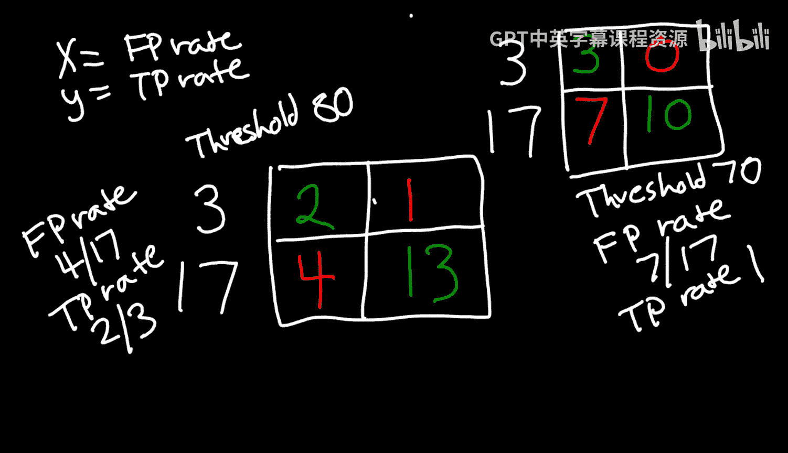

正如我们在动态演示中看到的，每一个有序数对（X = 假正率， Y = 真正率）都可以被绘制在XY坐标平面上。因此，**每一个阈值都对应一个坐标点**。

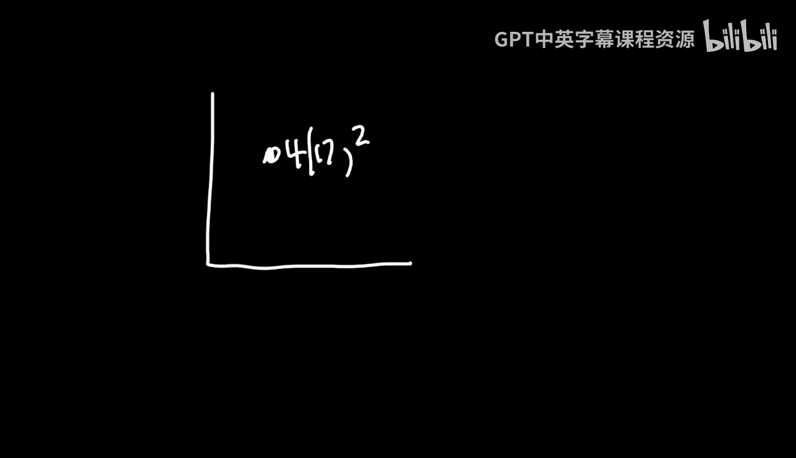

例如，阈值80对应的点是 **(4/17, 2/3)**，即略小于0.25的X值和约0.667的Y值。阈值70对应的点是 **(7/17, 1)**。

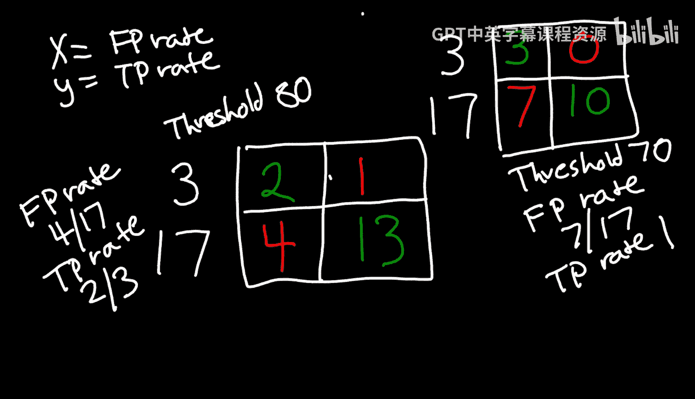

---

## 曲线下面积的意义

以下是所有可能阈值对应的假正率和真正率的图形化表示。

图中曲线下的**面积**是一个重要指标。在我们这个例子中，该面积为 **0.8**。对于任何旨在区分两种状态（如诊断工具）的模型而言，这是一个相当合理且不错的数值。

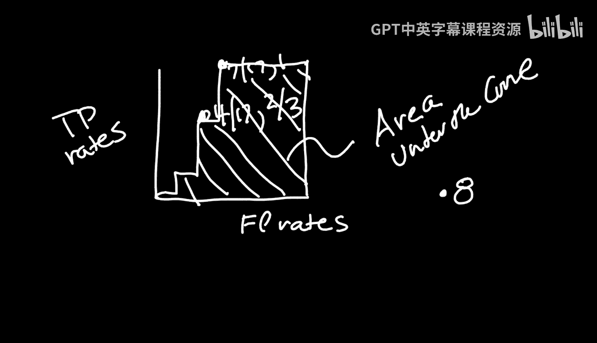

---

## 引入成本函数

然而，模型的实际表现究竟会给我们带来多少成本？这取决于**每次错误所导致的代价**。

一个**成本函数**正是基于这些代价来构建的。

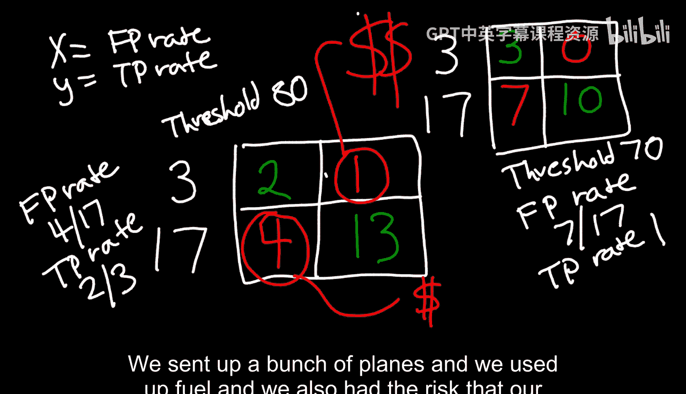

通常，不同类型的错误代价差异巨大：
*   **假负例**（例如，炸弹穿透防线）的代价通常非常高昂，可能造成巨大破坏。
*   **假正例**（例如，误派战机拦截）的代价虽然也高，但通常相对较低。这包括消耗燃料、占用资源，并承担战机部署错误位置的风险。

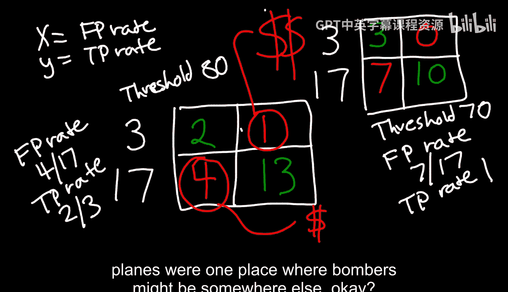

---

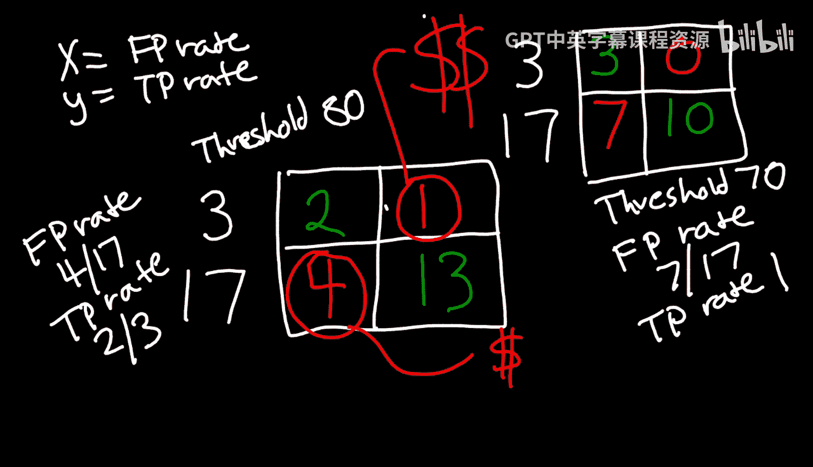

## 成本如何决定最优阈值

我们将在后续的测验和Excel表格练习中看到，**阈值的设置位置，将由这两类错误的相对成本大小决定**。

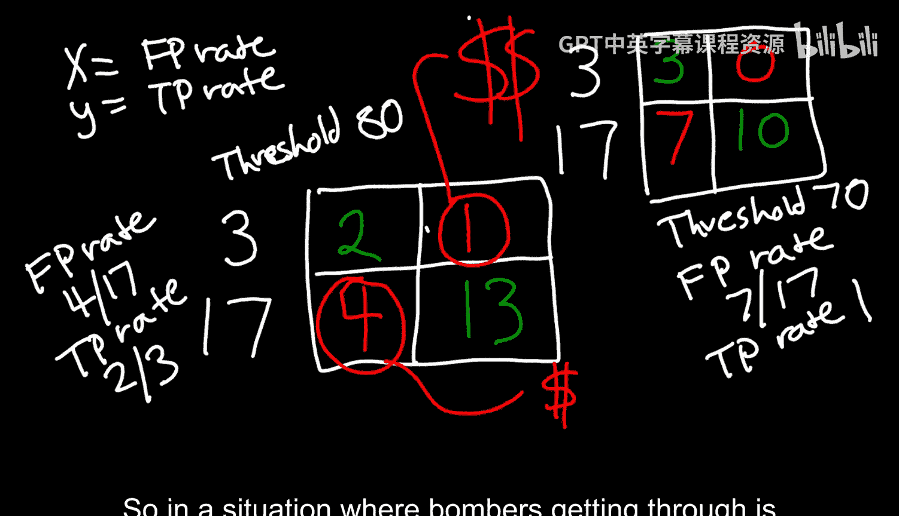

以下是成本影响阈值选择的核心逻辑：

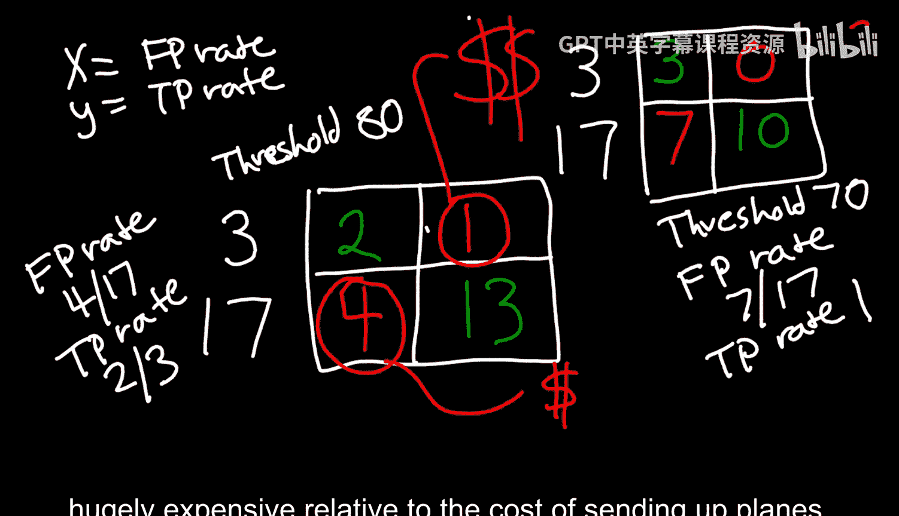

*   在**假负例成本**（如炸弹穿透）远高于**假正例成本**（如派遣战机）的情况下，你希望尽可能减少假负例的数量。因此，你愿意接受一个**更低的阈值**，以提高灵敏度，尽管这可能会增加假正例。
*   反之，如果假正例的成本相对更高，你则会倾向于选择一个**更高的阈值**，以减少误报。

---

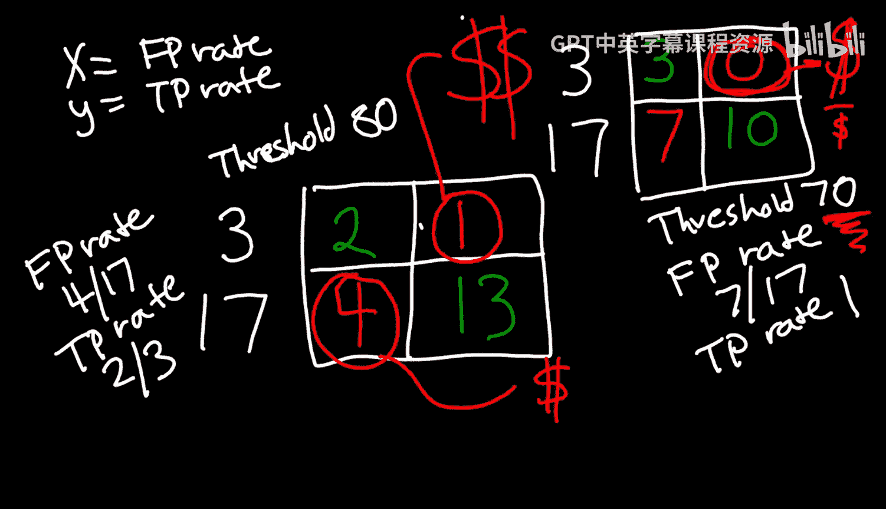

本节课中我们一起学习了如何通过假正率和真正率来评估阈值，并理解了错误成本是决定最优阈值的核心因素。关键在于根据实际业务场景中不同错误的代价，权衡并选择最经济的决策边界。