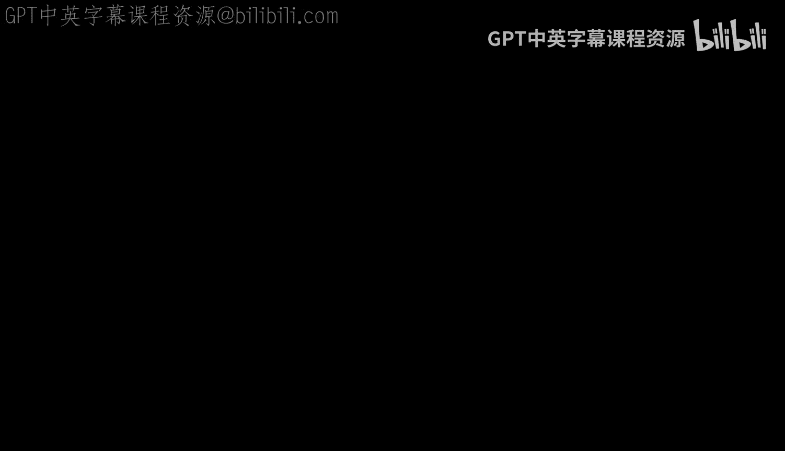
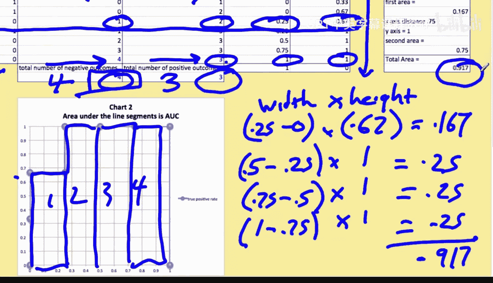
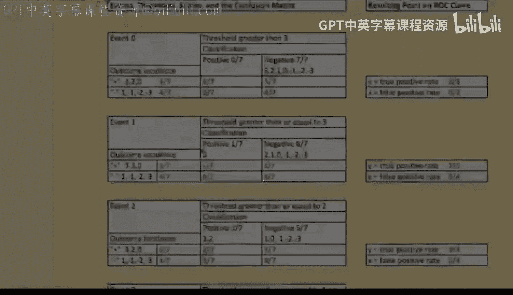
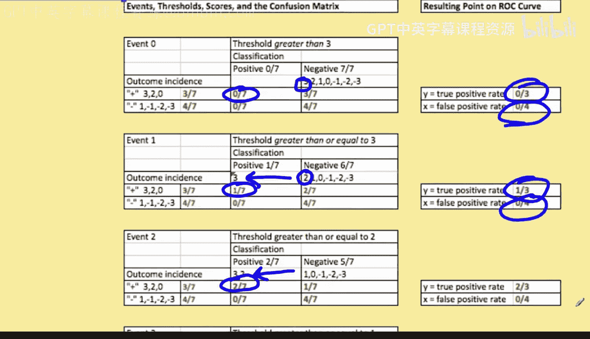
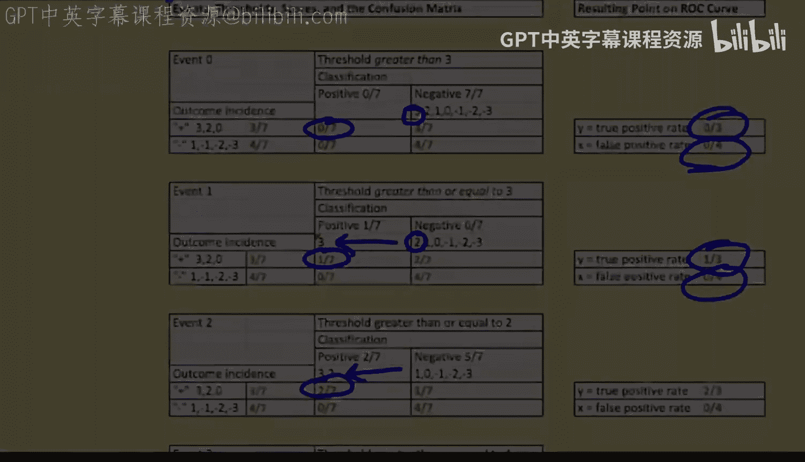

#  050：ROC曲线下面积计算方法 📊

在本节课中，我们将要学习接收者操作特征曲线下面积的计算方法。AUC是评估二分类模型性能最广泛使用的指标，其优势在于不受实际事件发生率或分类错误成本变化的影响。因此，当未来事件发生率或错误分类成本不稳定或未知时，AUC通常是最佳的性能评估指标。

## AUC概述

AUC的取值范围在0.5到1之间。AUC等于0.5表示分类结果与随机猜测无异，完全不确定。AUC等于1则表示实现了零错误的完美分类，但这通常是理论上的理想状态。在实际应用中，一个正常、良好到优秀的AUC值通常在0.65到0.85的范围内。

数据分析中的一个常见技术是开发一个二分类模型，通过调整某些参数，在已知结果的样本数据集上最大化AUC。这个数据集通常被称为训练集。在最终的课程项目中，你将计算自己在训练集上的AUC并应用此技术。

## 计算AUC的步骤

以下是计算给定分类模型和已知结果事件集合的AUC的具体步骤。你应该使用配套的AUC曲线Excel电子表格跟随操作。

### 准备数据

要绘制ROC曲线，我们从一个事件集合开始。在示例表格中，有七个事件，编号为1到7。每个事件都必须被分配一个分数和一个结果。我们的模型是一个输入事件已知数据并输出单一分数的程序或算法。这里我们专注于将分数和结果转化为ROC曲线，因此不关心分数是如何生成的。

二分类结果用1表示阳性，0表示阴性。要生成ROC曲线，我们需要知道真实结果，以及我们的模型在每个可能的阳性分类阈值下的效果。

### 排序与设定阈值

我们首先将所有事件按分数排序。请注意，表格中已经为你完成了排序。此方法要求所有事件必须严格按照分数进行排序。

然后，我们将沿着列表向下进行，在每个不同的可能阈值处执行一次分类。我们使用的阈值称为活动阈值。我们使用的第一个阈值实际上是一个高于最高分数的数字。在这个阈值下，所有事件都被分类为阴性。因此，没有假阳性，也没有真阳性。

我们将继续处理列表，在最低的阈值处，即大于或等于-3时，每个事件都被分类为阳性。因此，我们将有3个真阳性，等于我们集合中实际的阳性数量。但所有阴性结果都被错误地分类为假阳性。

### 计算假阳性率与真阳性率

ROC曲线衡量的是模型在每个可能阈值下的有效性。在本例中，从高于最高分到低于或等于最低分共有8个阈值。我们需要将假阳性和真阳性的总数转化为假阳性率和真阳性率。

要计算假阳性率，我们将每个特定阈值下的假阳性数量除以真实的阴性总数（4）。同样，真阳性率是真阳性数量除以真实的阳性总数（3）。

例如，选取阈值“大于或等于1”。在此阈值下，有三个结果：两个阳性结果和一个阴性结果。阴性结果被错误分类为阳性，因此有一个假阳性。两个实际的阳性结果被正确分类，因此有两个真阳性。假阳性率是1除以4，等于0.25。真阳性率是2除以3，约等于0.67。这个有序数对（0.25， 0.67）在我们的ROC曲线上对应一个点。

### 绘制ROC曲线与计算面积

当我们从列表顶部向下处理时，我们从假阳性率和真阳性率均为0的点开始，然后随着列表向下，逐步向右上方移动，直到到达点（1， 1），此时所有事件都被分类为阳性。

接下来，我们将对这些矩形区域的面积求和。我们有四个矩形。请注意，在任何两点之间，只有X轴值或Y轴值会发生变化，不会两者同时变化。这是因为我们使用的阈值变化很小，每次只能将一个结果从阴性分类切换到阳性分类。因此，只有假阳性率或真阳性率其中之一会改变。

我们通过计算每个矩形的宽度乘以高度来求和面积，从而得到分类模型的整体效能评估。

*   **第一个矩形**：宽度为 `0.25 - 0`，高度为 `0.67`。
*   **第二个矩形**：宽度为 `0.5 - 0.25`，高度为 `0.67`。
*   **第三个矩形**：宽度为 `0.75 - 0.5`，高度为 `1`。
*   **第四个矩形**：宽度为 `1 - 0.75`，高度为 `1`。

这些面积之和即为ROC曲线下面积。

## 混淆矩阵与ROC点的关系

需要指出的是，每个阈值都有其对应的混淆矩阵，这些矩阵已在你的电子表格中提供。我们有不变的结果：三个真实的阳性结果和四个真实的阴性结果。但我们的分类在变化。每次我们向下移动列表时，我们都在将一个项目从阴性分类转变为阳性分类。接着，我们将处理项目2，将其从阴性分类转变为阳性分类。你会看到，每次只有一个项目会发生变化。然后，我们查看假阳性率和真阳性率，这就得到了ROC曲线上的点。

## 总结

本节课中，我们一起学习了ROC曲线下面积的计算方法。我们了解了AUC作为模型性能指标的优势，并逐步演练了从数据排序、设定阈值、计算假阳性率与真阳性率，到最终绘制ROC曲线并计算其下面积的完整过程。这是本课程提供的最有用的工具之一，希望你能熟练掌握并在自己的项目中应用。