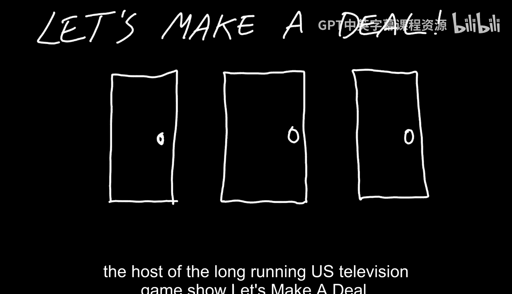
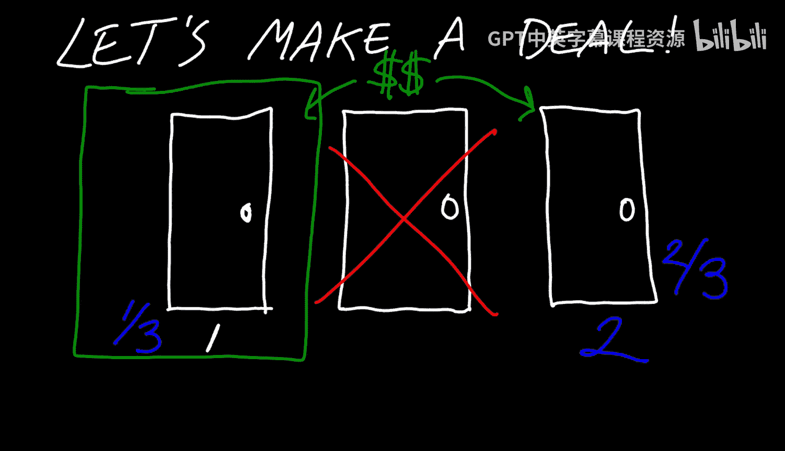
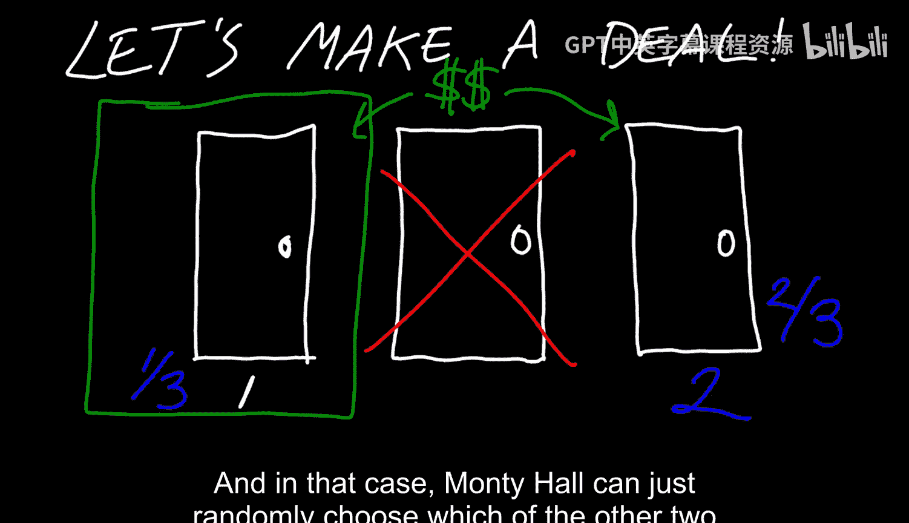
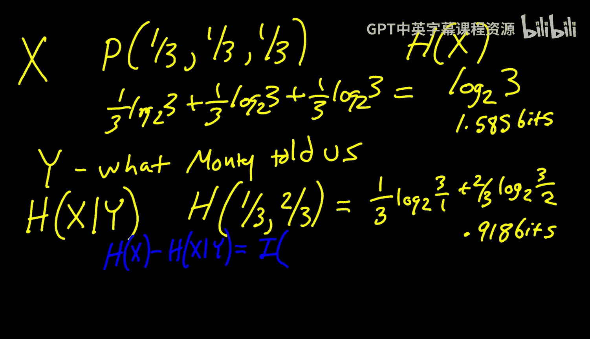
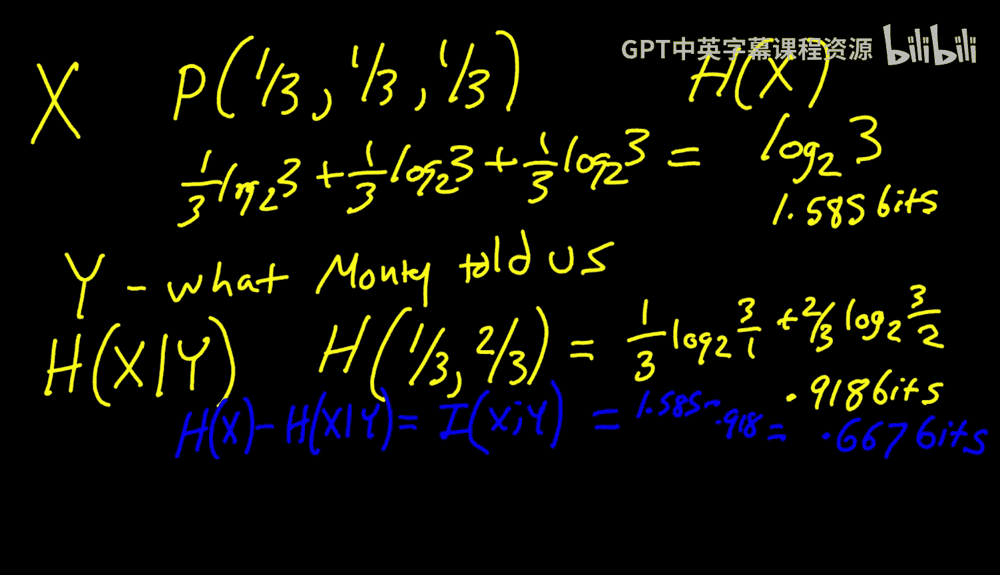
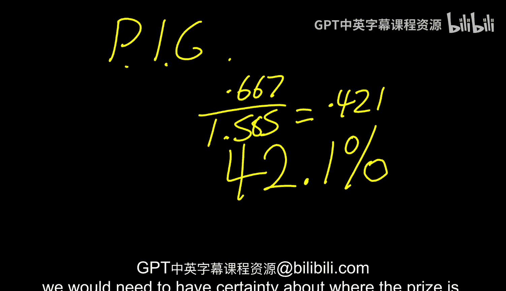

#  056：蒙提霍尔问题与信息增益 🎲

在本节课中，我们将学习一个著名的概率论问题——蒙提霍尔问题，并探讨如何通过信息熵和互信息来量化主持人行为所传递的信息量。

## 概述

蒙提霍尔问题源自美国一档名为《Let‘s Make a Deal》的电视游戏节目。我们将分析这个问题的经典场景，理解其反直觉的概率结果，并最终运用信息论工具，精确计算主持人打开一扇门这一行为为我们提供了多少“信息”。

## 问题背景

著名的蒙提霍尔问题以美国一档长期播出的电视游戏节目《Let‘s Make a Deal》的主持人命名。

一个贵重奖品被藏在三扇外观完全相同的门后。如果门看起来不完全相同，请想象它们是相同的。参赛者如果选中了正确的门，就能赢得奖品。

在游戏开始时，参赛者被告知可以任意选择一扇门。为了方便说明，我们假设参赛者选择了1号门。

由于没有选择依据，可以合理地假设奖品在任意一扇门后的概率都是三分之一。因此，参赛者获胜的初始概率是三分之一。

## 主持人的行动与选择

随后，主持人蒙提·霍尔会打开另一扇门，从而排除一个选项。

接着，在揭示奖品位置之前，他会给参赛者一个选择：是否要更换自己最初选择的门。

因此，蒙提霍尔问题的数学核心是：参赛者应该更换门吗？是坚持选择1号门，还是换到我们标记为2号的门？

更数学化地表述这个问题：在3号门被排除后，奖品在1号门和2号门后的新概率分布是怎样的？现在其中一扇门的概率是否比另一扇门更大？

## 概率分析

一种常见的直觉是，概率现在会在两扇门之间平均分配，各为二分之一。然而，这是不正确的。

事实上，奖品在1号门后的概率仍然保持在三分之一，就像最初选择它时一样。而原本与3号门相关的所有概率都转移到了2号门上，因此奖品在2号门后的概率现在是三分之二。

所以正确答案是：参赛者应该更换门，这样获胜的机会将翻倍。

## 理解的关键

理解这一结果的关键在于认识到，蒙提·霍尔并不是随机打开三扇门中的一扇。

如果其中一扇门是随机打开的（例如因为地震，恰好是3号门），那么此时奖品在剩余两扇门后的概率可能确实是各占50%。

但蒙提·霍尔的行为受到严格限制。他不能打开参赛者已经选择的门，也不能打开藏有贵重奖品的那扇门（可能是这扇，也可能是那扇，但总之不能是他打开的那扇）。

因此，蒙提·霍尔是在完全知晓奖品位置的情况下，有目的地选择打开一扇门。

*   有三分之一的时间，奖品就在参赛者最初选择的门（1号门）后。在这种情况下，蒙提可以随机选择打开另外两扇门中的任意一扇。
*   但有三分之二的时间，奖品在参赛者没有选择的两扇门中的一扇后面。在这些情况下，蒙提必须打开另一扇（没有奖品的）门，他别无选择。

所以，在三分之二的情况下，蒙提的行为实际上暗示了奖品的位置，只是我们不知道具体是哪三分之二的情况。

## 量化信息：从熵的角度

我一直觉得这个问题非常有趣。但有一个问题始终困扰着我，或者说我真正想知道答案的是：我接受蒙提霍尔打开门时向我们传递了一些信息这个事实，但我想知道具体是多少信息？他提供了达到完全确定所需信息的百分之几？

蒙提本可以直接告诉我们奖品在哪里，那样就是100%的信息，游戏结束。但他只是消除了一些不确定性，那么到底消除了多少？10%，20%，还是5%？

实际上，我们可以通过计算初始概率分布的信息熵，然后与主持人行动后的新概率分布的信息熵进行比较，来找到答案。

## 熵与互信息的计算

让我们通过这个简单的例子来计算一下。

初始状态，每扇门的概率都是三分之一：`P = [1/3, 1/3, 1/3]`。

我们的初始信息熵 `H(X)` 计算如下：
`H(X) = (1/3)*log₂(3) + (1/3)*log₂(3) + (1/3)*log₂(3) = log₂(3)`

计算结果约为 **1.585 比特**。

在主持人打开一扇空门（例如3号门）后，新的概率分布变为：`P = [1/3, 2/3, 0]`。

此时的条件熵 `H(X|Y)`（已知主持人行动后的不确定性）为：
`H(X|Y) = (1/3)*log₂(3) + (2/3)*log₂(3/2)`

计算结果约为 **0.918 比特**。

## 计算信息增益

现在，使用互信息公式 `I(X;Y) = H(X) - H(X|Y)`：

`I(X;Y) = 1.585 - 0.918 = 0.667`

所以，蒙提通过打开一扇门，为我们提供了 **0.667 比特** 的信息。

如果你想了解信息增益的百分比（PIG），可以这样计算：
`0.667 / 1.585 ≈ 0.421`

因此，蒙提·霍尔为我们提供了确定奖品位置所需全部信息的 **42.1%**。

## 总结

本节课我们一起学习了蒙提霍尔问题。我们首先分析了这个经典概率问题的场景和反直觉的答案——更换选择能将获胜概率从1/3提升到2/3。随后，我们超越了定性理解，引入了信息熵和互信息的概念，定量地计算出主持人打开一扇门这一行为所传递的信息量约为0.667比特，相当于消除了约42.1%的不确定性。这展示了信息论工具在量化决策过程中信息价值方面的强大应用。