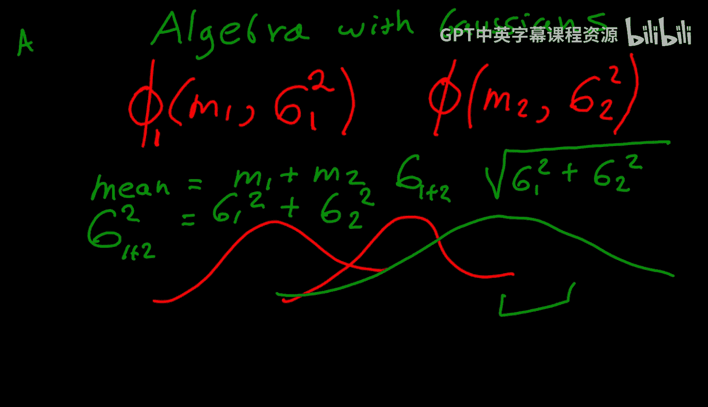
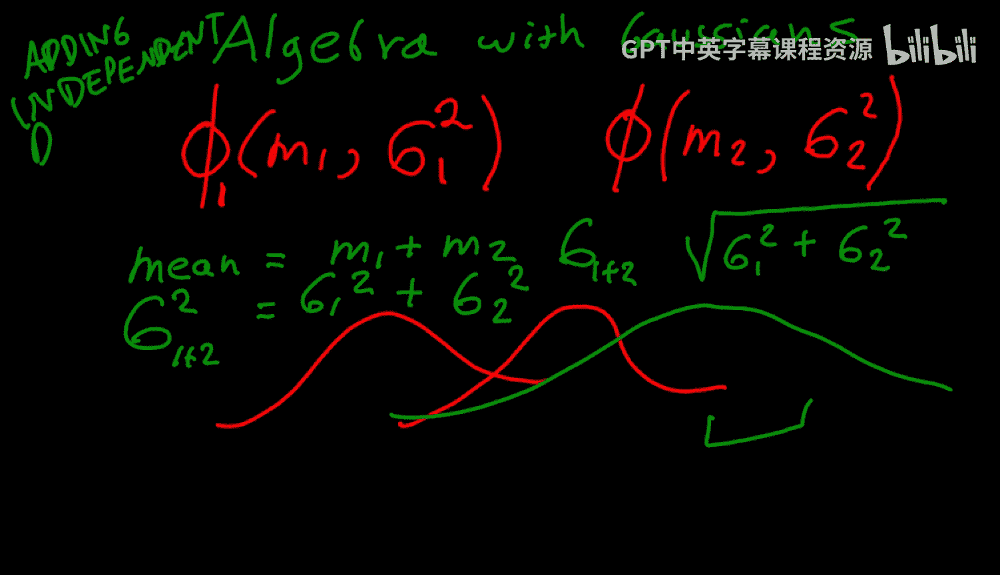
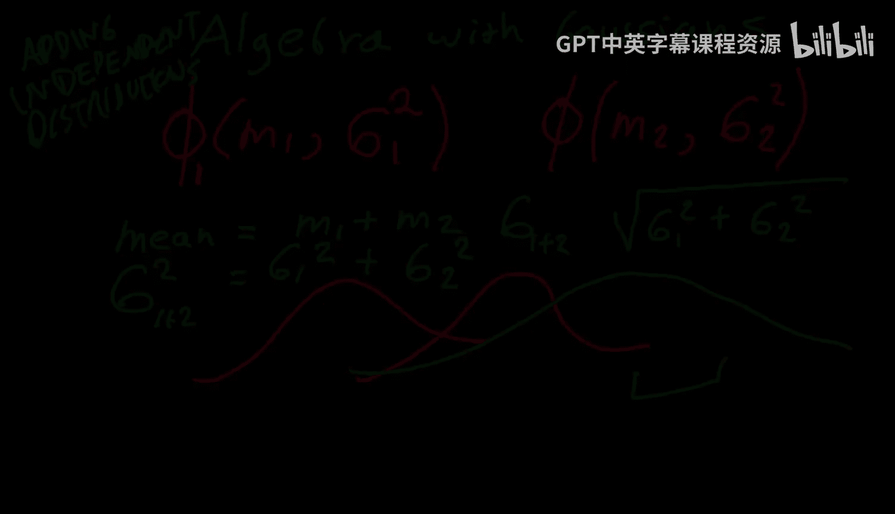
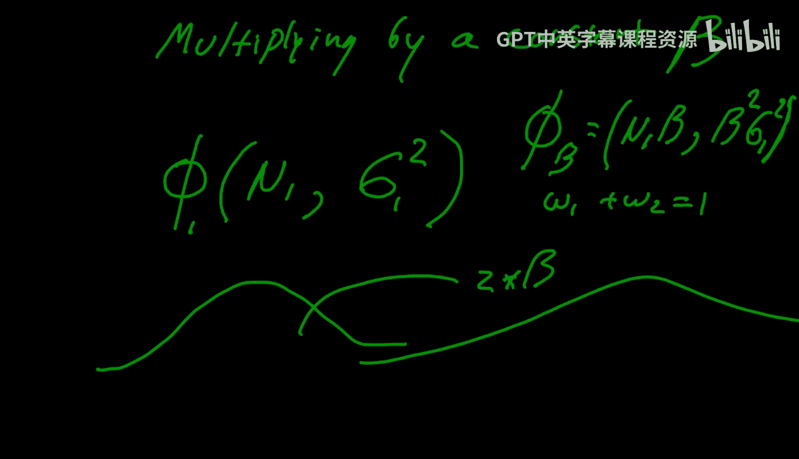
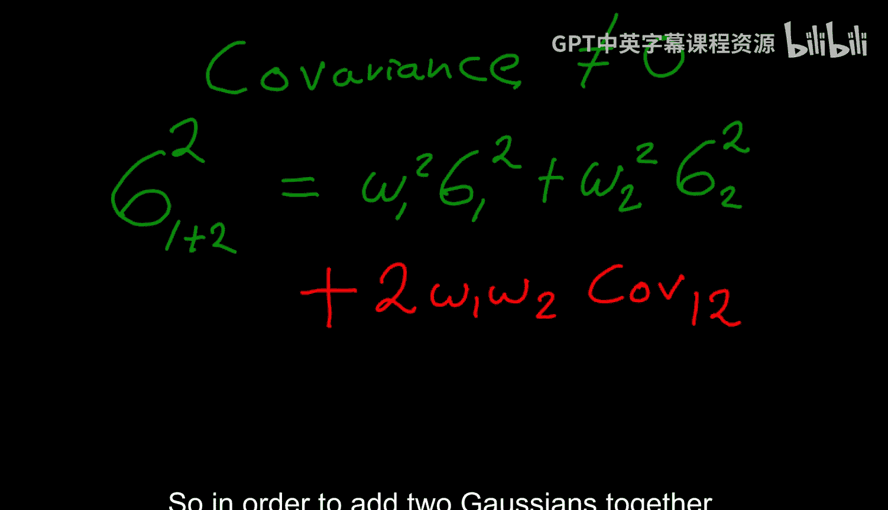
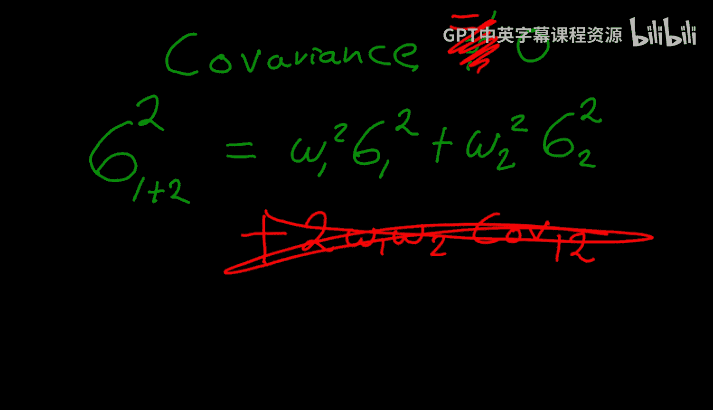

#  064：高斯分布代数运算 📊

在本节课中，我们将要学习高斯分布（正态分布）的代数运算。这些运算规则使得高斯分布在概率论和数据分析中非常强大和实用。

上一节我们介绍了高斯分布的基本概念，本节中我们来看看如何对它们进行数学运算。

## 概述：高斯分布的特性

高斯分布具有一系列独特的性质。除非你尝试组合其他概率分布并发现结果多么混乱，否则你很难体会到这些性质有多么不寻常。

## 加法运算：独立分布之和

首先，我们探讨如何将两个独立的高斯分布相加。

假设我们有两个独立的高斯概率分布。第一个分布的均值为 **μ₁**，方差为 **σ₁²**。第二个分布的均值为 **μ₂**，方差为 **σ₂²**。

如果我们从第一个分布中抽取一个样本，再从第二个分布中抽取一个样本，那么这两个样本之和所构成的新分布，其形态如下：

*   新分布的**均值**等于两个原始均值之和：**μ_new = μ₁ + μ₂**
*   新分布的**方差**等于两个原始方差之和：**σ_new² = σ₁² + σ₂²**

因此，如果我们想知道新分布的标准差，只需计算方差之和的平方根：**σ_new = √(σ₁² + σ₂²)**。

这里有一个非常重要的提醒：**上述规则仅当两个分布相互独立时才成立**。如果它们之间存在依赖、相关性或协方差，求和方式会有所不同，我们需要增加一个调整项，这将在稍后讨论。

我们想要强调的第一个高斯代数运算是：**相加独立的分布**。

以下是独立高斯分布相加的公式总结：
**若 X ~ N(μ₁, σ₁²)， Y ~ N(μ₂, σ₂²)，且 X 与 Y 独立，则：**
**X + Y ~ N(μ₁ + μ₂, σ₁² + σ₂²)**

## 乘法运算：乘以常数

接下来，我们学习高斯分布的第二个代数运算：**乘以一个常数**。

假设我们有一个高斯分布，其均值为 **μ**，方差为 **σ²**。我们将用常数 **β** 乘以该分布的每一个值。也就是说，当我们从这个分布中随机抽取一个值 **z** 时，我们得到的新值是 **β * z**。

那么，新分布的参数变化如下：

*   新分布的**均值**等于原均值乘以常数：**μ_new = β * μ**
*   新分布的**方差**等于原方差乘以常数的平方：**σ_new² = β² * σ²**

这可以理解为对高斯分布进行线性变换。

以下是乘以常数的高斯分布公式：
**若 X ~ N(μ, σ²)，则对于常数 β，有：**
**βX ~ N(βμ, β²σ²)**

## 加权组合与协方差

现在，我们处理两个分布之间存在相关性或协方差的情况。

当我们希望对两个高斯分布进行加权组合时（例如构建投资组合），首先会用各自的权重乘以它们的均值。假设权重为 **w₁** 和 **w₂**，且 **w₁ + w₂ = 1**。

在协方差 **Cov(X,Y)** 不等于 0 的情况下，组合后新分布的方差计算如下：

**σ_portfolio² = w₁² * σ₁² + w₂² * σ₂² + 2 * w₁ * w₂ * Cov(X, Y)**

到目前为止，公式的前两部分与我们之前讨论的线性变换没有区别。但现在我们引入了一个新项：**2 * w₁ * w₂ * Cov(X, Y)**。

为了将两个高斯分布相加，我们需要知道它们之间的协方差。

如果我们很幸运，知道它们的协方差等于 0，那么整个协方差项就消失了，我们可以像使用前两种代数方法一样简单地求和。

但是，如果我们知道协方差不等于 0，那么就必须包含这个调整项。

以下是考虑协方差的加权组合公式：
**若 X ~ N(μ₁, σ₁²)， Y ~ N(μ₂, σ₂²)，且 Cov(X, Y) 已知，则对于权重 w₁, w₂ (w₁ + w₂ = 1)，组合 Z = w₁X + w₂Y 的分布为：**
**Z ~ N(w₁μ₁ + w₂μ₂, w₁²σ₁² + w₂²σ₂² + 2w₁w₂Cov(X,Y))**

## 总结

本节课中我们一起学习了高斯分布的三种核心代数运算：

1.  **独立分布相加**：新分布的均值和方差分别为原分布参数之和。
2.  **乘以常数**：新分布的均值乘以该常数，方差乘以该常数的平方。
3.  **考虑协方差的加权组合**：在加权组合中，方差的计算需要额外加上一个包含协方差的调整项。

掌握这些运算规则，对于理解更复杂的统计模型和商业数据分析至关重要。