#  068：线性回归误差建模 📊

在本节课中，我们将学习如何为线性回归模型中的误差项建立数学模型。我们将基于标准化数据和正态分布的假设，推导出误差方差与相关系数之间的直接关系，并了解如何利用这种关系来构建预测的置信区间。

---

我们已经假设可以使用标准化数据进行工作。

现在，我们将做出一个额外的参数假设。我们假设变量 **X** 和 **y** 的形状服从高斯分布。换句话说，单个值是从正态分布的概率密度函数中抽取的。

因此，我们可以写出 **x** 值服从均值为 0、标准差为 1 的高斯分布。同样地，**y** 变量也服从均值为 0、标准差为 1 的高斯分布。

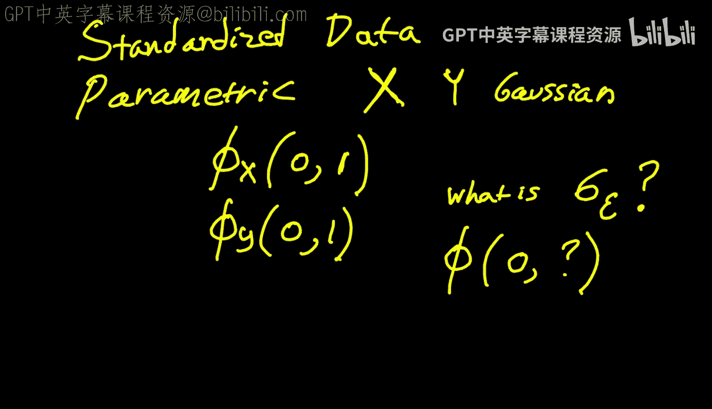

那么，这里有一个我们想知道的问题：误差的标准差是多少？我们知道误差也服从高斯分布，且误差的均值为零。但我们不知道误差本身的方差值。

我们希望将误差的方差直接与相关系数以及最佳拟合线的斜率联系起来。这正是我们接下来要做的事情。

---

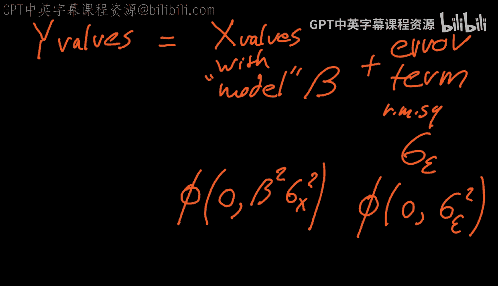

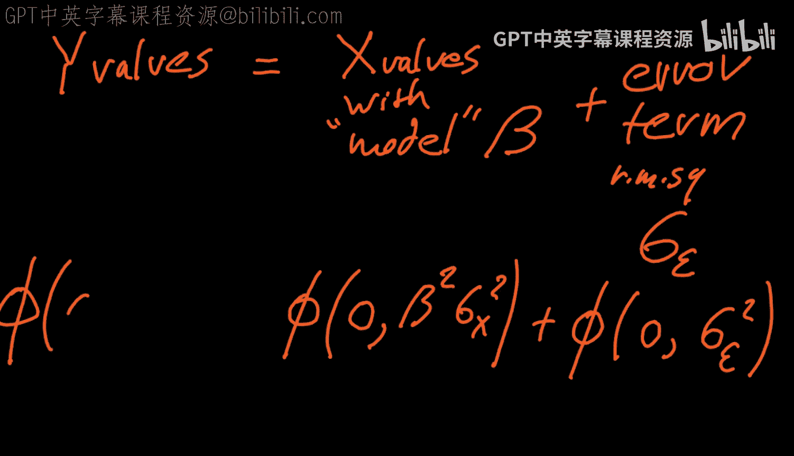

上一节我们介绍了误差服从高斯分布的假设，本节中我们来看看如何推导误差方差。

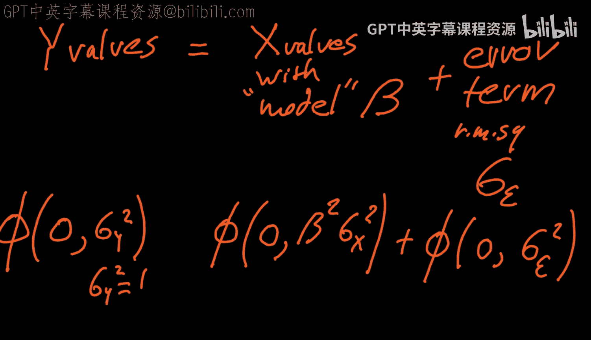

我们知道 **y** 值由 **x** 值加上我们的模型构成。在我们的标准化模型中，截距项 **α** 为 0，因此模型简化为线性关联项 **β** 加上一个误差项。

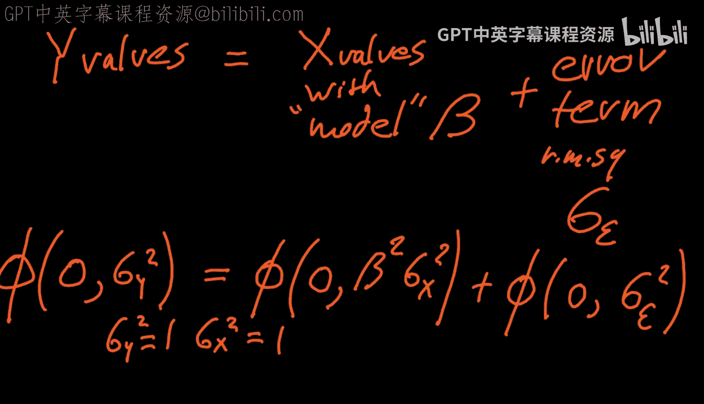

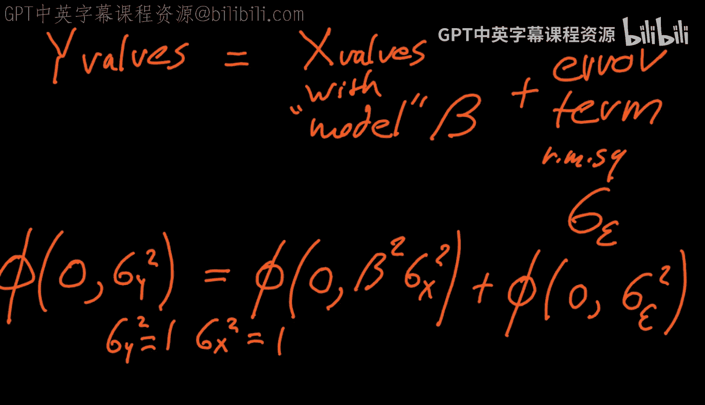

我们可以将模型写为：
`y_i = β * x_i + ε_i`

我们知道最佳拟合线的残差均值为 0，其方差如下所示。我们还知道，某个值乘以 **β** 后，其方差将乘以 **β²**。

因此，对于我们的标准化问题，**y** 的方差为 1，**x** 的方差也为 1。

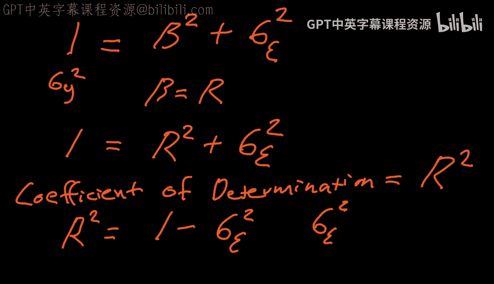

根据基本的高斯加法规则，**y** 的方差（等于1）等于 **β²** 乘以 **x** 的方差（等于1），再加上误差的方差。

我们知道，对于标准化数据，斜率 **β** 等于相关系数 **r**。因此，我们得到：
`1 = r² + σ_ε²`

这个等式揭示了相关系数（更精确地说是决定系数 **r²**）与误差方差之间的直接关系。决定系数是相关系数平方的一个别称。

由此，我们可以推导出：
`r² = 1 - σ_ε²`
以及
`σ_ε² = 1 - r²`

这意味着我们的误差标准差与相关系数之间存在直接联系。

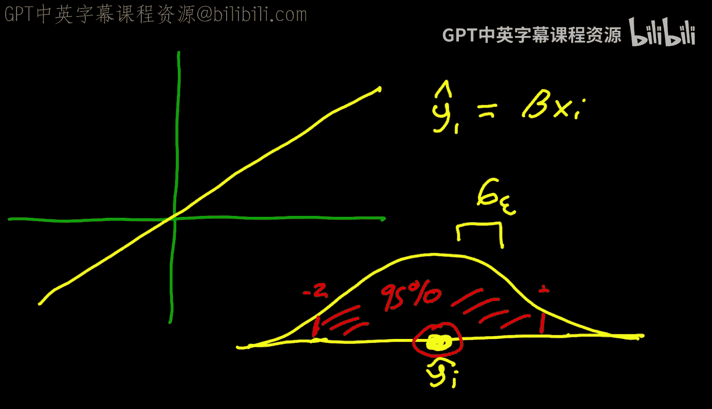

---

理解误差与相关系数的关系非常重要。当我们使用线性回归模型进行预测时，预测值 `ŷ_i = β * x_i` 总会包含一定的误差。

我们不仅希望给出一个点预测，更希望给出一个概率分布形式的预测。这个分布的均值是我们的估计值 `ŷ_i`，而其标准差就等于残差的标准差 `σ_ε`。

这使我们能够做出非常精确的陈述。例如，我们可以说我们有 95% 的置信度认为真实值将落在某个区间内。

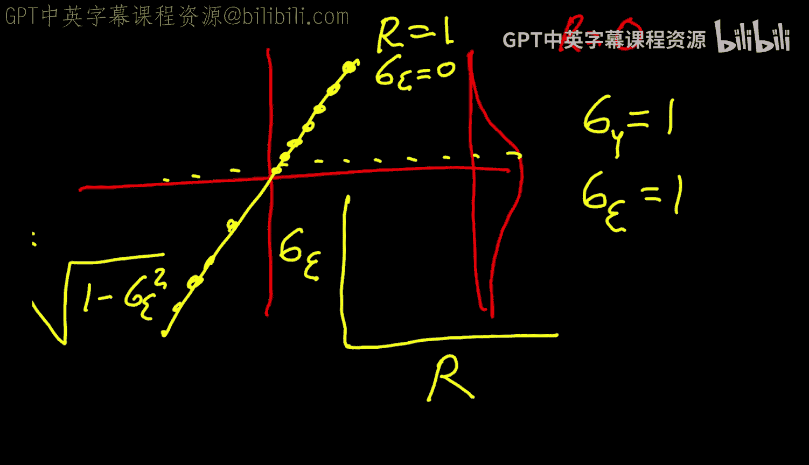

以下是构建置信区间的关键步骤：
1.  计算点预测值 `ŷ_i`。
2.  确定所需的置信水平（如 90%），并找到对应的 Z 分数（如 ±1.64）。
3.  根据相关系数 `r` 计算误差标准差：`σ_ε = sqrt(1 - r²)`。
4.  置信区间为：`ŷ_i ± Z * σ_ε`。

让我们考虑两个极端情况。假设变量之间完全没有关联，相关系数 **r = 0**。此时，最佳拟合线是水平的，**y** 的标准差为 1，误差的标准差也为 1。

另一个极端是完美模型，**r = 1**。在这种情况下，将没有任何误差，所有数据点都精确地落在回归线上。此时，置信区间将缩小为 0。

可以想象，随着相关系数 **r** 从 0 增加到 1，预测的误差（不确定性）会从 1 减小到 0，置信区间也随之收窄。

---

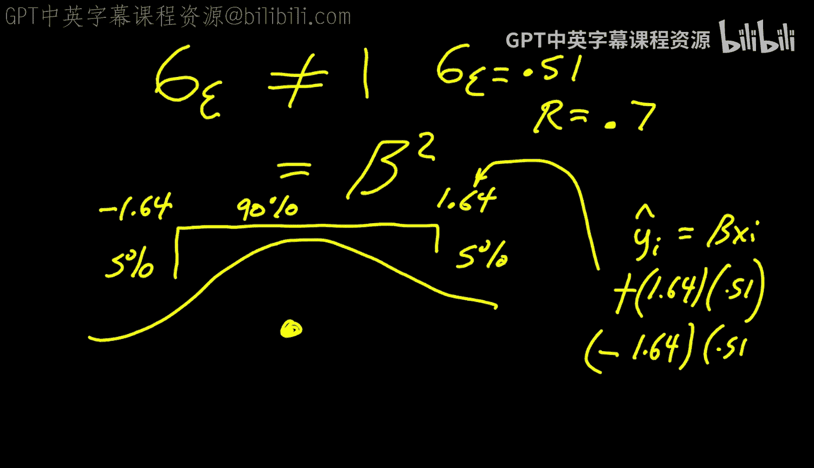

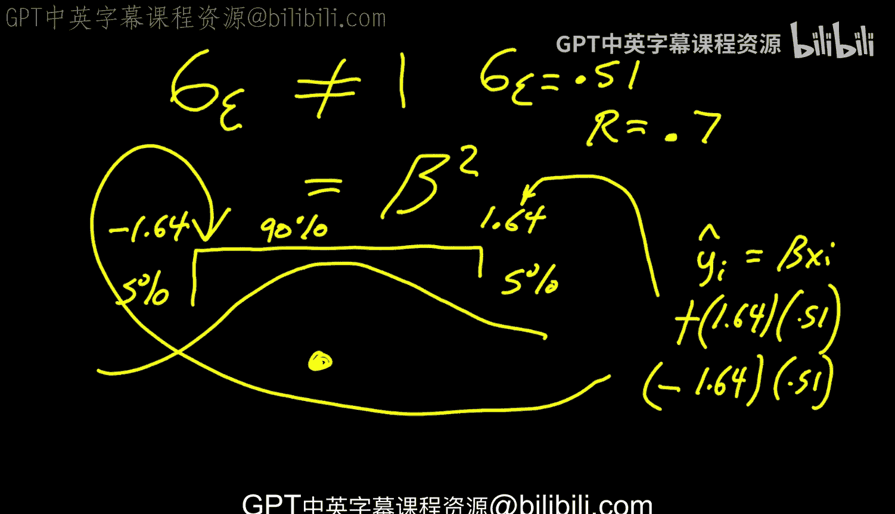

本节课中，我们一起学习了线性回归误差的建模过程。我们基于标准化和正态性假设，推导出误差方差 `σ_ε²` 与决定系数 `r²` 的关系公式：`σ_ε² = 1 - r²`。利用这个关系，我们可以将点预测扩展为概率分布预测，并构建出具有特定置信水平的预测区间，从而更全面、更可靠地评估预测结果的不确定性。