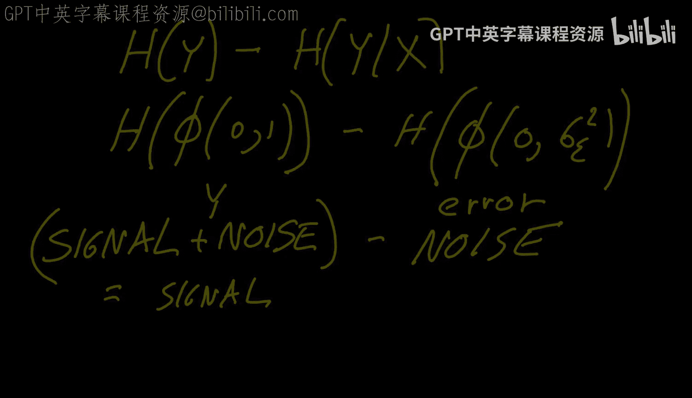
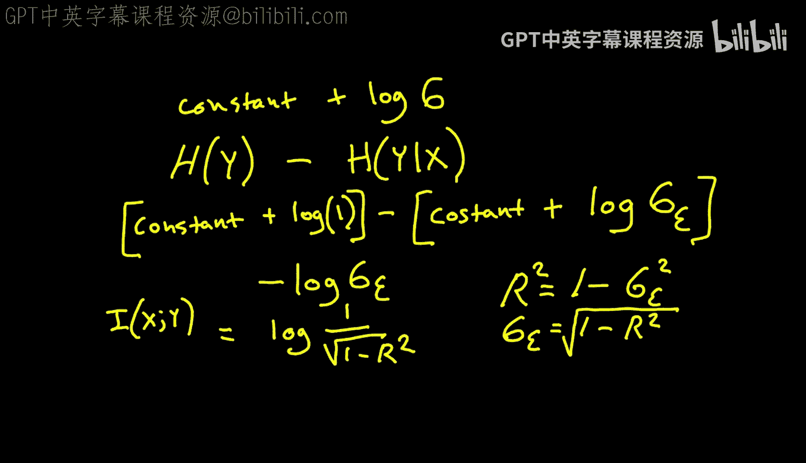
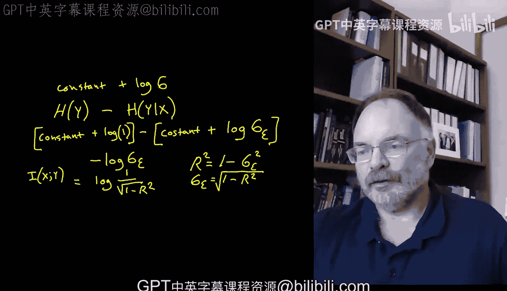

#  069：线性回归与互信息 📈

在本节中，我们将探讨一个虽不在课程考核范围内，但非常有趣且值得了解的主题：线性回归与互信息之间的数学联系。我们将看到，在特定的参数模型（如高斯分布）下，这两个看似不同的概念是如何通过一个简洁的公式联系起来的。

## 从熵到微分熵 🔄

上一节我们介绍了离散概率分布的熵公式。本节中，我们来看看连续概率分布对应的概念——微分熵。

对于像高斯分布这样的连续概率分布，其微分熵在形式上与离散熵相似，但性质略有不同。请注意，微分熵可以取负值，并且其代数运算规则也有所不同。例如，当两个分布变得完全相同时，互信息会趋近于无穷大。因此，在处理微分熵时，需要留意这些不同的特性。

## 互信息的基本公式 📐

互信息的基本公式定义如下：

**I(Y; X) = H(Y) - H(Y|X)**

其中：
*   `H(Y)` 是目标变量 `Y`（原始高斯分布）的微分熵。
*   `H(Y|X)` 是在已知预测变量 `X` 的条件下，`Y` 的条件微分熵。

这个公式的直观理解是：`Y` 的总不确定性（`H(Y)`），减去知道了 `X` 之后 `Y` 剩余的不确定性（`H(Y|X)`），结果就是 `X` 为预测 `Y` 所提供的信息量，即互信息。

在回归的语境下，`H(Y|X)` 实际上就是回归误差（噪声）分布的熵。因为 `Y` 可以分解为信号（由 `X` 解释的部分）加噪声（误差），所以从总熵中减去噪声的熵，就得到了信号的熵，即互信息。

## 建立联系：从微分熵到相关系数 ⛓️

我承诺过会解释互信息与线性回归是如何连接的，现在我们已经接近答案了。

关键在于高斯分布微分熵的一个性质：一个高斯分布的微分熵等于一个常数加上其标准差的对数。

因此，对于我们的互信息公式 `H(Y) - H(Y|X)`，我们可以写出：
`I(Y; X) = [C + log(σ_y)] - [C + log(σ_error)]`

由于我们在分析中通常使用标准化变量（均值为0，标准差为1），`σ_y` 就等于1。这极大地简化了我们的计算。于是公式简化为：
`I(Y; X) = -log(σ_error)`

我们知道，在线性回归中，皮尔逊相关系数 `r` 与回归误差的标准差 `σ_error` 存在明确的关系：
`σ_error = sqrt(1 - r^2)`

## 核心公式推导 🎯

现在，只需进行简单的代入，就能得到连接两者的核心公式。

将 `σ_error = sqrt(1 - r^2)` 代入 `I(Y; X) = -log(σ_error)`，我们得到：

**I(Y; X) = -log( sqrt(1 - r^2) )**

或者等价地：

**I(Y; X) = -1/2 * log(1 - r^2)**

这个优美的公式揭示了在线性回归的框架下，当变量服从高斯分布时，衡量变量间线性相关程度的相关系数 `r`，与衡量变量间统计依赖性的通用指标互信息 `I`，是如何被精确联系起来的。`r^2` 越大（线性关系越强），互信息的值也就越大。

## 总结 📝

本节课中，我们一起学习了线性回归与信息论中互信息概念之间的深刻联系。

我们首先回顾了离散熵并引出了连续分布的微分熵。接着，我们解释了互信息在回归中的含义：即从目标变量的总熵中扣除预测后剩余误差的熵。然后，利用高斯分布微分熵的性质以及相关系数与误差标准差的关系，我们最终推导出了关键公式 **`I(Y; X) = -1/2 * log(1 - r^2)`**。

这个结论表明，在基于高斯分布的参数模型中，线性回归分析所揭示的（线性）信息，完全可以通过互信息这一更通用的信息度量来捕捉和表达。这为我们理解不同数据分析工具之间的内在统一性提供了一个精彩的视角。