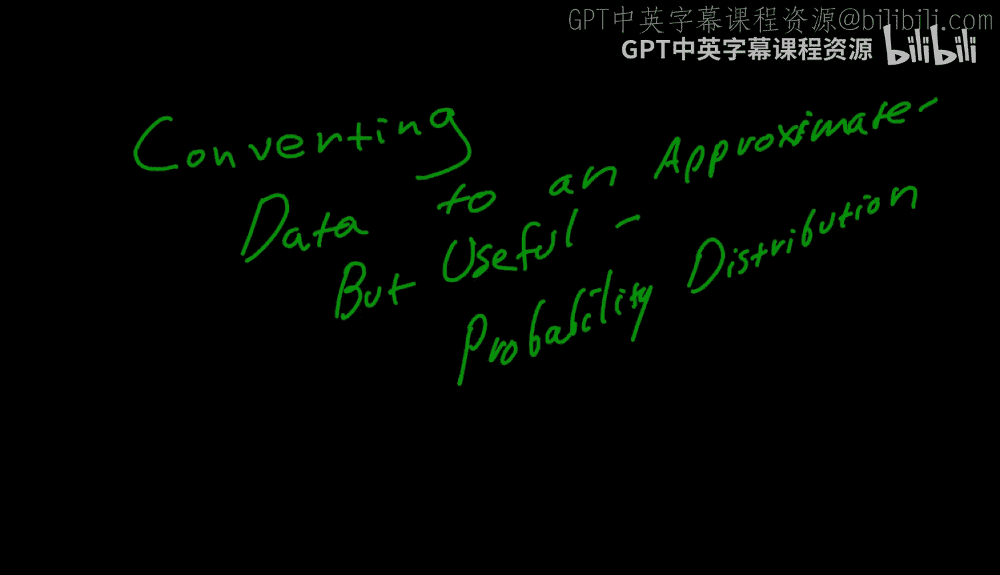
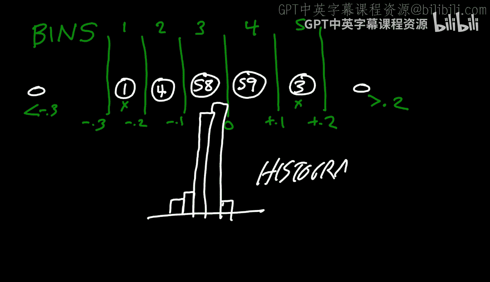
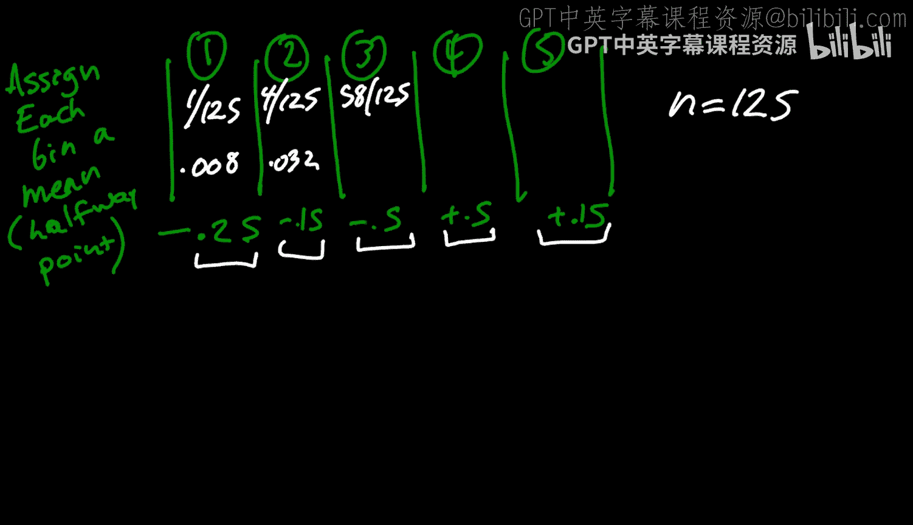
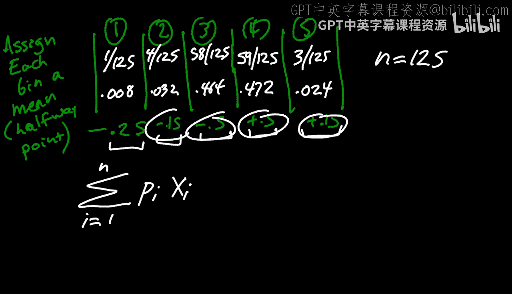
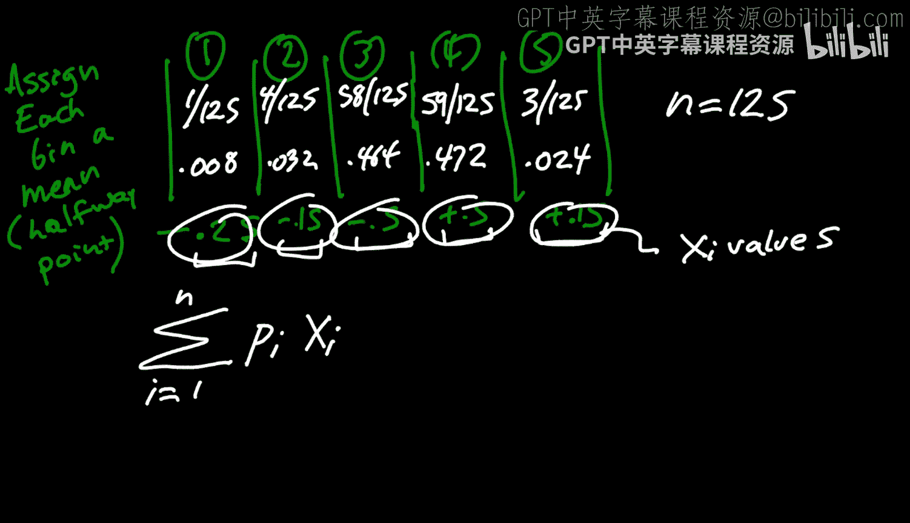
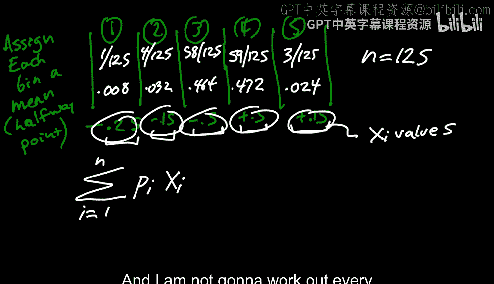
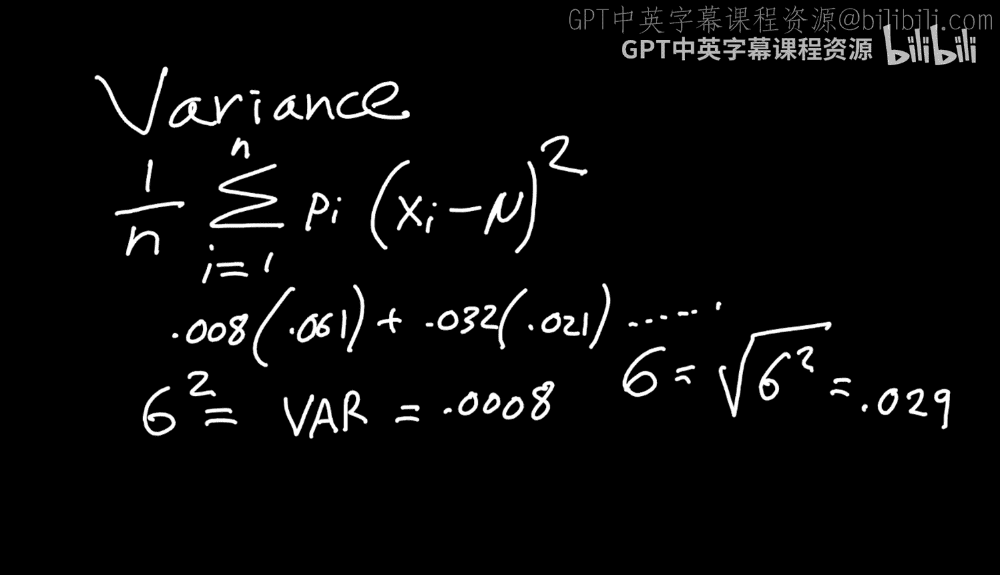
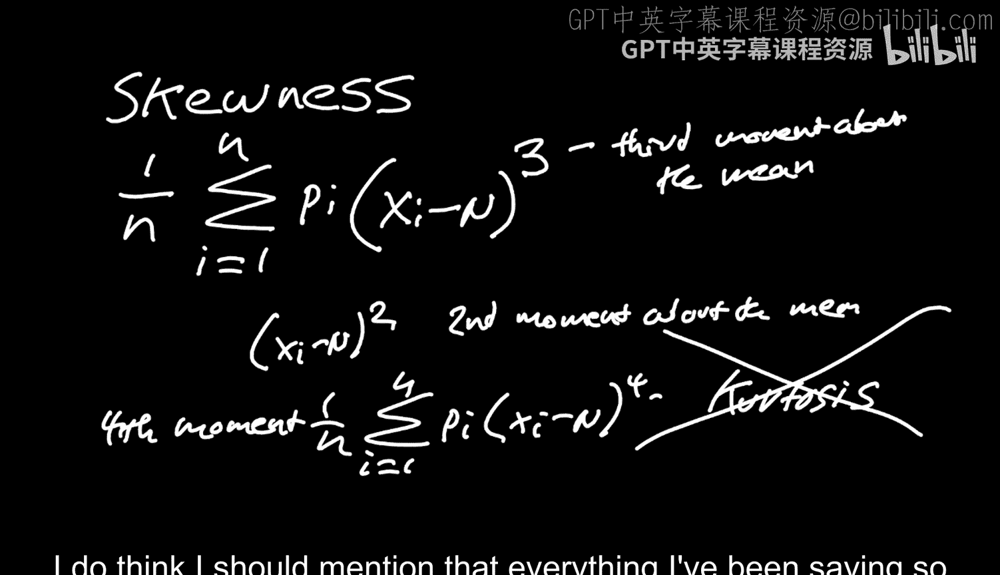
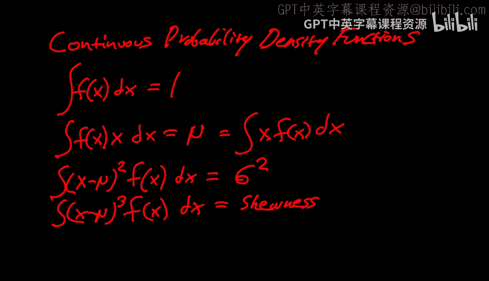
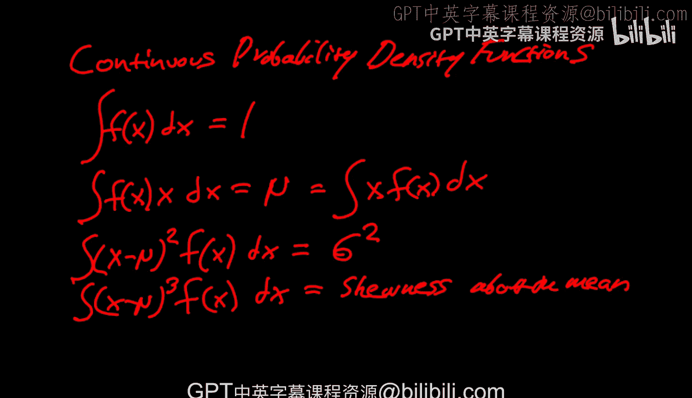

#  070：直方图与概率分布函数描述 📊

在本节课中，我们将学习如何将一组数据转换为直方图，并进一步将其描述为近似的概率分布。我们将探讨描述概率分布的关键统计量，包括均值、方差、标准差和偏度，并了解离散分布与连续分布在这些概念上的区别。

## 从数据到概率分布

上一节我们介绍了概率分布的概念。本节中，我们来看看如何将实际观测数据转化为一个有用的近似概率分布。

我们从一个数据集开始。假设我们从一个在-1到1之间的均匀分布中随机抽取了100个数据点。我们的目标是将每个数据点放入预设的“箱子”中。例如，如果有一个值是-0.27，它会被放入对应的箱子；如果有一个值是0.144，它会被放入另一个箱子。通过这种方式，我们逐渐累积信息。

假设在收集了125个数据点后，数据分布如下：第一个箱子有1个值，第二个箱子有4个值，第三个箱子有58个值，第四个箱子有59个值，第五个箱子有3个值。没有数据点落在最高或最低的箱子范围之外。

我们可以用图形来表示这个分布。这个图形就是**直方图**。

## 创建概率直方图

现在我们已经创建了第一个直方图。接下来，我们将把它转换为概率分布。

首先，为每个箱子分配一个中点值。然后，将每个箱子中的原始计数值除以数据点的总数（125）。以下是计算过程：

*   第一个箱子：1 / 125 ≈ 0.008
*   第二个箱子：4 / 125 ≈ 0.032
*   第三个箱子：58 / 125 ≈ 0.464
*   第四个箱子：59 / 125 ≈ 0.472
*   第五个箱子：3 / 125 ≈ 0.024

这样，我们就得到了一个**概率直方图**，它是真实概率分布的一个近似。

## 描述概率分布

在创建了概率分布之后，我们需要用一些描述性术语来向他人传达它的特征。以下是几个关键的描述性统计量。

### 均值（期望值）

均值，或称期望值，是概率分布的中心趋势度量。它的计算公式是每个值乘以其概率的总和。

对于离散分布，公式为：
`E[X] = μ = Σ (p_i * x_i)`
其中，`p_i` 是每个值 `x_i` 的概率。

### 方差与标准差

方差衡量了数据分布的离散程度，即数据点偏离均值的平均平方距离。

方差的公式为：
`Var(X) = σ² = Σ [ p_i * (x_i - μ)² ]`

标准差是方差的平方根，它与原始数据有相同的单位，更易于解释：
`σ = √Var(X)`

在我们的例子中，计算出的方差约为0.0008，标准差约为0.029。

### 偏度

偏度描述了分布的不对称性，即分布是向左偏（负偏）还是向右偏（正偏）。

偏度的计算公式是：
`Skewness = Σ [ p_i * (x_i - μ)³ ]`

这被称为关于均值的**三阶中心矩**。方差（关于均值的平方）是二阶中心矩。如果你好奇，四阶中心矩被称为峰度，但本课程不要求掌握。

## 离散分布与连续分布

需要指出的是，到目前为止我们讨论的都是**离散分布**。

对于**连续分布**，我们称之为**概率密度函数**。其核心思想是，曲线下的总面积始终等于1。

连续分布对应的描述统计量公式使用积分而非求和：

*   **均值**： `μ = ∫ x * f(x) dx`
*   **方差**： `σ² = ∫ (x - μ)² * f(x) dx`
*   **偏度**： `Skewness = ∫ (x - μ)³ * f(x) dx`

## 总结

本节课中，我们一起学习了如何将原始数据通过构建直方图转化为近似的概率分布。我们探讨了描述概率分布的三个核心统计量：**均值**（衡量中心位置）、**方差/标准差**（衡量离散程度）以及**偏度**（衡量不对称性）。最后，我们区分了离散概率分布与连续概率密度函数在计算这些统计量时的不同表达方式。掌握这些描述性工具，是理解和沟通数据分布特征的基础。