#  071：重要常见概率密度函数 📊

在本节课中，我们将学习三种重要的概率密度函数：均匀连续分布、均匀离散分布和高斯（正态）连续分布。理解这些分布的特性及其适用场景，对于在信息有限的情况下对数据进行建模至关重要。

处理数据时，一个常见的现象是许多过程都近似于某些特定的分布。在许多情况下，如果我们不知道真实的分布是什么，就应该选择某些特定的分布。这些分布是我们对未知信息最恰当的表示。这背后有充分的逻辑和数学理由：在仅已知某些约束条件的情况下，这些分布具有最大的熵或不确定性。因此，在了解更多信息之前，这些分布是表示数据的最佳选择。

## 均匀连续分布 📈

首先，我们来看均匀连续分布。当然，这正是我们在中心极限定理示例中使用的-1到1区间上的分布。

通常，我们将其表示为在区间 **A** 到 **B** 上的分布。其概率密度函数图像是一个矩形。为了使概率密度函数的积分为1，我们知道矩形的宽度是 **b - a**，因此其高度必须等于 **1 / (b - a)**。所以，该函数在定义域内每个点的值都是 **1 / (b - a)**。

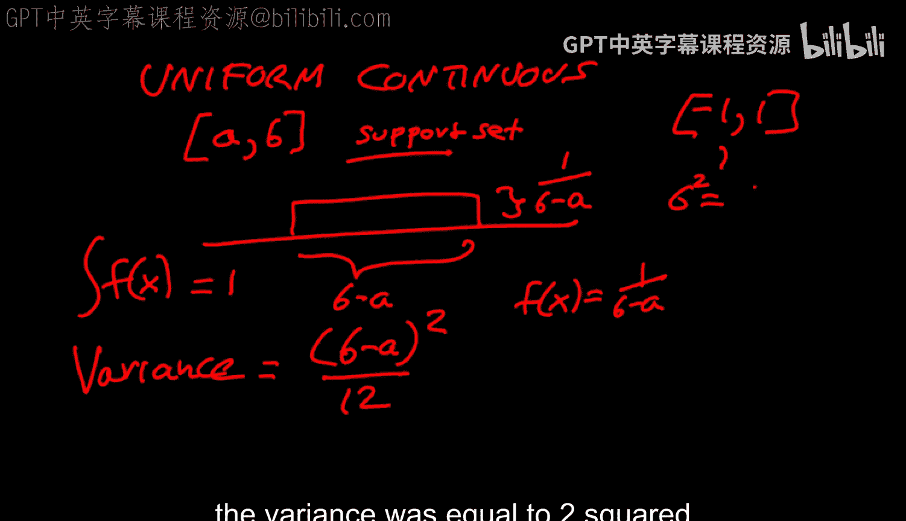

以下是均匀连续分布的关键特性：

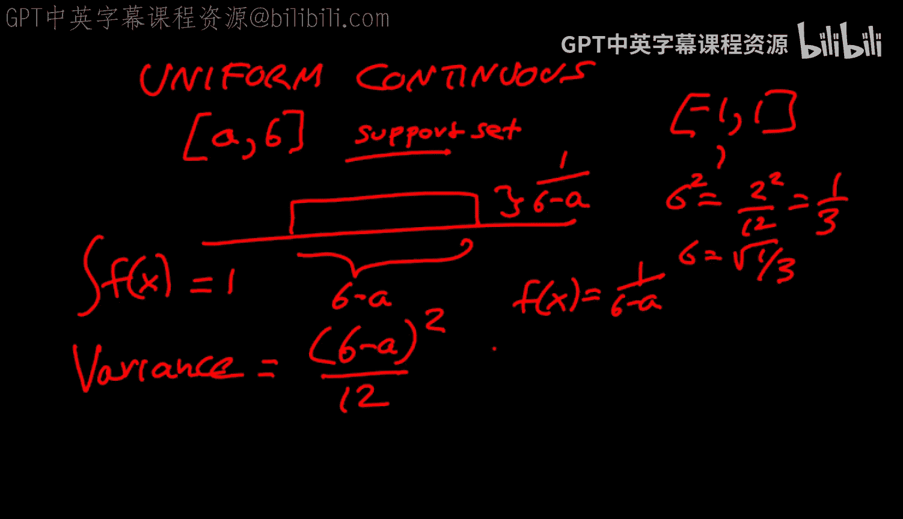

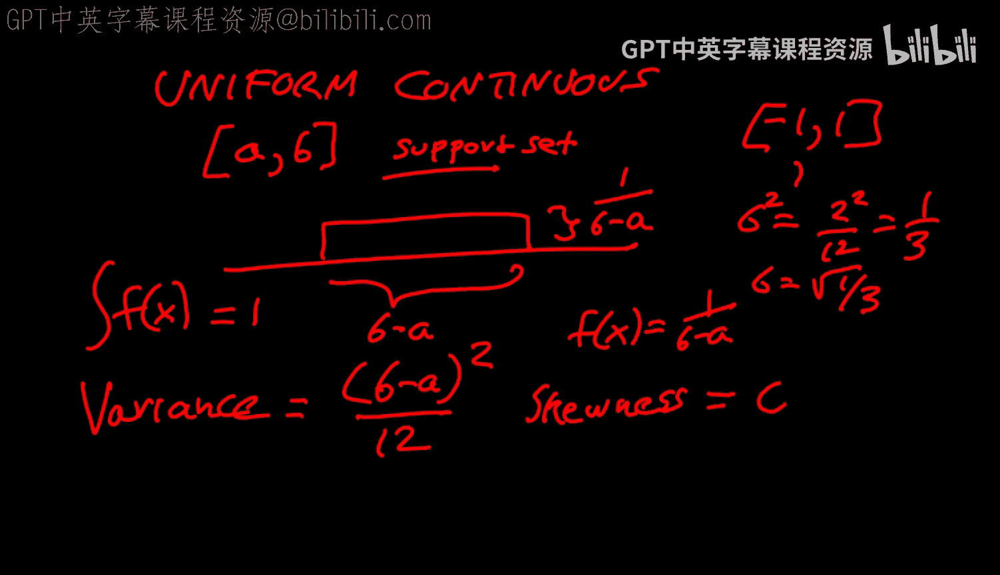

*   **支撑集**：定义在实数轴上的区间 **[A, B]**。
*   **均值**：计算公式为 **(A + B) / 2**。
*   **方差**：计算公式为 **(B - A)² / 12**。
*   **偏度**：关于均值的偏度为 **0**，这意味着它完全对称。
*   **熵**：其不确定性表示为 **log₂(B - A)**。

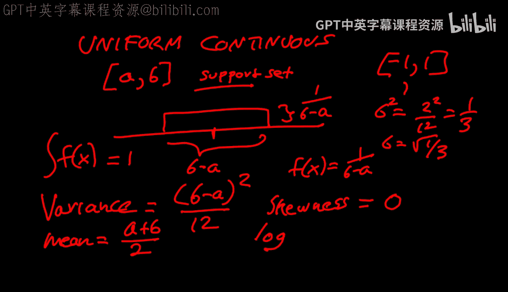

如果我们只知道某个变量分布在两个已知的有限点 **A** 和 **B** 之间，除此之外一无所知，那么选择均匀连续分布是合适的，因为它是该约束条件下的最大熵分布。

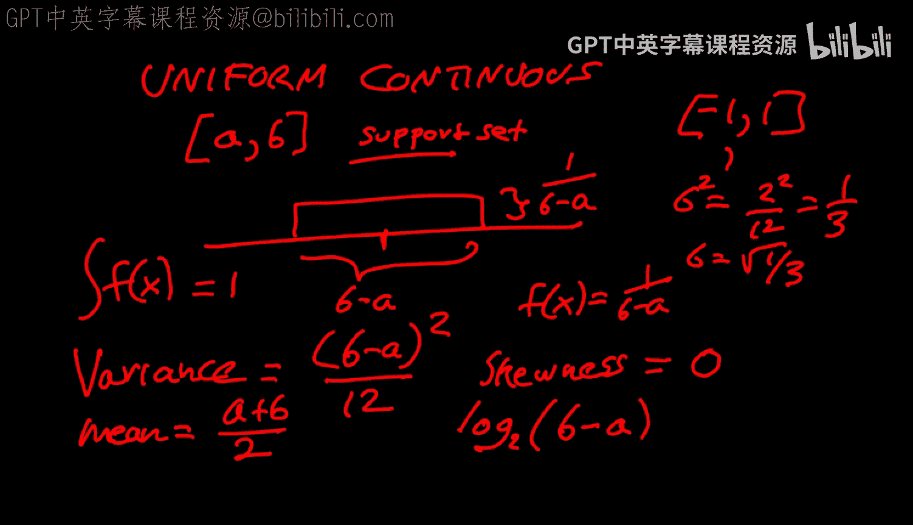

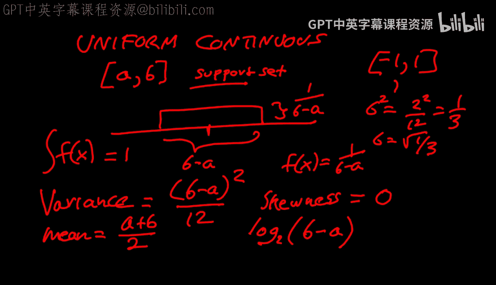

## 均匀离散分布 🎲

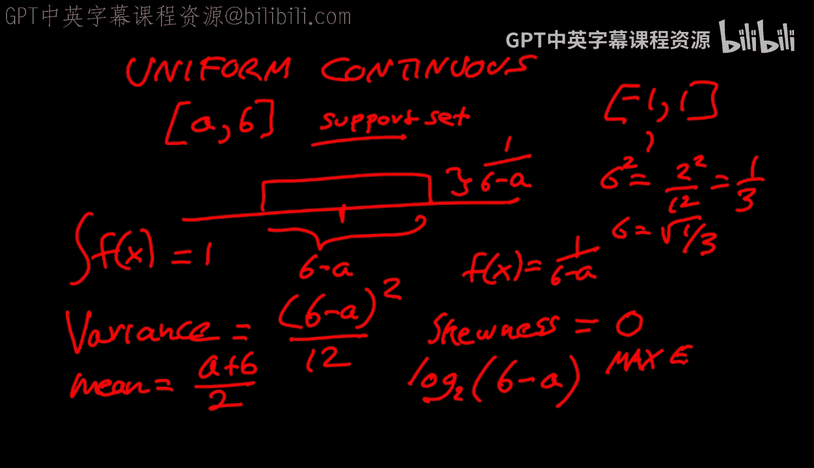

上一节我们介绍了连续情况，本节中我们来看看离散形式。均匀离散分布的一个例子是公平的骰子，其可能取值为1、2、3、4、5或6，但绝不会取到这些整数之间的值。

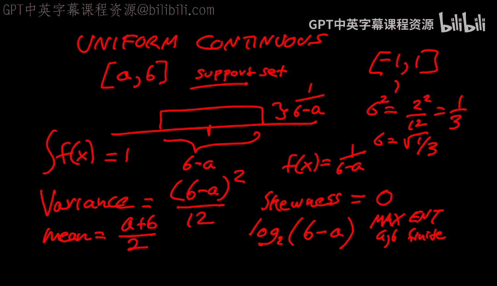

它通常表示为支撑集为 **{1, 2, 3, 4, 5, 6}** 的分布，但需理解这是离散的。其均值同样为 **(A + B) / 2**。

以下是均匀离散分布的关键特性：

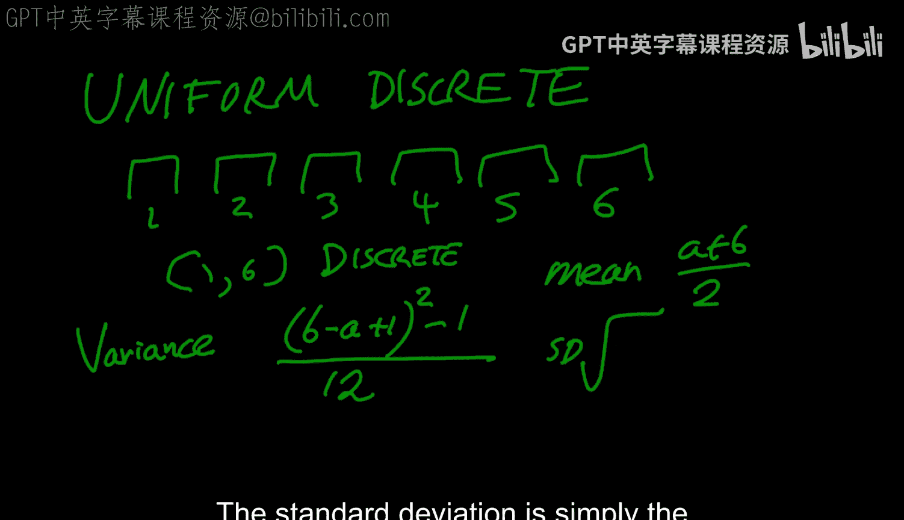

*   **方差**：计算公式为 **[(B - A + 1)² - 1] / 12**。
*   **标准差**：是方差的平方根。
*   **偏度**：同样为 **0**，完全对称于其均值（例如3.5）。
*   **熵**：等于 **log₂(n)**，其中 **n** 是可能结果的数量。

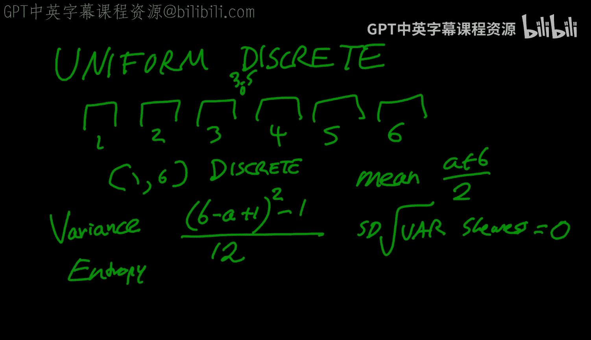

如果某个变量可以在已知的最小值和最大值之间取任何值，但这些值必须是离散的（即整数），那么均匀离散分布就是最大熵分布。在我们对结果选择一无所知的情况下，这是最合适的分布。

## 高斯（正态）连续分布 🔔

最后，不能不提我们的老朋友——高斯连续分布（正态分布）。现在让我们来讨论它。

其概率密度函数，你现在可能还记得，包含一个依赖于方差值的归一化常数。函数的公式为：

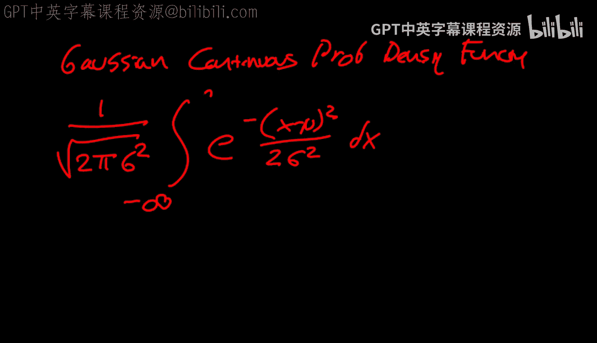

`f(x) = (1 / √(2πσ²)) * e^(-(x-μ)²/(2σ²))`

以下是高斯分布的关键特性：

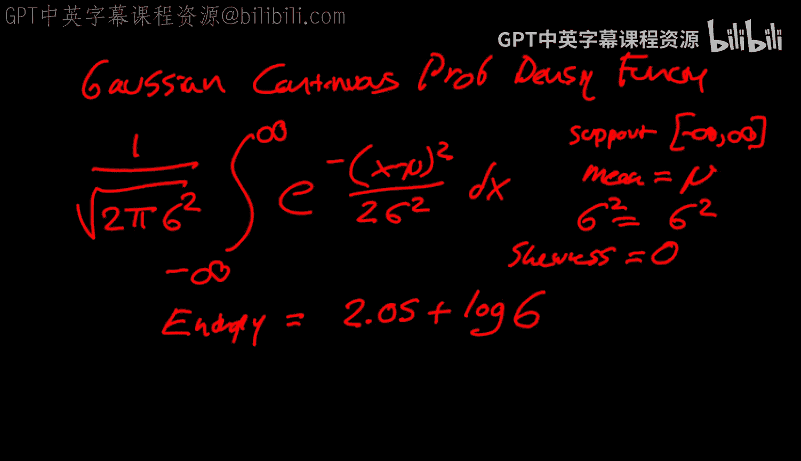

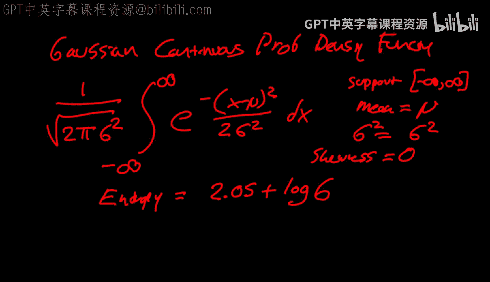

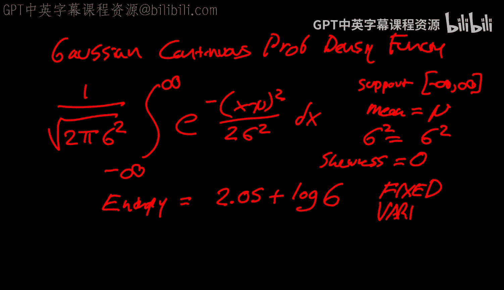

*   **支撑集**：从 **-∞** 到 **+∞** 的整个实数轴。
*   **均值**：等于 **μ**。
*   **方差**：等于 **σ²**。
*   **偏度**：为 **0**，呈对称分布。
*   **熵**：等于 **1/2 * log₂(2πeσ²)** 或近似为 **1.05 + log₂(σ)**。

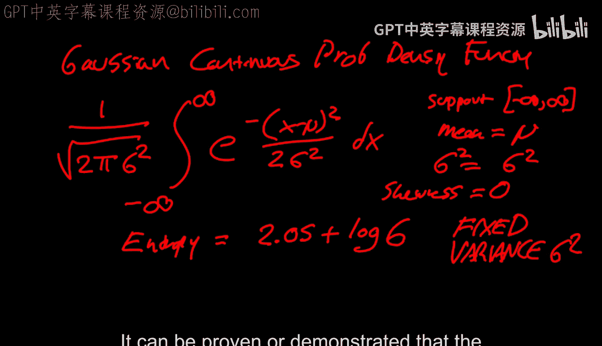

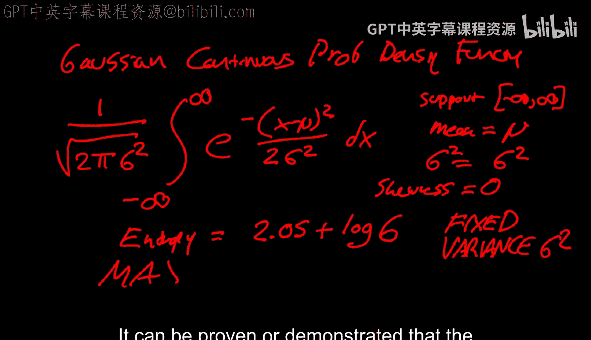

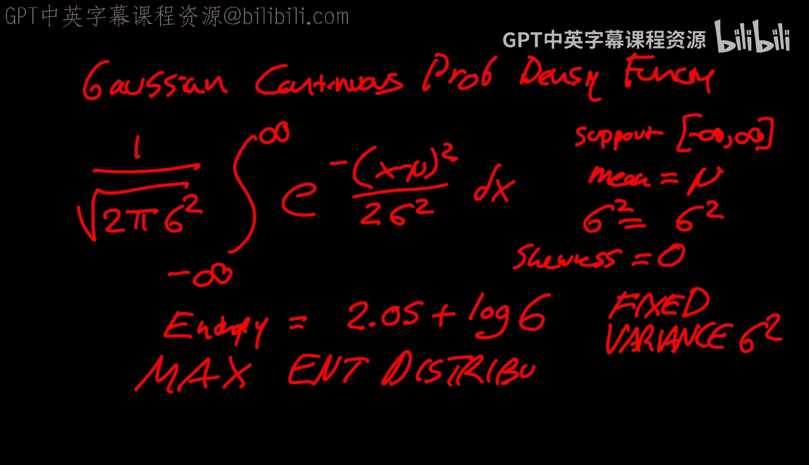

可以证明，对于一个方差固定的分布，如果其值域是从负无穷到正无穷，那么高斯分布就是最大熵分布。这意味着，如果我们对一个现象完全无知，只知道其方差，就应该用高斯分布来表示它。这或许为我们在噪声分布未知时持续使用高斯分布提供了一个更深刻、更令人满意的解释或理由。因为实际上，在了解更多信息之前，如果我们知道噪声的方差，高斯分布就是我们能使用的最合适的分布。

## 总结 📝

本节课中，我们一起学习了三种核心的概率分布。均匀连续分布适用于仅知变量上下界的场景；均匀离散分布适用于结果为离散整数的场景；而高斯分布则是在仅知方差且变量取值无界时的最大熵选择。理解这些分布及其最大熵原理，能帮助我们在商业分析中，面对信息不完全的数据时，做出更合理、更科学的建模假设。