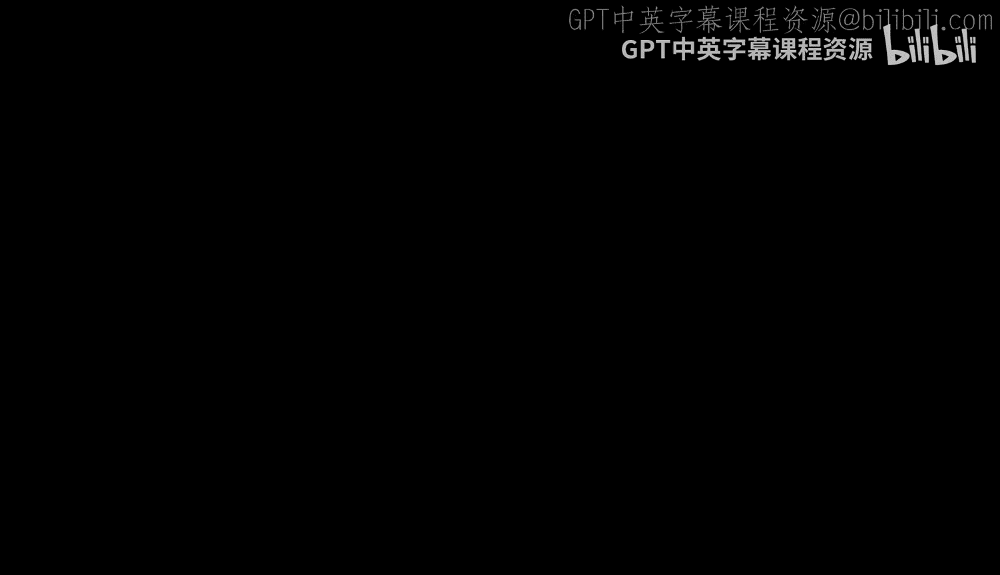
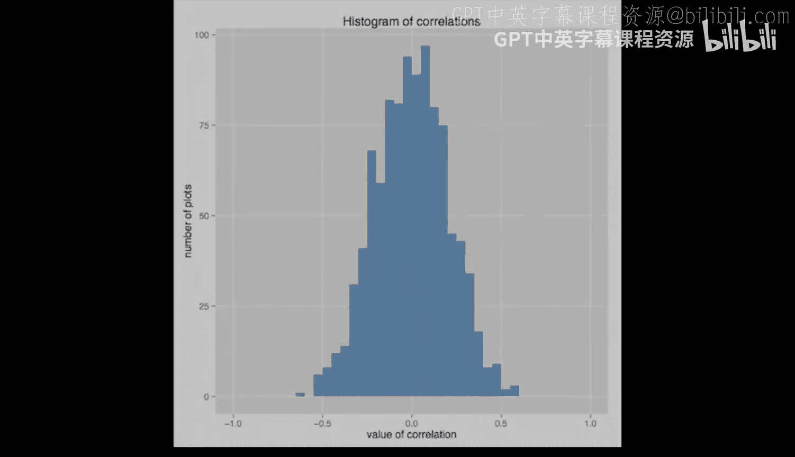

#  073：过拟合现象成因解析 📊

在本节课中，我们将要学习数据分析中的一个核心问题——过拟合。我们将探讨过拟合是什么，它是如何发生的，以及它为何会导致模型在新数据上表现糟糕。通过理解其背后的数学原理，我们可以更好地评估和构建模型。

---

## 什么是过拟合？🤔

数据分析中的一个主要问题是，借助计算机，我们可以非常容易地用复杂模型去拟合任何数据集。然而，当你试图将这个模型应用到新数据上时，即模型未曾训练过或设计时未考虑的数据，模型通常会完全失效，表现极差。这种现象有一个专门的名称，叫做**过拟合**。

在本课程最后的项目中，你将练习一些避免过拟合的技巧。但首先，我想向你展示一个完全随机数据的例子，并说明随机数据中出现看似有关联、看似可以建模的模式是多么常见。

---

## 随机数据中的虚假关联 🎲

我们这里有一组有序对，即 X 和 Y 值。每个值都是从均值为 0 的高斯分布中随机选取的。我们选取了 25 个有序对，然后计算了最佳拟合线。利用这些点和这条线，我们当然可以计算相关系数 R。

你会发现，这些相关系数的范围从小于 -0.5 的极端值，一直到 -0.63，再到大于 +0.5。这些相关性完全是由于**偶然性**造成的，两个底层随机变量 X 和 Y 的实际相关性为 0。

---

## 理解过拟合的视角 🔍

理解过拟合的一种方式是，当我们过于自信地认为我们的模型能够从信号和噪声的混合体中提取出信号时，过拟合就发生了。我们的模型将训练集数据中的一部分噪声也当作了信号的一部分，因此我们认为信号比实际情况更强。然后，当我们尝试在新数据上使用模型来预测新结果时，新的噪声无法告诉我们任何关于新结果的信息，导致我们的模型表现比预期差得多。

为了更好地理解这种过拟合的观点，我们首先考虑一个没有过拟合的简单线性回归模型的理想情况。

---

## 理想线性回归模型 📈

假设一个不变或平稳的过程，输入实数值（我们称之为 x_i），输出实数值 y_i。我们假设这个过程是参数化的，意味着 x 值和误差都来自独立的高斯分布，均值为 0，标准差为 1。这意味着我们 Y 输出的标准差（信号和噪声的组合）也等于 1。这是一个简化模型，但它给出了基本概念。

对于一个特定的 x_i，我们将其乘以系数 β。因此，我们的 y 值将是 β 乘以 x_i，再加上一个常数 α。在我们的简化模型中，由于均值为 0，α 将等于 0。最后，我们的 y 值中存在不确定性。这种不确定性表现为一个标准差为 σ_e（随机误差分量的标准差）的高斯分布。

所以，如果我们将模型视为生成 y 的估计值，记为 ŷ_i = β * x_i。y 的真实值是不同的，它是从一个均值为 β*x_i、方差为随机误差方差的高斯分布中抽取的。

通过本课程其他部分的计算，我们知道随机误差的标准差等于 √(1 - R²)。由于我们的标准化处理，我们知道 R 等于斜率 β，这也等于我们信号的标准差。所以，我们是在将信号（β * x_i）与噪声结合，以得到 y_i 的真实值。

想象一下，这条线上有一个点，我们有一个误差的高斯分布，y 的真实值可能落在这个分布内的任何地方，但很可能靠近信号值。误差给了我们一个额外的分量。y_i 与 ŷ_i 之间的差值被称为**残差**。如果我们取残差的标准差，那就是我们所说的误差标准差。

在本课程的大部分内容中，我们做了一个简化假设：在一组观测到的有序对上得到的最佳拟合线准确定义了固定参数 α、β 和误差标准差。现实生活可能更具挑战性。即使我们足够幸运地建模了一个真正平稳的过程，我们仍然不知道 α、β 和随机误差标准差的真实值。我们从某个底层过程中抽取的有序对样本中推导出的是**估计值**。因此，我们有 β 的估计值、α 的估计值和误差的估计值。

---

## 过拟合的数学影响 ➗

刚才观看动画的整个目的是让你相信，如果没有进一步的测试，从中等规模有序对集合生成的线性模型参数，不能可靠地用于预测未来未知的结果。

现在存在数学方法来计算我们每个估计值（β帽、α帽、σ_e帽）的误差概率分布。y_i 的真实误差不是 σ_e帽，而是这三种误差的某种组合。然而，这些计算超出了本课程的范围，详细解释这些调整的文献已在参考书目中列出。

我们提出这个问题是为了证明，过拟合不仅是将噪声当作信号来建模，而且过拟合的效果是，当我们在新数据上使用模型时，会增加残差，以至于我们的误差不仅比预期大，而且如果我们正确知道 β，误差实际上比真实情况下的噪声还要大。换句话说，过拟合使我们的误差变得更糟。

让我解释一下我的意思。我们假设一个平稳过程，其真实相关性 R = 0.5。这意味着我们真实的随机误差标准差将是 √(1 - R²) = √(1 - 0.25) = 0.866。

然而，假设我们使用一些有序对集合开发了这个模型，我们的最佳拟合线斜率 β帽 = 0.85。我们会认为相关性等于 0.85，因此我们会认为真实误差等于 √(1 - 0.85²) ≈ 0.527。比较这两个数字，你会发现真实误差比我们从过拟合模型中预期的误差大 64%（因为 0.866 / 0.527 ≈ 1.64）。

但是，还有一个额外的误差。假设我们有一个点 (2, 1.2) 和另一个点 (2, 1.7)。额外的误差等于 0.7。实际上，额外的误差将取决于 x_i 的值，并且将等于 x_i 乘以我们相信的斜率与真实斜率（或真实相关性）之间的差值。

既然我们知道 x 值也是从均值为 0、标准差为 1 的高斯分布中抽取的，我们可以将所有可能 x 值的这种额外误差项的影响加进来。这意味着如果我们不知道 x 的值，这个误差会有一个期望值。这个误差的期望值将等于我们的估计值与真实值之间的差值。

如果我们将这个误差加到之前的误差上并取其平方根，我们将得到 √(0.866² + 0.35²) ≈ 0.93。所以，我们新的总误差比预期差了约 77%，而不是 64%。这就是我们为过拟合付出的代价。

---

## 如何识别过拟合？🚨

通常，如果你在适量数据上开发出一个具有高相关性的模型，那么真实相关性低于你估计值的可能性，远高于高于你估计值的可能性。在第二组数据上出现低得多的相关性，是过拟合的明确迹象。新数据集上的新相关性估计值越接近你之前的相关性估计值，就越有可能这两个估计值都相对接近信号的**真实值**。

---

## 总结 📝

本节课中，我们一起学习了过拟合现象。我们了解到，过拟合发生在模型过于复杂，以至于拟合了训练数据中的噪声时。这会导致模型在新数据上表现不佳，因为模型错误地将噪声当作了有意义的信号。我们通过数学公式（如 ŷ_i = β * x_i + ε，其中 ε ~ N(0, σ_e²)）和概念（如残差、估计误差）深入探讨了其成因。关键在于要意识到，从有限数据中得出的高相关性可能具有欺骗性，必须通过在新数据上验证模型来避免过拟合。