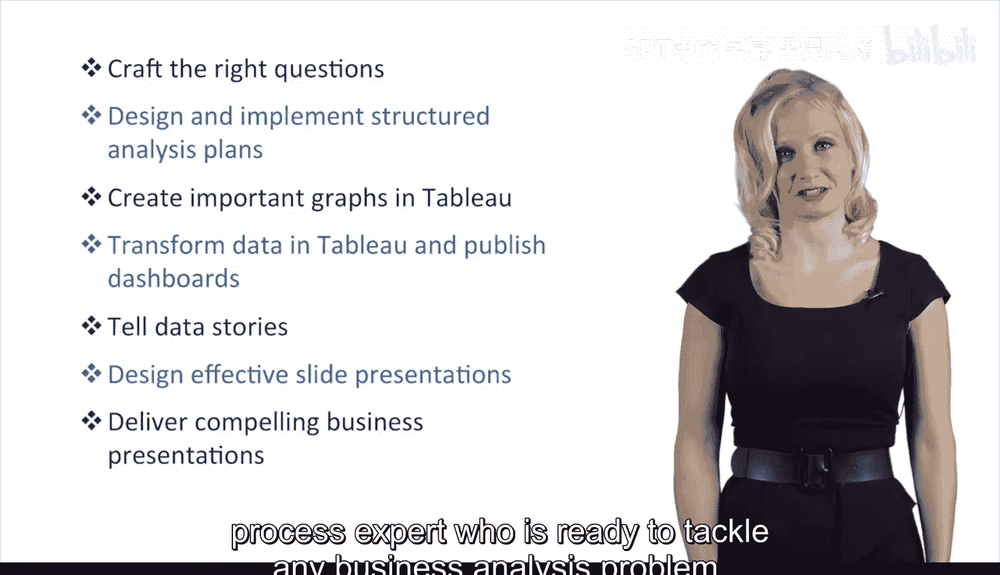

#  077：欢迎来到课程 📊

在本课程中，我们将学习如何利用数据可视化来加速商业洞察的生成，并有效地进行沟通。我们将使用 Tableau 软件，但重点不仅是掌握工具，更是理解如何在整个数据分析项目生命周期中，高效地运用可视化来驱动商业决策。

## 课程概述

在专项课程的第一门课《数据驱动公司的商业指标》中，你学习了大数据生态系统以及哪些指标对创造和评估商业价值最重要。

在第二门课《精通 Excel 数据分析》中，你学习了如何使用 Excel 为商业数据建模，以进行预测、评估不确定性和创造可执行的洞察。

在本课程中，我们将利用可视化的力量，加速你生成商业洞察的速度，并有效地进行沟通。

## 人类大脑与视觉模式

人类大脑是卓越的视觉模式检测器。设计出能在国际象棋上超越人类的计算机之所以花费了很长时间，原因之一就是我们无法让计算机像加里·卡斯帕罗夫（世界著名的国际象棋冠军）那样识别模式。

大数据分析的一个新趋势正试图利用这一点。其理念是：如果我们能让人们更容易地看到数据，他们自然会看到数据中的重要模式，并且速度远快于运行统计分析，尤其是在我们一开始并不知道该运行何种统计的情况下——这在处理现实世界中庞大而杂乱的数据时很常见。

如果你认同这个理念，那么一个自然的延伸就是：我们应该让尽可能多的人看到公司的数据，因为拥有专业知识的眼睛越多，我们可能发现的模式就越多。这就是公司仪表板变得如此流行的原因，它们旨在让公司上下的人都能寻找模式。

## 从模式到故事

商业世界还以另一种方式利用了人类大脑对模式的倾向性，即大脑会自然地将模式转化为故事或叙述。叙事故事能非常高效地传递复杂信息的含义，比罗列事实要快得多、完整得多。认识到这一点后，商业界对使用可视化和叙述来传达复杂数据的可执行意义感到非常兴奋。

本课程将帮助你投身于商业数据分析的这些新趋势。在接下来的几周里，你将学习如何利用可视化来：
1.  快速锁定哪些因素对解释你的数据和影响你的商业指标最为重要。
2.  将你的分析串联成一个故事，从而推动商业流程的变革。

## 课程目标与方法

我将教你如何使用可视化软件 Tableau，但我的目标不仅仅是让你成为 Tableau 专家。我希望帮助你成为使用 Tableau 来最大化商业数据分析项目效率和效果的专家。这听起来可能有些细微差别，但这一点很重要。

本课程可能与你见过的其他数据可视化或 Tableau 课程略有不同，因为本课程将根据数据分析项目的生命周期来组织，而不仅仅是根据 Tableau 的功能。我们将学习何时以及如何使用 Tableau 来实现数据项目生命周期的特定步骤，并学习如何利用 Tableau 提供的功能来制作引人注目的演示文稿，用数据来建议商业流程的变更。

## 可视化的定位与规划

尽管可视化很重要，但你会发现，在数据分析项目中，可视化既不应是第一步，也不应是最后一步。人类大脑非常善于发现模式，但也非常善于编造模式，并看到它想看到的，而不是实际存在的东西。

因此，尤其是在分析真正的大数据时，你甚至需要为分析项目中的可视化部分制定计划。而组织该计划的最佳方式，是使用经过深思熟虑的问题和假设作为你的路标。

此外，一旦你完成了所有可视化和模型，并认为自己理解了数据的含义，你仍然需要做一些工作，才能将你的分析转化为他人能理解的故事，并说服人们遵循你基于分析结论提出的建议。

## 课程学习成果

综上所述，我的目标是，在本课程结束时，你将能够：
*   知道如何提出正确的问题，以确保分析项目成功，并利用问题来设计和实施逻辑清晰、结构化的分析计划。
*   在掌握这些框架后，你将在 Tableau 中创建商业分析中最重要的图表，转换数据并制作仪表板，以及用数据讲故事。
*   掌握数据故事后，你将学习如何设计有效的幻灯片演示文稿来展示你的数据故事，以及如何进行引人入胜的商业演示。

你将成为一个 Tableau 高级用户。但更重要的是，你将成为一个数据分析流程专家，准备好应对任何商业分析问题。这听起来内容很多，但我知道你能胜任。

---

本节课中，我们一起学习了数据可视化在商业分析中的核心价值与定位。我们了解到可视化不仅是工具，更是加速洞察和有效沟通的关键。本课程将引导你从提出正确问题开始，通过 Tableau 实践，最终学会如何将分析结果转化为驱动商业变革的、有说服力的数据故事。