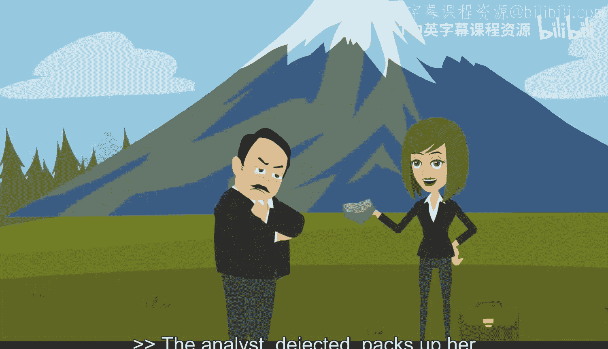
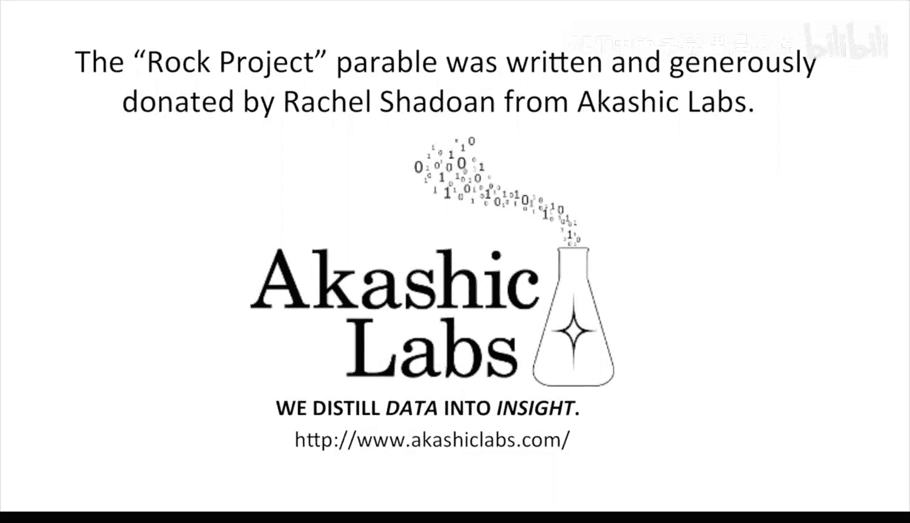

#  080：摇滚项目 🪨

在本节课中，我们将通过一个生动的比喻——“摇滚项目”的故事，来探讨商业分析项目中一个至关重要的陷阱：**需求不明确**。这个故事将揭示，如果分析师在开始分析前未能与利益相关者清晰定义项目的目标和预期价值，项目将如何陷入无休止的循环并最终失败。

## 故事开始：一个模糊的请求

我想给你讲一个关于“摇滚项目”的故事。

利益相关者说：“给我带一块石头来。我为这座大山花了很多钱，需要你从山上带一块石头回来，让这笔花费物有所值。”

分析师回应：“好的，石头。我能办到。我擅长找石头。你想要什么样的石头？”

利益相关者说：“嗯，我不确定，就是一块石头，一块能改变我们看问题方式的重要石头。”

分析师同意：“重要石头。明白，马上找来。”

## 第一轮尝试：带回“重要石头”

于是，分析师出发前往大山。她用镐敲打、挖掘，洗去尘土和碎石，最终找到了一块“重要石头”。

她很高兴，捡起这块重要石头，跑下山去给利益相关者看。分析师喊道：“我回来了！我从山上带回了一块重要石头，正如你所要求的。”

利益相关者接过石头检查，看起来并不满意。分析师继续说：“用这块重要石头，我们可以做很多伟大有趣的事情。你觉得它不好吗？”

利益相关者把石头在手里翻来覆去，说：“我不太确定，这不太符合我心目中的样子。这也许是块重要石头，但我想要一块不同的石头。你能回山上再给我带一块吗？”

分析师急切地想取悦对方，同意道：“当然，我马上就能去办。这次你能多告诉我一点你想要什么样的石头吗？是沉积岩、变质岩，还是水晶？”

利益相关者说：“哦，我也不太确定，但你会找到的。我知道你会的。毕竟我买下了整座山。”

## 第二轮尝试与持续的失望

分析师收拾好工具，返回山上。她敲打、凿刻，甚至炸开了一些巨石，最终找到了另一块重要石头。这块石头与第一块不同，她认为它更好。是的，这就是利益相关者想要的石头。她下山去展示。

分析师喊道：“看看这块重要石头！它比第一块出色得多。看看它所有优秀的岩石特性。”

利益相关者表示同意：“这是一块非常好的石头。在其他情况下，它甚至可能就是我需要的石头。但就目前情况而言，我不确定这是适合我的石头。你在那里还找到其他好石头了吗？你介意回去再找找吗？”

分析师有点沮丧地说：“这块石头已经是非常好的石头了。我不确定这座山还能产出多少这么好的石头。但我会回去看看。”

## 陷入循环：无休止的寻找

分析师收拾工具，再次返回山上。此时，她已熟悉这座山的特性，因此决定，要找到另一块好石头，必须投资一些大型基础设施。她在山里挖了一个深矿，反复敲打山的核心。她的头灯是检查潜在岩石时的唯一光源。“不是这块。不是那块。不，那块也不是。”

就在她几乎要放弃时，头灯的光圈扫过了一块石头。“我的天哪。这是完美的石头。我的意思是，完美。它比你之前找到的石头好太多了。”现在，她甚至有点不好意思曾想过把之前那些石头带给利益相关者。这块石头，是一块真正惊人的石头。

她跑下山，双手捧着这块完美的石头，兴奋地喊道：“利益相关者，我给你带来了一块真正惊人的石头！看看它超一流的岩石品质。它比之前的石头好太多了。它完全是个摇滚明星！”

利益相关者说：“哇，那是块好石头。但是，嗯，我仍然不确定这是我心目中的石头。买下这座山真的是一项投资，我只是想确保我们能最大限度地利用它。也许试试山的另一面？我听说山脉那一侧的人运气不错，找到了好石头。”

分析师垂头丧气，收拾好工具，返回山上。

## 故事的结局：失败与教训

这种情况永恒地持续下去。循环继续，分析师不断带来新的重要石头给利益相关者，却只看到石头再次被拒绝。

直到有一天，分析师崩溃了，用石头砸向利益相关者；或者，利益相关者将这座山亏本卖给了勘探者。

首先，我想我们都同意这个故事很“摇滚”。你刚刚听到的“摇滚故事”是一个寓言，比喻了当数据分析师在没有首先明确定义数据分析应创造何种价值的情况下，就同意承担一个分析项目时会发生什么。

发生的情况是：分析师不断尝试新事物，客户或利益相关者不断要求不同的东西，因为他们觉得自己的需求没有得到满足。项目无休止地进行，各方都变得越来越沮丧。

好消息是，你可以防止这种情况发生。在接下来的几个视频中，你将了解如何做到这一点。

## 本节总结

本节课中，我们一起学习了“摇滚项目”这个寓言。它核心揭示了商业分析项目失败的一个关键原因：**始于模糊的需求**。其根本问题可以概括为：

**`项目目标 = 模糊的期望`**

这导致了一个灾难性的循环：`分析师猜测 -> 交付结果 -> 被拒绝 -> 重新猜测`。要打破这个循环，关键在于在项目开始前，与利益相关者共同、清晰地定义什么是“好石头”（即成功的分析结果）。下一节，我们将开始学习如何通过明确的需求定义来避免陷入这个“摇滚”陷阱。