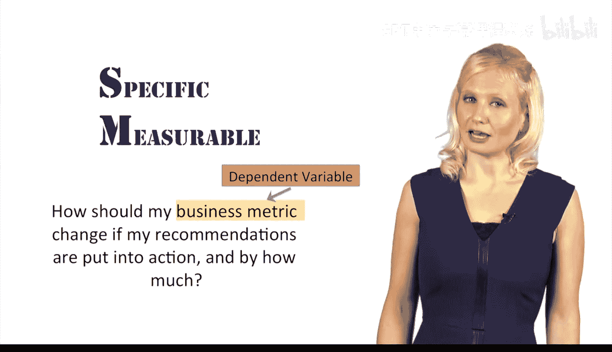
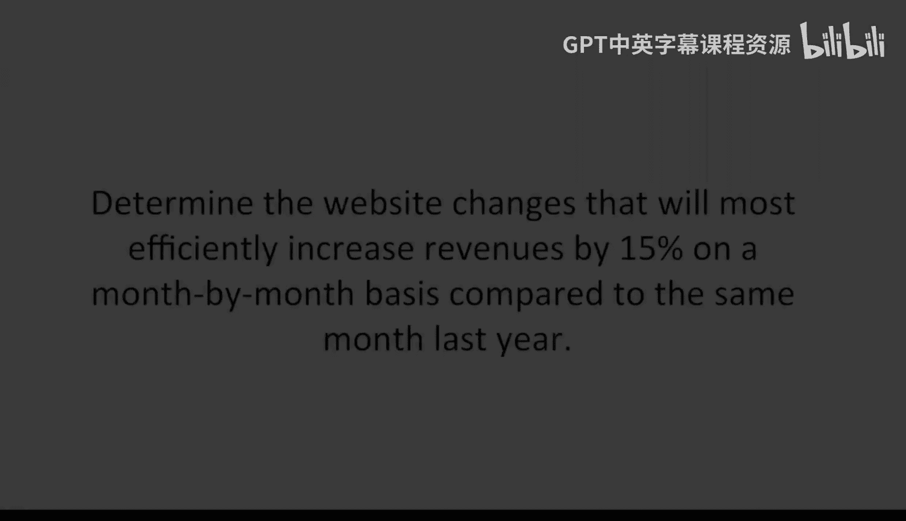

#  081：S-M-A-R-T 目标 🎯

在本节课中，我们将学习如何通过定义 S-M-A-R-T 目标来避免陷入“岩石项目”，并确保数据分析项目从一开始就方向明确、价值清晰。

## 避免“岩石项目” 🪨

上一节我们介绍了什么是“岩石项目”。本节中我们来看看如何避免它。

“岩石项目”令人厌恶，没人愿意参与。它们之所以发生，是因为分析师在未明确分析工作将提供何种价值之前，就贸然同意启动一个数据分析项目。

除非你足够幸运，拥有自己的数据集并自费分析，否则作为数据分析师，你的工作就是利用数据来解决付费利益相关者的业务问题。这意味着，为了让你的工作取得成功，你需要知道你和他们试图解决什么业务问题。当我说“知道”时，我的意思是真正地、彻底地了解。你需要理解促使利益相关者首先来找你的所有动机和细节。

那么，你如何弄清楚这一点呢？遵循本模块的主题，你当然要提问。然后给出明智的答案，并获得利益相关者对你这些明智答案的认可。

## 第一步：提问与倾听 🗣️

在决定是否承接一个数据分析项目时，你应该做的第一件事就是与项目的主要出资人安排一次会议。带着准备提问的心态参加会议，提出大量问题。

你提问的目标是设身处地为他们着想，弄清楚所有利益相关者真正的动机和财务利益所在。请记住，不幸的是，他们可能并不总是清楚自己的动机和财务利益所在，即使他们自认为清楚。

为了弄清楚这一点，计划提出旨在获取具体信息的问题，但同时尽可能保持问题的开放性，以便你的利益相关者能够以他们自然的方式交谈。

以下是你可以提出的问题示例：
*   **这个业务遇到了什么问题，你希望通过开发这个项目来解决？**
*   **你能详细说说这个问题是如何影响业务的吗？**
*   **你希望这个项目达到的理想结果是什么？**

我无法为你提供每次会议的确切脚本，因为每次会议都不同。但我在课程网站上提供了一些链接，你可以查看以获取其他可能想问的问题的思路。

无论你问什么问题，请记住，要认真倾听利益相关者的回答。他们的需求驱动着项目，而这是你了解他们需求的机会。

## 第二步：制定 S-M-A-R-T 目标 📝

在会议之后，你的下一个任务是综合你所听到的内容，并起草一份反映分析项目目标的 S-M-A-R-T 声明。

这里的“S-M-A-R-T”并非指你的聪明才智，而是指由乔治·杜兰在1981年提出的一个设计有效目标的方法框架。S-M-A-R-T 目标是指那些**具体**、**可衡量**、**可实现**、**相关**且**有时限**的目标。将这些形容词作为检查清单，对于确保你与利益相关者达成共识非常有用，尤其是“具体”和“可衡量”部分。

如何确保你的项目目标是 S-M-A-R-T 的呢？

首先，回顾专项课程第一门课《数据驱动型公司的业务指标》，挑选一两个最符合你特定问题的业务指标。然后，明确说明如果你的建议付诸实施，该指标应如何变化，以及变化多少。这个简单的过程将使目标变得具体和可衡量。

这反过来又让你非常清楚自己要处理什么，从而可以通过确认一个指标来评估项目范围是否现实。你可以立即开始从数字角度思考你的项目。你的指标基本上将成为你的**因变量**和分析中最重要的故事点。看看你是否能想象出任何**自变量**，这些变量能将指标改变到项目预期的水平。这将帮助你评估项目范围的可行性。

## 示例：从模糊到 S-M-A-R-T 🧥

让我们看一个例子。假设你的客户是一家名为“Be Bell”的设计师男装在线零售商。

当你的项目经理向你描述工作时，她说：“人们在首次登录我们的网站后没有回来。我需要你告诉我们如何将首次访问者转化为回头客。”

基于此，一个相当模糊的项目目标表述是：**增加回头客的数量**。

但一个更聪明的目标表述是：**与去年同月相比，将回头客数量按月至少提高15%**。这个目标具体且可衡量。你确切地知道你应该做什么，并且可以想象在你的实际数据集中需要哪些行和列来评估项目的成功。

但我们还可以让目标变得更聪明。我稍后会回到 S-M-A-R-T 目标中的“A”部分。现在，我想关注“R”部分。确保目标“相关”意味着什么？

让我们回到我之前所说的，向你的利益相关者提出开放式问题，以深入了解他们真正关心的是什么。你的项目经理可能这样开始对话：“我希望你增加我们网站的回头客数量。”但当你问她试图解决什么业务问题时，她是这样说的：

> “我们启动这个项目是因为最近收入一直在下降。这非常令人担忧，因为我们的成本保持不变。这影响了盈利能力。所以我们需要想办法增加利润。我知道其他公司通过提高客户忠诚度来增加收入，而他们是通过将首次访问者转化为回头客来实现的。我希望你为我们做同样的事情。”

通过提出有导向性的开放式问题，你了解到你的项目经理真正关心的是带来更多收入，而不是回头客本身。她只是根据她读到的东西假设利润下降的原因是客户没有回到网站。这是一个很好的假设。但实际上，我们不知道回头客数量是否与收入下降相关。如果事实证明回头客数量与收入下降无关，而你的分析完全专注于改变回头客数量，那么你的项目经理和其他利益相关者不会很高兴。

所以，确保你的项目目标是相关的。根据我们从提问中了解到的情况，以下是一个更准确地反映利益相关者关切点的陈述：

> **项目的目标是确定能最有效地将收入按月比去年同期提高15%的网站更改方案。**

现在，我们可以通过设定时限让这个目标变得更聪明，这样我们就知道有多少时间来完成它。让我们看看这个版本：

> **项目的目标是在两个月内，确定能最有效地将收入按月比去年同期提高15%的网站更改方案。**

到目前为止，这看起来相当不错。这个目标清楚地说明了你需要完成什么。

然而，S-M-A-R-T 目标中还有一个字母，有时可能是最难确定的。那就是“A”，代表“可实现”。你能多快确定如何更改网站以增加收入，取决于你拥有哪些可用数据。当然，如果你的利益相关者公司收集了每位网站访问者的每次点击，并将其与各种人口统计信息和以往的购买历史信息联系起来，这个项目似乎是可行的。

但是，如果你的利益相关者公司在专项课程第一门课中提到的、评估公司数据准备程度的检查清单上得分很低，并且除了记录同一IP地址的访问次数外，他们实际上没有从网站上收集任何数据，那么你面临的问题就大得多。要么你需要将项目移交给另一种不使用数据设计解决方案的分析师，要么你必须讨论帮助利益相关者收集有助于解决业务问题的方法。这些方法可能需要很长时间才能实施，具体取决于他们想要的解决方案类型，两个月的截止日期可能不可行。

因此，以下是两个符合“可实现”标准的新目标版本：

**版本一：**
> **项目的目标是在两个月内，分析存档的点击流数据，以确定能最有效地将收入按月比去年同期提高15%的网站更改方案。**

**版本二（可能包含两部分）：**
> **第一部分：在三个月内，安装一个系统，用于在基于云的关系数据库中收集和存储点击流数据。**
> **第二部分：在系统安装完成后的两个月内，分析这些数据，以确定能最有效地将收入按月比去年同期提高15%的网站更改方案。**

现在，将这些 S-M-A-R-T 目标与我们最初的目标“增加回头客的数量”进行比较。你更愿意将时间和金钱投入到哪种类型的目标上？

## 最终步骤：确认与签署 ✅

在最后阶段，确保将你的 S-M-A-R-T 目标初稿展示给利益相关者，并与他们反复沟通，直到每个人都认可这些目标。根据具体情况，你可以用一份文件来补充这些目标，详细说明其他重要截止日期、由谁评估项目、以及哪些类型的业务流程变更在或不在考虑范围内等事项。

如果你通过向利益相关者提出关于他们试图解决的业务问题的开放式问题来启动项目，并让他们签署 S-M-A-R-T 目标，你就不会发现自己身处“岩石项目”之中。同样重要的是，你在项目开始时设定的这些 S-M-A-R-T 目标将作为基石，帮助你集中和聚焦分析计划，确保你不会因为不确定应该用数据做什么而在后续的分析中迷失方向。

在本课程中，我们将多次回顾这些 S-M-A-R-T 目标，所以请确保你开始练习，将 S-M-A-R-T 标准添加到你的所有项目目标中，使之成为你的第二本能。

---

**本节课中我们一起学习了**：如何通过**提问**深入了解业务问题，并据此制定**S-M-A-R-T**（具体、可衡量、可实现、相关、有时限）目标，从而为数据分析项目奠定清晰、有价值的基础，避免陷入方向不明的“岩石项目”。