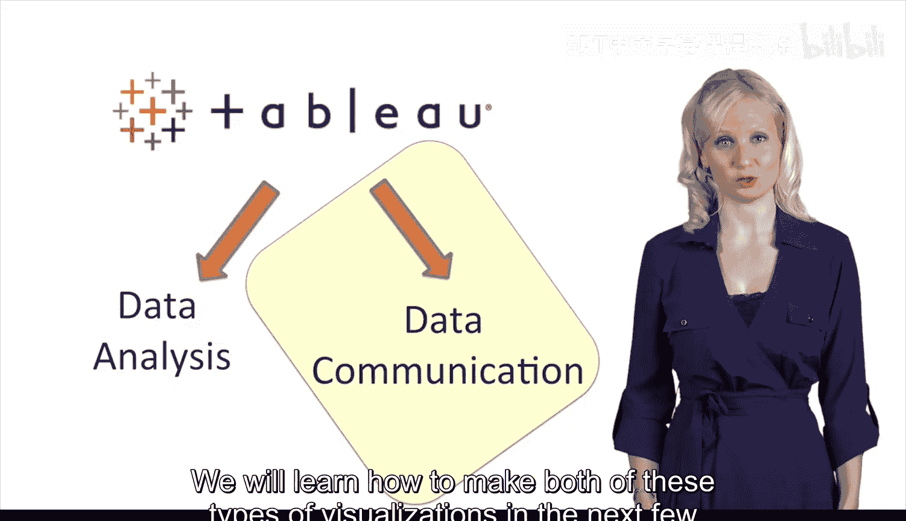

#  085：使用SPAPS构建思维框架 - 第二部分

## 概述
在本节课中，我们将学习如何运用已构建的结构化金字塔分析计划，通过逐层分析来寻找商业洞见。我们将具体介绍如何确定数据来源、设定分析优先级、利用可视化工具高效识别关键变量，并最终提炼出可指导商业决策的核心发现。

---

在上一节中，我们完成了结构化金字塔分析计划所有层级的填充。本节中，我们将探讨如何逐层处理SPAPS，以发掘商业洞见。

当你的类别和子类别都已组织好后，下一步就是明确列出你将使用哪些数据来应对每个大类下的最详细子类别。具体而言，你需要写下将使用哪个数据源中的哪个变量。如果你不清楚数据来源，请在SPAPS上做好标记。

以下是数据状态标记的建议：
*   **符号A**：我知道数据在哪里，并且知道如何获取。
*   **符号B**：我确信数据存在，但不完全清楚其具体位置或变量组织方式。
*   **符号C**：我完全不确定这类数据是否存在。

建议你这样做的原因是，虽然分析师通常能相对容易地获得某些数据，但要获取你真正想要的特定类型数据可能会困难得多。你需要尽快弄清楚是否存在关键数据缺失，或者是否有数据需要很长时间来准备。有时解决这类问题可能需要一个月甚至更久。因此，越早了解是否需要调整计划或与团队协作获取其他类型的数据，对你越有利。

---

一旦明确了每个类别或子类别将使用的数据变量，下一步就是根据提出者、预估影响力以及评估可行性，为每个类别和子类别设定优先级。

设定优先级后，建议你根据优先级重新排列金字塔中的每条分析路径，以便清晰地了解需要重点关注的内容。如果这样做，所有最高优先级的项目将位于左侧，而优先级较低的则位于右侧。最终，你将得到一个类似下图的布局。

顺便提一下，现在是你的分析项目生命周期中向团队和/或利益相关者寻求反馈的好时机。理想情况下，所有重要的利益相关者都会同意你制定的计划，因为这不仅决定了你的工作顺序，也是在紧迫截止日期下工作时，沟通和证明你时间分配决策的依据。你的利益相关者可能不习惯直接查看SPAPS，但他们会对拥有你具体计划的文档记录表示感激。

---

SPAPS的最后一步是实际执行计划，并聚焦于那些能帮助你解决商业问题的最重要议题或自变量。

在此项目最后阶段，你的任务是识别出值得投入时间的重大影响，并进行更深入的理解。了解你的智能指标与自变量之间可能的关系强度，能让你很好地预估出就商业问题得出结论所需的时间。

**判断逻辑如下：**
*   如果你测试的智能指标与自变量之间存在至少一些强效应，你应首先关注那些自变量。
*   如果智能指标与你测试的自变量之间没有任何强效应，那么你需要要么回头与利益相关者商讨，找出更多变量来检验；要么需要寻求具有更多统计专业知识的团队成员帮助，以建立更精细的模型。

分析项目的这一步，正是数据分析（而不仅仅是数据沟通）可视化软件威力最明显的体现。过去，分析师使用统计程序或Excel来寻找强效应。为了发现这些效应，你几乎需要为每一项想要实施的分析重新整理数据。相比之下，设计良好的可视化程序（如Tableau）能让强关系一目了然。而且，一旦你为第一次分析将数据整理成正确格式，就无需再次重新整理。因此，结合SPAPS，我发现可视化程序在快速识别哪些自变量对理解智能指标最为重要方面，比统计程序高效得多。这在不需要复杂统计或数学模型的传统商业分析情境中尤其如此。

---

我喜欢的可视化策略是，为SPAPS第二层和第三层中的每一个类别制作一到两张图表进行评估。暂时先不要为更深层制作可视化。

在你的变量旁边或金字塔的底层简要描述你的图表会是什么样子，以便于跟踪。我建议在此阶段将自己限制在**条形图、散点图和折线图**，具体原因我们将在未来几周学习。

逐一处理第二层和第三层的每个类别，查看图表是否揭示了明显的模式。对于制作的每一张图表，问自己：是否有任何模式脱颖而出或吸引了我的注意？

**处理流程如下：**
*   如果没有，用代表“不太可能产生洞见”的颜色高亮或标记该类别，并且不要继续深入该类别下的金字塔分支。
*   如果看起来智能指标和自变量之间可能存在某种关系，用一个符号或颜色标记，以表示你认为它有多大可能带来洞见。
*   如果智能指标和自变量之间肯定存在关系，用代表“需要回头深入分析”的符号标记。

每当你的SPAPS某部分被标记为“需要回头深入分析”时，应有意识地沿着金字塔的该部分向下深入所有层级，为每一层子类别制作图表，直到你对自己所发生的情况以及为何这些变量会影响你的智能指标形成一个良好、有力的假设。

---

遍历金字塔的所有层级需要时间。因此，我建议开始时仅为金字塔的第二层和第三层制作图表，而不涉及更深层，是希望这能帮助你避免不必要的工作。如果你在这些顶层没有看到明显的效应，那么在更详细的层级看到效应的可能性也较小。不过，通常同时为第三层和第二层制作图表是个好主意，因为仅查看第二层的大类可能会隐藏只有在将数据进一步细分时才能看到的重要效应。当你的第三层有很多子类别时，尤其如此。

也就是说，你可以根据是否有足够的数据或类别来判断，是值得遍历第三层及以下的每一项，还是为了节省时间仅制作第二层的图表。

在遍历金字塔各层时，确保将所学融入你的计划。添加新的假设，或划掉已知不再相关的假设。观察出现的模式，并优化和精简你的假设。例如，如果你发现两个可能的类别或因素可能与智能指标有非常强的关系，那么研究这些因素如何相互作用很可能很重要，并且你可能想将其添加到分析计划中。

记住在整个过程中也要持续获取反馈，以确保你正在进行的工作有意义且有用。

---

最终，在此过程结束时，你将逐步筛选出与你的智能指标似乎有最强关系的因素。

当你完成整个SPAPS分析后，你将要么对为实现智能目标可实施哪些商业变革有一个强有力的假设，要么对完成项目所需的其他资源有更清晰的认识。

此外，仅仅通过执行这个过程，你就拥有了一种向团队和利益相关者记录你所做工作的方法，并且如果还有更多工作要做，也拥有了一种与团队其他成员分工协作的机制。

你为SPAPS制作的所有可视化图表，其设计初衷都是为了帮助你分析数据。一旦你完成了分析，并知道了哪些数据对实现智能目标最为重要，你将开始从制作用于分析数据的可视化，转向制作用于传达数据含义的可视化。我们将在本课程接下来的几周内学习如何制作这两种类型的可视化。

## 总结
本节课中，我们一起学习了如何执行结构化金字塔分析计划。我们明确了确定数据变量与来源、设定分析优先级的方法，并重点介绍了如何利用可视化工具高效地识别关键自变量与智能指标之间的强关系。通过逐层分析和持续迭代，我们能够聚焦核心问题，形成有力的商业假设，并为后续的数据沟通奠定基础。