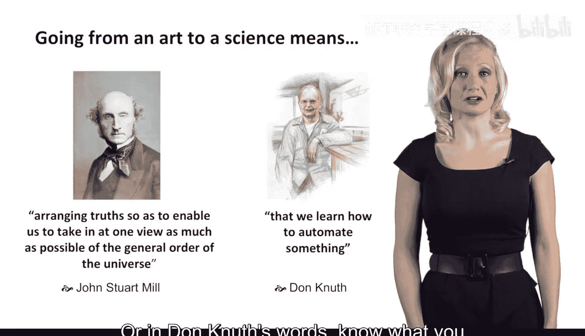

#  086：利用数据可视化驱动分析

在本节课中，我们将要学习数据分析师为何有时被称为数据科学家，以及数据可视化在揭示数据意义和指导预测模型构建中的核心作用。

## 数据分析的科学与艺术

数据分析师有时被称为数据科学家的原因在于，我们的目标是以一种清晰明了的方式呈现数据的洞察，让所有看到的人都能理解其含义、背后的真相以及如何据此采取行动。正如约翰·斯图尔特·密尔等许多哲学家所言，这属于科学的范畴。

进一步而言，在现实世界中，数据分析师和数据科学家的主要工作之一，是使用预测性计算机算法来自动化业务流程或商业洞察的生成。正如这里引用的计算机科学家约翰·麦卡锡所说，这也属于科学的范畴。

因此，根据以上两种定义，无论你的正式职位名称是什么，你的目标都应该是成为一名数据科学家，而不仅仅是一名数据分析师。

然而，除非我们了解世界的哪些特征对于纳入我们用于自动化流程的预测算法是重要的，否则我们无法有效地实现业务流程的自动化。这正是艺术发挥作用的地方。

## 数据科学的艺术

数据科学的艺术在于，找出如何将我们从数据中学到的东西，组织成有意义的形式。换句话说，就是将其编排成一个讲述科学真理的故事，这些真理被理解得如此透彻，以至于至少在理论上可以被自动化。

在实践中，这个过程意味着以多种不同的方式审视你的数据，直到你弄清楚数据洞察应该以何种顺序组织，以便你能够——用约翰·斯图尔特·密尔的话说——“揭示宇宙的普遍秩序”，或者用唐纳德·克努特的话说——知道你应该将什么放入你将在某种编程语言中实现的预测模型里。

## 数据可视化的作用

数据可视化正是为你实现这一目标。它帮助你高效地理解数据的含义，并在此过程中，帮助你聚焦于在统计模型或预测算法中应考虑哪些因素。

以下是数据可视化的两个核心作用：
*   **高效理解数据含义**：通过图形化展示，快速发现模式、趋势和异常。
*   **聚焦关键建模因素**：识别出对结果有重要影响的变量，指导后续的模型构建。

在接下来的两周，我们将学习如何使用 Tableau 软件来实现这类数据可视化。

本节课中，我们一起学习了数据分析兼具科学与艺术的双重属性。数据可视化是连接两者的关键工具，它不仅能高效传达洞察（科学），还能通过探索性分析帮助我们发现用于构建自动化预测模型的关键特征（艺术）。