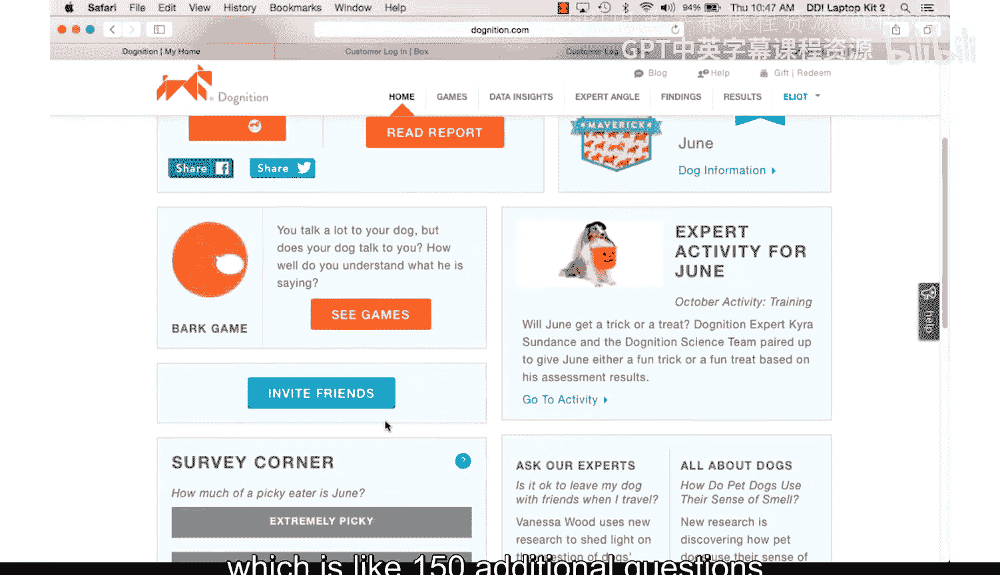
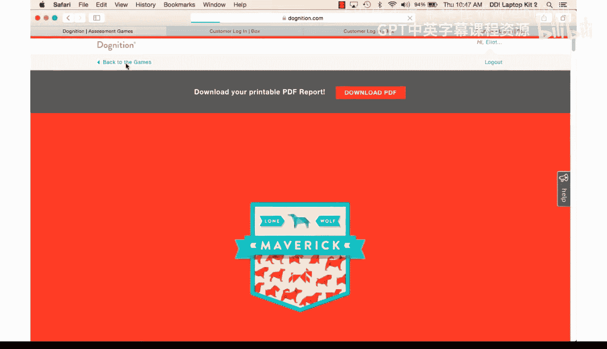
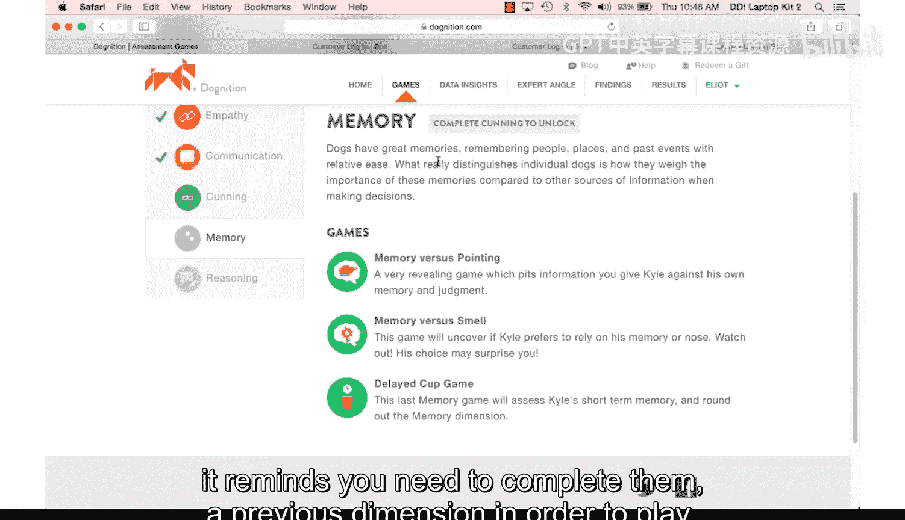
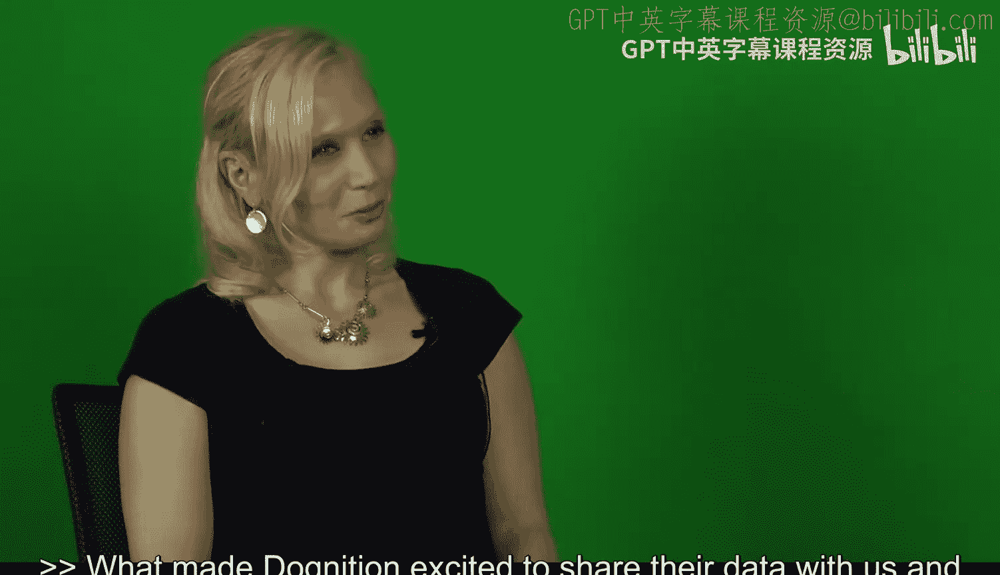

#  089：认识您的Dognition数据 🐕

在本节课中，我们将深入了解一个真实的商业数据集，它来自一家名为Dognition的公司。我们将探讨Dognition的业务模式、其收集的数据类型，以及他们希望通过数据分析解决的核心商业问题。

---

我们非常幸运，在本课程中能够使用来自真实商业环境的真实数据集。这家公司名为Dognition。今天，我们有幸邀请到Dognition的制作人Elliot Cohen，他将为我们介绍捐赠给我们的数据集。

Dognition是一个面向全球狗主人和爱狗人士的平台，旨在帮助他们更深入地了解自己的狗。该公司将世界各地犬类认知实验室中的科学游戏，分解成核心组成部分，并使用家庭中常见的物品进行了复现。然后，他们汇总了所有数据。目前已有超过3万名用户参与Dognition游戏。他们最近发表的首篇论文表明，其数据质量与实验室数据相当。

对于参与Dognition游戏的狗主人而言，他们能了解到许多关于自己爱犬的、原本可能不知道的信息。例如，游戏设计者Brian博士通过游戏发现，他的狗Tasmania并不像他预期的那样依赖记忆，而是更多地依赖他的指令。

Dognition游戏本身基于犬类智力的五个维度进行设计。这些维度是：**共情、沟通、狡猾、记忆和推理**。围绕这五个维度，共有20个游戏（实际上是10个核心游戏和10个热身游戏）。这些游戏贡献出各维度的得分，从而确定狗在特定维度（如记忆）中具体依赖哪些技能。基于这些结果，每只狗会被归入九种性格档案中的一种。

有趣的是，研究发现狗的品种对其最终的性格档案影响不大，关键在于个体狗解决问题的方式。

以下是用户登录网站后的体验概览。登录后，已完成所有测试的狗的主页会显示所有已完成的维度、下个月的推荐游戏、活动列表以及调查角。调查角包含约150个附加问题，用户很乐于回答关于自己狗的问题。报告部分则提供了长达15页的分析结果。

对于尚未完成测试的狗，主页会提示“接下来，玩游戏”，并列出需要按顺序完成的游戏。用户需要完成前一个维度的游戏，才能解锁下一个。

Dognition提供三种订阅模式：
1.  **核心Dognition评估**：包含10个游戏和10个测试/热身，用于生成狗的Dognition性格档案。
2.  **Dognition年度订阅**：在完成核心评估后，用户可以在一年内每月解锁一个新的附加游戏和一项由专家设计的活动。
3.  **Dognition月度订阅**：提供类似的月度附加内容。

Dognition游戏被设计为按特定顺序进行：从共情开始，然后是沟通、狡猾、记忆，最后是推理。这样设计有两个原因：首先，共情游戏最简单，能帮助狗进入状态；其次，游戏难度会逐渐增加。公司曾尝试调整顺序（例如先进行记忆游戏），虽然初期完成率有所提升，但用户整体进度并未改善，且记忆游戏复杂的指令容易让狗和主人感到挫败。

现在，我们来探讨Dognition希望我们帮助解决的核心商业问题。Dognition作为一个产品和公司，主要分为两部分：面向公众的“宣传册”（网站非登录部分）和用户登录后的“产品本身”（游戏、与专家互动等）。Dognition面临一个有趣的问题：他们非常关心客户购买后的行为。公司不仅希望获得收入，更希望用户能充分使用产品并完成测试。因为如果用户不完成测试，公司只能获得少量数据，而Dognition的终极目标是通过数据发表论文、增进对狗的了解。因此，他们寻求的核心帮助是：**找到方法提高用户的完成率，或至少推动他们在Dognition体验中走得更远**。

在数据分析方面，Elliot给出了一个重要建议：**每次测试都必须带着问题出发**。你需要有一个可验证的假设，并明确知道如何测试它。盲目地查看数据要么会发现无关紧要的信息，要么一无所获。

例如，在“记忆 vs. 指向”游戏中，测试者将食物藏在两个杯子之一下面，然后指向没有食物的杯子。这个游戏旨在判断狗是依赖自己的记忆，还是更依赖主人的肢体暗示，并没有标准答案。

Dognition乐于分享数据参与本课程，源于其对教育的重视。在分享数据时，他们非常注重用户隐私，所有数据都经过匿名化处理，移除了任何可能识别个人身份的信息。

现在您已经了解了我们需要共同解决的商业问题。您可以访问课程网站，获取Elliot和Dognition慷慨捐赠的数据集中具体字段的更多详细信息。同时，也建议您浏览Dognition网站，这是一家非常酷的公司，相信您会更有动力去解决他们的商业问题。

---

**本节课总结**：我们一起认识了Dognition公司及其业务，了解了他们通过游戏收集犬类行为数据的模式，明确了他们“提高用户测试完成率”的核心商业诉求，并获得了“带着假设进行数据分析”的重要方法论指导。接下来，我们将开始深入探索具体的数据集。