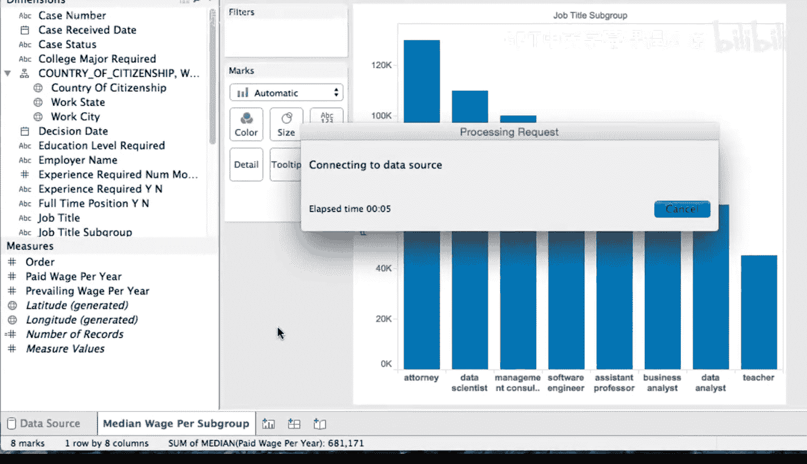
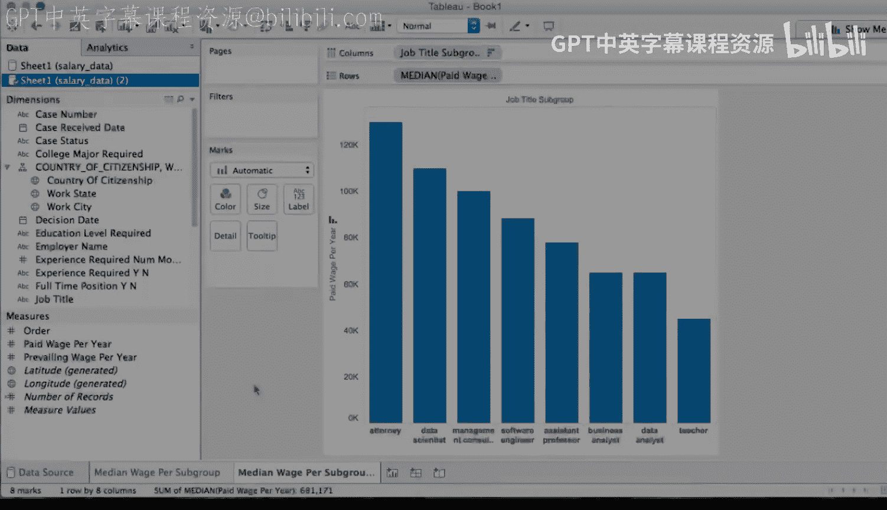
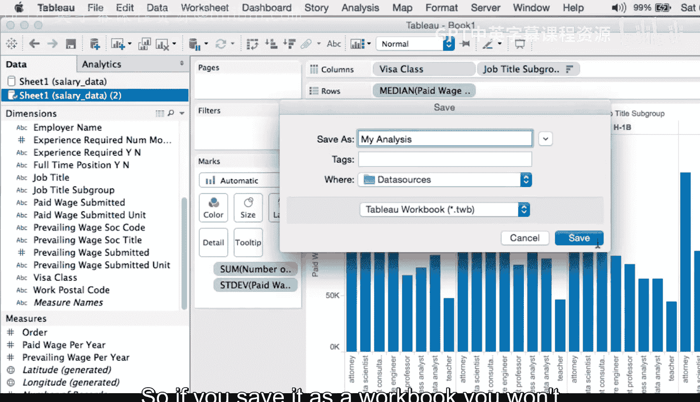

#  093：深入探索-使用行与列货架 📊

在本节课中，我们将学习如何在 Tableau 中通过将多个变量放入行或列货架来深入探索数据。我们将测试一个关于签证类型是否影响薪资的假设，并在此过程中掌握获取数据细节、检查数据分布以及高效保存工作的方法。

## 回顾与准备

上一节我们了解了不同数据相关领域的薪资概况。本节中，我们来看看签证类型是否会影响这些薪资。

我们的假设是：由于绿卡赞助成本更高，公司可能赞助更少，但对获得绿卡赞助的人要求也更高，因此他们的薪资可能也更高。让我们在数据中测试这个假设。

## 构建基础图表

首先，我们最后一次创建与上节课相同的图表。这次，我们学习一个额外技巧：设置默认聚合方式。

1.  在“数据”窗格中，找到“Paid Wage Per Year”变量。
2.  点击下拉箭头，选择“默认属性”。
3.  在“聚合”选项中，将默认值从“总和”改为“中位数”。

现在，将“Paid Wage Per Year”拖到行功能区，它会自动显示为中位数。接着，将“Job Title Subgroup”拖到列功能区，并使用“快速排序”按钮排序。这样我们就得到了与之前相同的中位数薪资图表。

为了方便管理，我们将工作表重命名为“Median Wage For Subgroup”。

## 使用多个变量进行分析

现在，我们想看看每个职位子类别中，不同签证类型的薪资有何不同。变量“Visa Class”代表签证类别。

以下是分解这些条形图的方法：

*   将“Visa Class”变量拖到列功能区，放在“Job Title Subgroup”的后面。
*   图表会立即将每个职位子类别的条形图按不同签证类型分解开。

这展示了 Tableau 快速生成可视化分析的能力。如果我们交换两个变量的顺序，将“Job Title Subgroup”拖到“Visa Class”后面，那么主要分类将变成签证类型，每个签证类型下再分解出职位子类别。

观察数据后，我们的假设似乎并不成立。律师的薪资在大多数签证类别中都是最高或非常高的，教师通常最低。不同签证类别之间没有明显的规律。

## 深入查看数据细节

如果对初步观察不满意，可以深入查看数据细节。

*   **悬停查看**：将鼠标悬停在任意条形上，会显示该条形的具体数值。
*   **查看底层数据**：右键点击条形，选择“查看数据”。在“摘要”标签页可以看到汇总值；切换到“完整数据”标签页，可以查看用于计算该条形图中位数的所有原始数据行。你可以在此取消勾选以仅显示特定字段。

在浏览底层数据时，你可能会注意到一些有趣的模式，例如某个签证类别下申请工作地点集中在纽约。这可以作为后续分析的线索。同时，注意角落显示的记录数，它告诉你构成该条形图的数据行有多少。

## 利用“标记”卡添加信息

有一种更快的方法来了解每个条形包含多少条记录，即使用“记录数”这个 Tableau 自动生成的度量。

*   将“记录数”拖到行功能区，放在“Paid Wage Per Year”后面。Tableau 会自动在图表下方生成一个新图形，显示每个条形对应的记录数。
*   此时，当你将鼠标悬停在顶部的薪资条形上时，工具提示中也会包含记录数信息。

即使不想在图表上显示记录数图形，也可以将其信息添加到工具提示中：

1.  将“记录数”从行功能区拖走。
2.  将“记录数”拖到“标记”卡上的“详细信息”按钮（图标类似一个加号）上。
3.  现在，“记录数”虽未形成图形，但当你悬停在薪资条形上时，工具提示中已包含此项信息。

“详细信息”按钮是“标记”卡的一个功能，它允许你在不改变图表视觉形式的情况下，为数据点添加更多背景信息。

## 分析数据变异性（标准差）

为了了解每个类别内薪资的波动情况，从而评估中位数的可靠性，我们可以计算标准差。标准差是衡量数据分布离散程度的指标。

以下是计算步骤：

1.  将“Paid Wage Per Year”再次拖到行功能区。
2.  点击该胶囊的下拉箭头，将聚合方式改为“标准差”。
3.  你会看到两种标准差：“标准差（总体）”和“标准差”。前者用于描述你手头这个特定数据集（或认为能完美代表总体的大样本）的离散程度；后者用于将当前样本视为对更大总体的估计时，更稳妥。由于我们希望将数据推论到自身（我们并不在数据集中），因此选择使用普通的“标准差”。

现在，图表下方会显示每个条形对应的薪资标准差。如果某个标准差非常大（如图中某些情况），通常意味着数据中存在极端异常值。这些异常值可能会显著影响平均值和标准差等统计量。因此，我们需要将“检查异常值”添加到分析计划中。

## 快速操作与保存工作

最后，介绍两个实用技巧：

*   **快速移动胶囊**：按住 Shift 键，可以将行功能区上的“Paid Wage Per Year（标准差）”胶囊直接拖到“标记”卡的“详细信息”上。这样图表消失，但工具提示中仍会保留标准差信息。
*   **保存工作簿**：无需每次重新制作图表。点击“文件”->“另存为”，选择保存为“Tableau 工作簿”（.twbx 文件）。这样，下次打开时，所有图表和分析状态都将保留。

## 总结

本节课中我们一起学习了以下内容：

*   **数据分析发现**：在我们分析的数据集中，申请的签证类型可能不会对不同职位子类别的薪资产生显著影响。因此，在后续分析中，我们可以暂时不再重点关注“Visa Class”。
*   **Tableau 技能提升**：
    *   我们掌握了在列货架或行货架中放入多个变量时，图表会如何分层和分组。
    *   我们学会了使用工具提示和“查看数据”功能来获取数据点的详细信息。
    *   我们了解了如何通过“标记”卡的“详细信息”按钮，在不添加图形元素的情况下丰富工具提示内容。
    *   我们学习了计算和解读标准差，以评估数据分布的离散程度并警惕异常值。
    *   我们掌握了快速操作胶囊以及保存 Tableau 工作簿以保留工作进度的方法。

通过这些技能，你可以更高效、更深入地在 Tableau 中探索和呈现数据。