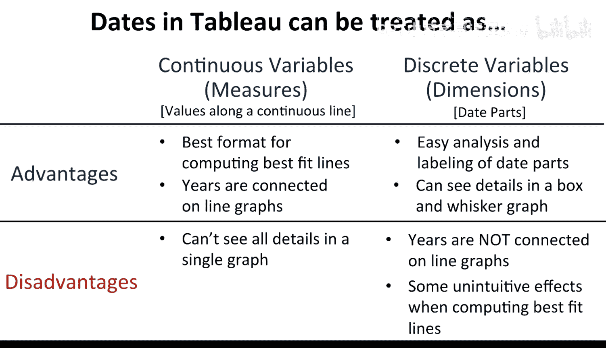

#  097：何时使用折线图 📈

在本节课中，我们将学习如何创建折线图，并深入探讨在何种情况下使用折线图是最佳选择。

## 概述
折线图是数据可视化中一种强大的工具，尤其擅长展示数据随时间变化的趋势或两个连续变量之间的关系。本节我们将对比折线图与条形图的应用场景，并解释在Tableau中如何处理日期数据以创建有效的折线图。

## 折线图的适用场景
折线图最适合传达两类信息。

第一类信息是展示事物如何随时间变化。我们很自然地将时间的流逝想象成一条线或一支箭。因此，与这种概念一致的折线图，通常比将时间分割成块的条形图更容易被我们的大脑处理。

第二类信息是展示两个连续变量之间的关联程度。当我们想观察两个变量如何相关时，看到的数据点越多越好，因为额外的细节能让我们更清楚地看到一个变量的变化如何与另一个变量的变化同步。

## Tableau中的日期处理
Tableau的一个有趣特性是，它可以将日期视为连续变量（称为“度量”）或离散变量（称为“维度”）。

**将日期视为连续变量**
当您将日期视为连续变量时，Tableau会将日期解释为一条连续线上的单个值。因此，当您想应用一种称为“回归”的统计方法来计算日期与另一个关注变量之间的最佳拟合线，以确定您的预测随时间变化的可靠性时，这是最符合逻辑的日期格式。这类图表对于判断所观察到的效应的重要性以及传达分析的最终结论特别有用。然而，从单一的折线图中理解所有数据细节可能比较困难。

**将日期视为离散变量**
当您将日期视为离散变量或维度时，Tableau会将日期解释为独立的日期部分的集合。日期部分是指诸如年、月、日这样的标签。每个日期部分都可以独立交互，这对于某些类型的图表（例如，当您想查看二月份的所有数据时）很有用。将日期视为维度时，标记日期部分也可能更直接。然而，在将日期视为维度的情况下制作时间折线图可能会导致一些奇怪的效果，因为Tableau会在年份之间断开线条。尽管如此，将日期视为维度允许您制作统计中使用的其他图表，称为箱线图或盒须图，这能让您看到不同时间点上数据的全部细节。盒须图通常过于复杂，无法有效地向观众传达分析结论，但它们对于您作为分析师快速理解数据细节非常有帮助。

## 实践决策
作为一名数据分析师，您必须善于决定哪种类型的可视化最适合哪种情况。

让我们通过解决下一个数据分析问题来获得一些决策的第一手经验。问题是：与数据相关的薪资是否随时间发生了变化？让我们一探究竟。

## 总结
本节课我们一起学习了折线图的核心价值：它最适合展示**随时间变化的趋势**和**连续变量间的关系**。我们还探讨了在Tableau中，根据分析目的将日期数据作为**连续度量**或**离散维度**处理的不同效果。掌握这些知识，将帮助您在面对具体业务问题时，做出最恰当的可视化选择。