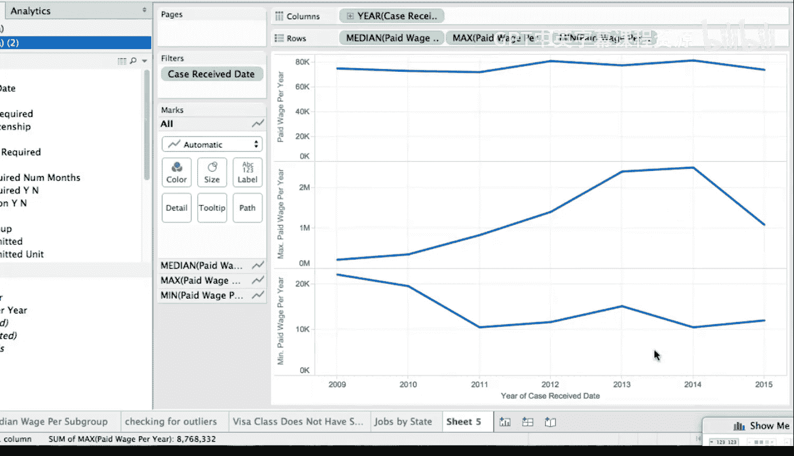

#  099：使用日期层级分析数据相关薪资随时间变化 📊

在本节课中，我们将基于上一节视频的知识，探讨特定类别的数据相关工作薪资是否随时间发生变化，尤其是与其他类型的工作相比。我们将学习如何在 Tableau 中通过添加工作子类别信息、使用高亮功能以及创建散点图和折线图来深入分析数据趋势。

---

在上一节中，我们学习了如何在 Tableau 中使用日期层级。本节中，我们将利用这些知识来解答一个具体问题：与数据相关的特定工作类别的薪资是否随时间变化。

现在，我们回到上次离开时的 Tableau 工作簿。

既然我们已经理解了日期的工作原理，就可以开始解答关于特定数据相关薪资类别是否在上涨的问题了，尤其是与其他工作类型相比。

为了实现这个目标，我们需要将工作子组信息添加到图表中。理想情况下，我们应为每个工作子类别在图表上添加一条独立的线条。

如何在同一图表中显示所有子类别的线条呢？我们无法使用列架或行架。这时，标记卡就派上用场了。

我建议用颜色来编码不同的工作子类别。请将“工作标题子组”字段拖拽到“颜色”标记上。

现在，Tableau 已为每个工作标题子组创建了不同颜色的线条。

在继续之前，数据清晰地显示了一个情况：2008 年的数据非常少。实际上，我们有 6 个工作子类别在 2008 年完全没有数据。因此，我们不应解读 2008 年的趋势。

回到我们刚刚创建的图表。我建议从现在开始，我们只查看 2009 年及以后的数据。我们可以像上次一样使用筛选器来实现。

你可以基于日期范围进行筛选。为此，我们可以将筛选范围调整到 2009 年开始。

以这种方式查看数据，会呈现出与之前不同的图景。现在看起来，总体薪资可能是在上涨的，尽管在 2015 年有所下降。

让我们回过头来，重点关注不同工作标题子组的变化趋势。再次将“工作标题子组”直接拖到“颜色”上。你会看到，由于使用的是同一个图表，它仍然只查看 2009 年及以后的数据。同时值得注意的是，仍然有两个工作标题子类别在 2009 年没有数据，这一点很重要。

我知道这个图表看起来有点杂乱，所以我要向你展示 Tableau 中一个很酷的功能，它能让浏览这类更复杂的图表变得容易得多。

在“工作标题子组”图例上，你会看到一个小图标，它是一个高亮器，显示“高亮显示所选项目”。点击它（这是一个开关），然后当你点击图例中的某个类别时，它会将其他所有内容灰显，只突出显示你选择的那个类别。

这使得单独查看每个不同类别变得更容易，而无需使用筛选器。这是一种不同的方式，并且它实际上并不会过滤掉数据，只是灰显了数据的特定部分。

观察图表，你会发现数据科学家的薪资看起来相对稳定，在 2015 年略有下降。软件工程师的薪资似乎开始上涨。数据分析师和商业分析师的趋势则不太明确。

我们目前掌握的信息还不足以得出结论，因此我建议我们更详细地查看数据，以更好地理解数据的真实情况。最好的方法是再次查看散点图，这样我们可以在一个视图中看到所有数据点。

在操作之前，请注意这里的药丸是绿色的。现在，请转到“分析”菜单，选择“聚合度量”以取消数据的聚合。

为了方便查看所有内容，我们现在将“年份”更改为维度变量，因为 Tableau 处理维度日期的方式会使 X 轴更紧凑。

然后，转到“智能显示”卡，点击散点图。

让我们把标记的大小调小一点。

现在，当我们这样做时，再次使用高亮功能查看特定的子组。我会按照我们一直关注的顺序来排列它们。

如果我们只看数据科学家的数据，底部的值似乎有下降趋势，上方的异常值似乎不多。

软件工程师的情况则非常不同。观察这些粉色圆点的底部值，它们看起来确实在下降，但每个数据“团块”的顶部值似乎又在上升。同时，随着时间的推移，异常值明显增多，出现了更多高薪的个例。

数据分析师呢？我们再次看到了这种模式，这次甚至更明显：最低值似乎在下降，最高值似乎在轻微上升，异常值没有那么多。

商业分析师的情况类似。

这表明，总体而言，薪资可能保持不变或略有上涨，但同时，获得更高薪资的机会可能增大了，但获得更低薪资的风险也可能增加了。

让我们更直接地审视这一点。我认为最好的方法是回到折线图。我们需要重新聚合度量。

这是我们之前的折线图。现在，为了当前的分析目的，让我们将“工作标题子组”从工作区中移除。

我想做的是更直接地审视：对于每个类别，最低薪资是否在下降，而最高薪资水平是否在上升。

为此，让我们将“每年支付工资”拖到行上。这次，我们不使用中位数，而是将其聚合，选择“最大值”。

让我们再做一次，显示“最小值”。

这里显示的是：随时间变化，我们整个数据集支付工资的中位数、最大值和最小值。

这样观察，情况变得相当明显：至少在整个数据集中，尽管中位数工资保持不变，但在个别情况下，有可能赚到多得多的钱，但也有可能获得远低于中位数预期的薪资。

---

我们如何确认在折线图中观察到的效应是否足够稳健，值得我们在后续分析和决策中加以考虑呢？

我建议，在此背景下，最好的方法是使用统计学。在下一个视频中，我们将学习如何在 Tableau 中计算这些统计数据。

---

本节课中，我们一起学习了如何利用 Tableau 的日期层级和可视化功能，深入分析不同数据相关工作子类别的薪资随时间变化的趋势。我们使用了颜色编码、高亮器、散点图和聚合折线图等多种工具，初步发现了薪资分布可能存在的两极分化现象，并为后续的统计分析奠定了基础。