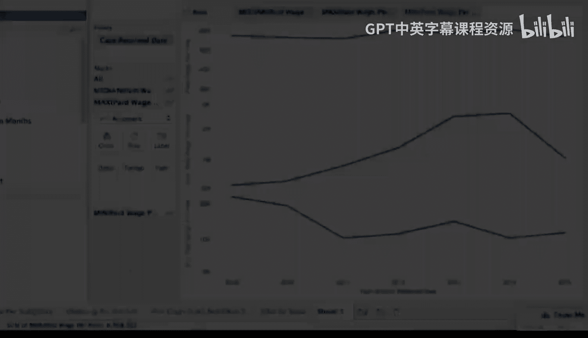
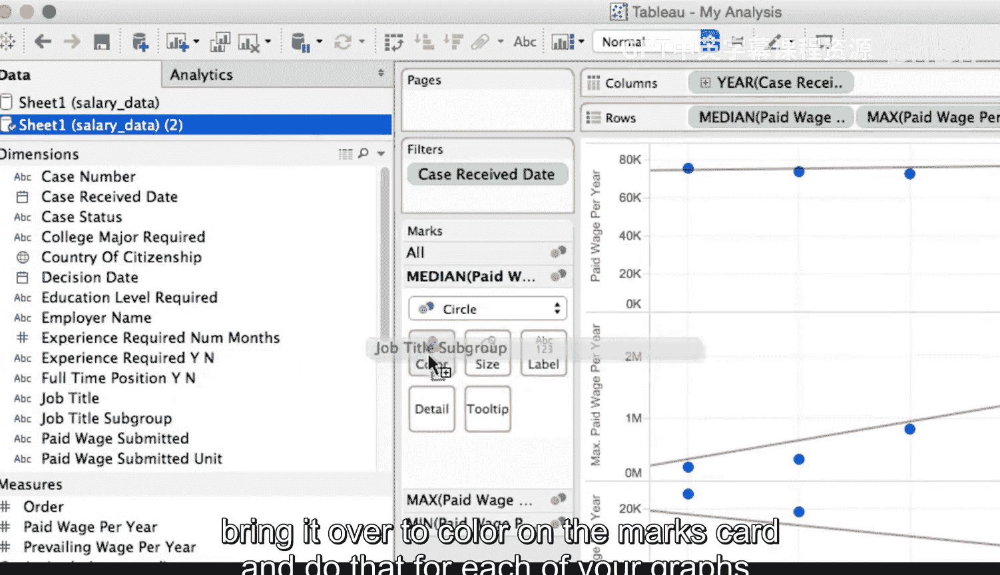
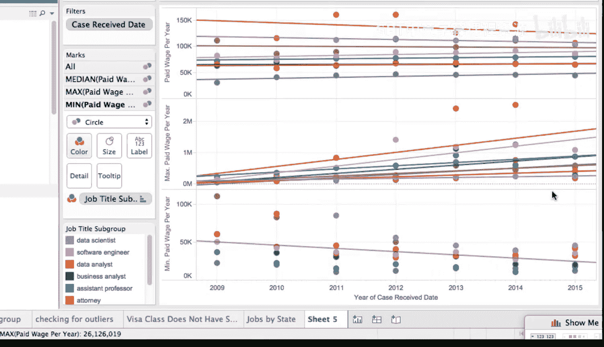

#  100：使用趋势线分析数据相关薪资随时间变化 📈

在本节课中，我们将学习如何在 Tableau 中使用趋势线（回归分析）来快速评估数据中的模式是否具有统计显著性，并应用此技术分析数据相关岗位薪资随时间的变化趋势。

## 概述

在前几节课程中，我们通过可视化图表探索了数据。本节我们将利用 Tableau 的简单统计功能——趋势线分析，来帮助我们判断哪些数据模式值得深入关注，从而加速数据分析过程。

## 从连线图到散点图

上一节我们介绍了如何使用连线图观察数据趋势。本节中，我们来看看如何将连线图转换为散点图，以便进行回归分析。

首先，我们需要调整之前的图表。请将视图中的连线去除，改为仅显示独立的数据点标记。请对每一个图表都进行此操作。

以下是操作步骤：
1.  在标记卡中，将“自动”或“线”更改为“圆”或其他形状。
2.  确保每个数据系列都显示为独立的点。

## 理解回归与趋势线

完成图表转换后，我们可以引入趋势线。回归分析是一个试图找到一条最贴合所有数据点的直线的过程。这条线被称为**最佳拟合线**或**趋势线**。

在 Tableau 中添加趋势线非常简单：
*   在图表区右键点击。
*   选择“趋势线” -> “显示趋势线”。

图表中出现的黑色直线就是最佳拟合线。它代表了回归分析所能找到的、连接所有数据点的最优路径。

## 解读置信区间与 P 值

趋势线周围的弯曲带状区域是**置信区间**。本例中显示的是 95% 置信区间，它帮助你了解这条趋势线的可靠性。可以理解为，有 95% 的把握认为真实均值落在这个区间内。

虽然置信区间提供了视觉上的可信度参考，但统计学的意义在于用具体数字辅助决策。Tableau 也提供了这个数字——**P 值**。

将鼠标悬停在趋势线上，可以看到趋势线的方程及其 P 值。
*   **P 值**表示观察到的趋势是偶然发生的可能性。P 值越小，说明从这条趋势线得出的结论越可靠，越值得信赖。
*   统计学惯例是，通常只信任 P 值小于 **0.05** 或 **0.01** 的趋势线。
    *   P 值 ≤ 0.05 意味着假阳性率在 5% 或以下。
    *   P 值 ≤ 0.01 意味着假阳性率在 1% 或以下。

例如，如果一条趋势线的 P 值为 0.07，由于它大于 0.05，我们在分析时可能不会将其视为一个需要重点关注的显著效应。

## 为各职位子类别添加趋势线

现在，我们将为每个职位子类别分别添加趋势线。为了使图表更清晰，我们首先关闭置信区间的显示。

操作步骤如下：
1.  右键点击趋势线，选择“编辑趋势线”。
2.  取消勾选“显示置信区间”，然后点击“确定”。

接下来，我们将“职位子类别”字段拖拽到标记卡的“颜色”上，为每个图表按子类别着色。然后，为每个子类别数据系列单独添加趋势线。

完成上述操作后，我们可以独立查看每个子类别（如数据科学家、软件工程师等）的数据趋势了。同样，我们可以使用高亮筛选功能，单独查看某一类别的趋势。

## 分析各职位薪资趋势

在分析时，务必注意各图表的纵轴刻度范围可能不同，这会影响对趋势线斜率的直观判断。最准确的方法是悬停查看每条趋势线的 P 值及其方程。

以下是基于趋势线分析得出的观察结果：
*   **数据科学家**：最高薪资随时间呈显著上升趋势，而中位数薪资变化不显著。
*   **软件工程师**：最高薪资随时间上升，最低薪资随时间下降，中位数薪资变化不显著。
*   **数据分析师**：最低薪资随时间下降，最高薪资基本持平，中位数薪资变化不显著。
*   **业务分析师**：最低薪资下降，最高薪资有上升趋势但不显著，中位数薪资无变化。

综上所述，分析表明：
*   数据科学家和软件工程师岗位获得高薪的机会可能在增加。
*   所有数据相关岗位的典型薪资（中位数）似乎保持稳定。
*   除数据科学家外，其他岗位随时间推移，获得低于预期薪资的风险可能略有增加。

## 全局趋势线与分颜色趋势线

最后，再介绍一个有用的功能。目前，我们为每个颜色组（即每个职位子类别）分别绘制了趋势线。你也可以绘制一条基于所有数据聚合的全局趋势线。

操作方法是：
1.  右键点击趋势线，选择“编辑趋势线”。
2.  取消勾选“允许每个颜色一条趋势线”。

此时，图表会显示一条代表所有数据整体趋势的黑色趋势线，同时仍保留按颜色区分的原始数据点。虽然在本例中分颜色趋势线对分析更有帮助，但全局趋势线在其他分析场景下可能非常有用。

## 总结

本节课中我们一起学习了以下内容：
*   如何将连线图转换为散点图以进行回归分析。
*   如何在 Tableau 中添加和解读**趋势线**（最佳拟合线）。
*   如何理解**置信区间**和关键的 **P 值** 统计量，并利用 P 值判断趋势的统计显著性。
*   如何为不同的数据子类别分别添加趋势线，并分析数据相关岗位薪资随时间的变化。
*   发现了数据科学家和软件工程师的最高薪资呈上升趋势，而多个岗位的最低薪资呈下降趋势，中位数薪资则保持稳定的有趣洞察。
*   了解了全局趋势线与分颜色趋势线的区别及应用场景。

通过本节学习，你掌握了使用 Tableau 进行快速统计检验以指导数据分析方向的方法。