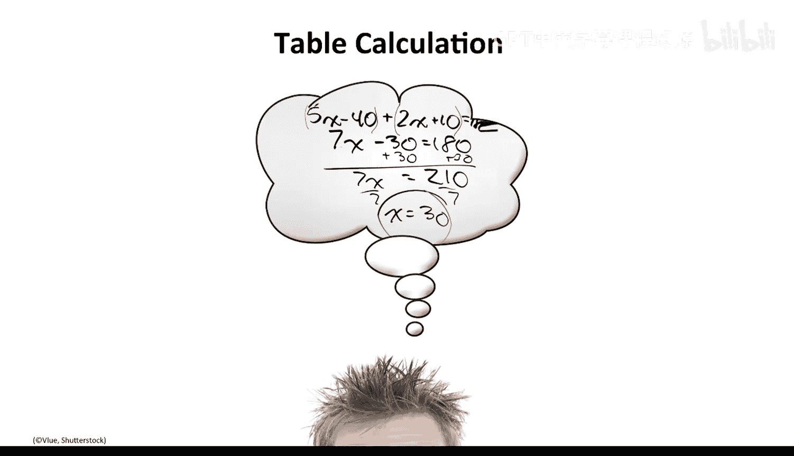

#  103：Tableau 计算类型 📊

在本节课中，我们将要学习 Tableau 中计算的核心概念、不同类型及其应用场景。计算是 Tableau 实现数据灵活分析和动态可视化的关键工具。

上一节我们介绍了 Tableau 的基础操作，本节中我们来看看如何通过计算来增强分析能力。

## 什么是计算？

计算通过“计算字段”来实现。计算字段类似于 Excel 中的命名单元格，其语法也与 Excel 公式非常相似。这些字段可以包含固定值，也可以包含引用其他单元格的公式。每个计算字段本身既可以作为其他计算的输入，也可以直接以特定方式显示结果。

## 计算的类型

Tableau 提供了多种类型的计算，以适应不同的分析需求。以下是主要的计算类型：

*   **数值计算**：用于执行算术运算，例如 `[销售额] - [成本]`。
*   **字符串计算**：用于修改单元格中的实际文本或单词，例如 `UPPER([客户名称])`。
*   **日期计算**：专门设计用于简化日期处理，例如 `DATEADD(‘month’, 1, [订单日期])`。
*   **类型转换计算**：用于更改您正在处理的变量类型，例如将数字转换为文本 `STR([产品ID])`。
*   **逻辑计算**：包含条件判断语句，例如 `IF [利润] > 0 THEN “盈利” ELSE “亏损” END`。
*   **聚合计算**：定义将多行数据汇总在一起的方式，例如 `SUM`、`MEDIAN`、`MIN` 等。
*   **用户计算**：这类计算比较独特，用于管理查看您数据的人员权限。

## 计算的聚合级别

计算最复杂的方面之一是它们可以在不同的聚合级别上实现。如果一个计算是为某个聚合级别设计的，它在其他级别上将无法工作。

理解计算如何与聚合级别交互的方法是问自己一个问题：如果我在 Excel 中执行此计算，我是在新列的每一行得到一个数字，还是在所有列的底部得到一个单一数字？

*   **行级计算**：如果您在 Excel 中会得到一个每行都有新数字的新列，那么在 Tableau 中您就需要行级计算。这将在数据集中为每一行创建一个带条目的新列。当您确定数字在任何详细级别都有用时，应使用此类计算。
*   **聚合级计算**：如果您在 Excel 中执行类似计算后，会在列底部得到一个单一数字，那么在 Tableau 中您就需要使用聚合级计算。这类计算一次处理多行数据或处理已经聚合的变量。
*   **表计算**：第三种类型与行级和聚合级计算非常不同，它是表计算。这类计算仅对可视化中已有的数据，并按照其在可视化中的组织方式进行运算。您可以将表计算理解为 Tableau 在“脑海中”进行的数学运算。它们功能极其强大，但也是 Tableau 中最难掌握的部分之一。

## 计算字段的使用

创建计算字段后，您可以像使用数据源中的度量和维度一样使用它。只要所有工作表都来自同一数据源，您就能在每个工作表中看到该计算字段。

我们无法逐一讲解 Tableau 能实现的所有计算类型，因为种类确实繁多，但我们会介绍其中广泛使用的多种类型。我鼓励您自行探索和尝试其他计算。如果在尝试过程中遇到问题，您可以随时在 Tableau 社区网站上寻求建议或发布问题。这是一个极好的资源，世界上一些最优秀的 Tableau 用户经常在那里发帖，因此我强烈推荐您去看看。

本节课中我们一起学习了 Tableau 计算的基础知识，包括其定义、主要类型（如数值、字符串、逻辑计算）以及关键的聚合级别概念（行级、聚合级和表计算）。理解这些是构建动态、强大数据分析视图的第一步。接下来，让我们开始动手创建一些计算吧。